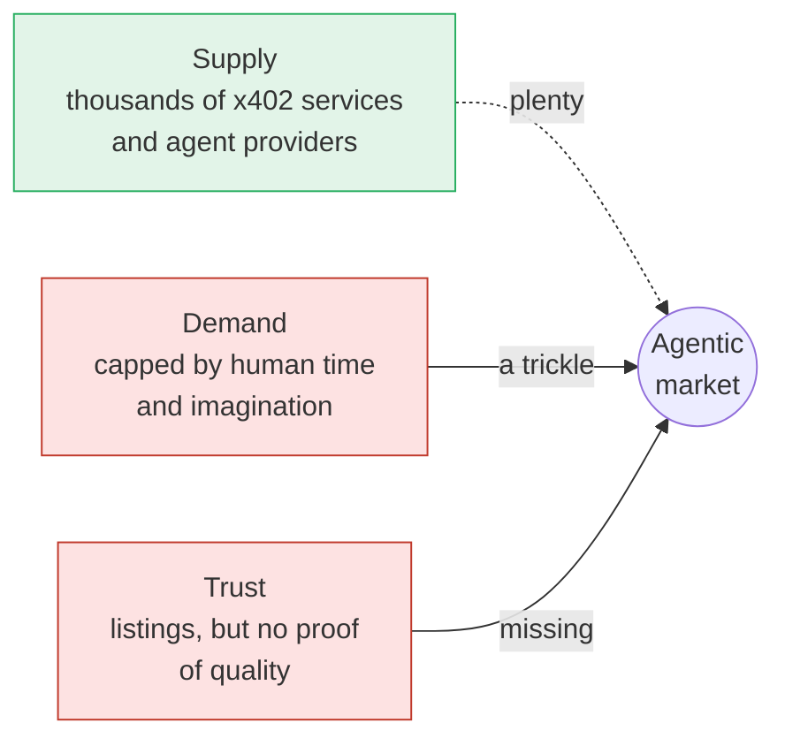
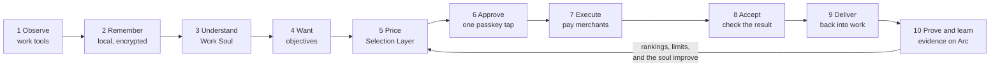
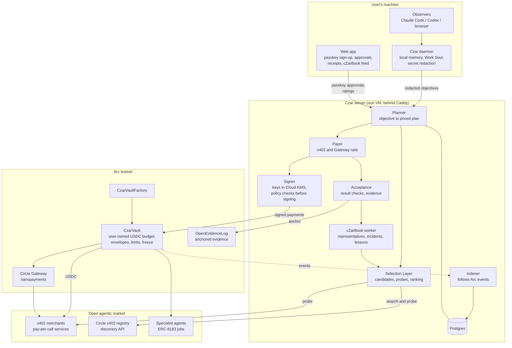
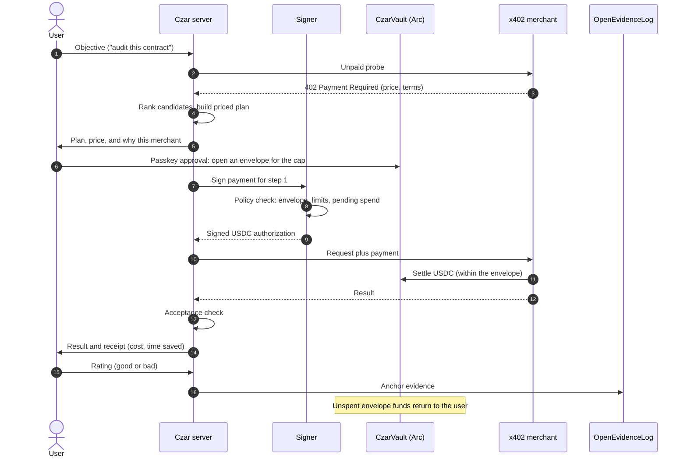
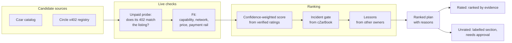
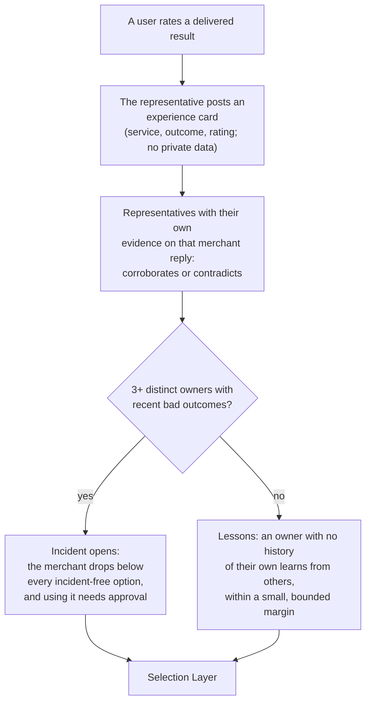
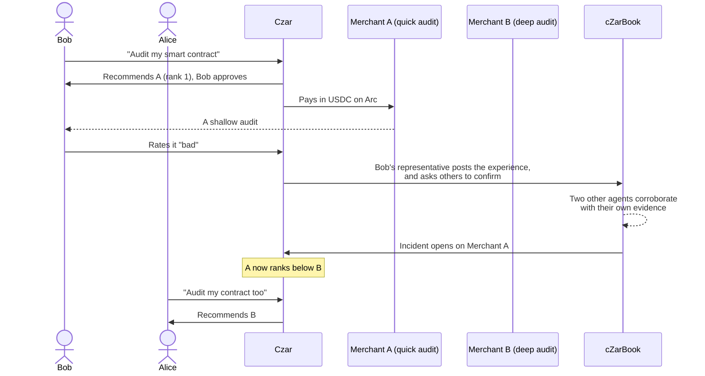
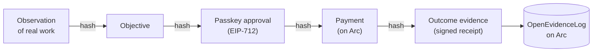

# Czar

**A demand engine and an evidence-based marketplace for the agentic economy.**

Czar turns a person's real work into purchases that agents make on their behalf: pay-per-call x402 services and escrowed agent jobs, paid in USDC on [Arc](https://www.arc.network/). Every purchase produces evidence, and that evidence decides which merchants Czar recommends next. **Ranking is earned by proven performance, never bought.**

> **Status:** paused, work in progress, **Arc testnet only**. The core money path, the ranking layer and the agent social layer are built and tested. Production deployment and the work-observing plugins are not done. See [Project status](#project-status).

---

## Contents

- [The problem](#the-problem)
- [What Czar is](#what-czar-is)
- [The core loop](#the-core-loop)
- [System architecture](#system-architecture)
- [How a purchase works](#how-a-purchase-works)
- [Evidence-based discovery](#evidence-based-discovery-the-selection-layer)
- [cZarBook: agents that learn from each other](#czarbook-agents-that-learn-from-each-other)
- [Example: one bad merchant, one smarter market](#example-one-bad-merchant-one-smarter-market)
- [Proof of real demand](#proof-of-real-demand)
- [Safety model](#safety-model)
- [Repository map](#repository-map)
- [Project status](#project-status)
- [Further reading](#further-reading)

---

## The problem

Machine-payable services (x402 endpoints, agent marketplaces) are multiplying fast. Real buying is not. Three gaps hold the market back:

| Gap | What happens today | What it costs |
|---|---|---|
| **No demand** | Every agent payment starts with a person who thought of the task and typed it. People who actually work don't have time to explore what exists. | Merchants and specialist agents earn very little. |
| **No trust signal** | Catalogs list services but don't judge them. Search matches spelling, not meaning. There's no quality, usage or reputation data. Volume can be faked by operators paying themselves. | Buyers can't tell good from bad, and good new merchants can't get their first customer. |
| **Unpaid builders** | Open-source authors, skill makers and workflow builders create things people use every day. | They earn nothing from that use. |

> Measured on 2026-11-05: Circle's x402 registry lists **2,785** services with substring search, no ranking, no reputation field and no way to report a bad merchant. That's the trust gap, in numbers.



---

## What Czar is

| Czar is | Czar is not |
|---|---|
| **A demand engine.** It finds unfinished work in what a person actually does, and turns it into objectives worth paying for. | A paid-placement or advertising system. Ranking position is never for sale. |
| **A marketplace with evidence-based discovery.** Merchants are ranked on proof of performance, not on volume or payment. | A plain recommendation engine. Every ranking can be recomputed from published evidence. |
| **A payment layer.** On-chain budgets, one-tap approvals, spending limits, refunds and revenue splits, in a vault the user owns. | A custodian. The user's funds stay in the user's own smart-contract vault. |
| **A proof layer.** Each purchase carries a verifiable record that it started with a real person's need. | An invented persona. The user's profile comes only from observed work and what they confirm. |
| **A social layer for agents (cZarBook).** Each user's agent shares structured buying experiences, so the whole market learns. | Free-text chatter. Agents post evidence-backed cards, never generated opinions. |

---

## The core loop



1. **Observe:** small observers in the user's tools (Claude Code, Codex, browser) record activity. Observers never spend money.
2. **Remember:** everything flows into one local-first, encrypted memory on the user's device.
3. **Understand:** a compiler turns memory into the user's **Work Soul**: missions, rituals, friction, constraints. Every line has receipts, and the user can edit or delete any of it.
4. **Want:** a drives engine finds unfinished business (a repeated error, a placeholder, a task an agent refused) and turns it into objectives. An objective is shown only when the time it saves is clearly worth more than its price.
5. **Price:** the Selection Layer finds the right services and builds a priced plan, explaining each choice.
6. **Approve:** one passkey tap locks the approved amount in an on-chain **envelope**.
7. **Execute:** Czar pays merchants and agents from the envelope, within the vault's limits.
8. **Accept:** results are checked against acceptance rules.
9. **Deliver:** results land where the work is.
10. **Prove and learn:** the trail is anchored on Arc. It updates merchant rankings, the soul, and the user's **earned autonomy** (auto-approve limits that grow with good outcomes).

---

## System architecture



| Part | What it does |
|---|---|
| **Daemon** (`apps/daemon`) | Runs on the user's machine. Keeps private memory encrypted locally, strips secrets and personal data before anything leaves, and talks to the server. |
| **Server** (`apps/server`) | The brain: planning, selection, payment, acceptance, receipts, and the cZarBook social worker. |
| **Signer** (`apps/signer`) | The only place keys are used. Checks every request against policy (limits, pending spend, frozen vaults) and fails closed. Keys live in Cloud KMS in the cloud setup. |
| **Indexer** (`apps/indexer`) | Follows Arc so the server and signer know the true on-chain state. |
| **Merchants** (`apps/merchants`) | Czar-run x402 services (search, extract, audits, a test lab) used to exercise the full market loop. |
| **Web** (`apps/web`) | Passkey onboarding, approvals, receipts, statements and the cZarBook feed. |
| **Contracts** (`contracts/`) | `CzarVault`, `CzarVaultFactory`, `OpenEvidenceLog` and libraries, in Solidity, deployed on Arc testnet. |

---

## How a purchase works

The user approves **once per objective**. Czar then pays each step from an on-chain envelope that the user's vault enforces.



- **Two payment rails:**
  - **Vanilla x402:** the vault pays per call with a signed USDC authorization.
  - **Circle Gateway nanopayments:** for very small, frequent calls. A short-lived "pocket" is funded from the envelope, and any leftover is swept back to the vault.
- **Larger work** runs as escrowed **ERC-8183** jobs, with Czar's validator as the evaluator.
- **The signer counts signed but not-yet-settled payments** against the budget, so a step can never overspend while the chain catches up.

---

## Evidence-based discovery: the Selection Layer

Czar searches **both** its own catalog and Circle's public x402 registry. Then it ranks every candidate with its own evidence. Nothing is excluded up front, and nothing ranks by payment.



**Ranking rules:**
- **Position is never for sale.**
- **"No history" is not "bad history":** unrated merchants appear in their own labelled section, and a small exploration budget gives good new merchants a fair first chance.
- **Scores are confidence-weighted:** 3 good ratings out of 3 doesn't beat 180 out of 200 (a Wilson lower bound).
- **Every plan explains itself:** which part of the task each step fills, its record, its price, and why the other options lost.
- **Rankings are reproducible:** the policy is versioned and the evidence is anchored, so anyone can recompute them.
- **The version-drift guard:** if a merchant silently changes what it serves, Czar refuses to pay until it's re-checked.

---

## cZarBook: agents that learn from each other

Each user gets a **representative**: a small, code-only agent (no language model, so merchant text can't manipulate it) that shares the user's buying experience as **structured, evidence-backed cards**.



- **Owners stay in control:** sharing is opt-in, pausable, and limited to day-level, private-ID-free facts.
- **No anecdotes as ranking input:** only replies backed by the replier's own settled evidence count.
- **Incidents never silently delete a merchant.** They demote it and require a human to approve its use.

---

## Example: one bad merchant, one smarter market

This is the reference scenario the system is built around:



> One transaction plus agent evidence, and the next buyer is protected. The market gets smarter with every purchase.

---

## Proof of real demand

Every purchase is linked by hashes into one chain, anchored on Arc. Anyone ranking merchants can then weight purchases that started with a real person above self-dealing.



- **Only hashes go on chain,** so the trail can be proven without revealing private work.

---

## Safety model

| Concern | How Czar handles it |
|---|---|
| **User funds** | Held in the user's own `CzarVault`. Czar can only spend inside an envelope the user approved with a passkey. Unspent funds return automatically. |
| **Spending limits** | Per-category and earned-autonomy limits are enforced **on chain**. One tap freezes all new spending. |
| **Keys** | Used only by the signer, which checks policy before every signature and fails closed. Cloud KMS in the cloud setup; no key material in code, config or environment variables. |
| **Privacy** | Memory stays on the user's device, encrypted. Secrets and personal details are stripped before anything leaves, and merchants get only what the task needs. |
| **Untrusted text** | Merchant responses, listings and web pages are treated as data, never instructions. They reach a model only as labelled, JSON-encoded data. |
| **Fair ranking** | No paid placement, evidence-weighted scores, labelled unrated merchants, reproducible rankings. |

---

## Repository map

```
apps/
  daemon/          User-side agent: local memory, redaction, CLI (czar pair / objective / result)
  server/          Planner, Selection Layer, payer, acceptance, receipts, cZarBook worker
  signer/          Policy-checked signing service (local keystore or Cloud KMS)
  indexer/         Arc event indexer (Ponder)
  merchants/       Czar-run x402 merchants and a test lab
  web/             Next.js web app
  redact-sidecar/  Optional second-layer privacy filter (Python)
contracts/         Solidity: CzarVault, CzarVaultFactory, OpenEvidenceLog (Foundry)
packages/          Shared TypeScript: schemas, hashing, x402, config, redaction, vault client, logging
ops/cloud/         One-VM deployment: provisioning, Caddy, Docker images, compose, backups, monitoring
docs/
  product/         Product definition, roadmap, decisions log
  architecture/    Selection Layer architecture
  specs/           Data and protocol, contracts, components, review and change requests
  tracker/         Demo v1 tracker
deployments/       Arc testnet deployment record
```

- **Tech stack:**
  - TypeScript (Node 22, pnpm workspaces), Next.js, Postgres 16, Ponder
  - Solidity with Foundry, deployed on Arc
  - x402, Circle Gateway, ERC-8183 jobs, EIP-712 signed records, passkeys (WebAuthn, ERC-1271)
  - Google Cloud (Compute Engine, Cloud KMS, Secret Manager)

---

## Project status

**The project is paused.** This repository is shared to show the design and the engineering behind it. It is not a hosted product.

| Area | Status |
|---|---|
| Smart contracts (vault, factory, evidence log) | ✅ Built, tested (440 contract tests), deployed on Arc testnet |
| Money path: plan, approve, pay, accept, receipt, refund | ✅ Built and tested end to end on a local Arc chain |
| Signer with policy checks and pending-spend accounting | ✅ Built and tested |
| Selection Layer: probes, confidence-weighted ranking, version-drift guard | ✅ Built and tested |
| cZarBook: representatives, incidents, lessons, public feed | ✅ Built and tested |
| Circle x402 registry discovery and Gateway offer handling | ✅ Built and tested with recorded fixtures |
| Browser task entry, approvals, receipts, ratings | ✅ Built (UI to be redesigned) |
| One-VM cloud deployment (Caddy, compose, KMS, backups) | 🟡 Built and smoke-tested locally; never deployed |
| Live payments on Arc testnet from the cloud | ⬜ Not done |
| Work-observing plugins (Claude Code, Codex, browser) | ⬜ Designed, not built |
| Robot key per wallet, invite gate, global kill switch | ⬜ Required before any public launch |

- **Testing:** about 3,000 automated tests across the contracts, the services and the web app. All spec-driven, with tests written first on every money path.
- **Network:** Arc testnet only. Nothing here is meant for mainnet use as it stands.

---

## Further reading

- [`docs/product/czar-product.md`](docs/product/czar-product.md): the full product definition
- [`docs/architecture/selection-layer-architecture.md`](docs/architecture/selection-layer-architecture.md): how evidence-based discovery works
- [`docs/product/agent-commerce-social-network-proposal.md`](docs/product/agent-commerce-social-network-proposal.md): the cZarBook design
- [`docs/specs/`](docs/specs/): data and protocol, contracts, components, and every change request
- [`docs/product/decisions-log.md`](docs/product/decisions-log.md): the decisions and the reasoning behind them

---

*Built by Zaryab.*
