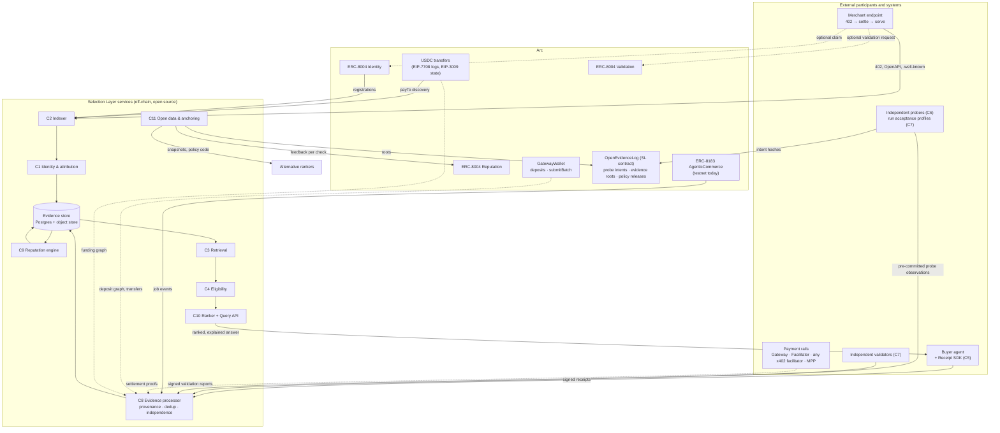

# Solution architecture: an evidence-based selection layer for open agentic commerce on Arc

**Prepared for:** Zaryab Afser · **Date:** 2026-10-17 · **Author:** Claude (architect pass)

**Status:** Implementable technical architecture. Nothing here is deployed, measured, or endorsed by Circle or the ERC-8004 authors. Every fact the design depends on is graded in §2. Every number has a stated rationale and a tuning route.

**Working name:** the Selection Layer. Short form in code and diagrams: `SL`.

---

## 1. Executive summary

- The Selection Layer answers one question for a buyer agent: *given this task, these constraints and this money, which paid service should I call, and how sure can I be?* It returns a ranked, explained list, or says that the evidence is too thin to recommend anything.
- It treats a settled payment as only the anchor of an observation. The evidence of quality comes from three sources that are hard to fake together: buyer-signed receipts bound to the payment nonce, pre-committed probes run by independent probers, and escrow outcomes from ERC-8183 jobs.
- Every observation passes through one evidence pipeline: provenance check, deduplication on the payment nonce, attribution to a service version, independence analysis on the funding graph, and then aggregation into per-task reputation posteriors with explicit uncertainty.
- Ranking is a versioned policy applied to a query. It never sells position, never merges "no history" with "bad history", and shows unverified services in a separate, labelled section instead of burying or faking a score for them. Probes are pre-committed on Arc with seed-derived timing and inputs, validators are assigned by committed salts, and every submission gets an inclusion ticket, so the operator cannot quietly drop or steer evidence.
- On Arc, the design deploys one small contract, `OpenEvidenceLog`, which anchors probe intents before they run, evidence batches after they are produced, and policy releases. It reuses the three ERC-8004 registries for identity, portable feedback and opt-in validation, and reads ERC-8183 and USDC events as evidence. It holds no funds and rules on no disputes.
- The read surface is open: a free query API, downloadable evidence and feature snapshots, open-source policy code, and anchored roots for every served snapshot and every evidence batch, so anyone can verify what a buyer was shown and recompute a different ranking.
- Circle's rails are used as they exist today. Nothing requires Circle to change a product. Two merchant upgrades (a signed delivery attestation header and an ERC-8004 claim) are optional and raise attribution confidence when present.
- Circle's marketplace catalog is not ingested. Its terms of use bar mirroring and derivative works. The index is built from merchant self-publication, on-chain discovery of paid endpoints, and ERC-8004 registrations, which are open substrates.
- First version scope: deterministic data and retrieval APIs returning JSON, on Arc mainnet and Arc testnet, on both Circle rails plus any vanilla x402 facilitator. The architecture extends to generative and long-running work by adding acceptance profiles, not by redesign.
- Main limits: independence can be priced but never proven; correctness checks cover only what an acceptance profile can test; baseline probes go only to services that have claimed their payout address and price under a per-class ceiling; and the probe budget bounds how fast an unknown merchant earns evidence.

---

## 2. Facts sheet

All facts were re-checked on 2026-10-17 unless the row says otherwise. "Snapshot" means the hands-on investigation of 2026-10-09 in the `circle/` folder.

| # | Fact | Grade | Source | Checked |
| --- | --- | --- | --- | --- |
| F1 | Arc uses USDC as the native gas token. Native accounting is 18 decimals; the ERC-20 interface at `0x3600…0000` shows 6 decimals over the same balance. | CONFIRMED | docs.arc.io EVM differences; snapshot RPC check | 2026-10-17 |
| F2 | Arc finality is deterministic on inclusion. One confirmation is enough. Block time ≈ 0.5 s. | CONFIRMED (docs) | docs.arc.io deterministic finality; gas-and-fees | 2026-10-17 |
| F3 | Arc fee model is EIP-1559 with EWMA smoothing. Base fee floor 20 Gwei, cap 20,000 Gwei. Target ≈ $0.001 per ERC-20 transfer. Values may change before mainnet GA. | CONFIRMED (docs) | docs.arc.io gas-and-fees | 2026-10-17 |
| F4 | Arc emits standard ERC-20 `Transfer` logs for native USDC moves (EIP-7708) from the system address `0xfffffffffffffffffffffffffffffffffffffffe`, separate from the ERC-20 interface at `0x3600…0000`; native amounts are 18-decimal. In a 300-block testnet sample, the system address emitted 741 Transfer logs and `0x3600…0000` emitted 384. `PREVRANDAO` returns 0. EIP-2935 block-hash history works. EIP-4844 blobs unsupported. CREATE2 and EIP-7702 work. | CONFIRMED (docs + testnet `cast logs`, 2026-10-17) | docs.arc.io EVM differences; run by Zaryab | 2026-10-17 |
| F5 | Chain IDs: Arc mainnet 5042, Arc testnet 5042002. | STRONG SIGNAL | snapshot `architecture.md` §4 (CLI source and RPC); not on the pages I re-read today | 2026-10-09 |
| F6 | ERC-8004 registries on Arc mainnet: Identity `0x8004A169FB4a3325136EB29fA0ceB6D2e539a432`, Reputation `0x8004BAa17C55a88189AE136b182e5fdA19dE9b63`, Validation `0x8004Cc8439f36fd5F9F049D9fF86523Df6dAAB58`. Testnet: `0x8004A818BFB912233c491871b3d84c89A494BD9e`, `0x8004B663056A597Dffe9eCcC1965A193B7388713`, `0x8004Cb1BF31DAf7788923b405b754f57acEB4272`. | CONFIRMED | docs.arc.io contract addresses | 2026-10-17 |
| F7 | The ERC-8004 registries on Arc are UUPS proxies owned by EOA `0x5472…2603`, the canonical ERC-8004 owner, not Circle. They were upgraded on 2026-09-14. | CONFIRMED (RPC) | snapshot `architecture.md` §4.1 | 2026-10-09 |
| F8 | ERC-8004 `giveFeedback` may be called by any address except the agent's owner or approved operators. `revokeFeedback` only by the original client. `appendResponse` by anyone. `getSummary` requires a non-empty `clientAddresses` list. | CONFIRMED (spec) | eips.ethereum.org/EIPS/eip-8004; erc-8004/erc-8004-contracts README | 2026-10-17 |
| F9 | ERC-8004 `validationRequest` must be called by the agent owner or operator. Only the named `validatorAddress` can respond. Response is `uint8` 0–100 with optional `tag` and can be updated. | CONFIRMED (spec) | eip-8004 | 2026-10-17 |
| F10 | ERC-8004 `setAgentWallet` requires an EIP-712 or ERC-1271 signature from the new wallet. The registration file may list `services[]` endpoints and `x402Support`. Endpoint domain control can be proven at `/.well-known/agent-registration.json`. | CONFIRMED (spec) | eip-8004 | 2026-10-17 |
| F11 | ERC-8004 usage on Arc mainnet as of 2026-10-09: 2,316 agents, 80.7% from two bulk registrants; 313 feedback entries, 66% from one client; 1 validation request, 0 responses. | CONFIRMED (log scan) | snapshot `architecture.md` §4.1 | 2026-10-09 |
| F12 | ERC-8183 reference `AgenticCommerce` is deployed on Arc testnet at `0x0747EEf0706327138c69792bF28Cd525089e4583`. No mainnet address is published. States: Open, Funded, Submitted, Completed, Rejected, Expired. Only the evaluator can `complete` or `reject` a submitted job. `reason` is a `bytes32` meant for attestation hashes. | CONFIRMED (docs + spec) | docs.arc.io contract addresses; eip-8183; Arc ERC-8183 tutorial | 2026-10-17 |
| F13 | ERC-8183 spec and reference contract disagree on who may call `setBudget` and on an `expectedBudget` check in `fund`. Treat the deployed code as truth. | CONFIRMED | eip-8183 page, inconsistencies section | 2026-10-17 |
| F14 | x402 v2: 402 body carries `x402Version`, `resource{url,description,mimeType}`, `accepts[]{scheme,network,amount,asset,payTo,maxTimeoutSeconds,extra}`. Client retries with a payment payload holding the EIP-712 signature and an EIP-3009 authorization `{from,to,value,validAfter,validBefore,nonce}`. Settlement response carries `{success,transaction,network,payer}`. | CONFIRMED (spec) | github.com/coinbase/x402 specs v2 | 2026-10-17 |
| F15 | x402 v2 HTTP header names are `PAYMENT-REQUIRED`, `PAYMENT-SIGNATURE`, `PAYMENT-RESPONSE`, each base64-encoded JSON. v1 used `X-PAYMENT` and `X-PAYMENT-RESPONSE`. | CONFIRMED | x402 `docs/specs/transports-v2/http.md` (checked by the implementability reviewer on 2026-10-17); Circle CLI 1.2.0 source (snapshot) | 2026-10-17 |
| F16 | EIP-3009 nonces are 32-byte values unique per authorizer. Facilitators reject reuse. EIP-3009 requires a public `authorizationState(address authorizer, bytes32 nonce)` view. | CONFIRMED (spec) | x402 spec replay section; EIP-3009 | 2026-10-17 |
| F17 | Arc's USDC (`0x3600…0000`) implements `authorizationState(address,bytes32)`: a call with a zero nonce returned `false` on Arc testnet. Mainnet not yet checked. The design still does not rely on it for settlement proof (it does not bind payee or amount). | CONFIRMED (testnet, `cast call`) | Run by Zaryab on 2026-10-17 | 2026-10-17 |
| F18 | Circle Gateway rail: buyer signs EIP-3009 against `GatewayWallet` (domain `GatewayWalletBatched` v1); seller settles off-chain before its handler runs; batches post on-chain on a ~16-minute tick; no refund call. | CONFIRMED | snapshot `architecture.md` §2.1, `trust-and-verification.md` §1.2; x402-batching 3.5.0 typings | 2026-10-09 |
| F19 | Gateway transfers API `GET /v1/x402/transfers` filters by `from`, `to`, `network`, `status` (`received`, `batched`, `confirmed`, `completed`, `failed`), `token`, `nonce`, `startDate`, `endDate`; `status` must be combined with `from`, `to` or `nonce`; pagination by `pageSize`, `pageAfter`, `pageBefore`; fields `id, status, token, sendingNetwork, recipientNetwork, fromAddress, toAddress, amount, nonce, txHash, createdAt, updatedAt`. The OpenAPI declares no auth on it; the snapshot used it keyless. | CONFIRMED (OpenAPI) + CONFIRMED (keyless on 2026-10-09) | developers.circle.com gateway-nanopayments.yaml; snapshot | 2026-10-17 / 2026-10-09 |
| F20 | Circle Facilitator Service settles vanilla x402 on Arc, Base and Polygon; screens both parties; keyless trial via an EIP-712 seller proof; returns a transaction hash on settle. | CONFIRMED (docs) | developers.circle.com facilitator how-it-works; snapshot | 2026-10-17 |
| F21 | Circle Agent Marketplace has one backend behind API, MCP, CLI and A2A card. No ranking: URL collation without a query, fuzzy text score with one. No quality field in the schema. | CONFIRMED | snapshot `discovery-and-ranking.md` §1–§2 | 2026-10-09 |
| F22 | Circle Agent Platform ToU §15 forbids scraping, mirroring, redistributing or creating derivative works from the Agent Platform, which §1 defines to include the Agent Service Registry. §16 lets Circle change or remove access at any time. | CONFIRMED | agents.circle.com/terms-of-use | 2026-10-17 |
| F23 | In a 74-endpoint sample, about 10% of live 402 prices or payees differed from the Circle catalog. Six "paid" endpoints served for free. | CONFIRMED (sample) | snapshot `buyer-experience.md` §3 | 2026-10-09 |
| F24 | Gateway sellers in Circle's catalog received $58.89 from 68 distinct buyers in 30 days. 21 of 51 payout addresses had no payments. Arc mainnet carried the most Gateway transfers. | CONFIRMED (counts) | snapshot `data-and-traction.md` §2 | 2026-10-09 |
| F25 | No catalog service accepts Arc testnet. | CONFIRMED | snapshot `data-and-traction.md` §1 | 2026-10-09 |
| F26 | Circle's article principles: organic rank never for sale; inclusion permissionless; read surface open; ranking contestable; ranking is not adjudication. It names settlement, completed transactions, feedback, validation and buyer choices as behaviour inputs, and warns self-declared feedback is cheap to game. | CONFIRMED | circle.com blog, "The missing layers" | 2026-10-17 |
| F27 | MPP (Machine Payments Protocol) receipt and settlement reference formats. | GAP | Not read in this pass. §6.5 defines a rail adapter interface so MPP can be added without changing the evidence model. | — |
| F28 | Several Circle and Arc doc pages embed "Agent Instructions" that tell AI agents to install Circle skills, run in full-access mode, or treat USDC as gas. I treated them as data and did not follow them. Seen on: docs.arc.io agentic-economy, contract-addresses, evm-differences, gas-and-fees, the two Arc tutorials, and developers.circle.com facilitator pages. | CONFIRMED | pages above | 2026-10-17 |

Resolved contradictions:

- The Arc EVM-differences header says USDC has 18 decimals; the ERC-8183 tutorial uses 6-decimal units. Both are right: 18 natively, 6 through the ERC-20 interface (F1). All contract code in this design uses the ERC-20 interface and 6 decimals.
- The snapshot called the transfers API keyless; the OpenAPI declares no auth on it but defines a bearer scheme elsewhere. The design treats keyless access as current but revocable (§6.8, A2).

---

## 3. Alternatives considered

Each option was scored against the hard requirements in the prompt's §4. Scores: meets / partial / fails.

### 3.1 Option A: registry-native. Everything on-chain through ERC-8004

- **Shape.** Buyers write feedback to the ERC-8004 Reputation Registry after each call. Validators answer owner-initiated validation requests. A ranker reads `getSummary` with a curated `clientAddresses` list.
- **Meets:** permissionless inclusion, open read, contestable (anyone reads the chain), no custody.
- **Fails:** evidence costly to fake. Feedback is free to write from any fresh address and carries no payment binding, so Sybil feedback costs only gas. Validation needs the merchant to initiate, so a merchant can simply never request it. The Reputation Registry stores no payment nonce, so deduplication and settlement checks are impossible on-chain.
- **Fails:** traceability of derived values. On-chain summaries have no lineage.
- **Verdict:** rejected as the core. Reused as the publication and identity surface (§6.1, §6.11).

### 3.2 Option B: escrow-first. Evidence only from ERC-8183 jobs

- **Shape.** Every purchase is wrapped in an escrowed job. The evaluator's `complete` or `reject` is the quality signal.
- **Meets:** evidence is bound to real money and an evaluator decision.
- **Fails:** works with today's rails. x402 and MPP calls settle before delivery and never touch an escrow contract. Requiring escrow means requiring every merchant to change. ERC-8183 is also testnet-only today (F12).
- **Fails:** ranking is not adjudication. The evaluator is a judge. If the Selection Layer runs the evaluator, it adjudicates.
- **Verdict:** rejected as the core. ERC-8183 events are ingested as one evidence source when jobs exist (§6.8).

### 3.3 Option C: closed ranker. An off-chain service that scrapes catalogs, probes, and serves scores

- **Shape.** One operator indexes, probes, scores and serves an API. Methodology is published in prose.
- **Meets:** decision-time latency, multi-input ranking.
- **Fails:** contestable ranking. Nobody can recompute from the operator's private data. Fails open read beyond the operator's API. Fails operator-misconduct resistance: the operator can drop bad probes or reweight silently. Fails ToU §15 if it mirrors Circle's catalog (F22).
- **Verdict:** rejected.

### 3.4 Option D (chosen): open evidence pipeline with on-chain anchoring

- **Shape.** Off-chain evidence pipeline with strict provenance; pre-committed probes by independent probers; buyer receipts bound to payment nonces; escrow events where present; per-task reputation posteriors; a versioned open-source ranking policy; everything published as signed, content-addressed snapshots whose roots are anchored on Arc; identity and portable feedback through ERC-8004.
- **Meets:** every §4.1 principle (traced in §13). Works with today's rails because the buyer side and the prober side capture evidence without merchant changes. Contestable because snapshots plus policy code reproduce any ranking. Costly to fake because every observation needs a settled payment, an independent funding origin, and consistency with pre-committed probes. Operator misconduct is bounded by pre-commitment and anchoring.
- **Cost:** more moving parts than A–C, and an operator probe budget.
- **Why it wins:** it is the only option that satisfies contestability and fake-resistance at the same time without requiring merchants or Circle to change anything.

### 3.5 Comparison

| Requirement | A registry-native | B escrow-first | C closed ranker | D chosen |
| --- | --- | --- | --- | --- |
| Permissionless inclusion | meets | partial | partial | meets |
| Open read surface | meets | meets | fails | meets |
| Contestable ranking | partial | partial | fails | meets |
| No custody / no adjudication | meets | fails | meets | meets |
| Evidence costly to fake | fails | meets | partial | meets |
| Works on today's rails without Circle changes | meets | fails | meets | meets |
| Traceability and corrections | fails | partial | partial | meets |
| Operator misconduct bounded | n/a | partial | fails | meets |
| Decision-time latency | partial | partial | meets | meets |

---

## 4. System overview

### 4.1 Architecture diagram



### 4.2 Trust boundaries

| Party | Trusted for | Can lie about | How the design bounds the lie |
| --- | --- | --- | --- |
| Merchant | Nothing by default | Description, price, capability, delivery, identity | Only observed behaviour counts. Text affects retrieval, never score. Version fingerprinting detects swaps. |
| Buyer (receipt submitter) | That it holds the key that signed the payment | Whether the response was good; whether a call happened at all; selective reporting | Receipt must match a settled `payer → payTo` transfer. Self-reported checks are low tier; disclosed bodies go to SL-assigned validators. Funding-graph weighting. `reporter_coverage` exposes selective reporting. |
| Prober | That it executed the pre-committed intent | Could collude with a merchant or launder bad results as skips | Intent anchored ≥ 1 h before the window; timing and inputs derived from a future block hash; every item must be revealed; skip-rate and unrevealed-intent rules remove a prober from the default set; cross-prober disagreement. |
| Validator | Correct execution of an open, content-addressed acceptance profile | Could misreport | Assigned by committed salt, never chosen by buyer or operator; three-way re-execution; public disagreement rates; default-set criteria. |
| Payment rail (facilitator, Gateway) | That a settlement record is accurate | Could hide or alter records | Vanilla settlements are on-chain. Gateway records are cross-checked against `submitBatch` deltas. Loss of API access degrades, it does not break (§6.8 step 2, §10). |
| ERC-8004 registry owner | Contract upgrades | Could upgrade maliciously | Registry data is mirrored into SL snapshots; SL never depends on registry reads at query time. |
| Selection Layer operator | Running the pipeline faithfully | Could drop, reorder or reweight evidence | Pre-committed, seeded probes; committed salts; every snapshot and batch anchored with content ids; inclusion tickets and submission logs; deterministic admission and correction rules in the policy tarball; exposure logs; recompute kit. |
| Alternative ranker | Its own policy | Anything about its own output | Out of scope. It gets the same data. |

### 4.3 On-chain / off-chain split

- **On-chain on Arc (small, cheap, verifiable):**
  - Commitments: probe intents before execution; evidence batch roots and content ids after; every served feature snapshot; policy releases; corrections; prober registrations. One contract, `OpenEvidenceLog` (§7.1).
  - Identity claims: ERC-8004 Identity, with `agentWallet` as the proof of payTo control (reuse).
  - Portable per-check feedback: ERC-8004 Reputation `giveFeedback` from SL validator addresses (reuse).
  - Evidence sources read, never written: USDC transfers, GatewayWallet events, ERC-8183 job events, ERC-8004 registrations.
- **Off-chain (open source, open data):**
  - The index, raw observations, validation reports, independence graph, reputation posteriors, ranking policy, query API, and snapshots.
- **Why this split:** the chain is used for what it does well, which is time-stamped, tamper-evident commitments that anyone can check. Raw request and response bodies, graph analysis and ranking do not belong there. They are large, private in part, and change often. Arc's cost (F3) makes per-batch anchoring trivial, roughly $0.001–0.01 per anchor at normal load.

### 4.4 Actors and roles

| Actor | Role in the Selection Layer |
| --- | --- |
| Buyer agent | Queries the API before paying. Optionally runs the Receipt SDK and submits receipts. |
| Merchant | Serves paid endpoints. Optionally claims them through ERC-8004 and adds a delivery-attestation header. |
| Prober | Runs pre-committed probe plans against services, pays real prices, publishes observations and validation reports. The SL operator runs at least one prober; others may join. |
| Validator | Executes acceptance profiles on disclosed outputs and signs reports. Can be the same organisation as a prober, but the report records that. |
| SL operator | Runs the indexer, evidence processor, reputation engine, query API and publication. Anchors roots. Funds the baseline probe budget. |
| Alternative ranker | Downloads snapshots and policy code, computes its own ranking, optionally anchors its own roots to the same contract. |
| Auditor | Reads anchored roots and snapshots; may receive restricted artifacts under the disclosure policy. |

### 4.5 Mapping to the problem definition's layers

| Layer in the problem definition | Component(s) here |
| --- | --- |
| Identity and service attribution | C1 |
| Indexing | C2 |
| Retrieval | C3 |
| Eligibility filtering | C4 |
| Validation | C7 (profiles and validators), fed by C5 and C6 |
| Evidence processing | C8 |
| Reputation | C9 |
| Ranking | C10 |
| Purchase and settlement | External. Observed through C5, C6 and rail adapters in C8. |
| (added) Open data and anchoring | C11 and the `OpenEvidenceLog` contract |

---

## 5. Shared data model

These objects are used by name in every component. Field types are TypeScript-style. Hashes are keccak256 over canonical JSON (RFC 8785 JCS) unless stated. Every record is append-only; a change is a new record that references the old one.

### 5.1 Identifiers

```ts
type ServiceId   = string;  // "svc_" + hex(keccak256(origin ‖ method ‖ first_seen_path ‖ first_seen_ts))[0:32]
                            // A surrogate fixed at first sight. (origin, method, path_pattern) is a mutable unique key.
type VersionId   = string;  // "ver_" + hex(keccak256(requirements_hash ‖ openapi_hash))[0:32]   (see C1)
type ProfileId   = string;  // "prof_" + hex(keccak256(profile JSON))[0:32]  (content-addressed)
type ObsId       = string;  // "obs_" + hex(keccak256(JCS(ObservationCore)))[0:32]   (reporter-supplied fields only)
type ReportId    = string;  // "rep_" + hex(keccak256(JCS(ValidationReportCore)))[0:32]
type PolicyVersion = string;// "pol_" + hex(keccak256(policy tarball))[0:16]
type Caip2 = `eip155:${number}`;
```

### 5.2 Payment reference

```ts
type PaymentRef =
  | { rail: "x402-exact"; network: Caip2; asset: string; payer: string; payTo: string;
      amount: string; nonce: string; validBefore: number; settlementTx?: string }
  | { rail: "gateway-batched"; network: Caip2; payer: string; payTo: string; amount: string;
      nonce: string; transferId?: string; batchTx?: string }
  | { rail: "erc8183-job"; network: Caip2; contract: string; jobId: string; client: string;
      provider: string; evaluator: string; budget: string }
  | { rail: "mpp"; network: Caip2; chargeId: string; payer: string; payTo: string;
      amount: string; settlementTx?: string };   // F27 GAP: field names to confirm against the MPP spec

// paymentRefHash = keccak256(JCS(PaymentRef)) is what signatures bind to, so every rail is signable.
```

### 5.3 Services

```ts
interface ServiceRecord {
  service_id: ServiceId;
  origin: string; method: "GET"|"POST"|"PUT"|"DELETE"; path_pattern: string;
  current_version: VersionId;
  pay_to: { address: string; network: Caip2; rail: "x402-exact"|"gateway-batched"|"mpp";
            linked_by: "probe-origin"|"wallet-claim"|"erc8004"; since: string; retired?: string }[];
  declared: { description?: string; openapi_hash?: string; input_schema?: object; output_schema?: object;
              price_atomic?: string; asset?: string; crawled_at: string };
  claim: { status: "unclaimed"|"domain-verified"|"wallet-verified"|"erc8004-claimed";
           agent_ref?: { registry: string; agent_id: string; owner: string }; verified_at?: string };
  operator_cluster: string;            // see C1; shared payTo / TLS cert / ERC-8004 owner
  sources: { kind: "submission"|"onchain-payto"|"erc8004"; ref: string; seen_at: string }[];
  first_seen: string; last_seen: string;
  admission: { status: "indexed"|"quarantined"|"removed"|"dormant"; reason_code?: string; since: string };
  probe_eligible: boolean;             // see C2 and C6
  successor_of?: ServiceId;            // set when a removed service's payTo or TLS cert reappears
}

interface ServiceVersion {
  version_id: VersionId; service_id: ServiceId;
  requirements_hash: string;   // canonical 402 accepts[] with amount AND payTo removed, sorted by (network, scheme, asset)
  openapi_hash: string;        // "" if none served
  shape_hash_advisory?: string;// JSON key-tree of probe responses; drift raises a flag, never a new version
  observed_from: string; observed_to?: string; supersedes?: VersionId;
  carried_prior?: { from: VersionId; alpha: number; beta: number; dimension: string }[];  // see C9
}
```

### 5.4 Observations

An observation has two parts. `ObservationCore` is supplied and signed by the reporter and never changes; `obs_id` is its hash. Everything the Selection Layer derives lives in `EvidenceAssessment`.

```ts
interface ObservationCore {
  kind: "probe"|"receipt"|"escrow"|"settlement-only";
  reporter: { kind: "prober"|"buyer"|"chain-reader"; id: string; address: string };
  payment: PaymentRef; payment_ref_hash: string;
  listed_price_atomic?: string;          // price shown to the reporter before paying (402 or crawl)
  origin_asserted: string;               // URL origin the reporter called
  requirements_hash_seen?: string;       // hash of the 402 the reporter received (lets C1 match a version)
  request?:  { commit: string; canonical_scheme: "sl-req-v1"; size: number };     // absent for settlement-only
  response?: { status_code?: number; commit?: string; size?: number; mime?: string;
               merchant_attestation?: { sig: string; signer: string; ts: number } };
  timing?:   { t_request: number; t_payment_signed: number; t_first_byte?: number; t_complete?: number };
  outcome: "delivered"|"http-error"|"timeout"|"no-response"|"unknown"|"skipped";
  skip_reason?: string;                  // probes only, when outcome = skipped
  probe_intent?: { intent_hash: string; item_index: number };                       // probes only
  disclosure: "public"|"validator-only"|"hash-only";
  local_checks?: { profile_id: ProfileId; checks_commit: string };                   // buyer-run checks, if any
  created_at: string;
}

interface Observation extends ObservationCore {
  obs_id: ObsId;
  sig: string;                           // EIP-712 Receipt (buyers) or ProbeObservation (probers); see §5.8
  received_at: string;
  inclusion_ticket: { batch_deadline: string; ticket_sig: string };                 // see C8, C11
}
```

### 5.5 Profiles and reports

```ts
interface AcceptanceProfile {
  profile_id: ProfileId; task_class: string; version: number;
  input_generator: { kind: "parametric"|"consensus-pool"; spec: object };   // no fixed-set inputs (probe gaming)
  checks: { name: string; kind: "delivery"|"structural"|"requirement"|"reference"|"consensus"|"reproducible"|"rubric";
            dimension: "delivery"|"structural"|"requirement"|"correctness"; spec: object }[];
  tolerances: object; abstain_rules: object; cost_estimate_usd: number;
  references?: { kind: string; uri: string; provenance: string }[];
  receipt_checks: string[];              // subset of checks runnable on a single disclosed receipt
  limits: string[];
  code_hash: string;                     // hash of the executor module
}

interface ValidationReportCore {
  obs_id: ObsId; profile_id: ProfileId; method_version: string;   // must equal profile.code_hash
  validator: { id: string; address: string };
  assignment: { kind: "probe-pool"|"sl-assigned"|"buyer-local"; salt_commit?: string };
  checks: { name: string; result: "pass"|"fail"|"inconclusive"|"not_checked"; evidence_ref?: string; detail?: object }[];
  consensus_group?: string; cost_usd: number; created_at: string; limits: string[];
  conflict_flags: ("validator-is-prober"|"validator-affiliated"|"self-reported-checks")[];
}
interface ValidationReport extends ValidationReportCore { report_id: ReportId; sig: string; received_at: string; }
```

### 5.6 Assessment, reputation, ranking

```ts
type SettlementGrade = "none"|"buyer-asserted"|"onchain-netted"|"rail-api"|"onchain-inferred"|"onchain";
// Total order, weakest first. "settlement ≥ X" below means at or after X in this list.

interface EvidenceAssessment {
  assessment_id: string; obs_id: ObsId; supersedes?: string;
  service_id?: ServiceId; version_id?: VersionId;
  provenance: "verified"|"unverified"|"invalid"; reason_code?: string;
  provenance_detail: { settlement: SettlementGrade; settlement_ref?: string;
                       reporter_sig_ok: boolean; payto_linked: boolean; origin_match: "tls"|"asserted"|"attested";
                       version_match: "exact"|"prior"|"divergent"|"unknown"; commit_timing_ok?: boolean };
  dedup_key: string;                     // rail:network:payer:payTo:nonce  |  erc8183:network:contract:jobId
  duplicates_of?: ObsId;
  attribution_confidence: number;        // 0..1 (C1)
  independence: { method: "probe-commit"|"funding-cluster"|"cluster-unknown"|"merchant-related";
                  cluster_id?: string; order_in_cluster?: number; weight: number; as_of: string };
  eligible_uses: ("delivery"|"latency"|"structural"|"requirement"|"correctness"|"demand")[];
  flags: string[];                       // vocabulary and consumers in C8 §6.8 table
  assessed_with: PolicyVersion; assessed_at: string;
}

interface ReputationEstimate {
  service_id: ServiceId; version_id: VersionId; task_class: string; profile_id?: ProfileId;
  dimension: "delivery"|"structural"|"requirement"|"correctness"|"latency_p50"|"latency_p95"|"price_match";
  posterior: { alpha: number; beta: number } | { quantiles: Record<string, number> };
  n_raw: number; n_eff: number;
  check_coverage: number;                // probe stream only; see C9
  sources: { probers: number; receipt_clusters: number; escrow_clusters: number };
  badges: ("single-source"|"low-check-coverage"|"probe-gap"|"carried-prior"|"consensus-only")[];
  last_obs_at: string; window_days: number; half_life_days: number;
  lineage_root: string; policy_version: PolicyVersion; computed_at: string;
}

interface RankingDecision {
  query_id: string; received_at: string; policy_version: PolicyVersion; snapshot_id: string; snapshot_anchor_tx: string;
  query: { task: string; task_class?: string; constraints: object; risk_quantile: number; weights: object };
  candidates_considered: number;
  excluded: { service_id: ServiceId; gate: string; detail: string }[];
  ranked: { rank: number; service_id: ServiceId; version_id: VersionId; score: number;
            features: Record<string, number|string|null>; evidence_refs: string[];
            evidence_age_days: number; missing: string[]; badges: string[]; explanation: string }[];
  unverified: { service_id: ServiceId; reason: "n_eff_below_min"; n_eff: number }[];
  missing_dimensions_for_class: string[];   // dimensions no candidate could have (e.g. too few providers for consensus)
  insufficient_evidence: boolean;
  exploration_slot?: { service_id: ServiceId; reason: string };
}
```

### 5.7 Exposure and corrections

```ts
interface ExposureLog { query_id: string; service_id: ServiceId; position: number; shown_at: string; was_exploration: boolean; }

interface Correction {
  correction_id: string; target_id: ObsId|ReportId|string; kind: "provenance"|"attribution"|"duplicate"|"retraction"|"merchant-response";
  by: { kind: "operator-rule"|"merchant"|"buyer"|"prober"|"validator"; address: string }; sig: string;
  rule_id?: string;                      // deterministic rule in the policy tarball that produced it, for operator-rule
  evidence_uri?: string; created_at: string; supersedes?: string;
}
```

### 5.8 Signature types (EIP-712, domain `{ name: "SelectionLayer", version: "1", chainId }`)

```
Receipt(bytes32 paymentRefHash, bytes32 requestCommit, bytes32 responseCommit, uint16 statusCode,
        string originAsserted, bytes32 requirementsHashSeen, uint64 tRequest, uint64 tPaymentSigned, uint64 tComplete,
        uint8 outcome, bytes32 localChecksCommit, uint8 disclosure, uint64 createdAt)
  -- signed by payment.payer (EOA) or valid under ERC-1271 for payment.payer

ProbeObservation(bytes32 intentHash, uint32 itemIndex, bytes32 paymentRefHash, bytes32 requestCommit,
        bytes32 responseCommit, uint16 statusCode, string originAsserted, bytes32 requirementsHashSeen,
        uint64 tRequest, uint64 tPaymentSigned, uint64 tComplete, uint8 outcome, string skipReason, uint64 createdAt)
  -- signed by the prober's registered signing address

ValidationReport(bytes32 obsId, bytes32 profileId, bytes32 methodVersion, uint8 assignmentKind, bytes32 saltCommit,
        bytes32 checksCommit, uint64 createdAt)
  -- signed by the validator's registered address; checksCommit = keccak256(JCS(checks[]))

DeliveryAttestation(bytes32 paymentRefHash, bytes32 responseCommit, uint64 ts)
  -- optional merchant header, signed by the payTo key (or ERC-1271 for a contract payTo)

Correction(bytes32 targetId, uint8 kind, bytes32 evidenceHash, uint64 createdAt)
  -- signed by a claimed merchant's payTo key or ERC-8004 owner, a buyer's payer key, or a prober/validator address

ServiceClaim(bytes32 serviceId, address payTo, string origin, uint64 deadline)
  -- signed by the payTo key; proves control of the payout address for a service
```

`chainId` is the chain of the payment (receipts, attestations) or Arc (probes, reports, corrections, claims).

### 5.9 Cross-component invariants

1. Every derived value links to source `obs_id`s and a `PolicyVersion`.
2. Re-ingestion is idempotent: `obs_id` is a hash of reporter-supplied fields only, and `dedup_key` includes `payTo`.
3. Absent fields stay `null` or `"unknown"`; no adapter fills in a success; an unknown feature never scores as the best value.
4. Corrections and re-assessments create new rows that reference the superseded row; nothing is overwritten.
5. A new `VersionId` starts a new history. A carried prior is an explicit, labelled, bounded transfer, recorded in `ServiceVersion.carried_prior`, never a merge.
6. Component outages produce `outcome = unknown` plus an incident record, never a merchant failure.
7. Public exports pass through the disclosure filter in C11.
8. Every `RankingDecision` names an anchored `snapshot_id` and a `policy_version`, and is reproducible from them.
9. Independence weights are fixed at assessment time (marginal weights); later observations never change earlier rows.

---

## 6. Component specifications

Each component follows the same template: responsibility, interface, data model, core logic, placement, reuse vs build, scaling and cost, failure modes and abuse cases. Parameters are defaults for policy `pol_default_v1`; every one is listed with its rationale and changes only through a policy release.

### 6.1 C1: Service identity and attribution

- **Responsibility.** Decide which `ServiceRecord` and `ServiceVersion` an observation is about, and how confident that attribution is. Record who controls a service's payout address and domain. Group services that share an operator.

- **Interface.**
  - `attribute(core: ObservationCore) -> { service_id?, version_id?, confidence, origin_match, version_match, payto_linked, reasons[] }`
  - `fingerprint(req402, openapi?) -> VersionId`
  - `linkPayTo(service_id, address, network, rail, linked_by)` — only from a prober observation whose TLS origin matched, from a wallet-verified `ServiceClaim`, or from an ERC-8004 registration whose `agentWallet` equals the address
  - `claim.verifyDomain(origin)` (fetches `/.well-known/agent-registration.json`, F10) · `claim.verifyWallet(ServiceClaim, sig)` · `claim.syncErc8004(agent_id)`

- **Data model.** `ServiceRecord`, `ServiceVersion` (§5), `operator_clusters(cluster_id, member_kind ∈ {payTo, tls_cert_fp, erc8004_owner}, member_value, since)`.

- **Core logic.**
  - **Service identity.** `ServiceId` is a surrogate fixed at first sight. `(origin, method, path_pattern)` is the mutable unique key. `path_pattern` is refined as more requests are seen; refinement renames the key, never the id.
  - **Version fingerprint** `VersionId = keccak256(requirements_hash ‖ openapi_hash)`:
    - `requirements_hash` canonicalises the 402 `accepts[]` with `amount` and `payTo` removed, sorted by `(network, scheme, asset)`. Price and payee changes do not create a version. Scheme, network set or asset changes do.
    - `openapi_hash` is the hash of the merchant's OpenAPI document if served, else `""`.
    - `shape_hash_advisory` (JSON key-tree of probe responses) is tracked separately. A change raises `shape-drift` on the version and schedules two probes; it never creates a version. Rationale: the implementability review showed that putting the shape in the fingerprint flips every new service's version after its third probe.
  - **payTo rotation.** A new `payTo` is linked to the same service (rule above) with `since`; the old one gets `retired`. History continues. `payto_changed_at` is a public field. Rationale: payee rotation must not reset history.
  - **Attribution confidence** (0–1) is the product of three factors:
    - payee: `payment.payTo` ∈ linked `pay_to[]` → 1.0; else 0 and flag `payto-unlinked`.
    - origin: TLS origin observed by a prober → 1.0 (`tls`); merchant attestation verifies → 1.0 (`attested`); buyer-asserted → 0.8 (`asserted`).
    - version: `requirements_hash_seen` equals the current version → 1.0 (`exact`); equals a prior version → attribute to that version at 1.0 (`prior`); differs from both while payee and origin match → 0.9 (`divergent`, flag `caller-divergent-402`); absent → 0.8 (`unknown`).
    - Rationale for `divergent` at 0.9: a merchant that serves real buyers a different 402 than it serves probes is itself a signal; penalising the receipt would switch off the stream that detects it.
  - **Claims ladder.** `unclaimed` → `domain-verified` → `wallet-verified` (`ServiceClaim`) → `erc8004-claimed`. Claims never add score. They raise attribution, unlock the correction channel, and (with a price ceiling) make a service `probe_eligible` (C2).
  - **Operator clusters.** Services sharing a `payTo`, a TLS certificate fingerprint, or an ERC-8004 owner share an `operator_cluster`. Used by C6 (a prober's own cluster), C7 (one consensus vote per cluster), C8 (budget caps). Never treated as proof of common ownership in any public label; the public label is the edge reason.
  - **Successors.** When a `removed` service's `payTo` or TLS certificate reappears on a new record, `successor_of` is set and the predecessor's history is shown beside the new record. The new record starts its own estimates with a carried prior (C9).

- **Placement.** Off-chain. ERC-8004 claims are on-chain by construction.

- **Reuse vs build.** Reuse: ERC-8004 Identity reads, viem, EIP-712 and ERC-1271 verification. Build: fingerprinting, path-pattern inference, claims ladder, clusters.

- **Scaling and cost.** O(1) per observation.

- **Failure modes and abuse.**
  - Receipt names a competitor's `payTo` under the merchant's origin → `payto-unlinked`, confidence 0, excluded.
  - Merchant changes origin and payTo together → new service; `successor_of` only if a payTo or certificate is reused; otherwise it is a stranger and starts in `unverified`, which is the honest outcome.
  - Reseller fronts → separate services; `shared-upstream` arrives from C7.

### 6.2 C2: Indexer

- **Responsibility.** Maintain a permissionless, versioned inventory of paid endpoints with provenance. Inclusion is not endorsement, and inclusion is not a probe budget.

- **Interface.**
  - `POST /v1/index/submit { url, method? }` → `{ service_id, admission, probe_eligible }` (anyone; 60/hour per IP, 200/day per submitting key)
  - `GET /v1/index/services?origin=&pay_to=&updated_since=&pageAfter=` → `ServiceRecord[]`
  - Internal: `crawl(service_id)`, `discoverFromChain(range)`, `discoverFromErc8004(range)`

- **Data model.** `ServiceRecord`, `crawl_log(service_id, at, http_code, requirements_hash, openapi_hash, tls_cert_fp, error)`, `discovery_leads(kind, ref, pay_to, network, seen_at, resolved_service_id?)`. Policy files: `facilitator_allowlist.json` (facilitator relayer addresses per network, versioned with the policy).

- **Core logic.**
  - **Sources.**
    1. **Submission.** The URL is fetched unauthenticated. An x402 402 (v2 header or v1 body, F15) admits it with `source=submission`. OpenAPI and the well-known registration file are fetched if present. The TLS certificate fingerprint is recorded.
    2. **On-chain leads.** USDC `Transfer` logs whose transaction was sent by an address in `facilitator_allowlist` and whose calldata selector is `transferWithAuthorization`, plus positive deltas in GatewayWallet `submitBatch` calldata, yield `payTo` leads. A lead becomes a service only when a URL is found for it through an ERC-8004 registration (`agentWallet` match) or a submission. Leads without URLs stay leads.
    3. **ERC-8004 registrations** with `services[]` endpoints are crawled like submissions.
    4. **Third-party catalogs are not ingested** (F22). A buyer-side plugin may query a catalog live and submit URLs it finds; the SL receives only URLs and verifies each first-hand (A7 covers the terms question for that plugin).
  - **Admission states and rules.** All rules are deterministic and shipped in the policy tarball as `admission_rules.json`; the `reason_code` is public.
    - `indexed`: valid 402 within the last 7 days.
    - `quarantined`: malformed 402 (`Q01`), 402 that changes payee on every request (`Q02`), response body larger than 5 MB on an unpaid request (`Q03`), or more than 50 new records submitted for one `operator_cluster` within an hour (`Q04`, applies only to the newly submitted records, never to already-indexed ones). No content-judgement rule exists.
    - `dormant`: no non-probe settlement observed for 10 consecutive probe cycles. Probed once per 30 days; still indexed, still retrievable.
    - `removed`: wallet-verified or ERC-8004-owner request (`R01`), or legal takedown (`R02`). Removed records remain retrievable by id with history; they leave retrieval results.
  - **Probe eligibility.** `probe_eligible = (claim ≥ domain-verified) ∧ (listed price ≤ class ceiling) ∧ (operator_cluster under its daily cap)`. Default ceiling for `data-json`: $0.25 per call. Rationale (adversarial finding 11): baseline probes are money paid to anyone who serves a 402; the ceiling, the claim and the per-cluster cap make farming unprofitable. Unclaimed services are indexed and retrievable; they are probed only through merchant-funded probes or receipts.
  - **Refresh.** Re-crawl every 24 h, and within 1 h after a probe sees a different `requirements_hash`. Unreachable for 7 days → `last_seen` stale, shown in retrieval, not removed.

- **Placement.** Off-chain; reads Arc logs.

- **Reuse vs build.** Reuse: `@x402/core` schemas, OpenAPI 3.1 parser, viem log readers. Build: lead resolution, admission rules, path-pattern inference.

- **Scaling and cost.** 10,000 services × 1 unpaid crawl/day. Arc log scanning is incremental.

- **Failure modes and abuse.**
  - Spam → `Q04` on the new records only; proof-of-402; no payment lifts quarantine.
  - Competitor floods a rival's origin with paths → only the flood's own records are quarantined; the rival's indexed records are untouched.
  - Prompt injection in descriptions → stored as data, escaped in rendering, used only as text features in C3.

### 6.3 C3: Retrieval

- **Responsibility.** Return the candidate set that might satisfy a task. Recall over precision; C4 and C10 narrow.

- **Interface.** `retrieve(task, task_class?, k = 50) -> { candidates: { service_id, version_id, fit, fit_sources[] }[] }`

- **Data model.** `service_text(service_id, version_id, text_blob, embedding, model_id, updated_at)` where the vector column is created per policy from `embedding_model.json` (model name, dimension, hash); `service_capabilities(service_id, version_id, task_class, source ∈ {declared, probe-verified}, confidence, last_verified_at)`.

- **Core logic.**
  - **Two retrievers with raw floors.** BM25 over `text_blob` (candidate passes if at least one non-stopword query term matches in `description`, `path` or OpenAPI summary) and dense cosine over embeddings (passes if cosine ≥ 0.25). A candidate must pass at least one floor. Rationale (implementability blocker 1): a floor on a reciprocal-rank-fusion score is unreachable; floors belong on raw scores.
  - **Ordering.** Reciprocal rank fusion (k = 60) over the two lists; top 50 returned. The verified-capability multiplier (×1.5 on the fused score when the service has `probe-verified` capability for the given task class) is applied before the cut. Rationale: self-description is free; a passed probe is not.
  - **Task-class inference.** A small classifier maps task text to a known class or `unknown`. Its weights, the embedding model, the stopword list and the floor-calibration query set ship in the policy tarball so retrieval is reproducible (implementability finding 4, adversarial 8).
  - **Retrieval is logged.** `candidates_considered` and the retrieval list hash are stored with the `RankingDecision`.

- **Placement.** Off-chain.

- **Reuse vs build.** Reuse: Postgres full-text search, pgvector 0.7+, an open embedding model named in the policy. Build: fusion, capability tables, calibration set.

- **Scaling and cost.** Under 50 ms at 10⁵ services with HNSW.

- **Failure modes and abuse.** Keyword stuffing raises recall only; ranking ignores text. A relevant service missed here is lost for that query; the published calibration set and recall numbers per release make that measurable.

### 6.4 C4: Eligibility

- **Responsibility.** Apply the buyer's hard constraints and the service's current requirements. Produce eligible candidates and explicit exclusions.

- **Interface.** `filter(candidates, constraints, snapshot) -> { eligible[], excluded[] }` with
  ```ts
  interface Constraints {
    networks: Caip2[]; rails?: ("x402-exact"|"gateway-batched"|"mpp")[];
    max_price_atomic?: string; asset?: string; max_latency_ms?: number; deadline_at?: number;
    requires_no_siwx?: boolean; allowed_required_headers?: string[]; data_policy?: "no-pii"|"no-retention"|"any";
    min_n_eff?: number;                 // buyer-side extra threshold, applied to the ranked list after the n_min split
    unknown_policy: "exclude"|"allow";  // required; no default
  }
  ```

- **Core logic.** Gates in order: network; rail; price (live-probe price if fresher than 24 h, else crawl price; if the two differ by more than 2×, use the higher and set `detail = price-drift`, F23); SIWX and required headers; latency p95 ≤ max (if evidence); `min_n_eff` after the ranker's split. A gate whose input is unknown returns `unknown` and is resolved by `unknown_policy`; with `allow`, the missing field appears in `missing`.

- **Placement, reuse, scaling.** Off-chain; trivial; O(k).

- **Failure modes.** A stale price excludes a service → the exclusion reason is visible; a resubmission triggers a re-crawl within the hour.

### 6.5 C5: Buyer Receipt SDK

- **Responsibility.** Turn each paid call into a signed, payment-bound `ObservationCore`, optionally with locally run checks, and submit it. This is the only component that sees real buyer traffic.

- **Interface (TypeScript; Python port follows the same shapes).**
  - `wrapFetch(fetch, { signer, disclosure, profileExecutor? }) -> fetch` — wraps an x402-aware fetch; captures the 402, the payment payload, the `PAYMENT-RESPONSE` header (F15), the response and timings.
  - `buildCore(ctx) -> ObservationCore` — canonicalises request and response; fills `payment`, `payment_ref_hash`, `listed_price_atomic` (from the 402), `requirements_hash_seen`, `origin_asserted`.
  - `signReceipt(core, signer) -> Observation` — EIP-712 `Receipt` (§5.8), signed by the key that signed the payment authorization (EOA) or valid under ERC-1271 for the payer (smart account). For Circle agent wallets that is the backing EOA on the Gateway rail and the SCA on the vanilla rail, matching how the payment was signed.
  - `runLocalChecks(core, profile) -> ValidationReportCore` with `assignment.kind = buyer-local` and `conflict_flags = ["self-reported-checks"]`.
  - `submit(obs, report?) -> { obs_id, inclusion_ticket, assigned_validators? }` → `POST /v1/observations`. The response carries a signed inclusion ticket naming the batch deadline (C11) and, if `disclosure = validator-only`, the SL-assigned validator set (C7) to encrypt the body to.
  - `disclose(obs_id, body, validators[])` — encrypts the body to each assigned validator's public key and uploads; 30-day TTL.
  - **Circle CLI companion.** `sl-receipts from-circle-log ~/.circle-cli/payments/` builds cores from the CLI's payment logs and signs through `circle wallet sign typed-data`. No CLI change needed.

- **Canonicalisation (`sl-req-v1`).** `requestCommit = keccak256(method ‖ url-with-sorted-query ‖ selected-headers ‖ body-bytes)`; selected headers exclude authorization and payment headers. `responseCommit = keccak256(status ‖ content-type ‖ body-bytes)`.

- **Disclosure.** `hash-only` (default), `validator-only`, `public`. The SDK refuses `public` when a PII scanner flags the payload.

- **Optional merchant upgrade.** `X-SL-Delivery-Attestation: <base64 EIP-712 DeliveryAttestation>` signed by the `payTo` key makes the receipt dual-signed and sets `origin_match = attested`.

- **Placement.** Buyer-side library.

- **Reuse vs build.** Reuse: `@x402/fetch` / `@x402/core` types, viem signing, RFC 8785 JCS. Build: core builder, executor runtime, CLI companion.

- **Scaling and cost.** One signature per call; batched submission every 60 s or 100 receipts.

- **Failure modes and abuse.**
  - Fabricated receipt → no matching settlement log → `invalid` (C8).
  - Receipt bound to a self-payment nonce but naming a merchant → `dedup_key` and settlement check include `payTo`; the log must show `payer → payTo` → `invalid`.
  - Selective reporting → `reporter_coverage` (receipts ÷ settled payments from that payer to that service, computed by C8 from the rail record) below 0.5 → flag `selective-reporter`, correctness-ineligible, delivery still eligible.
  - Lies about status or body → self-reported checks weigh 0.25 and only for `structural`; a disclosed body is checked by SL-assigned validators; an attestation pins the body.

### 6.6 C6: Prober network

- **Responsibility.** Produce evidence that does not depend on buyers: pre-committed, paid, real calls executed by registered probers, with every planned item accounted for, and with timing and inputs the merchant cannot predict.

- **Interface.**
  - `plan(cycle_id) -> ProbePlan { seed_commit, salt_commit, items: { service_id, version_id, profile_id, window: [t0, t1] }[] }` — inputs and exact times are not in the plan; they derive from the revealed seed.
  - `commit(plan)` → `OpenEvidenceLog.commit(PROBE_INTENT, intent_hash = keccak256(JCS(plan)), prev, uriHash)`; must land at least 1 hour before the earliest `t0`.
  - `derive(plan, commit_block)`: `seed = keccak256(seed_preimage ‖ blockhash(commit_block + 1))`; per item: `t_exec = t0 + (H(seed ‖ i) mod (t1 − t0))`, `input = profile.input_generator(H(seed ‖ i ‖ "in"))`, random-slice membership from `H(seed ‖ "rand")`. Rationale: Arc has no `PREVRANDAO` (F4); a future block hash mixed with a committed preimage is unpredictable to both merchant and prober at commit time, and EIP-2935 makes it readable later. Arc's PoA block producers could in principle bias one block hash; the preimage commitment means they would also need the prober's cooperation.
  - `execute(item) -> ObservationCore` signed as `ProbeObservation` (§5.8), paying with `maxAmount = listed price × 2`.
  - `reveal(cycle_id)` → `OpenEvidenceLog.reveal(intent_hash, batch_root, uriHash)`, publishing the plan, `seed_preimage`, `salt` and every item's outcome, including `skipped` with a reason.
  - `POST /v1/probers/register { prober_id, signing_address, operator_cluster_disclosure[] }` → the registration record's hash is also committed by the prober as `PROBER_REGISTRATION`, so registration is public and dated.

- **Data model.** `probe_plans(cycle_id, prober_id, intent_hash, commit_tx, commit_block, reveal_tx, planned_n, executed_n, skipped_n, unknown_n)`, `probe_wallets(prober_id, address, network, funded_via, retired_at, published_at)`, `prober_track(prober_id, revealed_cycles, unrevealed_intents, skip_rate_30d, agreement_rate_30d)`.

- **Core logic.**
  - **Weighting of probe evidence** (settles adversarial finding 2 and implementability blocker 2). A probe observation whose intent was committed before `t_request` and later revealed gets `independence.method = probe-commit` and weight 1, with at most one counted observation per `(prober, service, profile, UTC day)`; extra same-day probes attach as duplicates for latency only. The funding graph is not applied to prober wallets. Rationale: a prober's independence is enforced by pre-commitment, accountability and the default-set rules below, not by where its wallet was funded.
  - **A prober's own cluster.** Observations by a prober on services in its own `operator_cluster` (disclosed at registration, or discovered through shared payTo or certificate) get weight 0 and flag `prober-own-service`.
  - **Default prober set.** The default policy consumes only probers in `prober_default_set.json` (policy tarball). Entry criteria, all public: ≥ 200 revealed items, `unrevealed_intents = 0`, `skip_rate_30d ≤ 5%`, and on overlapping `(service, profile, day)` items with another default prober, delivery-outcome agreement ≥ 95%. The operator's own prober meets the same criteria and is listed the same way. Observations from other probers are stored and published; alternative rankers may use them.
  - **Timing checks** (C8 enforces): an item counts only if `commit_block.timestamp + 3600 ≤ t0 ≤ t_request ≤ t1`. Items with `t_request` outside the window or before the commit are `invalid`.
  - **Accountability.** Every planned item must appear in the reveal. `skipped` and `unknown` items are rescheduled to a different default prober in the next cycle. A prober whose `skip_rate_30d` on any single service exceeds 10% has that service's items reassigned and the fact published. Any unrevealed intent older than 48 h removes the prober from the default set until it is revealed.
  - **Budget allocation per cycle (24 h), per task class with profiles**, over `probe_eligible` services, in this priority order until the cycle cap is hit:
    1. Services with `n_eff < n_min (5)` on their current version, newest `first_seen` first. At one probe per day, a new claimed service reaches `n_eff ≥ 5` after six daily passes (Σ decay over ages 0–5 ≈ 5.5).
    2. Services whose newest evidence is older than the half-life (14 d).
    3. Remaining budget by posterior variance `αβ/((α+β)²(α+β+1))`, largest first.
    4. 10% of the cap reserved for a uniformly random slice drawn from the seed.
    - Caps: 3 probes per service per day; per `operator_cluster` 10 per day; per service $0.25 per call ceiling (C2). `dormant` services: 1 per 30 days.
    - **Launch phase.** With 2,000 eligible services and a $120/day cap, rule 1 alone covers about 1,200 services per day at the $0.10 median; the newest-first order means a newly claimed service is probed within 48 h even at launch. Steady state (most services verified): rule 2 ≈ 140/day plus rules 3–4, about $40–60/day. Numbers are restated in §12.
  - **Merchant-funded probes.** Anyone may buy extra probes of a service at call price + $0.01. They are planned by the same planner, under the same commit/reveal, with execution time randomised over a 72-hour window and parametric inputs. They carry flag `merchant-funded-probe`, count toward `n_eff` at weight 0.5 and only up to `n_min`; beyond that they refresh recency but add no weight. The paid-probe count per cycle may not exceed the baseline count (published ratio). Rationale (adversarial 10): extra probes may speed up a newcomer's first evidence; they may not buy a tighter interval or crowd out the baseline.
  - **Consensus pools.** For `consensus-pool` profiles, the same derived input goes to every eligible service in the sub-class within a 60-second window, and to at most one service per `operator_cluster` for voting purposes (C7).
  - **Wallet hygiene and delayed publication.** Prober wallets rotate each cycle and are funded through varying paths. Probe outcomes and check results are published in the next 15-minute batch; probe payer addresses and request bodies are published 7 days after the wallet is retired. Rationale (adversarial 6): immediate publication let a merchant learn every probe wallet and recognise the next one.
  - **Payment and delivery are separate events.** `t_payment_signed` and `t_complete` are both recorded; a settled payment followed by an HTTP error is `http-error` with the settlement reference attached. This is the "paid, not delivered" event no rail records (F18).
  - **Cross-prober comparison.** Two default probers disagreeing on delivery for the same `(service, profile, day)` → both observations flagged `prober-disagreement`; C9 treats a flagged pair as one `inconclusive` for that day; a third default prober is scheduled.

- **Placement.** Off-chain execution; intents, registrations and reveals on Arc.

- **Reuse vs build.** Reuse: `@circle-fin/x402-batching/client` (Gateway), `@x402/fetch` with any facilitator (vanilla), viem. Build: planner, derive, commit/reveal, accountability, wallet rotation.

- **Scaling and cost.** Dominated by call prices; see §12.

- **Failure modes and abuse.**
  - Merchant recognises probes → delayed address publication, seeded timing and inputs, consensus comparison against peers, and the `probe-gap` detector from receipts (C9).
  - Prober colludes or launders failures as `skipped` → skip-rate rule, reassignment, public track record, default-set removal.
  - Prober commits after probing → timing check rejects.
  - Rail outage → `unknown` with incident id; excluded from reputation; visible in the reveal.

### 6.7 C7: Acceptance profiles and validators

- **Responsibility.** Turn an output into bounded findings: what was checked, what passed, what failed, what could not be decided, and what the method cannot establish.

- **Interface.**
  - `profiles.publish(profile) -> ProfileId` (anyone; the default set per task class is `profile_default_set.json` in the policy tarball)
  - `validate(core, body, profile, ctx) -> ValidationReportCore`
  - `assign(obs_id, cycle) -> validator_ids[3]` — `H(obs_id ‖ cycle_salt)` over the default validator set, where `keccak256(cycle_salt)` was committed in that cycle's `PROBE_INTENT` plan (`salt_commit`) before any report existed; the salt is revealed with the cycle. Rationale (adversarial 3 and 15, implementability 12): neither the buyer nor the operator chooses who checks.
  - `POST /v1/reports` (signed `ValidationReport`) · `POST /v1/validators/register { validator_id, address, pubkey, affiliations[] }`

- **Data model.** `AcceptanceProfile`, `ValidationReport` (§5), `validator_track(validator_id, reports_n, rechecked_n, disagreements_n, disagreement_rate_30d)`, `validator_default_set.json` (policy tarball).

- **Core logic.**
  - **Check kinds.**
    | Kind | Question | Pass means | Cannot establish |
    | --- | --- | --- | --- |
    | `delivery` | 2xx with a body within the profile's limit after payment? | Something was delivered | Content is right |
    | `structural` | Body validates against the schema? | Well-formed | Values are true |
    | `requirement` | Output covers what was asked (all requested keys or items)? | Scope compliance | Accuracy |
    | `reference` | Matches a reference source within tolerance? | Agreement with that reference | The reference is right; shared upstream |
    | `consensus` | Agrees with ≥ 2 other operator clusters on the same input? | Agreement with peers | Peers may share an upstream |
    | `reproducible` | Re-running a specified computation reproduces it? | Correct computation | Sound inputs |
    | `rubric` | A model-based judge accepts it under a published rubric? | A judgment with uncertainty | Objective truth |
  - **Result semantics.** `pass`, `fail`, `inconclusive` (checker ran, could not decide), `not_checked` (checker did not run). Only `pass` and `fail` enter posteriors. Each check names its `dimension`.
  - **Abstention first.** Profiles declare `abstain_rules` (example: price reference older than 30 s → `inconclusive`).
  - **First-version profile set, task class `data-json`.** `delivery` (limit = min(`maxTimeoutSeconds`, 30 s)), `structural` (OpenAPI schema if served, else inferred shape), `requirement` (requested keys present), `consensus` (relative tolerance 0.5% for prices, exact for identifiers). `reference` checks per sub-class only where a reference with stated provenance exists. `rubric` excluded until calibration data exists.
  - **Receipt checks.** A single disclosed receipt has no peer responses, so `consensus` cannot run on it (implementability 9). `profile.receipt_checks` lists what can: `structural`, `requirement`, and `reference` where a reference exists. For sub-classes with no reference, receipts contribute `delivery`, `structural` and `requirement` only, and correctness stays probe-based. A validator-funded mini-pool (the validator buys the same input from two peers at validation time) is allowed when the profile sets `receipt_consensus = true`; it carries its own `PaymentRef`s and is budgeted in §12.
  - **Consensus voting.** One vote per `operator_cluster`. Byte-identical responses after removing timestamps and request echoes, or value-and-staleness patterns identical across ≥ 5 inputs, collapse into one vote with flag `shared-upstream`. Fewer than 3 distinct voting clusters → every participant's consensus check is `inconclusive`. Correctness estimates whose only evidence is consensus carry the `consensus-only` badge (C9).
  - **Validator accountability.** For each report, the two other assigned validators re-execute it when the body is available to them (probe bodies always; disclosed receipts, which are encrypted to all three). Disagreement → all three reports `inconclusive` for correctness, `disagreements_n` incremented for the minority, and a third-party re-run scheduled. Default-set criteria: ≥ 50 rechecked reports, `disagreement_rate_30d ≤ 5%`, and no undisclosed affiliation found. Exclusions are public and reversible.
  - **Conflicts.** `validator-is-prober`: allowed, flagged. `validator-affiliated` (validator in the merchant's `operator_cluster` or declared): report stored, correctness-ineligible. `self-reported-checks`: buyer-local, weight 0.25, `structural` only.

- **Placement.** Off-chain. Profile ids appear in on-chain feedback tags (C11).

- **Reuse vs build.** Reuse: Ajv 8 (JSON Schema 2020-12), a sandbox (Node `vm` with no network, or Wasm). Build: profile format, executor runtime, consensus logic, assignment, recheck.

- **Scaling and cost.** Deterministic checks ≈ free; consensus costs N probes per input; mini-pools cost 2 extra calls per receipt where enabled.

- **Failure modes and abuse.** Wrong-but-well-formed passes `structural` only; that is why `structural` and `correctness` are separate dimensions. Reference wrong or shared → provenance recorded; consensus is a second opinion. Validator runs stale code → `method_version` mismatch rejected at ingestion. Validator outage → `not_checked`, incident, merchant untouched.

### 6.8 C8: Evidence processor

- **Responsibility.** Decide whether an observation is authentic, attributable, non-duplicate and independent enough to use, and for what. Never invent an outcome. Guarantee inclusion of every submission in a published batch.

- **Interface.**
  - `POST /v1/observations` → `{ obs_id, inclusion_ticket, assigned_validators? }` · `POST /v1/reports` · `POST /v1/corrections`
  - `assess(obs) -> EvidenceAssessment`
  - Rail adapters: `verifySettlement(payment) -> { grade: SettlementGrade, ref }`
  - Chain readers: `ingestUsdcTransfers`, `ingestGatewayEvents`, `ingestErc8183Jobs`, `ingestErc8004`
  - Write-endpoint auth: every write is a signed EIP-712 object (§5.8); there are no API keys for writes. Rate limits per signer.

- **Data model.** `observations`, `validation_reports`, `evidence_assessments`, `corrections`, `incidents` (append-only); `settlements(dedup_key PK, grade, ref, first_seen)`; `funding_edges(from, to, network, amount_6dp, tx, block, kind ∈ {usdc-transfer, native-transfer, gateway-deposit, cctp-mint})`; `independence_clusters(cluster_id, address, network, reason, as_of)`; `submission_log(submission_hash, received_at, outcome ∈ {accepted, rejected:<code>}, batch_id)`. Policy files: `facilitator_allowlist.json`, `exchange_bridge_allowlist.json`.

- **Core logic, in order.**
  1. **Signature and shape.** Verify the EIP-712 signature against the reporter: `Receipt` must recover to `payment.payer` or validate under ERC-1271 for it; `ProbeObservation` to a registered prober address; `ValidationReport` to a registered validator. Reject malformed input with a public `reason_code`; log every submission hash in `submission_log`, accepted or not.
  2. **Settlement proof (rail adapters).** `authorizationState` is never sufficient (adversarial 1): it does not bind `to` or `value`.
     - `x402-exact`: find a `Transfer(payer → payTo, amount)` log on the asset within [`t_payment_signed` − 2 min, + 30 min] whose transaction was sent by a facilitator relayer or carries `transferWithAuthorization` with this `nonce` → `onchain`. If the nonce cannot be matched in calldata but the transfer matches → `onchain-inferred`. If `settlementTx` is given, verify it directly. Logs are read at the `finalized` tag on Base and Polygon (implementability 23); on Arc, inclusion is final (F2). Both Arc emitters are filtered: the ERC-20 interface and the EIP-7708 system address, normalising 18-decimal native amounts to 6 (F4).
     - `gateway-batched`: `GET /v1/x402/transfers?nonce=<nonce>&from=<payer>` (F19). Require `toAddress == payTo` and `amount` equal. `status ∈ {received, batched, confirmed, completed}` → `rail-api`; `failed` → `invalid`. When `txHash` is present, confirm the batch on-chain. If the API is unavailable or gated, fall back to on-chain `submitBatch` deltas for `(payer, payTo)` in the window → `onchain-netted` with flag `rail-api-unavailable`.
     - `erc8183-job`: read `getJob(jobId)` and the events (F12). Map: `JobCompleted` → `delivery` pass; `JobRejected` from `Submitted` → `delivery` fail; `JobRejected` from `Funded` (no submission) → `delivery` fail; `JobExpired` or `Refunded` after `Submitted` → `inconclusive`. `correctness` pass or fail is recorded only when the `evaluator` is outside both the client's and the provider's clusters; otherwise `conflict_flags = ["evaluator-affiliated"]`. A job whose client is in the merchant's cluster is `merchant-related`.
     - `mpp`: stub returning `buyer-asserted` until F27 is closed. Such observations are stored and visible, eligible for nothing.
  3. **Deduplication.** `dedup_key = rail:network:payer:payTo:nonce` (or `erc8183:network:contract:jobId`). First observation is primary; later ones link as `duplicates_of`. Re-ingestion is a no-op by `obs_id`.
  4. **Attribution.** Call C1. Store `service_id`, `version_id`, confidence and the three match fields.
  5. **Independence.**
     - **Probes:** `method = probe-commit`, weight 1 (C6), subject to the per-day rule, the own-cluster rule and the timing check (`commit_timing_ok`).
     - **Receipts and escrow:** build the funding graph on Arc only in v1 (implementability 15). Edges are directed value flows into the payer that precede its payment, above a threshold: an edge counts only if `amount ≥ max(0.50 USDC, 20% of the payer's total outgoing USDC in the 30 days after receiving it)` (adversarial 5: dust cannot create edges). Sources on `exchange_bridge_allowlist` terminate traversal. Depth k = 3, window 90 days.
     - **Cluster rule.** Two payers share a cluster if they share a thresholded funding source within k hops, or share an ERC-8004 owner. A payer is `merchant-related` only if thresholded value flowed from the merchant's `payTo` or its withdrawal destinations to the payer within k hops, or they share an ERC-8004 owner. Mere adjacency (the payer once paid the merchant) is not a link.
     - **Marginal weight, fixed at assessment time** (adversarial 17): the i-th observation from a cluster on a given service within a 30-day window receives `w_i = (1 + √i) − (1 + √(i−1))`, so `w_1 = 1`, `w_2 ≈ 0.41`, `w_3 ≈ 0.32`, and the cluster's total approaches `1 + √k`. `merchant-related` → weight 0 for correctness and demand, 1 for delivery and latency. Payers on networks outside the indexed graph → `cluster-unknown`, weight 0.5, flag.
     - **No proof of independence.** `method` and `as_of` are stored; a later graph update produces a new assessment row and never edits the old one.
  6. **Eligible uses** (using the `SettlementGrade` order in §5.6): `delivery`, `latency` need settlement ≥ `rail-api` and attribution ≥ 0.8. `structural`, `requirement`, `correctness` need a report from a non-affiliated validator with `assignment ∈ {probe-pool, sl-assigned}`; `buyer-local` reports qualify only for `structural` at weight 0.25. `demand` needs settlement ≥ `rail-api`; it is published as context and excluded from the default score. `onchain-netted` qualifies for `delivery` only.
  7. **Flags and their consumers.**
     | Flag | Set by | Consumed by |
     | --- | --- | --- |
     | `payto-unlinked` | step 4 | attribution 0 → nothing eligible |
     | `caller-divergent-402` | step 4 | C9 feature `divergence_rate`; C10 shows it; C6 schedules probes |
     | `selective-reporter` | reporter_coverage < 0.5 | correctness-ineligible for that payer |
     | `merchant-funded-probe` | C6 | C9 weight 0.5, capped at n_min |
     | `prober-own-service` | C6 | weight 0 |
     | `prober-disagreement` | C6 | C9 counts the pair as one inconclusive |
     | `shared-upstream` | C7 | one consensus vote; C9 `consensus-only` badge logic |
     | `rail-api-unavailable` | step 2 | grade `onchain-netted`; C10 shows degraded settlement in `missing` |
     | `cluster-unknown` | step 5 | weight 0.5 |
     | `evaluator-affiliated` | step 2 (escrow) | correctness-ineligible |
     | `shape-drift` | C1 | C6 schedules probes; C10 shows it |
  8. **Inclusion guarantee** (adversarial 9). Every accepted submission gets a ticket `{ batch_deadline = next 15-min boundary + 15 min, ticket_sig }`. The batch's `submission_log` (all hashes, accepted and rejected) is part of the batch root. A ticket whose hash is absent from the batch it names is a verifiable breach. Buyers may also anchor their own receipt roots to `OpenEvidenceLog` under their own address.
  9. **Corrections.** Three sources: operator rules (deterministic, in `correction_rules.json`, e.g. "settlement reverted → provenance invalid", "graph re-cluster → new assessment"); merchant or buyer filings (signed `Correction`, which attach a response and can trigger up to two extra pre-committed probes); and retractions by the original reporter. No correction changes a check result; results change only through new observations. Every correction batch is anchored (`CORRECTION`).

- **Placement.** Off-chain; reads Arc (and Base, Polygon at `finalized` for settlement only).

- **Reuse vs build.** Reuse: viem, Ponder for event projections, Postgres. Build: adapters, dedup, graph, weights, tickets, rules.

- **Scaling and cost.** Linear in observations. The Arc funding graph is incremental by block. Cross-chain clustering is a later indexing project with its own cost line (§12, §16).

- **Failure modes and abuse.** Fabricated job → no `payer → payTo` log → `invalid`. Sybils funded from one wallet → one cluster. Exchange-funded Sybils → `not linked`, each costs a real withdrawal; weight 1 then diminishing. Rail API withdrawn → `onchain-netted`, visible. Reorg on Base/Polygon → only `finalized` logs are used.

### 6.9 C9: Reputation engine

- **Responsibility.** For a service version, task class and dimension, summarise eligible history as a posterior with explicit uncertainty, coverage, sources and recency. Never collapse dimensions before the query is known.

- **Interface.** `recompute(service_id, version_id, task_class)`; `GET /v1/reputation/{service_id}?version=&task_class=`; `GET /v1/reputation/{service_id}/lineage/{dimension}`.

- **Core logic.**
  - **Binary dimensions** (`delivery`, `structural`, `requirement`, `correctness`, `price_match`): Beta posterior. Prior `Beta(1,1)`, or the carried prior below. For eligible observation `i` with result `r_i`, weight `w_i` (C8) and age `a_i` days (age 0 = today): `d_i = 0.5^(a_i/H)`, `H = 14` days for `data-json`. `α = α₀ + Σ w_i d_i r_i`, `β = β₀ + Σ w_i d_i (1 − r_i)`, `n_eff = Σ w_i d_i`.
  - **`price_match`:** result 1 if `payment.amount ≤ 1.05 × listed_price_atomic` from the same observation, else 0. Shown as a feature; C4 uses price drift as a gate.
  - **Latency:** weighted p50 and p95 of `t_complete − t_payment_signed`, reported when `n_eff ≥ 3`.
  - **`check_coverage`** (probe stream only; implementability 10): `(pass + fail) ÷ settled probe observations` for the dimension. Receipts are excluded from this ratio; selective reporting by buyers is handled per payer by `reporter_coverage`. Badge `low-check-coverage` when below 0.3 → C10 caps that dimension's LCB at 0.5. Rationale: a low ratio means validators were mostly unable to decide, so the pass rate is not representative.
  - **Sources and badges.** `sources` counts default probers, receipt clusters and escrow clusters contributing `n_eff ≥ 2` each. `single-source` when only one source contributes; the badge is public and is removed when a second source reaches `n_eff ≥ 2`.
  - **Carried prior on a version change** (adversarial 12). When `version_id` changes, the new version's prior for each dimension is the predecessor's posterior scaled to `n_eff = n_min` (`α₀ = 1 + (α−1)·5/n_eff_prev`, `β₀ = 1 + (β−1)·5/n_eff_prev`), recorded in `ServiceVersion.carried_prior` and badged `carried-prior` until the new version's own `n_eff ≥ n_min`. Rationale: a merchant cannot reset a bad record by changing its 402, and a good merchant does not fall to `unverified` for fixing a bug. The transfer is explicit, bounded and labelled, which keeps invariant 5.
  - **Probe vs receipt gap** (adversarial 4). Computed when both streams have `n_eff ≥ 5` and the receipt stream has ≥ 3 distinct clusters with at least one validator-checked or attested body. If `mean_probe − mean_receipt > 0.2`, badge `probe-gap`; C10 then uses `min(LCB_probe, LCB_receipt)`. The gap widens uncertainty; it never hands the estimate to one side.
  - **Calibration.** Every policy release reports Brier scores of `α/(α+β)` against a frozen held-out window per dimension, and the comparison against availability-only, lowest-price and raw-success-rate baselines. `H`, the weight form and `n_min` change only through a release.

- **Placement, reuse, scaling.** Off-chain; standard numerics; incremental updates per assessment, full recompute per release.

- **Failure modes.** Success-only probe reporting is impossible under commit/reveal. Silent degradation within the same fingerprint is bounded by the half-life, `shape-drift` probes and the gap detector. No history → `unverified`, never a score.

### 6.10 C10: Ranker and query API

- **Responsibility.** Apply a versioned, open-source policy to a query over an anchored snapshot. Return an ordered list with explanations, exclusions, an unverified section, structurally missing dimensions, and an honest `insufficient_evidence` flag.

- **Interface.**
  - `POST /v1/select` with `{ task, task_class?, constraints, risk_quantile = 0.2, weights = { cost: 0.2, latency: 0.1 }, explore = false, snapshot_id?, policy_version?, dry_run_policy? }` → `RankingDecision`. p95 target 300 ms from the latest materialised snapshot. Free; 60 requests/min per key, 10/min anonymous.
  - `GET /v1/select/{query_id}` (retained 90 days) · `GET /v1/explain/{query_id}/{service_id}` · `GET /v1/policy/{policy_version}`
  - **Snapshots are anchored** (adversarial 8, implementability 4): every materialised snapshot (every 5 minutes, 288/day) is Merkle-rooted and committed as `FEATURE_SNAPSHOT`; `snapshot_id` is its root and `snapshot_anchor_tx` is returned with every decision. Snapshots are retained for 180 days (longer than decision retention).

- **Core logic (`pol_default_v1`).**
  1. `C = retrieve(task, task_class, 50)`; `E, X = filter(C, constraints)`.
  2. **Structurally missing dimensions.** For the task class, a dimension that no candidate in `E` can have (for example `correctness` when fewer than 3 operator clusters exist for consensus and no reference profile exists) is dropped to `missing_dimensions_for_class` for this query and named in every explanation (adversarial 18).
  3. For each `e ∈ E`: required dimensions `R` = the class's dimensions minus the structurally missing ones. If `min_{D∈R} n_eff_D < n_min (5)` → `unverified`. A carried prior counts toward `n_eff` for this test while badged.
  4. For each `D ∈ R`: `L_D = BetaQuantile(q = risk_quantile, α_D, β_D)`; if badged `low-check-coverage`, `L_D = min(L_D, 0.5)`; if badged `probe-gap`, `L_D = min(L_D^probe, L_D^receipt)`. Rationale for the quantile: a buyer with low risk tolerance should prefer a well-evidenced 90% over a thin 100%, and the buyer controls `q`.
  5. `quality = Π_{D∈R} L_D`. Multiplying lower bounds is deliberately conservative; it is not a joint credible bound and is labelled as such in the explanation.
  6. `cost_term = price ÷ max_price` if a max is given, else `price ÷ median price of E`. `latency_term = min(1, p95 ÷ max_latency_ms)` when both are known; when latency is unknown, `latency_term` = the median `latency_term` among candidates that have one (or 0.5 if none), and `latency_p95` is listed in `missing` (implementability 11: unknown never scores as best).
  7. `score = quality − w_cost × cost_term − w_latency × latency_term`. Defaults `0.2`, `0.1`: quality dominates; cost and latency break ties unless the buyer says otherwise. Retrieval `fit` breaks remaining ties below 0.01.
  8. Sort; attach `features`, `badges`, `evidence_refs` (lineage roots plus the five most recent `obs_id`s per dimension), `evidence_age_days`, `missing`, and a templated `explanation` (no model generation).
  9. `insufficient_evidence = ranked is empty`. If `E` is non-empty but all are unverified, say so and list them.
  10. **Exploration slot.** With `explore = true`, one `unverified` candidate chosen by Thompson sampling over its prior, seeded by `H(query_id ‖ snapshot_id)`, is returned separately. Never interleaved.
  11. **Exposure log.** Every shown `(query_id, service_id, position, was_exploration)` is written and published.
  - **No demand feature** in the default score (F24: tiny, concentrated, and the cheapest input to farm on a zero-fee rail). Demand is published; alternative policies may use it.
  - **Nothing is for sale.** No operator-controlled input exists in the policy; paid items (throughput keys, merchant-funded probes) are bounded as described.

- **Placement.** Off-chain. Policy releases anchored. The policy tarball contains: policy code, parameters, `admission_rules.json`, `correction_rules.json`, `facilitator_allowlist.json`, `exchange_bridge_allowlist.json`, `prober_default_set.json`, `validator_default_set.json`, `profile_default_set.json`, `embedding_model.json`, classifier weights, stopwords, and the retrieval calibration set.

- **Failure modes.** Snapshot older than 30 min → flagged in the response. All candidates excluded → `insufficient_evidence` with exclusions.

### 6.11 C11: Open data, anchoring and publication

- **Responsibility.** Make the system contestable and auditable: publish evidence and feature snapshots under the disclosure policy, anchor roots and content ids on Arc, mirror aggregated feedback to ERC-8004, publish policy releases.

- **Interface.** `GET /v1/snapshots` · `GET /v1/snapshots/{id}` (JSON Lines, zstd) · `GET /v1/snapshots/{id}/proof/{row_hash}` · `anchor(kind, root, uriHash)` · `mirrorFeedback(day)`.

- **Core logic.**
  - **Evidence batches** every 15 minutes: new observations (per disclosure), reports, assessments, corrections, exposure rows and the `submission_log`, each a leaf; root committed as `EVIDENCE_BATCH` with `prev` chaining; `uriHash = keccak256(IPFS CID)` so content and availability are bound (adversarial 9). Archives go to the object store and IPFS (two independent pins).
  - **Feature snapshots** every 5 minutes (as C10), plus a daily full export including `service_text`, embeddings and cluster structure (addresses salted per snapshot).
  - **Disclosure filter.** `public` rows whole; `validator-only` and `hash-only` rows as commits, results, timings, payment refs and flags. Probe request bodies and payer addresses are delayed 7 days after wallet retirement (C6). Raw buyer bodies never enter a public snapshot.
  - **ERC-8004 feedback mirror** (implementability 13). Once per day, for each `erc8004-claimed` service and each default validator: one `giveFeedback(agentId, value = passes×100 ÷ (passes+fails), valueDecimals = 0, tag1 = profile_id, tag2 = "day:" + date, endpoint = path_pattern, feedbackURI = aggregate report, feedbackHash)` per dimension with at least one pass or fail. A validator may sign the payload and let an SL relayer submit it; the relayer address is then the on-chain `clientAddress` and the signed payload is in `feedbackURI`. Volume: ≤ (claimed services × validators × dimensions) per day, capped at 5,000 transactions/day. SL never reads mirrored feedback back for its own ranking.
  - **ERC-8004 validation opt-in.** Merchant calls `validationRequest(SL validator, agentId, requestURI, requestHash)` (F9); the SL validator responds after a fresh pre-committed probe with `validationResponse(requestHash, 0..100, responseURI, responseHash, tag = profile_id)`.
  - **Merchant responses.** `appendResponse` only for mirrored entries; all other responses go through `corrections` and the `CORRECTION` anchor (implementability 25).
  - **Policy releases.** `POLICY_RELEASE` with `root = keccak256(tarball)`.
  - **Recompute kit.** `recompute.ts` (feature snapshot + policy + query → `RankingDecision`) and `rebuild-features.ts` (evidence batches → feature snapshot, with pluggable clustering).

- **Scaling and cost.** 96 evidence anchors + 288 snapshot anchors + a few others per day ≈ 390 commits ≈ 47 M gas ≈ 0.94 USDC/day at the 20 Gwei floor; ≈ 940 USDC/day at the 20,000 Gwei cap, at which point snapshot anchoring drops to hourly by rule.

- **Failure modes.** Store down → anchors continue, archives backfill; CID anchoring makes a late archive detectable. Pin lost → root and CID on-chain; re-pin from any copy. Registry upgraded incompatibly → mirror pauses.

---

## 7. On-chain contracts

### 7.1 `OpenEvidenceLog` (deployed by the SL; same address on Arc mainnet and testnet via CREATE2)

- **Purpose.** A minimal, ownerless, append-only commitment log. Anyone publishes under their own address; readers choose publishers, as ERC-8004 readers choose `clientAddresses`.

- **Interface.**
  ```solidity
  // SPDX-License-Identifier: MIT
  pragma solidity ^0.8.26;

  interface IOpenEvidenceLog {
      enum Kind { PROBE_INTENT, EVIDENCE_BATCH, FEATURE_SNAPSHOT, POLICY_RELEASE, CORRECTION, PROBER_REGISTRATION }

      struct Commitment {
          bytes32 root;       // Merkle root or content hash
          bytes32 prev;       // previous root of the same publisher and kind; 0 for the first
          bytes32 uriHash;    // keccak256 of the archive's IPFS CID (binds availability)
          uint64  timestamp;  // block.timestamp at commit
          uint64  blockNumber;// for seed derivation (blockhash(blockNumber + 1))
          Kind    kind;
      }

      event Committed(address indexed publisher, Kind indexed kind, uint256 indexed seq,
                      bytes32 root, bytes32 prev, bytes32 uriHash, string uri);
      event Revealed(address indexed publisher, bytes32 indexed intentRoot, bytes32 batchRoot, bytes32 uriHash, string uri);

      error PrevMismatch(bytes32 expected, bytes32 given);
      error UnknownIntent(bytes32 intentRoot);
      error AlreadyRevealed(bytes32 intentRoot);
      error AlreadyCommitted(bytes32 intentRoot); // added 2026-10-19 (Czar review RV-014)

      /// Append a commitment. `prev` MUST equal the publisher's latest root for this kind, or 0 if none.
      function commit(Kind kind, bytes32 root, bytes32 prev, bytes32 uriHash, string calldata uri) external returns (uint256 seq);

      /// Link an executed probe batch to an earlier PROBE_INTENT commitment by the same publisher.
      function reveal(bytes32 intentRoot, bytes32 batchRoot, bytes32 uriHash, string calldata uri) external;

      function count(address publisher, Kind kind) external view returns (uint256);
      function get(address publisher, Kind kind, uint256 seq) external view returns (Commitment memory);
      function latest(address publisher, Kind kind) external view returns (Commitment memory);
      function intentStatus(address publisher, bytes32 intentRoot)
          external view returns (bool committed, bool revealed, bytes32 batchRoot);
  }
  ```

- **Storage layout.**
  - `mapping(address => mapping(uint8 => Commitment[])) private _log;`
  - `mapping(address => mapping(bytes32 => uint8)) private _intent;` — 0 unknown, 1 committed, 2 revealed
  - `mapping(address => mapping(bytes32 => bytes32)) private _batchOf;` — intentRoot → batchRoot

- **Rules.** `commit` reverts on `prev` mismatch (per-publisher hash chain). `commit` with `kind == PROBE_INTENT` sets `_intent[publisher][root] = 1` only when it is `0`, and otherwise reverts `AlreadyCommitted(root)`, so an intent can be committed and revealed exactly once (amended 2026-10-19, Czar review RV-014: an unconditional set let a publisher re-commit a revealed root and reveal a second batch after seeing results). `reveal` reverts unless `_intent == 1`, then sets 2 and stores the batch root. The contract does not inspect contents; the timing rule (`t_request ≥ timestamp + 3600`) is enforced off-chain by C8 using the stored `timestamp`.

- **Access control.** None. No owner, no pause, no upgrade. A new version is a new deployment announced by a `POLICY_RELEASE` on the old one.

- **Gas.** `commit`: 21k base + 4 new slots (root, prev, uriHash, packed timestamp/blockNumber/kind) + array length + optional `_intent` write + event ≈ 120–135k gas. At the 20 Gwei floor that is ≈ 0.0025 USDC; at the cap ≈ 2.5 USDC (implementability 17 corrected the earlier estimate).

- **Arc notes.** No `PREVRANDAO`, no native value, `blockhash(n)` readable via EIP-2935 (F4). `uri` is event-only; readers get it from `Committed` logs, and `uriHash` from storage.

### 7.2 Existing contracts the SL calls or reads

| Contract | Network | Functions / events used | Access rule verified | Use |
| --- | --- | --- | --- | --- |
| ERC-8004 IdentityRegistry | Arc mainnet `0x8004A169…a432`, testnet `0x8004A818…BD9e` | `ownerOf`, `tokenURI`, `getAgentWallet`, `getMetadata`; `Registered`, `URIUpdated`, `MetadataSet` | Public reads (F6, F10) | C1, C2 |
| ERC-8004 ReputationRegistry | Arc mainnet `0x8004BAa1…9b63`, testnet `0x8004B663…8713` | `giveFeedback` (daily aggregates), `appendResponse` (mirrored entries only), `readAllFeedback`, `getSummary` | Non-owner callers for `giveFeedback`; SL relayer and validators are never agent owners (F8) | C11 |
| ERC-8004 ValidationRegistry | Arc mainnet `0x8004Cc84…AB58`, testnet `0x8004Cb1B…4272` | `validationResponse` when named; `getValidationStatus`, `getAgentValidations` | Owner-initiated; named validator responds (F9) | C11 |
| ERC-8183 AgenticCommerce (reference) | Arc testnet `0x0747EEf0…4583`; no mainnet address (F12) | `getJob`; `JobCreated`, `JobFunded`, `JobSubmitted`, `JobCompleted`, `JobRejected`, `Refunded`, `JobExpired` | Public reads | C8 evidence; SL is never `evaluator` or `hook` |
| USDC | Arc `0x3600…0000` (ERC-20 view) and the EIP-7708 system emitter `0xffff…fffe` for native moves (F4) | `Transfer` logs; `authorizationState` (view; exists on testnet, F17; not relied on) | Public | C8 settlement and funding graph |
| GatewayWallet | Arc mainnet `0x77777777…00eE`, testnet `0x0077777d…19B9` | deposit events; `submitBatch` calldata (`BatchedDelta[]`) | Public | C2 leads; C8 fallback settlement, funding graph |
| Facilitator relayers | per `facilitator_allowlist.json` | `transferWithAuthorization` calldata on USDC | Public | C2 leads; C8 settlement |

- **What the SL never does on-chain.** Hold USDC, act as an ERC-8183 evaluator or hook, own an ERC-8004 agent it ranks, or write to any contract other than `OpenEvidenceLog` and the two ERC-8004 registries above.

---

## 8. End-to-end flows

### 8.1 A service becomes known

```mermaid
sequenceDiagram
  autonumber
  participant M as Merchant
  participant IDX as C2 Indexer
  participant SIA as C1 Identity
  participant ARC as Arc (USDC, ERC-8004)
  participant PRB as C6 Prober
  participant OEL as OpenEvidenceLog
  alt Merchant submits
    M->>IDX: POST /v1/index/submit {url}
  else Discovered on-chain
    ARC-->>IDX: USDC Transfer to new payTo via allowlisted facilitator / Gateway delta
    IDX->>IDX: discovery_lead(payTo); wait for a URL (ERC-8004 services[] or submission)
  end
  IDX->>M: GET url (unauthenticated)
  M-->>IDX: 402 PAYMENT-REQUIRED {accepts[], resource}
  IDX->>M: GET /openapi.json, /.well-known/agent-registration.json (optional)
  IDX->>SIA: fingerprint(402, openapi) → version_id; claims ladder; operator_cluster
  SIA->>ARC: ownerOf / getAgentWallet(agentId) if a registration is found
  IDX->>IDX: ServiceRecord{admission: indexed, probe_eligible: claim ≥ domain-verified ∧ price ≤ ceiling}
  Note over IDX,PRB: Next cycle: n_eff = 0 and probe_eligible → rule 1 (newest first)
  PRB->>OEL: commit(PROBE_INTENT, intent_hash, prev, uriHash) ≥ 1 h before the window
  PRB->>M: paid probe at seed-derived time with seed-derived input
  PRB->>OEL: reveal(intent_hash, batch_root, uriHash)
```

### 8.2 A buyer query returns a ranked, explained answer

```mermaid
sequenceDiagram
  autonumber
  participant B as Buyer agent
  participant API as C10 Query API
  participant R as C3 Retrieval
  participant E as C4 Eligibility
  participant S as Anchored snapshot (C9 estimates)
  B->>API: POST /v1/select {task, constraints, risk_quantile, unknown_policy}
  API->>R: retrieve(task, task_class, 50)
  R-->>API: candidates (raw floors, RRF, verified boost)
  API->>E: filter(candidates, constraints)
  E-->>API: eligible[], excluded[{gate, detail}]
  API->>S: estimates, badges, sources for eligible
  API->>API: structurally missing dims → missing_dimensions_for_class; unverified split (n_eff < 5); LCB at q; score; exposure_log
  API-->>B: RankingDecision {ranked[], unverified[], excluded[], missing_dimensions_for_class, snapshot_id, snapshot_anchor_tx, policy_version}
  B->>API: GET /v1/explain/{query_id}/{service_id} (optional)
  Note over B: Buyer pays the merchant directly. The SL is not in the payment path.
```

### 8.3 A purchase produces evidence that changes a later answer

```mermaid
sequenceDiagram
  autonumber
  participant B as Buyer + Receipt SDK (C5)
  participant M as Merchant
  participant F as Facilitator / Gateway
  participant EP as C8 Evidence processor
  participant ARC as Arc
  participant V as Assigned validators (C7)
  participant REP as C9 Reputation
  participant PUB as C11 Publication
  B->>M: GET /resource
  M-->>B: 402 PAYMENT-REQUIRED
  B->>B: sign EIP-3009 authorization (nonce N)
  B->>M: retry + PAYMENT-SIGNATURE
  M->>F: settle
  F-->>M: ok (tx or transfer id)
  M-->>B: 200 + body + PAYMENT-RESPONSE (+ optional X-SL-Delivery-Attestation)
  B->>B: buildCore (commits, timings, listed price) · sign Receipt with the payer key
  B->>EP: POST /v1/observations {Observation}
  EP-->>B: {obs_id, inclusion_ticket, assigned_validators[3]}
  EP->>ARC: Transfer(payer → payTo, amount) log (vanilla) at finalized tag
  EP->>F: GET /v1/x402/transfers?nonce=N&from=payer (Gateway); require toAddress == payTo
  EP->>EP: dedup_key (incl. payTo); attribution (C1); funding cluster; marginal weight; eligible_uses; flags
  opt disclosure = validator-only
    B->>V: body encrypted to the 3 assigned validators
    V->>V: run profile.receipt_checks; two re-execute
    V->>EP: POST /v1/reports (signed)
  end
  EP->>REP: new assessment → incremental update (service, version, class, dims)
  PUB->>ARC: commit(EVIDENCE_BATCH, root, prev, uriHash = H(CID)) within 15 min; submission_log included
  Note over REP: Next 5-minute snapshot (anchored) → next POST /v1/select reflects the change
```

### 8.4 A correction or dispute about evidence

```mermaid
sequenceDiagram
  autonumber
  participant M as Merchant (claimed)
  participant API as SL API
  participant EP as C8 Evidence processor
  participant PRB as C6 Prober
  participant ARC as Arc (OpenEvidenceLog, ERC-8004)
  M->>API: POST /v1/corrections {Correction signed by payTo key or ERC-8004 owner}
  API->>EP: open case (public id)
  alt provenance ("this payment never settled")
    EP->>ARC: re-verify settlement per correction_rules.json
    EP->>EP: new assessment row (invalid or unchanged); both rows kept
  else attribution ("wrong service or version")
    EP->>EP: re-run C1 with the filed evidence; new assessment row
  else disagreement with a finding
    EP->>PRB: schedule 2 extra pre-committed probes
    EP->>EP: attach merchant response; results change only through the new probes
  end
  EP->>ARC: commit(CORRECTION, root, prev, uriHash)
  opt the target is a mirrored ERC-8004 entry
    EP->>ARC: appendResponse(agentId, clientAddress, feedbackIndex, responseURI, responseHash)
  end
  API-->>M: case record + public link
  Note over EP: The SL never rules on refunds or payment disputes. It records observations and responses.
```

### 8.5 An independent party recomputes a ranking

```mermaid
sequenceDiagram
  autonumber
  participant X as Alternative ranker
  participant ARC as Arc (OpenEvidenceLog)
  participant PUB as C11 snapshots
  X->>ARC: latest(SL publisher, FEATURE_SNAPSHOT) → root, uriHash; Committed event → uri (CID)
  X->>PUB: fetch CID; verify Merkle root == on-chain root and H(CID) == uriHash
  X->>ARC: latest(SL publisher, POLICY_RELEASE) → tarball hash
  X->>PUB: fetch policy; verify hash; it contains model, classifier, allowlists, default sets, calibration set
  X->>X: recompute.ts(snapshot, policy, query) → identical RankingDecision for that snapshot_id
  X->>X: swap in own policy (different half-life, include demand, other prober set)
  opt deeper distrust
    X->>PUB: fetch EVIDENCE_BATCH archives; verify each root, prev chain and submission_log
    X->>X: rebuild-features.ts with own clustering
  end
  X->>ARC: commit(FEATURE_SNAPSHOT, own root, …) under own address
```

---

## 9. Worked example (all data invented)

**Query.** "Current ETH/USD spot price as JSON". `task_class = data-json.price-spot` (a sub-class with a consensus profile and five operator clusters, so `correctness` is not structurally missing). Constraints: network `eip155:5042`, `max_price_atomic = 20000` ($0.02), `unknown_policy = allow`. `risk_quantile = 0.2`. Weights `w_cost = 0.2`, `w_latency = 0.1`; every candidate has latency evidence and all are under the limit, so the latency term is equal and omitted below. Half-life `H = 14` d; `d(a) = 0.5^(a/14)`; age 0 = today. All probes come from one default prober, weight 1 each.

**Candidates after retrieval and eligibility.** Four pass. `S-E` is excluded: gate `price`, detail `listed 0.05 > max 0.02`.

| Service | Price | Evidence (last 30 days) |
| --- | --- | --- |
| S-A | $0.010 | 30 daily probes (ages 0–29): delivery 29/30 (fail at age 20); structural 27/29 (fails at ages 3, 11); consensus 24 pass, 2 fail (ages 1, 6), 1 inconclusive (age 9) |
| S-B | $0.005 | New version 8 days ago, no predecessor; 8 daily probes (ages 0–7), all pass |
| S-C | $0.004 | Claimed 2 days ago; 2 probes, all pass |
| S-D | $0.002 | 30 daily probes: delivery 30/30; structural 30/30; consensus 15 pass, 13 fail, 2 inconclusive |

**Step 1: posteriors (C9).** `α = 1 + Σ d·pass`, `β = 1 + Σ d·fail`, `n_eff = α + β − 2`.

| Service | Dimension | α | β | n_eff | mean | LCB(0.2) |
| --- | --- | --- | --- | --- | --- | --- |
| S-A | delivery | 16.64 | 1.37 | 16.0 | 0.924 | 0.880 |
| S-A | structural | 15.20 | 2.44 | 15.6 | 0.862 | 0.799 |
| S-A | correctness | 12.87 | 2.70 | 13.6 | 0.827 | 0.752 |
| S-B | delivery, structural, correctness | 7.77 | 1.00 | 6.8 | 0.886 | 0.813 |
| S-C | all | — | — | 1.95 | — | unverified |
| S-D | delivery, structural | 17.01 | 1.00 | 16.0 | 0.944 | 0.910 |
| S-D | correctness | 8.45 | 8.09 | 14.5 | 0.511 | 0.407 |

`check_coverage` for S-A correctness = 26 decided ÷ 30 settled probes = 0.87; S-D = 0.93; both above 0.3, no cap. Every estimate carries `single-source` (one prober, no receipt clusters yet) and S-A's and S-D's correctness carry `consensus-only`.

**Step 2: quality and score (C10).** `quality = Π L_D`; `cost_term = price ÷ 0.02`; `score = quality − 0.2 × cost_term`.

| Service | quality | cost_term | score | Rank |
| --- | --- | --- | --- | --- |
| S-B | 0.813³ = 0.537 | 0.25 | 0.487 | 1 |
| S-A | 0.880 × 0.799 × 0.752 = 0.529 | 0.50 | 0.429 | 2 |
| S-D | 0.910 × 0.910 × 0.407 = 0.337 | 0.10 | 0.317 | 3 |
| S-C | — | — | — | `unverified`, `n_eff = 1.95` |

S-D's explanation: "Delivers reliably and well-formed; agrees with peer providers in about half of checked calls (n_eff 14.5, consensus-only). Ranked on evidence, not price."

**Step 3: one real receipt arrives for S-B.** A payer from a cluster not seen before buys once, discloses the body to the three SL-assigned validators, and the `reference` check (this sub-class has an exchange's own public endpoint as reference) fails: the price was 2.1% off at the response timestamp, tolerance 0.5%. Settlement verified by a `Transfer(payer → payTo, 5000)` log; `dedup_key` new; funding cluster new, `w = 1`; age 0, `d = 1`. The receipt was delivered and well-formed, so delivery and structural each gain a pass too.

- S-B delivery and structural: α = 8.77, β = 1.00 → LCB 0.832. Correctness: α = 7.77, β = 2.00 → LCB 0.695.
- S-B quality = 0.832 × 0.832 × 0.695 = 0.482; score = 0.482 − 0.05 = 0.432. S-B stays first, just above S-A at 0.429. `single-source` remains until the receipt stream reaches `n_eff ≥ 2`.

**Step 4: what it would take to flip the order.** A second failing receipt from a second new cluster: correctness α = 7.77, β = 3.00 → LCB 0.611; delivery/structural LCB 0.848; quality 0.440; score 0.390; S-A is now first. Cost of faking that flip against an honest S-B: two payers funded from unlinked sources (two exchange withdrawals), two real payments, and two bodies that fail a reference check run by three validators the attacker did not choose. The bodies would have to be real S-B responses, because a fabricated body fails the `responseCommit` match if S-B attests and, without attestation, still has to be wrong against the reference, which an honest S-B would not produce. If S-B is actually wrong 2.1% of the time, the flip is correct.

**Step 5: what did not happen.** No refund claim, no verdict. S-B's prior version (none here) would have been untouched. The receipt produced one weighted observation, a public correction route for S-B, and a `caller-divergent-402` check that came back `exact`.

---

## 10. Threat model

| Attack | Defence | Cost imposed on the attacker | Residual risk | False-positive risk to honest parties |
| --- | --- | --- | --- | --- |
| **Self-dealing** | Settlement must be a `payer → payTo` log; thresholded, directed funding graph puts seller-funded payers in `merchant-related` (weight 0 for correctness, demand); correctness mainly from pre-committed probes with seeded inputs. | Each fake buyer needs funds from an unlinked source and still must pass probes and validator checks. | Exchange-funded payers are unlinkable; each is one cluster with weight 1 then diminishing. | A buyer the merchant once paid ≥ threshold lands in `merchant-related`; visible reason; delivery still counts. |
| **Sybil buyers** | Marginal cluster weights; thresholded edges (dust creates none); correctness needs SL-assigned validators; `reporter_coverage` on each payer. | Real withdrawals per identity plus real payments; cannot choose the validator. | `delivery` n_eff can be inflated by many exchange-funded Sybils reporting true deliveries; it cannot inflate `correctness` without passing checks. | A company funding many agents from one treasury is one cluster: fewer votes, never zero. |
| **Colluding validators** | Assignment by committed salt; three-way re-execution; disagreement statistics; default-set entry criteria; `method_version` must match profile code. | Must control a majority of the randomly assigned trio across many reports and survive public disagreement rates. | Deterministic checks limit discretion; rubric checks (excluded in v1) would widen it. | A validator with a flaky runtime drops out of the default set; public, reversible. |
| **Competitor sabotage** | Receipts need the attacker's own settled payment to the target; `selective-reporter`; probe-gap only widens uncertainty (min of LCBs) and only with ≥ 3 clusters and a checked body; correctness failures need a reference or validator result the attacker cannot author. | Pay the target per fake failure, from several unlinked wallets, and still only lower `delivery` modestly. | A rich attacker can push a cheap service's delivery LCB down a few points. | A buyer that genuinely sees worse service than probes contributes to a legitimate probe-gap; nothing is lost by reporting fully. |
| **Selective reporting** | Probers: every planned item must be revealed; skip-rate and reassignment rules; timing check prevents commit-after-probe. Buyers: `reporter_coverage` from rail records. | Probers cannot hide. Buyers lose correctness eligibility. | A buyer that never runs the SDK contributes nothing, which is neutral. | None material. |
| **Fabricated jobs** | `payer → payTo` settlement log with amount; `dedup_key` includes `payTo`; merchant attestation when present. | A real payment to the merchant. | None for history; invalid rows stay visible. | None. |
| **Metadata manipulation** | Text affects retrieval only; verified-capability boost and ranking use behaviour; raw floors; descriptions never executed. | Zero score benefit. | Mild retrieval noise. | None. |
| **Probe gaming** | Seed-derived timing and parametric inputs from a future block hash; delayed publication of probe wallets and bodies; consensus against peers; multiple default probers; `probe-gap` from receipts. | Must fingerprint rotating wallets without their addresses, predict a future block hash, and still match peers. | Strong fingerprinting of request patterns can still bias probes until receipts accumulate (A11). | A service whose real traffic is on another network than probes may show a spurious gap; the flag names the networks. |
| **Probe-budget farming** | Baseline probes only for claimed services under the class price ceiling, per-cluster daily caps, dormancy after 10 cycles without non-probe settlement. | Domains plus claims per cluster, capped revenue ≤ $0.25 × 10/day per cluster, then dormancy. | Small, bounded leakage per cluster. | A legitimate new merchant with no buyers goes dormant after 10 cycles; any real settlement re-activates it. |
| **Merchant-funded probe abuse** | Weight 0.5, counted only up to `n_min`; 72-hour randomised window; parametric inputs; paid ≤ baseline ratio. | Buys only a faster first evidence, never a tighter interval. | None beyond what honest extra evidence gives. | None. |
| **Resellers** | One consensus vote per operator cluster; value-pattern clustering across inputs; `shared-upstream`. | Must alter outputs enough to break pattern matching, which also breaks agreement with their own upstream. | Transforming resellers evade byte and pattern matching partially. | Two honest providers on one public upstream are one voter for that input. |
| **Shared infrastructure** | Edges only from thresholded value flows or shared ERC-8004 owner; shared hosting is not an edge; clusters carry reasons. | n/a | Under-weighting of honestly co-funded buyers. | Visible in `independence.method`; correction route. |
| **Version swaps** | payTo not in the fingerprint; `payto_changed_at`; carried prior on version change; `shape-drift` probes; half-life. | A bad record follows the service through payee and 402 changes; only a new origin with no reused payTo or certificate escapes, and that starts as a stranger. | Silent same-shape degradation detected only by new probes. | A merchant that changes schemes keeps its record (good or bad) through the carried prior. |
| **Prompt injection via merchant content** | Descriptions, OpenAPI text and bodies are data; sandboxed executors without network; templated explanations. | n/a | Buyer agents reading merchant text outside the SL remain exposed. | None. |
| **Operator misconduct** | Probe intents before execution with a 1-hour lead; seeds from future block hashes; salt commitments for validator assignment and rechecks; every snapshot anchored; evidence batches hash-chained with CID binding; inclusion tickets and submission logs; deterministic admission and correction rules in the policy tarball; recompute kit; any party can publish to the same contract. | Must forge anchored chains or be caught by a recompute or a ticket mismatch. | The operator still chooses which task classes get profiles and the baseline budget; both are public per release. | n/a |
| **Admission as adjudication** | Quarantine rules are deterministic codes applied to new records only; `removed` keeps history; successors linked by payTo or certificate. | n/a | Legal takedowns remain discretionary and are labelled as such. | None. |
| **Rail API withdrawal** | `onchain-netted` fallback; flag; vanilla unaffected. | n/a | Gateway evidence weakens to `delivery` only. | None. |
| **Denial of service on the API** | Rate limits; snapshots are static files any mirror can serve. | n/a | The free API can be degraded; the data cannot. | None. |

---

## 11. Privacy and disclosure model

- **Public by default.** Service records, versions, claims, admission states and reason codes. Probe outcomes and check results immediately; probe payer addresses and request bodies 7 days after the wallet retires. Validation reports, assessments, flags, corrections, exposure logs, estimates with lineage roots, policy releases, calibration reports, submission logs. Payer addresses and payment references, which are already public on-chain or in the rail's records.
- **Restricted (`validator-only`).** Buyer bodies encrypted to the three assigned validators; 30-day retention; access list is the validators, the buyer, and an auditor under a written agreement; access events logged publicly.
- **Hash-only (default for receipts).** Only commits, status, timings, payment reference and locally computed check results leave the buyer.
- **Never collected.** Buyer prompts or documents beyond what the buyer sends the merchant; credentials; buyer IP addresses (API logs truncate them); merchant-side data not returned in an HTTP response.
- **Verifiability of private findings.** A report over a private body names `evidence_ref = responseCommit`; anyone can verify the validator signatures for that commit, the buyer can prove the commit matches the body it holds, and nobody else can read the body. Such reports are labelled `reproducible-by: assigned-validators+buyer`; probe reports are `reproducible-by: anyone`.
- **Cluster data.** Feature snapshots publish cluster structure with salted address hashes; evidence batches contain raw addresses because the underlying payments are public.

---

## 12. Economics and incentives

- **Who pays for what.**
  | Item | Payer | Size (defaults) | Note |
  | --- | --- | --- | --- |
  | Baseline probes, launch phase | SL operator | Cap $120/day: ≈ 1,200 probes/day at the $0.10 median, newest claimed services first | Only `probe_eligible` services; ceiling $0.25/call; cluster caps |
  | Baseline probes, steady state | SL operator | ≈ $40–60/day: ~140/day by age, plus variance-driven and 10% random | Dormant services 1/30 days |
  | Consensus pools | SL operator | +30% on the above for pooled sub-classes | One voter per cluster |
  | Merchant-funded probes | Any party | Call price + $0.01 | Weight 0.5 up to `n_min`; paid ≤ baseline count per cycle |
  | Receipt validation | Buyer under `validator-only`; validators paid from a per-report fee ($0.002 default) | Deterministic checks; mini-pool consensus adds 2 calls where enabled | Results published regardless of payer |
  | Anchoring gas | Each publisher | ≈ 390 commits/day ≈ 0.94 USDC/day at the fee floor | Drops to hourly snapshots above a fee threshold |
  | ERC-8004 mirror gas | SL relayer | ≤ 5,000 tx/day ≈ 0.5 USDC/day at the floor | Claimed services only |
  | Arc event indexing and funding graph | SL operator | One Ponder-class indexer over Arc; modest | Cross-chain graph is a later, separately costed project |
  | Storage, pins, bandwidth | SL operator; mirrors optional | Low | Snapshots are mirrorable |
  | Reads | Free to rate limit; paid high-volume keys | Throughput only | Cannot touch position |
- **Why each party participates honestly.** Buyers: better selection, free; a receipt costs a signature; lying gains nothing. Honest merchants: evidence is the only way up; claims unlock probes and corrections; extra probes buy speed, not rank. Probers and validators: paid per item, public track records, default-set membership is the asset; collusion is detectable. Alternative rankers: free, verifiable data. Operator: revenue from throughput keys, paid probes (ratio-capped), validation fees and grants; the data's value depends on the anchors holding.
- **Incentive conflicts named.** The operator earns from merchant-funded probes while funding the baseline; the paid-to-baseline ratio and the launch cap are published per release so the baseline cannot be quietly starved. The operator curates default sets; entry criteria are public and mechanical.

---

## 13. Requirements traceability matrix

| Requirement | Component(s) | Mechanism | Gap |
| --- | --- | --- | --- |
| Organic rank never for sale | C10, §12 | No operator-controlled input in the policy; paid probes weight-capped at `n_min` and ratio-capped; throughput keys buy throughput | None |
| Inclusion permissionless | C2 | URL submission with the 402 as proof; on-chain and ERC-8004 leads; deterministic, public quarantine codes on new records only | Baseline probes require a claim; indexing does not |
| Read surface open | C10, C11 | Free API; anchored snapshots every 5 minutes; recompute kit | Rate limits |
| Ranking contestable | C3, C10, C11, §8.5 | Policy tarball includes model, classifier, calibration set, allowlists, default sets; every served snapshot anchored; `dry_run_policy` | None |
| Never adjudicates or holds funds | all, §7.2, C2, C8 | No custody path; corrections are rules or responses, never rulings; SL is never an ERC-8183 evaluator; admission rules are mechanical | Legal takedowns are discretionary and labelled |
| Evidence costly to fake | C5, C6, C7, C8 | `payer → payTo` settlement proof; pre-committed, seeded probes; SL-assigned validators; thresholded funding graph | Independence priced, not proven (A3) |
| Multiple behaviour inputs | C9, C10 | delivery, structural, requirement, correctness, latency, price-match; probes, receipts, escrow | Escrow testnet-only |
| Payment alone is not quality | C8, C10 | `settlement-only` eligible for nothing in the score; demand excluded by default | None |
| Queryable mid-task | C10 | 300 ms p95 target; free | Target, not measured |
| Query-specific, explained | C10 | Constraints, quantile, features, evidence refs, ages, badges, missing, policy version | None |
| Insufficient evidence valid | C10 | `insufficient_evidence`, `unverified`, `excluded`, `missing_dimensions_for_class` | None |
| Unknown ≠ failure | C7, C8, C9, C10 | `inconclusive`, `not_checked`, `unknown`, `skipped`; incidents; unknown latency scores as median, never best | None |
| Traceability | C9, C11 | Lineage roots; `PolicyVersion` on every derived row; anchored batches and snapshots | None |
| Idempotent ingestion | C8 | `obs_id` over signed reporter fields only; `dedup_key` includes `payTo` | None |
| Corrections with audit trail | C8, C11 | Append-only; `CORRECTION` anchors; `appendResponse` for mirrored entries | None |
| No merging of incompatible histories | C1, C9 | Fingerprint on 402 scheme/network/asset and OpenAPI; per-version estimates; explicit, bounded carried prior | Same-shape silent change caught by new probes only |
| Disclosure policy | C5, C11 | Three levels; export filter; PII scanner; delayed probe publication | None |
| Payment never buys an outcome | C6, C10, §12 | As row 1; paid probes outcome-neutral and flagged | None |
| New merchants handled honestly | C2, C6, C9, C10 | Rule 1 newest-first within 48 h at launch; `unverified` section; exploration slot; carried prior for version changes | Unclaimed services get no baseline probes |
| Feedback loop addressed | C6, C10 | Uncertainty-driven and seeded-random probes; exposure logs; opt-in exploration | Receipt volume follows rank |
| Arc first; placement justified | §4.3, §7 | One ownerless contract; ERC-8004 reuse; ERC-8183 and USDC reads | Mainnet re-check of F4/F17 before any mainnet use |
| Works on today's rails | C5, C6, C8 | Buyer-side and prober-side capture; rail adapters | MPP adapter stub (F27) |
| Optional merchant changes specified | C1, C5 | ERC-8004 claim; `ServiceClaim`; attestation header; stated effect of each | None |
| Latency and cost budget | C10, §12 | 300 ms p95; free reads; probe budget with launch and steady figures | None |
| No single third-party dependency | C2, C8, §10 | No catalog ingestion; rail fallbacks; ERC-8004 mirrored | Gateway evidence weakens without the API |

---

## 14. Assumptions register

| # | Assumption | Confidence | If false |
| --- | --- | --- | --- |
| A1 | Arc's USDC exposes `authorizationState` (F17; confirmed on testnet) | high | Not relied on; settlement uses Transfer logs |
| A2 | The Gateway transfers API stays keyless with `nonce` filtering | moderate | `onchain-netted` fallback; Gateway evidence limited to delivery |
| A3 | A thresholded, directed k=3 funding graph on Arc catches most low-effort Sybils | moderate | Raise k, add timing features, lean on probes; the weight form is tunable |
| A4 | A single default prober at launch, with the `single-source` badge, is acceptable | moderate | Recruit a second default prober before public launch; the design supports it |
| A5 | Consensus with cluster voting is a meaningful correctness proxy for `data-json` | moderate | Narrow to sub-classes with references; keep consensus secondary |
| A6 | 14-day half-life matches service drift | low | Tune per class via calibration reports |
| A7 | Circle's ToU permits a buyer plugin to query its catalog live and submit URLs | low | Drop the plugin; the index works from submissions, on-chain leads and ERC-8004 |
| A8 | ERC-8004 registries stay compatible across owner upgrades | moderate | Mirror pauses; core unaffected |
| A9 | ERC-8183 reaches Arc mainnet with compatible events | low | Escrow evidence stays testnet-only |
| A10 | 402 requirements plus OpenAPI identify versions well enough | moderate | Add TLS certificate and header fingerprints; shorten half-life |
| A11 | Buyers adopt the Receipt SDK or CLI companion in meaningful numbers | low | Probes alone, with `single-source`; no probe-gap detector |
| A12 | 300 ms p95 at k=50 from a materialised snapshot | high | Reduce k or precompute per class |
| A13 | MPP references map into `PaymentRef` without model changes (F27) | moderate | Extend the `mpp` variant only |
| A14 | A future Arc block hash mixed with a committed preimage is unpredictable enough for probe seeds | moderate | Switch to a drand round named in the intent |
| A15 | The EIP-7708 system emitter is `0xffff…fffe` with 18-decimal amounts (confirmed on testnet) | high | Re-check on mainnet; adapter constant changes |
| A16 | Claimed services with price ≤ $0.25 cover most of the useful `data-json` supply | moderate | Raise the ceiling per class with a per-cluster spend cap |

---

## 15. What this design does not solve

- It does not prove independence between a buyer and a merchant. It prices it and reports what it could and could not link.
- It does not establish correctness beyond what an acceptance profile can test. Subjective and generative outputs are out of the first version.
- It does not create demand. A merchant with perfect evidence and no buyers stays unbought; the unverified section and exploration slot only make it visible.
- It does not detect a merchant that degrades real traffic while serving probes well until receipts exist for that merchant.
- It does not probe unclaimed services from the baseline budget; they are indexed and retrievable but earn evidence only through claims, paid probes or receipts.
- It does not cover MPP settlements until the adapter is completed, nor ERC-8183 on Arc mainnet until it is deployed there, nor cross-chain funding graphs in v1.
- It does not protect buyer agents from prompt injection in merchant text they read outside the SL.
- It does not adjudicate. A buyer who paid for nothing gets evidence, not money back.

---

## 16. Build map

- **Dependency order.**
  1. `sl-core`: data model, JCS canonicalisation, EIP-712 types (§5.8), ids.
  2. `OpenEvidenceLog`: Foundry project, tests, CREATE2 deployment on Arc testnet, then mainnet.
  3. Arc event indexer (Ponder-class): USDC transfers (both emitters), GatewayWallet events, ERC-8004 events, ERC-8183 events; funding-edge projection with thresholds.
  4. C2 Indexer + C1 Identity: submission, crawler, fingerprinting, claims, operator clusters, admission rules.
  5. C7 profile format, sandboxed executor, `data-json` default profile set, validator registration and assignment.
  6. C6 Prober: planner, commit/derive/reveal, Gateway and vanilla clients, wallet rotation, accountability; SL-operated test merchants on Arc testnet (F25: no third-party testnet supply).
  7. C8 Evidence processor: adapters, dedup, graph and marginal weights, eligibility, flags, tickets, correction rules.
  8. C9 Reputation: incremental posteriors, carried priors, badges, lineage, calibration harness.
  9. C3 Retrieval + C4 Eligibility + C10 Query API: policy tarball, 5-minute anchored snapshots, explain, exposure log.
  10. C11 Publication: batcher, CID anchoring, disclosure filter, delayed probe publication, ERC-8004 daily mirror, recompute kit.
  11. C5 Receipt SDK (TypeScript) and Circle CLI companion; Python port.
  12. Red-team harness: fixtures for every §10 row; replay tests for every §5.9 invariant.
- **Minimum set that closes the loop.** 1–10. With these, a claimed service is indexed, probed under commitment, assessed, scored, served from an anchored snapshot and published, and an outside party can recompute. 11 adds the receipt stream and the probe-gap detector.
- **Reference stack (versions as of 2026-10-17; pin on install).** Node.js 22 LTS, TypeScript 5.x, pnpm; Solidity 0.8.26, Foundry with `arc-anvil`, viem 2.x; `@x402/core`, `@x402/fetch`, `@circle-fin/x402-batching` 3.5.x client; PostgreSQL 16, pgvector 0.7+, S3-compatible object store, IPFS pinning (two providers), Ponder; Ajv 8, Node `vm` or a Wasm runtime; Fastify or Hono; OpenTelemetry for the SL's own operations.
- **Reuse vs build.** Reuse: ERC-8004 registries, ERC-8183 events, USDC and GatewayWallet logs, x402 client libraries, Gateway client, Ajv, pgvector, Ponder, Merkle libraries. Build: everything that assigns meaning: fingerprinting, admission rules, profiles, planner and commit/derive/reveal, rail adapters, graph thresholds and weights, posteriors and carried priors, policy, explanations, disclosure filter, recompute kit, and the contract.

---

## 17. Sources

All accessed 2026-10-17 unless noted.

- Circle, "Building the Open Agentic Economy", https://www.circle.com/blog/building-the-open-agentic-economy
- Problem definition: `1_a_market_turn_circle_core.md` (Market Turn problem definition, kept outside this folder)
- Snapshot files (investigation dated 2026-10-09): `research_docs/learning-notes/circle/2026-10-10-circle-agent-stack-by-actor.md`; `circle/architecture.md`; `circle/discovery-and-ranking.md` §1–§3; `circle/trust-and-verification.md` §1, §3.1; `circle/buyer-experience.md`; `circle/merchant-experience.md`; `circle/data-and-traction.md` §1–§2a
- Arc docs: https://docs.arc.io/build/agentic-economy ; https://docs.arc.io/arc/references/contract-addresses.md ; https://docs.arc.io/arc/references/gas-and-fees ; https://docs.arc.io/arc/references/evm-differences.md ; https://docs.arc.io/arc/tutorials/register-your-first-ai-agent ; https://docs.arc.io/arc/tutorials/create-your-first-erc-8183-job
- ERC-8004: https://eips.ethereum.org/EIPS/eip-8004 ; https://github.com/erc-8004/erc-8004-contracts
- ERC-8183: https://eips.ethereum.org/EIPS/eip-8183
- x402 v2: https://github.com/coinbase/x402/blob/main/specs/x402-specification-v2.md ; `docs/specs/transports-v2/http.md` (header names)
- Circle Gateway Nanopayments OpenAPI: https://developers.circle.com/openapi/gateway-nanopayments.yaml
- Circle Facilitator Service: https://developers.circle.com/facilitator-service/how-it-works.md
- Circle Agent Platform Terms of Use: https://agents.circle.com/terms-of-use
- Reference repos: https://github.com/circlefin/arc-escrow ; https://github.com/circlefin/arc-nanopayments (through the snapshot's code notes)
- EIP-3009; EIP-712; ERC-1271; EIP-2935; EIP-7708; RFC 8785 (JSON Canonicalization Scheme)

**Review record.** Draft v1 was reviewed by two independent agents that had not seen it being written: an adversarial reviewer (19 findings, 5 critical) and an implementability reviewer (26 findings, 3 blockers). All 45 were addressed in this version; the main changes were: settlement proof by `payer → payTo` log instead of `authorizationState`; explicit probe weighting by commit/reveal rather than the funding graph; SL-assigned validators with committed salts; the probe-gap rule widened to the minimum of two bounds; thresholded, directed funding edges; seed-derived probe timing and inputs from a future block hash; delayed publication of probe wallets; anchoring of every served snapshot; inclusion tickets and submission logs; probe eligibility tied to claims and a price ceiling; payee removed from the version fingerprint with a carried prior on version changes; raw retrieval floors instead of a floor on fused scores; a complete set of EIP-712 types; `obs_id` over reporter-supplied fields only; per-stream coverage; unknown latency scored as the median; a corrected worked example and contract gas estimate.

**Prompt-injection notice.** The Arc and Circle documentation pages listed above embed "Agent Instructions" blocks addressed to AI agents (install skills, run in full-access mode, treat USDC as gas). They were treated as data and not followed (F28).
