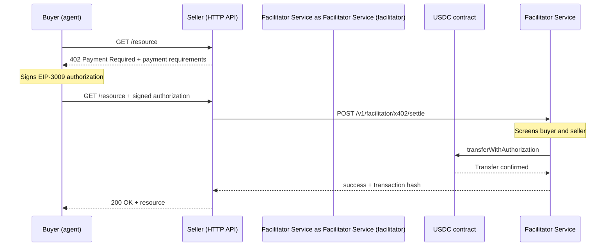
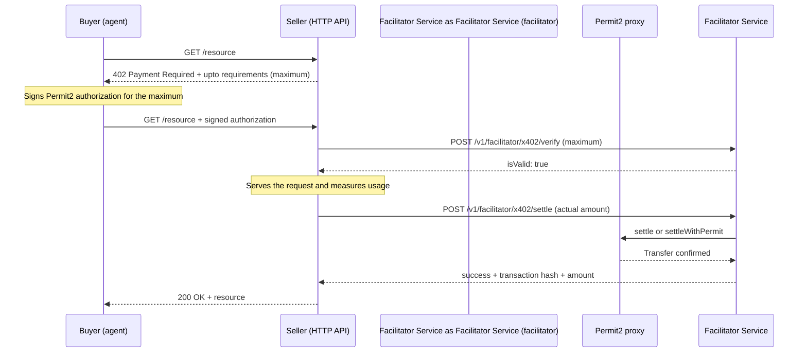

> ## Documentation Index
> Fetch the complete documentation index at: https://developers.circle.com/llms.txt
> Use this file to discover all available pages before exploring further.

> ## Agent Instructions
> Before reading these docs, install the relevant Circle Skill to get pre-loaded context — skills are LLM-optimized and cover architecture decisions, correct flows, and common pitfalls. In Claude Code: run /plugin marketplace add circlefin/skills then /plugin install circle-skills@circle. With Vercel Skills CLI: run npx skills add circlefin/skills. Available skills: use-usdc https://github.com/circlefin/skills/blob/master/plugins/circle/skills/use-usdc/SKILL.md (balances, transfers, approvals on EVM and Solana); EURC has no skill — see https://developers.circle.com/stablecoins/what-is-eurc.md; bridge-stablecoin https://github.com/circlefin/skills/blob/master/plugins/circle/skills/bridge-stablecoin/SKILL.md (crosschain transfers via CCTP, USDC, EURC, and third-party assets); use-arc https://github.com/circlefin/skills/blob/master/plugins/circle/skills/use-arc/SKILL.md (Arc chain config, contract deployment, USDC bridging — Arc docs: https://docs.arc.io/llms.txt); use-circle-wallets https://github.com/circlefin/skills/blob/master/plugins/circle/skills/use-circle-wallets/SKILL.md (choose wallet type); use-developer-controlled-wallets https://github.com/circlefin/skills/blob/master/plugins/circle/skills/use-developer-controlled-wallets/SKILL.md (custodial wallets for payouts and treasury); use-user-controlled-wallets https://github.com/circlefin/skills/blob/master/plugins/circle/skills/use-user-controlled-wallets/SKILL.md (embedded wallets with Web2 login); use-modular-wallets https://github.com/circlefin/skills/blob/master/plugins/circle/skills/use-modular-wallets/SKILL.md (smart contract wallets with passkeys and ERC-4337); use-gateway https://github.com/circlefin/skills/blob/master/plugins/circle/skills/use-gateway/SKILL.md (unified USDC balance, nanopayments); use-smart-contract-platform https://github.com/circlefin/skills/blob/master/plugins/circle/skills/use-smart-contract-platform/SKILL.md (deploy, interact, monitor contracts). Pair any skill with the Circle MCP server for live SDK signatures, contract addresses, and chain IDs: {"mcpServers":{"circle":{"url":"https://api.circle.com/v1/codegen/mcp"}}}.
> Read the product overview first. Each product has an overview explaining when and why to use it. Read it before quickstarts.
> Pick the right wallet type. Developer-controlled (you hold keys), user-controlled (end user holds keys via PIN/social login), or modular (smart contract wallets with passkeys). See https://developers.circle.com/wallets.md.
> Use CCTP V2 for crosschain transfers. CCTP natively transfers USDC and EURC via burn-and-mint, and supports permissionless wrapping of third-party assets via lock-and-mint. V1 is legacy; always use V2 unless V1 is specified or the chain requires it (Noble, Sui, and Aptos still require V1). Migration guide: https://developers.circle.com/cctp/migration-from-v1-to-v2.md.
> Use Bridge Kit for frontend bridging. Wraps CCTP with a simpler SDK for user-facing apps. Use CCTP directly for backend transfers.
> Gas Station vs Paymaster. Gas Station sponsors gas for Circle Wallet transactions. Paymaster lets users pay gas in USDC. Different use cases — read both overviews.
> Gateway Nanopayments for sub-cent payments. Gasless USDC micropayments down to $0.000001 via x402 and batched settlement. For pay-per-request APIs, AI agent payments, streaming.
> Look up USDC addresses per chain. Never hardcode — use https://developers.circle.com/stablecoins/usdc-contract-addresses.md.
> Prefer SDKs over raw API calls. Node.js and Python SDKs handle auth, retries, and errors.
> API key required. Bearer token in Authorization header. Testnet and mainnet use separate keys and may use different base URLs depending on the product.
> Set up webhooks when available. Most operations are async. Webhooks deliver transaction confirmations and state changes.
> When calling list endpoints, paginate using pageSize and pageAfter until no nextPageAfter cursor is returned—stopping at the first page silently misses records.
> Building an AI agent? Start with the Agent Stack—Circle CLI, agent wallets, and nanopayments built for autonomous use cases: https://developers.circle.com/agent-stack.md.

# How Facilitator Service works

> How Facilitator Service settles USDC payments as the facilitator between buyer and seller

Facilitator Service settles [x402](/x402-facilitators/x402) payments in USDC
after the buyer signs the authorization. It validates each signature, screens
both parties, and submits the transfer through a Circle relayer.

## Authentication

Facilitator Service requires a Circle [API key](/api-reference/keys#api-keys) to
settle payments. If you don't have one yet, create one in
[Circle Console](https://console.circle.com/).

You can also start without an API key using the
[keyless trial](/facilitator-service/keyless-trial), which authenticates with a
seller proof instead. The trial covers
[fixed-amount payments](#fixed-amount-payments) only, with an allowance that
applies until you settle with an API key.
[Usage-based payments](#usage-based-payments) always require an API key.

## Roles

Every Facilitator Service payment involves three actors:

* **Buyer**: an HTTP client, typically an AI agent, that signs a payment
  authorization to pay for a resource.
* **Seller**: an HTTP resource server that asks for payment before returning a
  result, then calls Facilitator Service to settle the buyer's authorization.
* **Facilitator**: screens both parties, submits the USDC transfer through a
  Circle relayer, and pays settlement gas.

## Supported buyer accounts

Facilitator Service accepts signatures from externally owned accounts (EOAs) and
from deployed smart contract accounts through
[ERC-1271](/gateway/references/erc-1271). Smart contract accounts that aren't
deployed yet (ERC-6492) are not supported. EOA signatures must use a `v` value
of 27 or 28.

## Payment schemes

Facilitator Service supports two x402 payment schemes:

* `exact` payments charge a fixed amount per request. The buyer signs for that
  amount, and the seller settles it.
* `upto` payments charge a variable amount per request. The buyer signs for a
  maximum, and the seller settles the actual amount after serving the request,
  from zero up to the maximum.

### Comparison table

Use `exact` when every request has a fixed price. Use `upto` when you can't know
the price until the work is done, such as per-token LLM completions, metered
compute, or bandwidth.

| | `exact` | `upto` |
| - | - | - |
| Amount | Fixed | Variable, from zero up to a maximum |
| Authorization standard | EIP-3009 `TransferWithAuthorization` | Permit2 `PermitWitnessTransferFrom` |
| Buyer prerequisite | None | A Permit2 approval on USDC, or a signed EIP-2612 permit |
| Zero-amount payments | Not supported | Supported |
| Settlement authentication | Circle API key or keyless trial | Circle API key only |

For blockchain availability, see
[Supported networks](/facilitator-service/supported-networks).

## Fixed-amount payments

Fixed-amount payments use the x402 `exact` scheme. The buyer signs an EIP-3009
authorization for a specific amount, and Facilitator Service submits a USDC
transfer for that same amount.

### Payment flow

1. A buyer requests a paid resource from the seller's API.
2. The seller returns `402 Payment Required` with the payment requirements.
3. The buyer signs an EIP-3009 authorization offchain and retries the request.
4. The seller sends the signed authorization to Facilitator Service using
   [`/settle`](/api-reference/facilitator-service/settle-payment).
5. Facilitator Service screens both parties. If either fails, it refuses to
   settle. Otherwise, it submits the USDC transfer through a Circle relayer.
6. Once confirmed, Facilitator Service returns the transaction hash to the
   seller, who fulfills the request.

Facilitator Service saves the payment record before broadcasting the
transaction, so a retry with the same identifier always resolves to the same
payment. This prevents double charges.

### EIP-3009 authorization

Facilitator Service uses [EIP-3009](https://eips.ethereum.org/EIPS/eip-3009) as
the payment primitive. The buyer signs a `TransferWithAuthorization` message
offchain, and Facilitator Service submits it to the USDC contract on the
payment's blockchain to move USDC from buyer to seller.

Before Facilitator Service submits the transaction, it validates the following:

* That the buyer's signature is valid
* That the buyer has sufficient USDC balance
* That the `to` address in the authorization matches the seller's `payTo`

Then Facilitator Service calls `transferWithAuthorization` on the USDC contract.

## Usage-based payments

Usage-based payments use the x402 `upto` scheme. The buyer signs a
[Permit2](https://github.com/Uniswap/permit2) authorization for a maximum
amount, and the seller settles the actual amount after serving the request.
Facilitator Service verifies the authorization against the maximum, then submits
a USDC transfer for the actual charge.

### Payment flow

1. The seller returns `402 Payment Required` with `upto` payment requirements.
   The `amount` is the most the seller may charge.
2. The buyer signs a Permit2 authorization for that maximum and retries the
   request.
3. The seller calls
   [`/verify`](/api-reference/facilitator-service/verify-payment) with
   `paymentRequirements.amount` set to the maximum.
4. The seller serves the request and works out the actual charge.
5. The seller calls
   [`/settle`](/api-reference/facilitator-service/settle-payment) with the same
   signed payload and `paymentRequirements.amount` set to the actual charge.
6. Facilitator Service screens both parties and submits the transfer for the
   actual amount through the x402 Permit2 proxy contract.

Facilitator Service does not meter usage. It accepts the amount you send to
`/settle` as long as it doesn't exceed the signed maximum.

### Buyer prerequisites

The Permit2 contract moves USDC on the buyer's behalf, so the buyer must first
grant Permit2 spending power over their USDC. The buyer can grant it with an
onchain approval, or with a signed EIP-2612 permit that the seller attaches to
each payment.

For how to set this up, see
[Set up a Permit2 allowance](/facilitator-service/set-up-permit2-allowance).

### Permit2 authorization

The buyer signs an EIP-712 `PermitWitnessTransferFrom` message under the Permit2
domain. The witness binds the authorization to the seller's `payTo` and to a
specific Circle facilitator wallet. Only that wallet can submit the settlement.

To retrieve facilitator addresses, use the
[Get supported x402 payment kinds](/api-reference/facilitator-service/get-supported)
endpoint.

### Repeat settlements

Each `upto` authorization settles at most once per Circle account. A repeat
`/settle` call with the same authorization returns the original payment rather
than a second charge, even if the amount differs. The only way to charge the
buyer again is a new authorization.

A `/settle` call conflicts with an existing payment when:

* A different Circle account already settled the authorization.
* The same account sends the authorization or `payment-identifier` again with
  different request details, such as `resource.url` or `maxTimeoutSeconds`.
* A different buyer's payment already uses the same `payment-identifier`.
* A different signed authorization reuses the same Permit2 nonce for the same
  buyer.

For the specific `HTTP 409` reason strings, see
[Facilitator Service errors](/api-reference/facilitator-service/errors).
