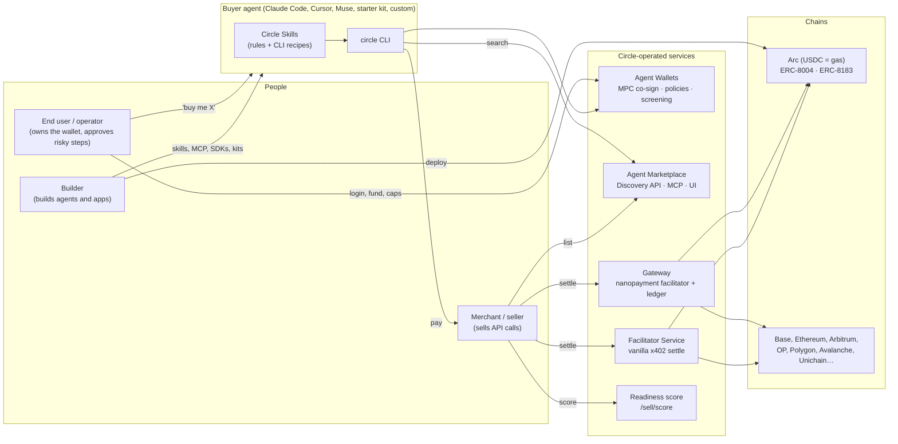
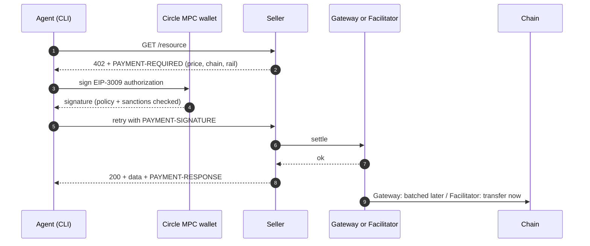
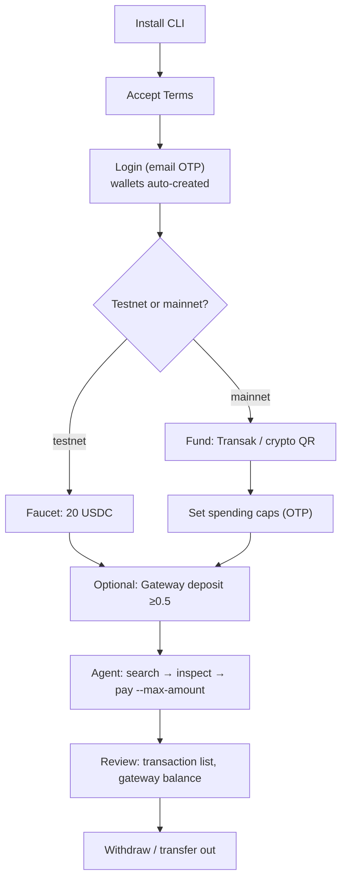
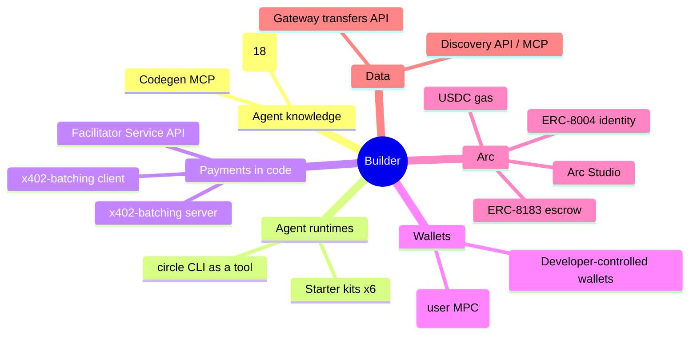
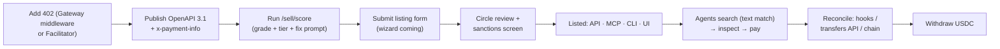

# Circle Agent Stack, by actor: what it lets each party do

- **What this is:** a first-principles map of what Circle's agent stack lets you do, organised by who you are.
- **Status:** as of 2026-10-10 (CLI 1.2.0).
- **Evidence base:** everything here was read in the docs, read in shipped code, or run on Zaryab's machine on 2026-10-09.
  - Evidence and raw outputs: `circle/` (start with `circle/discovery-and-ranking.md`, `circle/cli-playbook.md`, `circle/hands-on-log.md`).
- **Status tags:**
  - **LIVE**: works on mainnet today.
  - **TESTNET**: works on testnet; I ran it.
  - **HIDDEN**: behind a feature flag in the CLI.
  - **BUILT, NOT LIVE**: code or strings shipped, but not reachable.
  - **DOC ONLY**: documented, not tested by us.

---

## 0. Read this first: three limits

- **"Purchasing items" mostly means buying API calls.**
  - The catalog has 2,852 paid endpoints from 41 listing operators (2026-10-09). Most of them are data, search, LLM and infra APIs priced per request (median $0.10).
  - A handful touch the real world: reservations, gift-card refills, travel, domains.
  - There is no cart, no shipping, no returns and no product feed. Circle's stack is pay-per-call commerce, not retail checkout.
- **Most of the stack is Circle-operated.**
  - Circle runs the MPC co-signer, the spending-policy engine, the catalog, both facilitators, the nanopayment batcher and the telemetry.
  - "Open protocols" (x402, EIP-3009, CAIP-2) sit on top of Circle services.
- **Nothing in the stack checks quality.**
  - It checks compliance (sanctions), reachability (claimed) and readiness (schema).
  - It does not check whether a seller delivered what it charged for.

---

## 1. First principles: the five problems the stack solves

An agent that buys things needs five capabilities. Circle ships a component for each.

| # | Problem | Circle component | One-line mechanism |
| --- | --- | --- | --- |
| P1 | **Who may spend, and with what key?** | Agent Wallets (user-controlled, 2-of-2 MPC smart accounts) | Email OTP session → Circle co-signs every signature with the user's key share. The agent never holds a full key |
| P2 | **How does money get in?** | `wallet fund` (faucet / Transak / crypto QR), CCTP bridge, swap, Gateway deposit | USDC lands in the agent wallet, optionally moved into a Gateway balance |
| P3 | **How does the agent pay per request?** | x402 over two rails: Gateway Nanopayments (batched) and the Facilitator Service (per payment, on-chain) | Seller answers `402` → agent signs an EIP-3009 authorization → facilitator settles |
| P4 | **How does the agent find a seller?** | Agent Marketplace: Discovery API, marketplace MCP, CLI search, skills | One keyless catalog; fuzzy text search; no ranking |
| P5 | **How is risk contained?** | Spending policies, sanctions screening, `--max-amount`, Terms gate, readiness score | Server-side caps (mainnet), OFAC screening on every transfer and settle |

### 1.1 The whole stack in one picture



### 1.2 The two payment rails, side by side

Every purchase goes through one of these. Knowing which one is in play explains most behaviour.

| | **Gateway Nanopayments** | **Facilitator Service (vanilla x402)** |
| --- | --- | --- |
| What the buyer signs | EIP-3009 authorization against the **GatewayWallet** contract (domain `GatewayWalletBatched` v1), valid ≥ 7 days | EIP-3009 authorization against the **USDC** contract (domain `USDC` v2) |
| Who signs for an agent wallet | The wallet's backing EOA (through Circle MPC) | The smart account itself. It must be deployed: ERC-1271 yes, ERC-6492 no |
| Prerequisite | A Gateway deposit (CLI minimum 0.5 USDC) | USDC in the wallet |
| Settlement | Off-chain ledger. `submitBatch` on a ~16-minute tick (median 960 s, measured) | One on-chain transfer per payment. Arc has instant finality |
| Minimum payment | $0.000001 | Unpublished per-settle minimum |
| Fees | None per payment. 0.5 bps crosschain | Unpublished |
| Chains | 12 EVM mainnets + testnets | Arc, Base, Polygon PoS (+ testnets) |
| Seller needs | A payout address only (keyless) | A seller proof signed by the `payTo` key (keyless trial) or a Circle API key |
| Public trace | Per-payment records via a keyless `GET /v1/x402/transfers?to=` | USDC `Transfer` logs |



---

## 2. Actor 1: the end user (a human who wants things bought for them)

**Who.** You own the money and the identity. You either run the CLI yourself or let an agent run it for you. Your job is to set the agent up, fund it, cap it and approve the risky steps.

### 2.1 Features, in the order you meet them

1. **Connect any agent to Circle in one prompt.** LIVE.
   - **How:** paste into your agent: `Run curl -sL https://agents.circle.com/skills/setup.md, and use the returned setup instructions to set up my agent wallet.` Circle promotes this for Claude, Cursor and Meta's Muse.
   - **Enables:** the agent installs the CLI and the Circle skills, then walks you through Terms, login and funding.
   - **Caveat:** `setup.md` asks the agent to run in "full-access mode" and to install the skills globally. Doing it by hand is safer (step 2).
2. **Install the CLI.** LIVE.
   - **How:** `npm install -g @circle-fin/cli` (Node ≥ 20.18.2). Check with `circle --version` → `1.2.0`.
   - **Enables:** every capability below. The CLI is the agent's single tool.
3. **Accept the Terms (a legal gate).** LIVE.
   - **How:** `circle terms show --init --output json` (shows the URLs), then `circle terms accept`. A human does this.
   - **Enables:** every non-help command. Without it, even free catalog search is blocked in the CLI. The raw API stays open.
4. **Log in and get wallets automatically.** LIVE / TESTNET.
   - **How:**
     - Mainnet: `circle wallet login <email> --type agent`.
     - Testnet: add `--testnet`. It works but is missing from `--help`.
     - Agent-friendly two-step form: `--init`, then `--request <id> --otp <code>`.
     - Check with `circle wallet status`.
   - **Enables:**
     - A 28-day session, stored in the OS keychain. Mainnet and testnet sessions are separate.
     - The first login **auto-creates one smart-account wallet on every supported EVM chain**: Ethereum, Base, Arbitrum, OP, Polygon, Avalanche, Unichain, Monad, Arc.
     - Up to 5 wallets per chain (`circle wallet create`).
   - **Custody:** 2-of-2 MPC. Circle holds one share, your credential unlocks the other. Neither the agent nor Circle can move funds alone. Every transfer is sanctions-screened.
5. **Fund the wallet.** LIVE / TESTNET.
   - **How:**
     - Testnet: `circle wallet fund --address <W> --chain ARC-TESTNET` → 20 USDC in about 20 s (done on 2026-10-09).
     - Mainnet fiat: `--method fiat` (Transak; not on ARC).
     - Mainnet crypto: `--method crypto` (EIP-681 QR, `--open` or `--export`).
     - Check with `circle wallet balance --address <W> --chain <C>`.
   - **Enables:** USDC for payments. Gas is sponsored ($0, "subject to fair use"). On Arc, USDC is the gas token.
6. **Move funds to where sellers are.** LIVE.
   - **Bridge:** `circle bridge transfer <toChain> --amount <x> --address <W> --chain <from>`. CCTP with Circle's Forwarding Service: fee $0.05 + destination gas, ~8–20 s, no gas needed on the destination. Check fees with `circle bridge get-fee`.
   - **Swap:** `circle wallet swap USDC 1 EURC [minOut] --chain <C>`. 2 bps fee, 3% default slippage, `--quote` to preview.
   - **Enables:** paying a seller who accepts a different chain or token.
7. **Open a Gateway balance (for nanopayments).** LIVE / DOC ONLY.
   - **How:**
     - `circle gateway deposit --amount ≥0.5 --address <W> --chain <C> --method direct|eco`.
     - `direct` is an on-chain deposit on the same chain.
     - `eco` is a fast, gasless single-use vault from Base, Arbitrum or OP. It settles on Arc. An Eco fee applies.
     - Check with `circle gateway balance --address <W> --chain <C> --all`.
   - **Enables:** gasless payments down to $0.000001, signed offline, settled in batches.
8. **Cap what the agent can spend.** LIVE (mainnet only).
   - **How:**
     - Set: `circle wallet limit set --address <W> --chain <C> --policy-type stablecoin --per-tx 0.05 --daily 1 --weekly 2 --monthly 2`. You type the email OTP.
     - Allow or block lists: `--rule-type recipient-allowlist|recipient-blocklist|contract-allowlist|contract-blocklist --targets "[0x…]"`.
     - View: `circle wallet limit`. Remaining budget: `limit budget`. Reset: `limit reset` (OTP).
   - **Enables:** a server-side cap enforced by Circle's wallet backend before it co-signs.
   - **Caveats:**
     - There are no policies on testnet. `limit` on ARC-TESTNET is rejected (tested).
     - The docs disagree on whether caps are per chain or EVM-wide.
     - Default caps exist but their values are undocumented.
     - Circle's live `wallet-policy.md` has the agent relay your OTP. Type it yourself.
9. **Let the agent find services.** LIVE.
   - **How:** `circle services search "<need>" [--category …] [--limit 50]`.
   - **Enables:** one search over the whole marketplace.
   - **What you get:**
     - Unranked results: alphabetical by URL with no query, fuzzy text relevance with one.
     - The CLI always hides SIWX (sign-in) services: 209 endpoints, including all of Quicknode.
10. **Check a service before paying.** LIVE.
    - **How:** `circle services inspect <url>`.
    - **Enables:** a live unpaid probe that reports price, chains, rail, input schema, and `payable / free / unavailable / unsupported`.
    - **Caveat:** in our 74-endpoint sample, about 10% of live prices or payees differed from the catalog. Trust the probe, not the listing.
11. **Pay per call, with a ceiling.** LIVE.
    - **How:** `circle services pay <url> --address <W> --chain <C> [-X POST -d '{…}'] --max-amount 0.01`. `--estimate` shows the cost without paying.
    - **Enables:** a full x402 round trip in one command.
      - The CLI prefers Gateway.
      - It falls back to vanilla on the same chain if your Gateway balance is short (new in 1.2.0).
      - It enforces `--max-amount`.
    - **Caveats:** payment happens before the seller runs its handler. If the seller then fails, you have paid and there is no refund path. Debug logs go to `~/.circle-cli/payments/`.
12. **Review, cancel or speed up transactions.** LIVE.
    - **How:** `circle transaction list --address <W> --chain <C>`, `transaction cancel <id>`, `transaction accelerate <id>`.
13. **Get money back out.** LIVE.
    - **How:** `circle gateway withdraw --amount <x> --address <W> --chain <C>` (same chain only), then `circle wallet transfer <to> --amount <x> --token <USDC> --address <W> --chain <C>`.
14. **Control your data.** LIVE.
    - **How:** `circle telemetry disable`, or `DO_NOT_TRACK=1`. It is on by default and sends command, outcome, wallet ID and paid-URL host to Datadog.
    - `circle wallet logout` clears both sessions.
15. **Earn yield on idle USDC.** LIVE, local wallets only.
    - **How:** `circle earn deposit --amount <x> --address <W> --chain <C> --vault <0x…>` (Morpho vaults).
    - **Caveat:** not available for agent wallets yet.
16. **Borrow against crypto.** HIDDEN.
    - **How:** `CIRCLE_EXPERIMENTAL_CREDIT=1 circle wallet borrow …`. Morpho cirBTC/USDC market on Arc: `market`, `open`, `add-collateral`, `repay`, `close`.
    - **Enables (later):** agent working capital. Circle's CPO: agents "will be getting credit very soon".

### 2.2 The user's journey



### 2.3 What the user cannot do today

- See any rating, usage count, uptime or reputation for a seller.
- Get a refund through the stack. Disputes go to the seller (ToU §8.4).
- Set spending caps on testnet.
- Pay SIWX-gated sellers through the CLI.
- Pay on Sonic, Sei, HyperEVM, World Chain, Solana or Monad through the CLI, although Gateway supports some of them.

---

## 3. Actor 2: the buyer agent (the software that spends)

**Who.** The LLM agent running in a harness. Circle treats it as a first-class customer: "the first full suite where AI agents themselves are the customers."

### 3.1 What the agent can do alone vs what needs the human

| Action | Agent alone? | Why |
| --- | --- | --- |
| Search, inspect, read balances | Yes | Read-only |
| Pay, deposit, transfer, bridge, swap | Yes, within caps | Co-signed by Circle MPC with the session key; mainnet caps checked server-side |
| Accept the Terms | **No** | Legal consent. Circle's `setup.md` forbids the agent from doing it |
| Log in | Needs the human's OTP | Identity |
| Set or reset spending caps | Needs a fresh human OTP | The control is meant to be human-only (but see the OTP-relay caveat) |
| Submit feedback | Needs a mainnet session | `circle feedback submit` |

### 3.2 Features, in order

1. **Load Circle's playbook as skills.** LIVE.
   - **How:** `circle skill install --tool claude-code`, `npx skills add circlefin/skills`, or the Claude Code plugin `circle-skills@circle`.
   - The live skill files sit at `agents.circle.com/skills/*.md`.
   - **Enables:** recipes for login, funding, paying and failure recovery.
   - **Built-in behaviour rules:**
     - "search the marketplace first" for every task needing an external API;
     - use the marketplace "as a rescue" before declining;
     - pay "routine micropayments below a few cents" without confirmation.
2. **Discover through three equivalent surfaces.** LIVE.
   - **CLI:** `circle services search` (50 per page, SIWX hidden).
   - **MCP:** `https://agents.circle.com/api/mcp`, tools `search_agent_marketplace_services` (10 by default) and `get_agent_marketplace_service`.
   - **HTTP:** `GET https://api.circle.com/v2/x402/discovery/resources` (keyless; filters `query, category, network, asset, scheme, payTo, maxUsdPrice, supportsCircleGateway, supportsVanillax402, siwx, limit ≤200, offset`).
   - **Enables:** the same answer everywhere. All three read one backend.
3. **Pay autonomously over x402.** LIVE.
   - Same command as §2.1 item 11.
   - The agent handles chain choice, rail choice and the failure table in `wallet-pay.md`. The table covers no Gateway balance, wrong chain, wallet not deployed, header-gated sellers, 405 after payment, and more.
4. **Sign arbitrary messages and typed data.** LIVE.
   - **How:** `circle wallet sign message …`, `circle wallet sign typed-data '<json>' …`.
   - **Enables:** custom x402 schemes, SIWX logins, off-chain agreements.
5. **Act on-chain beyond payments.** LIVE / experimental.
   - **How:** `circle wallet execute "<fn sig>" <args> --contract <0x> …` and `circle contract deploy --bytecode … [EXPERIMENTAL]`.
   - **Enables:** escrow (for example ERC-8183 jobs on Arc testnet), approvals, any contract call from the smart account.
6. **Report friction to Circle.** LIVE (mainnet session).
   - **How:** `circle feedback submit "<text>" [--category BUG]`. The message is scrubbed for secrets.

---

## 4. Actor 3: the builder (you build agents, apps or tooling on the stack)

**Who.** A developer who wires Circle into an agent framework, builds an agent app that pays, or builds on Arc.

### 4.1 Features, in order

1. **Give coding agents Circle knowledge.** LIVE.
   - **How:**
     - Claude Code plugin: `/plugin marketplace add circlefin/skills`, then `/plugin install circle-skills@circle`. This adds 18 skills plus the codegen MCP.
     - Or `npx skills add circlefin/skills -s <skill>` (selective).
     - Or the MCP alone: `claude mcp add --transport http circle https://api.circle.com/v1/codegen/mcp`.
   - **Enables:** correct Circle SDK code. There are 11 code-gen skills (USDC, CCTP bridge, Gateway, Arc, wallets, smart-contract platform, swaps) and 7 agent-flow skills.
   - **Caveat:** two agent-flow skills pre-approve `circle services pay *` and `curl -s *`. Install selectively.
2. **Drop a paying agent into a framework.** LIVE (demo grade).
   - **How:** `circlefin/agent-stack-starter-kits`: LangChain Deep Agents, Claude Agent SDK, OpenAI Agents SDK, Vercel AI SDK, Google ADK, Mastra.
   - **Enables:** a working agent with a shell that runs `circle`, plus y/N approval on spending commands.
   - **Caveats:**
     - The kits log in to **mainnet** despite their "Arc testnet only" note.
     - The approval regex misses `earn`, `contract deploy` and `wallet fund`.
     - There is no `--max-amount`.
3. **Build a buyer in code, without the CLI.** LIVE.
   - **How:** `@circle-fin/x402-batching/client`:
     ```ts
     import { GatewayClient } from "@circle-fin/x402-batching/client";
     const client = new GatewayClient({ chain: "arcTestnet", privateKey: process.env.PK as `0x${string}` });
     await client.deposit("1.00");
     const { data, status } = await client.pay("https://seller.example/premium");
     ```
   - **Enables:** gasless nanopayments from your own EOA. No Circle account is needed.
4. **Give your agents managed wallets.** DOC ONLY.
   - **How:** Circle developer-controlled wallets (`@circle-fin/developer-controlled-wallets`; Console account + API key + entity secret). Arc's "register your first AI agent" tutorial uses them.
   - **Enables:** custodial wallets you control for a fleet of agents. This is the alternative to user-controlled agent wallets.
5. **Give agents an on-chain identity and reputation.** LIVE contracts, unused by Circle.
   - **How:** ERC-8004 registries on Arc.
     - Mainnet Identity `0x8004A169…a432`, Reputation `0x8004BAa1…9b63`, Validation `0x8004Cc84…AB58`.
     - Calls: `register` → `ownerOf/tokenURI`; `giveFeedback(...)` from a non-owner; `validationRequest/Response`.
   - **Enables:** portable agent IDs and feedback.
   - **Reality:**
     - 2,316 agents on Arc mainnet; 80.7% come from two bulk registrants.
     - The canonical ERC-8004 owner EOA controls the contracts, not Circle.
     - No Circle product reads them.
6. **Escrow work between agents.** TESTNET.
   - **How:** ERC-8183 `AgenticCommerce` on Arc testnet (`0x0747EEf0…4583`). It "creates jobs, holds USDC in escrow, and settles payment after evaluation."
   - Related samples:
     - `arc-escrow`: an AI model verifies deliverables before release.
     - `arc-ecommerce-payments`: Commerce Payments Protocol with authorize, capture, void and refund.
   - **Enables:** pay-on-delivery, which x402's settle-first model lacks.
7. **Build and deploy Arc apps with a hosted coding agent.** LIVE (testnet deploys).
   - **How:** Arc Studio (`studio.arc.io`) or `@circle-fin/arc-studio-cli` (`arc-studio login`, `arc-studio run`). It needs an account and has usage billing.
   - **Enables:** Circle's sandboxed agent writes, audits and deploys full-stack apps to Arc testnet.
8. **Build discovery or routing on the catalog.** LIVE (terms-limited).
   - **How:** the Discovery API or MCP (above). The CLI also honours `CIRCLE_DISCOVERY_URL`, so it can point at a different index with the same schema.
   - **Enables:** Circle's blog invites "an agent framework [to] route a task to the cheapest healthy provider."
   - **Limit:** the Terms forbid scraping, mirroring, redistribution or derivative works of the platform. Query live; don't mirror.
9. **Read payment outcomes.** LIVE.
   - **How:** `GET https://gateway-api.circle.com/v1/x402/transfers?to=<payTo>&startDate=…&pageSize=100` (keyless).
   - **Enables:** per-payment buyer, amount, status (`received → batched → completed`) and batch `txHash` for any Gateway seller. Useful for reconciliation, analytics and trust scoring.
10. **Move USDC across chains in apps.** LIVE.
    - **How:** the CCTP V2 skills and Bridge Kit / App Kit (`bridge-stablecoin`, `unify-balance`), or `circle bridge transfer` from the CLI.

### 4.2 The builder's toolbox at a glance



---

## 5. Actor 4: the merchant (you sell API calls to agents)

**Who.** You run an HTTP API and want agents to pay you per request in USDC, and to find you.

### 5.1 Features, in order

1. **Become payable with Gateway Nanopayments.** LIVE, no account.
   - **How** (Express):
     ```ts
     import express from "express";
     import { createGatewayMiddleware } from "@circle-fin/x402-batching/server";
     const app = express();
     const gateway = createGatewayMiddleware({
       sellerAddress: "0xYOUR_PAYOUT",
       facilitatorUrl: "https://gateway-api-testnet.circle.com", // omit = MAINNET (since 3.0.0)
       networks: ["eip155:5042002"],                            // omit = all 12 Gateway chains
     });
     app.get("/premium", gateway.require("$0.001"), (req, res) => res.json({ ok: true }));
     ```
     Built and verified on 2026-10-09: `circle/sandbox/test-seller/gateway-seller.mjs`.
   - **Enables:** accept gasless sub-cent payments from any buyer with a Gateway balance on 12 chains. No per-payment fee is published.
   - **Caveats:**
     - It settles **before** your handler runs, and there is no refund call.
     - Funds become available after the batch, on a ~16-minute tick.
2. **Become payable with the Facilitator Service (vanilla x402).** LIVE, keyless trial.
   - **How:**
     - Return a standard x402 v2 `402` (`exact`, USDC, `eip155:5042|8453|137` or testnets).
     - On payment, call `POST https://api.circle.com/v1/facilitator/x402/verify` then `/settle`.
     - Send header `Facilitator-Seller-Proof`: a base64url EIP-712 `SellerRequest` signed by your `payTo` key, bound to purpose, method, bodyHash, network, nonce and a 5-minute expiry.
     - Built and verified: `circle/sandbox/test-seller/vanilla-seller.mjs`.
   - **Enables:** on-chain settlement per payment on Arc, Base or Polygon, with no Circle account, until `403 registration_required`. Then use a Console API key, which binds your history to your account.
   - **Caveats:**
     - The trial size, fees and minimum are unpublished.
     - Keyless mode needs the `payTo` private key on your server.
     - The trial applies on mainnet too.
3. **Use any other x402 path.** LIVE.
   - **How:** `@x402/express` with any facilitator, or Circle's listed third-party tools: Blockrun (directory), Proceeds (x402 + nanopayments + MPP on Arc), Sponge (x402 + MPP), x402scan (registry).
   - **Enables:** being payable outside Circle's facilitators. Circle's marketplace lists vanilla-x402 sellers too (709 endpoints are vanilla-only).
4. **Make the API machine-legible.** LIVE.
   - **How:** serve OpenAPI 3.1 at `/openapi.json` with `x-payment-info`, input schemas, `info.x-guidance` (~1,000 tokens), a contact email and a docs URL. Accept 2+ networks.
   - **Enables:** agents and Circle's checks understand what you sell and how to call it.
5. **Score your readiness.** LIVE, free, no signup.
   - **How:** `https://agents.circle.com/sell/score` → enter your public URL. Localhost and private hosts are blocked.
   - **Enables:**
     - A grade out of 100 across 3 dimensions (Discovery & Structure, Payment Readiness, Agent Consumability) and 12 checks.
     - A trust tier: Unverified → Origin-hosted → Ownership-verified → Runtime-verified.
     - A "fix-it prompt" to paste into Claude or Cursor.
   - **Caveat:** it measures readiness, not delivery quality.
6. **Get listed in the Agent Marketplace.** LIVE (manual).
   - **How:** submit the Google Form (`forms.gle/7YFzvdmMcn1JH5tF6`) with your endpoint, payout wallet and description.
   - **Review:** Circle reviews your 402, your OpenAPI spec and a sanctions screen of the payout wallet. No timeline or criteria are published.
   - **Enables:** you appear in the Discovery API, the MCP, CLI search, the web UI, the A2A card, and Circle's editorial posts.
   - **Coming:**
     - A self-serve wizard (Endpoint → Metadata → Verify → Launch → "Go live") is BUILT, NOT LIVE.
     - UI copy says "Once a paid call settles, Circle also indexes you automatically."
7. **Be found.** LIVE.
   - **How it works today:** there is no ranking.
     - Unqueried lists sort by URL alphabetically.
     - Queries use fuzzy text relevance across URL, provider name, descriptions, tags and category.
   - **What you control:** your description and tags, your category (note: `DATA_ENRICHMENT` cannot be filtered by any surface today), and avoiding SIWX if you want CLI buyers to see you.
8. **Reconcile and get paid.** LIVE.
   - **How:**
     - Gateway: lifecycle hooks (`onAfterSettle`, …); the transfers API `?to=<payTo>`; withdraw via the SDK.
     - Facilitator: USDC lands directly in `payTo`; poll `/status/{paymentId}`.
   - **Enables:** accounting per request.
   - **Missing:** there is no seller dashboard. Your Gateway payment history is also readable by anyone through the keyless transfers API.
9. **Keep 100% of revenue.** LIVE.
   - **How it works:** ToU §8.4 says fees are "owed and paid directly to the applicable Service Provider and not to Circle." No marketplace take rate is published.
10. **Stay listed.** LIVE.
    - **Rules:** you must stay reachable (health checks) and pass sanctions screening.
    - Circle may remove any listing "at any time in its sole discretion."

### 5.2 Merchant journey



### 5.3 Reality check for a new merchant (measured 2026-10-09)

- **Becoming payable is fast.** From an empty folder to a valid testnet 402 on both rails took about 3 minutes of work.
- **Demand is thin.**
  - Over 30 days, catalog Gateway sellers together took $58.89 from 68 buyers.
  - 21 of 51 Gateway payout addresses earned nothing.
- **There is no testnet demand.** No catalog service accepts Arc testnet, so your first testnet sale is to yourself.

---

## 6. Other actors

### 6.1 Circle, as the operator

| Role | What Circle does | What it sees |
| --- | --- | --- |
| MPC co-signer | Holds one key share and co-signs every agent-wallet signature | Every payment authorization, on both rails |
| Policy engine | Enforces spending caps server-side (mainnet) | Each wallet's spend history |
| Compliance | Sanctions-screens transfers, settlements and listings | Both parties |
| Catalog curator | Reviews listings, health-checks, posts editorial spotlights | What agents search for (API logs) |
| Gateway facilitator + batcher | Keeps the off-chain ledger. A Nitro Enclave signer posts `submitBatch` every ~16 min via one relayer | Every nanopayment before it hits the chain |
| Facilitator Service | Settles vanilla x402 on Arc, Base and Polygon | Each settled payment |
| CLI vendor | Remote minimum-version policy (it can block old CLIs) and Datadog telemetry (opt-out) | Command usage and paid-URL hosts, if telemetry is on |
| Arc operator | Runs the L1 where USDC is gas. PoA validators today, PoS planned for 2027 | Arc chain activity |

### 6.2 Resellers and aggregators

- **Who:** operators that wrap other APIs and resell them per call over x402.
  - AIsa API lists 1,581 endpoints (55% of the catalog), wrapping TikHub, DataForSEO, Apollo, OpenMeteo and model-grounded search.
  - Orthogonal (294 endpoints) and BlockRun (138) are others.
- **What the stack lets them do:** list hundreds of endpoints under one operator, accept both rails, and appear in many categories.
- **Effect:** endpoint counts measure wrapping, not supply. Many "services" in the UI are one operator.

### 6.3 Third-party discovery and ranking builders

- **What the stack offers:**
  - A keyless Discovery API and MCP, 1-hour cacheable, 200 per page.
  - The keyless Gateway transfers API (outcome data).
  - A CLI override (`CIRCLE_DISCOVERY_URL`) so agents can point `circle services search` at another schema-compatible index.
- **What limits them:** the Agent Platform ToU §15 (no scrape, mirror, redistribute or derivative works) and the Developer Terms (no "substantially the same" service).
  - Circle's vision paper still invites "multiple rankers competing over the same substrate."

### 6.4 Infrastructure partners in the money path

| Actor | Role |
| --- | --- |
| Eco | Fast-deposit vaults into Gateway (`--method eco`). "Circle does not operate or audit" it |
| Transak | Fiat onramp for `wallet fund --method fiat` |
| Morpho | Yield vaults (`earn`) and the hidden credit market (`borrow`) |
| CCTP / Iris | Burn-and-mint bridging with fast attestation |
| ERC-8004 owner (`0x5472…2603`) | Controls the identity, reputation and validation registries on Arc, Base and Ethereum |
| Arc validators | PoA set (named in Circle's launch: BlackRock, Visa, Mastercard, among others) |

### 6.5 Harness and platform vendors

- **Claude Code, Cursor, Codex:** native Circle plugin manifests.
- **Windsurf, OpenCode, Amp:** reached via `npx skills`.
- **Meta Muse:** promoted by Circle through the `setup.md` prompt.
- **What the stack lets them do:** give every user an agent that can pay, with Circle's skills deciding when the marketplace is consulted.

---

## 7. Summary matrix

| Capability | End user | Buyer agent | Builder | Merchant | Status |
| --- | --- | --- | --- | --- | --- |
| MPC smart-account wallets on 9 chains | own | operate | integrate | — | LIVE |
| Faucet / fiat / crypto funding | ✓ | asks user | — | — | LIVE / TESTNET |
| Bridge (CCTP) and swap | ✓ | ✓ | ✓ (kits) | — | LIVE |
| Gateway deposit / withdraw | ✓ | ✓ | ✓ (SDK) | withdraw | LIVE |
| Spending caps and allow/block lists | set (OTP) | bound by | — | — | LIVE, mainnet only |
| Catalog search (API / MCP / CLI) | ✓ | ✓ | build on (terms) | be listed | LIVE |
| Live pre-pay probe (`inspect`) | ✓ | ✓ | — | — | LIVE |
| Pay per call (x402, two rails) | ✓ | ✓ | ✓ (SDK) | accept | LIVE |
| Keyless seller onboarding | — | — | — | ✓ | LIVE |
| Readiness score + trust tier | — | — | — | ✓ | LIVE |
| Listing | — | — | — | form (wizard coming) | LIVE / BUILT, NOT LIVE |
| Payment-outcome feed | — | — | ✓ | ✓ (and everyone else) | LIVE, keyless |
| ERC-8004 identity / reputation | — | possible | ✓ | possible | LIVE contracts, unused |
| ERC-8183 escrow | — | possible | ✓ | possible | TESTNET |
| Yield (Morpho) | local wallets | — | — | — | LIVE, limited |
| Credit (Morpho cirBTC/USDC) | — | — | — | — | HIDDEN |
| Hosted coding agent (Arc Studio) | — | — | ✓ | — | LIVE, testnet deploys |
| Ratings / reputation / refunds | ✗ | ✗ | ✗ | ✗ | not offered |

---

## 8. So what for v2

- **Indexing:** Circle is one curated source of 41 operators. Its admission looks set to move toward "one settled payment." v2 should not depend on Circle staying gated.
- **Retrieval:** every actor's discovery path converges on one fuzzy-text backend. The `CIRCLE_DISCOVERY_URL` override is a neutral door for a schema-compatible v2.
- **Ranking:** no actor gets a merit order today. The slot is empty.
- **Verification:** no actor gets delivery evidence. Payments settle before service, and nothing records the gap. That is v2's clearest opening.
- **New merchants:** they are payable in minutes and listable by form. Then they are found by text and the alphabet. Demand, not incumbency, binds.
- **Bets:**
  - Bet 2 (someone consults a signal) is where Circle is strongest: its skills tell agents to search its catalog first.
  - Bet 3 (not buyable or editable) is where Circle is weakest: its order is seller-editable text.
- **Competitive threat:** high. Circle sees every payment it co-signs and every nanopayment it batches.
- **Steal:** the keyless seller proof (EIP-712 over purpose, body hash, payee and expiry). It lets a merchant prove control of a payout address with no signup.
- **Avoid:** presenting readiness checks as trust.

## Sources

- Hands-on, 2026-10-09: `circle/hands-on-log.md`, `circle/data/` (catalog snapshot, MCP calls, Gateway transfers, claim probe, on-chain notes), `circle/sandbox/test-seller/`.
- CLI 1.2.0 help and source map: `circle/cli-command-tree.md`.
- Circle docs and pages, read 2026-10-09: listed in `circle/sources.md`. Key pages:
  - developers.circle.com agent-stack, facilitator-service and gateway-nanopayments pages;
  - agents.circle.com `/sell/score` and `/terms-of-use`;
  - the vision paper (2026-08-12) and the Discovery API blog (2026-09-09).
- Repos: `circlefin/skills` @58ab864, `agent-stack-starter-kits` @3996330, `arc-nanopayments` @a29f920; `@circle-fin/x402-batching` 3.5.0 tarball.
- Deeper analysis by topic:
  - `circle/discovery-and-ranking.md`
  - `circle/merchant-experience.md`
  - `circle/buyer-experience.md`
  - `circle/trust-and-verification.md`
  - `circle/architecture.md`
