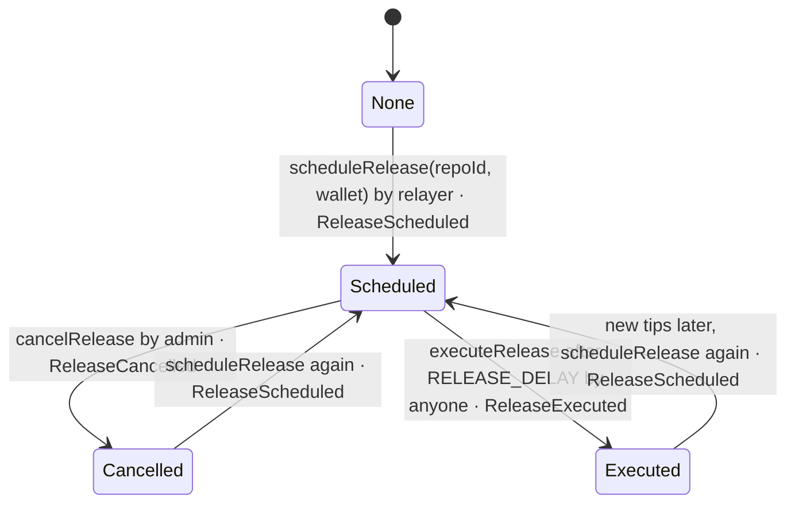

# `BuilderEscrow` and `RecipeSplits` (spec 03, Phase 2)

- **Date:** 2026-10-18
- **Status:** draft. **Phase 2** (D29: Phase 1 pays merchants and specialist agents only; D24: builder tipping is low priority). Specified fully so spec 05 can schedule it.
- **Decisions:** D9 (tips, one per tool), D17 (Czar runs the claim server), D19 (unclaimed tips stay claimable), D20 (no sponsor pool), D23 (GitHub sign-in or committed file; escrow keyed by repo id; claim server approves; relayer releases), D24, D29.
- **Primary source read this session:** `0xSplits/splits-contracts-monorepo` @ `efec4ac4` (2026-10-02): `packages/splits-v2/src/splitters/SplitFactoryV2.sol`, `splitters/push/PushSplitFactory.sol`, `splitters/push/PushSplit.sol`, `libraries/SplitV2.sol`.
- **Shared types:** `repoId` (spec 02 §7.1), `Amount6`, `PayeeLeaf` kind `3` (spec 02 §4.7).

---

## Part A. `BuilderEscrow`

### A.1 Purpose and phase

- Holds USDC tips for open-source builders, keyed by `repoId = keccak256(utf8("github:" + <numeric repo id>))` (spec 02 §7.1), until the builder proves control of the repo (D23) and Czar's claim server (CZ-21, K9) schedules a release.
- A release is public and delayed, so a leaked relayer key becomes a visible, cancellable event rather than a loss (spec 01 §8.6, K9).
- Tippers never get refunds (D19). There is no shared pool (D20).
- Phase 2. Czar admin role is Ownable2Step (OpenZeppelin v5.7.0).

### A.2 Roles and permissions

The vault roles from spec 01 §7.1 apply only to the vault. `BuilderEscrow` has its own roles; the vault is just a depositor.

| Action | Vault (`agentSigner` via `tip`) | Relayer (K9, `RELAYER_ROLE`) | Admin (Ownable2Step, K20-class key) | Anyone |
|---|---|---|---|---|
| `deposit(repoId, amount)` | yes (any address may deposit) | yes | yes | yes |
| `scheduleRelease(repoId, wallet)` | no | yes | no | no |
| `cancelRelease(repoId)` | no | no | yes | no |
| `executeRelease(repoId)` | no | yes | yes | yes (after the delay) |
| `setRelayer`, `pause`, `unpause` | no | no | yes | no |
| reads | yes | yes | yes | yes |

### A.3 Constants and immutables

| Name | Value | Reason |
|---|---|---|
| `USDC` (immutable) | `0x3600000000000000000000000000000000000000` | A1-01; the only token |
| `RELEASE_DELAY` | `48 hours` | long enough for monitoring and an admin cancel (spec 01 §8.6 "e.g. 48 h"); moderate confidence |
| `MIN_TIP` | `10_000` (0.01 USDC) | keeps dust from bloating storage; D9 tips are "one per tool" |
| `MAX_ACTIVE_RELEASES_PER_REPO` | `1` | one scheduled release at a time per repo |

### A.4 Storage layout

| Variable | Type | Meaning | Written by |
|---|---|---|---|
| `balance` | `mapping(bytes32 repoId => uint256)` | unclaimed USDC per repo (6-dec units) | `deposit` (+), `executeRelease` (−) |
| `release` | `mapping(bytes32 repoId => Release{address wallet; uint64 executableAt; uint8 state})` | the active release | `scheduleRelease`, `cancelRelease`, `executeRelease` |
| `relayer` | `address` | the claim server's relayer key | `setRelayer` |
| `paused` | `bool` | | `pause`/`unpause` |
| `totalHeld` | `uint256` | Σ `balance` (for the solvency invariant) | deposit / execute |

### A.5 Functions

| Function | Caller | Preconditions (in order) | State changes | External calls | Events | Errors | Reentrancy | Gas (est., 20 Gwei) |
|---|---|---|---|---|---|---|---|---|
| `deposit(bytes32 repoId, uint256 amount)` | anyone (the vault's `tip`, spec 03 vault) | 1. not paused. 2. `repoId != 0`. 3. `amount ≥ MIN_TIP`. 4. caller approved `amount` to the escrow. | `balance[repoId] += amount`; `totalHeld += amount` | `USDC.safeTransferFrom(msg.sender, this, amount)`; balance-delta check (`received == amount`) | `Tipped(repoId, from, amount, newBalance)` | `Paused`, `ZeroRepo`, `TipTooSmall`, `UnexpectedAmount` | `nonReentrant` (external token call) | ≈ 70k ≈ 0.0014 USDC |
| `scheduleRelease(bytes32 repoId, address wallet)` | relayer | 1. not paused. 2. `msg.sender == relayer`. 3. `wallet != 0`. 4. `balance[repoId] > 0`. 5. `release[repoId].state ∈ {None, Executed, Cancelled}` (no active one). | `release[repoId] = {wallet, now + RELEASE_DELAY, Scheduled}` | none | `ReleaseScheduled(repoId, wallet, executableAt, amountAtSchedule)` | `NotRelayer`, `ZeroWallet`, `NothingToRelease`, `ReleaseActive` | none | ≈ 50k |
| `cancelRelease(bytes32 repoId)` | admin | 1. `release[repoId].state == Scheduled` | state → Cancelled | none | `ReleaseCancelled(repoId, wallet)` | `NotScheduled` | none | ≈ 30k |
| `executeRelease(bytes32 repoId)` | anyone | 1. not paused. 2. state == Scheduled. 3. `block.timestamp ≥ executableAt`. 4. `balance[repoId] > 0`. | `amount = balance[repoId]`; `balance = 0`; `totalHeld −= amount`; state → Executed (effects before the transfer) | `USDC.safeTransfer(wallet, amount)` | `ReleaseExecuted(repoId, wallet, amount)` | `Paused`, `NotScheduled`, `DelayNotElapsed`, `NothingToRelease` | `nonReentrant`; checks-effects-interactions | ≈ 60k |
| `setRelayer(address)` | admin | non-zero | `relayer = x` | none | `RelayerSet(old, new)` | `ZeroWallet` | none | ≈ 30k |
| `pause()` / `unpause()` | admin | — | `paused` | none | `Paused(account)` / `Unpaused(account)` (OZ Pausable) | — | none | ≈ 25k |
| `balanceOf(bytes32 repoId) → uint256`, `releaseOf(bytes32 repoId) → Release` | anyone (view) | — | — | — | — | — | — | view |

- Deposits that arrive while a release is Scheduled are included at execution (`balance` is read at execute time). The `ReleaseScheduled` event carries `amountAtSchedule` only for monitoring.
- A USDC blacklist on `wallet` makes `executeRelease` revert (p1-A8); the admin cancels and the builder claims with another wallet.

### A.6 State machine (one release per repo)

| From | To | Trigger | Who | Event |
|---|---|---|---|---|
| None / Cancelled / Executed | Scheduled | `scheduleRelease` | relayer | `ReleaseScheduled` |
| Scheduled | Cancelled | `cancelRelease` | admin | `ReleaseCancelled` |
| Scheduled | Executed | `executeRelease` after delay | anyone | `ReleaseExecuted` |

### A.7 Events and errors

| Event | Indexed | Carries | Indexer use (A7-04: no subgraph, events carry everything) |
|---|---|---|---|
| `Tipped(bytes32 repoId, address from, uint256 amount, uint256 newBalance)` | `repoId`, `from` | amount, running balance | per-repo balance without storage reads |
| `ReleaseScheduled(bytes32 repoId, address wallet, uint64 executableAt, uint256 amountAtSchedule)` | `repoId`, `wallet` | | alert: unexpected wallet; countdown |
| `ReleaseCancelled(bytes32 repoId, address wallet)` | `repoId` | | |
| `ReleaseExecuted(bytes32 repoId, address wallet, uint256 amount)` | `repoId`, `wallet` | amount | ROI and claim records |
| `RelayerSet(address old, address new)` | both | | alert |

| Error | When |
|---|---|
| `ZeroRepo()` | `repoId == 0` |
| `TipTooSmall(uint256 amount)` | below `MIN_TIP` |
| `UnexpectedAmount(uint256 expected, uint256 received)` | token balance delta mismatch |
| `NotRelayer()` | caller is not the relayer |
| `ZeroWallet()` | zero address |
| `NothingToRelease(bytes32 repoId)` | balance 0 |
| `ReleaseActive(bytes32 repoId)` | a Scheduled release exists |
| `NotScheduled(bytes32 repoId)` | no Scheduled release |
| `DelayNotElapsed(uint64 executableAt)` | too early |

### A.8 External dependencies

| Contract | Pinned | Functions | Trusted for | If upgraded |
|---|---|---|---|---|
| USDC | `0x3600…0000`, impl `0xC6AD…3cA6` (A1-01) | `transferFrom`, `transfer`, `balanceOf` (6-dec view, A1-03) | moving USDC; blacklist (p1-A8) | `Upgraded` alert (FD-18); deposits pause |

### A.9 Invariants

| Id | Invariant |
|---|---|
| BE-1 | `USDC.balanceOf(escrow) ≥ totalHeld = Σ balance[repoId]` |
| BE-2 | USDC leaves the escrow only through `executeRelease`, only to `release[repoId].wallet`, only after `executableAt`, and only once per Scheduled release |
| BE-3 | No function ever transfers to a tipper (D19) |
| BE-4 | At most one Scheduled release per repo at any time |
| BE-5 | `cancelRelease` never moves funds |

### A.10 Edge cases

| Case | Behaviour |
|---|---|
| 6 vs 18 decimals | all amounts are 6-dec ERC-20 units; the escrow never sends native value (p1-A4) |
| USDC paused | deposit and execute revert; nothing lost |
| recipient blacklisted | execute reverts; admin cancels; builder re-claims |
| plain USDC transfer to the escrow (no `deposit`) | not credited to any repo; stays in the contract (BE-1 still holds); admin cannot move it (no sweep function by design); documented as lost |
| relayer key leaks (K9) | attacker schedules releases to its wallet; `ReleaseScheduled` alert fires; admin cancels within 48 h; worst case = repos whose releases go unnoticed for 48 h |
| repo renamed on GitHub | `repoId` uses the numeric id (spec 02 §7.1) |
| builder claims twice | second `scheduleRelease` while one is Scheduled reverts `ReleaseActive` |

### A.11 Gas budget (20 Gwei floor)

| Function | Gas (est.) | USDC |
|---|---|---|
| `deposit` | 70,000 | 0.0014 |
| `scheduleRelease` | 50,000 | 0.0010 |
| `executeRelease` | 60,000 | 0.0012 |

Tips are at least 0.01 USDC (`MIN_TIP`), so the per-tip cost stays under D37's bound (deposit ≈ 14% of the minimum tip; the vault batches tips per objective to amortize).

### A.12 Mainnet differences

- Same address through CREATE2 (A9-15). USDC address identical (A1-01). Admin and relayer keys differ per network. GitHub-side verification is network-independent.

---

## Part B. `RecipeSplits`

### B.1 Purpose and phase

- A thin router from `recipeId` to a payout target. Holds no funds.
- Target is either a 0xSplits v2.2 `PushSplit` (claimed co-authors) or `BuilderEscrow` (unclaimed), per spec 01 §6.1.
- Phase 2 (D29).

### B.2 Roles and permissions

| Action | Vault | Relayer | Admin (Ownable2Step) | Anyone |
|---|---|---|---|---|
| `setTarget(recipeId, target, kind)` | no | no | yes | no |
| `payoutTarget(recipeId)` (view) | yes | yes | yes | yes |
| `createAuthorSplit(recipeId, split)` | no | yes (claim server) | yes | no |

### B.3 Constants and immutables

| Name | Value | Reason |
|---|---|---|
| `PUSH_SPLIT_FACTORY` (immutable) | `0x8E8eB0cC6AE34A38B67D5Cf91ACa38f60bc3Ecf4` (both Arc networks) | A7-01 |
| `BUILDER_ESCROW` (immutable) | the `BuilderEscrow` address | Part A |
| `MAX_RECIPIENTS` | `16` | bounds the `recipients` array passed to the factory (SplitV2 has no hard cap; gas limits apply, `SplitV2.sol` lines 18–21) |

### B.4 Storage layout

| Variable | Type | Meaning | Written by |
|---|---|---|---|
| `target` | `mapping(bytes32 recipeId => Target{address addr; uint8 kind})` | `kind`: `1` PushSplit, `2` BuilderEscrow | `setTarget`, `createAuthorSplit` |

### B.5 Functions

| Function | Caller | Preconditions | State changes | External calls | Events | Errors | Reentrancy | Gas (est.) |
|---|---|---|---|---|---|---|---|---|
| `setTarget(bytes32 recipeId, address addr, uint8 kind)` | admin | `recipeId != 0`; `addr != 0`; `kind ∈ {1,2}`; if `kind == 2` then `addr == BUILDER_ESCROW` | `target[recipeId] = {addr, kind}` | none | `TargetSet(recipeId, addr, kind)` | `ZeroRecipe`, `ZeroWallet`, `BadKind` | none | ≈ 45k |
| `createAuthorSplit(bytes32 recipeId, address[] recipients, uint256[] allocations, uint256 totalAllocation, uint16 distributionIncentive)` | relayer or admin | `recipients.length == allocations.length ≤ MAX_RECIPIENTS`; Σ `allocations == totalAllocation`; `distributionIncentive == 0` | `target[recipeId] = {split, 1}` | `PUSH_SPLIT_FACTORY.createSplit(SplitV2Lib.Split{recipients, allocations, totalAllocation, distributionIncentive}, owner = address(0), creator = address(this))` (`SplitFactoryV2.sol` lines 82–96; immutable split since owner is zero) | `TargetSet(recipeId, split, 1)`, factory `SplitCreated` | `LengthMismatch`, `TooManyRecipients`, `BadAllocation` | external call last; `nonReentrant` | ≈ 250k (clone deploy) |
| `payoutTarget(bytes32 recipeId) → (address addr, uint8 kind)` | anyone (view) | — | — | — | — | — | — | view |

- **How a recipe run pays the author (vault side, spec 03 `czar-vault.md`):** the plan's `PayeeLeaf` for the author step has `kind = 3` and `payee = RecipeSplits.payoutTarget(recipeId).addr`. For a PushSplit target the vault transfers USDC to the split address, then anyone calls `PushSplit.distribute(split, USDC, distributor)` (`PushSplit.sol` lines 39–50; the caller must pass the exact `Split` struct, checked against `splitHash`). For the escrow target the vault calls `BuilderEscrow.deposit(repoId, amount)`.
- `distributionIncentive` is forced to `0` so no distributor fee is skimmed (the library caps it at 6.5%, `SplitV2.sol` line 25).

### B.6 State machine

A `recipeId` has no lifecycle beyond `Unset → Set` (target may be replaced by admin with an event). No diagram needed beyond:

| From | To | Trigger | Who | Event |
|---|---|---|---|---|
| Unset | Set | `setTarget` / `createAuthorSplit` | admin / relayer | `TargetSet` |
| Set | Set | `setTarget` (replace) | admin | `TargetSet` |

### B.7 Events and errors

| Event | Indexed | Carries |
|---|---|---|
| `TargetSet(bytes32 recipeId, address addr, uint8 kind)` | `recipeId`, `addr` | kind |

| Error | When |
|---|---|
| `ZeroRecipe()`, `ZeroWallet()`, `BadKind(uint8)` | validation |
| `LengthMismatch()`, `TooManyRecipients(uint256)`, `BadAllocation()` | split params |

### B.8 External dependencies

| Contract | Pinned | Functions used | Fact / source | If upgraded |
|---|---|---|---|---|
| `PushSplitFactory` (v2.2) | `0x8E8eB0cC6AE34A38B67D5Cf91ACa38f60bc3Ecf4`, 3,030 bytes (A7-01, A7-02) | `createSplit(SplitV2Lib.Split calldata, address owner, address creator) → address` (`SplitFactoryV2.sol` lines 82–96); event `SplitCreated(address indexed split, Split splitParams, address owner, address creator, uint256 nonce)` (lines 24–26) | clones are CREATE2 (A7-07) | factories are not upgradeable; a new factory version is a new address and a Czar admin decision |
| `PushSplit` clones | per recipe | `distribute(Split calldata, address token, address distributor)` (`PushSplit.sol` line 39) | A7-07 | n/a |
| `SplitV2Lib.Split` | struct `{address[] recipients; uint256[] allocations; uint256 totalAllocation; uint16 distributionIncentive}` (`libraries/SplitV2.sol` lines 27–32) | | | |
| `SplitsWarehouse` | `0x8fb66F38cF86A3d5e8768f8F1754A24A6c661Fb8` (A7-01) | not called by Czar (push splits send directly, A7-07) | | |

- Audit note: the only V2 audit report predates v2.2 (A7-05, GAP). Czar limits exposure by sending only one recipe run's author share at a time and never holding balances in splits.

### B.9 Invariants

| Id | Invariant |
|---|---|
| RS-1 | `RecipeSplits` holds no USDC and has no transfer function |
| RS-2 | `payoutTarget(recipeId).addr` is either a split created by `PUSH_SPLIT_FACTORY` through this contract or `BUILDER_ESCROW` |
| RS-3 | every target change emits `TargetSet` |

### B.10 Edge cases

| Case | Behaviour |
|---|---|
| author adds a co-author | admin or relayer creates a new split and `setTarget`s it; old split keeps already-sent funds |
| a recipient is USDC-blacklisted | `distribute` reverts for the whole split (p1-A8); funds sit in the split until the split is replaced; Czar routes future runs to the new target |
| recipe unclaimed → claimed | target flips from escrow to a split; escrow balance is released by Part A |
| 6 vs 18 decimals | USDC sent as 6-dec ERC-20; splits handle ERC-20 balances; test on `arc-anvil` (A7 design implication 4) |

### B.11 Gas budget

| Function | Gas (est.) | USDC at 20 Gwei |
|---|---|---|
| `setTarget` | 45,000 | 0.0009 |
| `createAuthorSplit` | 250,000 | 0.005 |
| `PushSplit.distribute` (per run, paid by Czar's relayer) | ≈ 60,000 + 30,000 per recipient | 0.0012 + 0.0006/recipient |

### B.12 Mainnet differences

- Factory and warehouse addresses are identical on both networks (A7-01). `RecipeSplits` and `BuilderEscrow` deploy to the same addresses via CREATE2 (A9-15). No subgraph on either network; the indexer reads `SplitCreated` and `TargetSet` (A7-04).

## Interface files

- `interfaces/IBuilderEscrow.sol`
- `interfaces/IRecipeSplits.sol`
