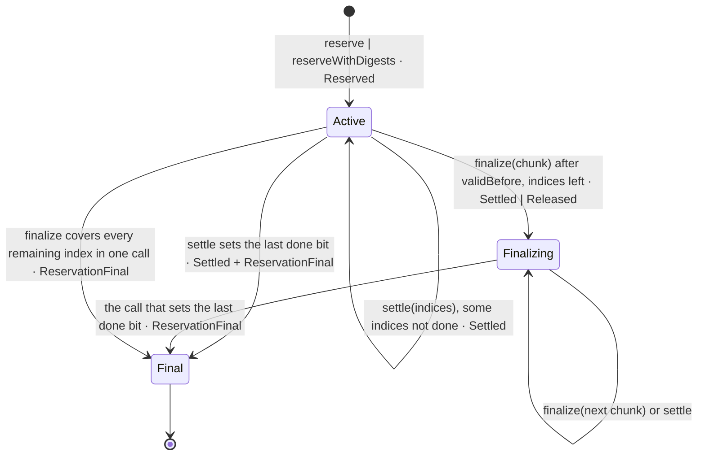
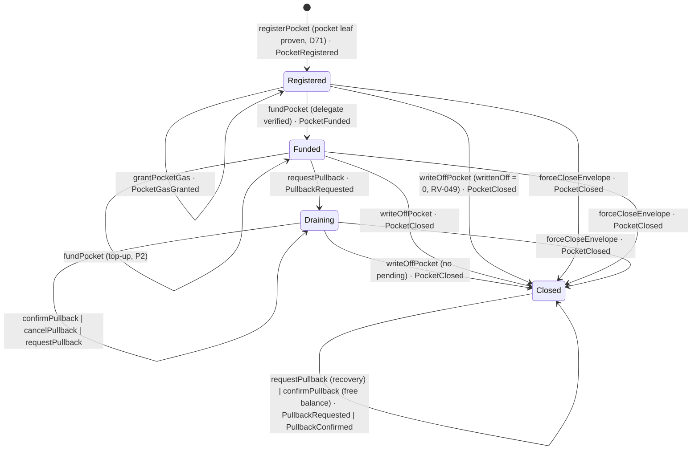
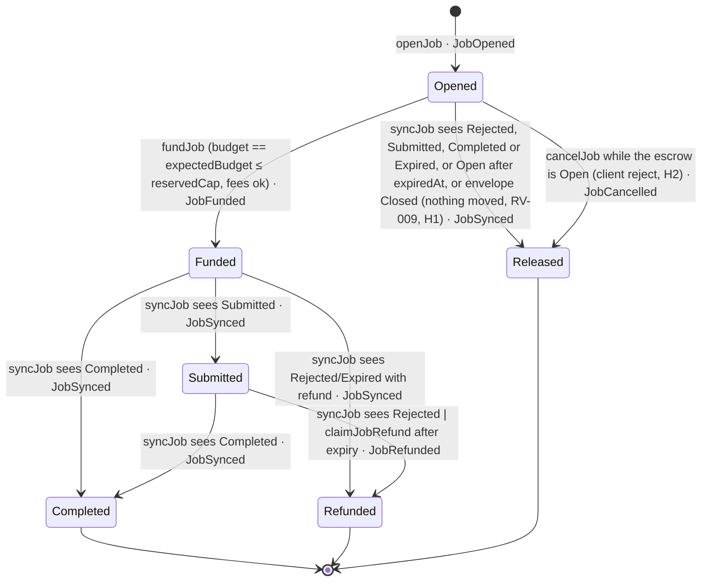

# `CzarVault` (spec 03)

- **Date:** 2026-10-18; amended 2026-10-19 (G0-01 review fixes, see the change log). **Status:** draft for review. **Canonical ABI:** where a table row and `interfaces/ICzarVault.sol` differ in a name, argument order or event field, the `.sol` file wins (RV-060). Shared types, hashes, EIP-712 types and ids are defined in `docs/specs/02-data-and-protocol/data-and-protocol.md` (cited as "02 §n"). Interface: `interfaces/ICzarVault.sol`.
- **Solidity:** `0.8.30`, pinned. Reason: the ERC-1271 payer that Circle's Facilitator settled live on Arc testnet was compiled with `solc_version = "0.8.30"`, `evm_version = "prague"`, optimizer on (`a1-erc1271-usdc/foundry.toml`, A1-12, A1-17), so that toolchain is proven on Arc; 0.8.30 has transient storage and is below the newest release `0.8.37` (2026-09-10), leaving a margin for audit tooling. EVM target `prague` for the same reason (Arc is Osaka-based, p1-A7; `prague` is the highest target the proven run used). **GAP:** `arc-forge` v0.8.0-2's bundled solc list was not checked; `forge` downloads solc per `solc_version`.
- **OpenZeppelin:** `openzeppelin-contracts` v5.7.0 (2026-07-29): `MerkleProof`, `Hashes`, `ECDSA`, `MessageHashUtils`, `IERC1271`, `SafeERC20`, `ReentrancyGuardTransient`, `P256`, `WebAuthn`.

## 1. Purpose and phase

- One vault per user. Holds the user's USDC, enforces envelopes and limits, is the ERC-1271 payer for vanilla x402 (A1-17), funds and drains pocket wallets (A2-02, A2-19), is the ERC-8183 job client (D27), and emits every change for the indexer.
- **Phase 1.** Immutable; no proxy (D33). Migration = owner withdraws to a new vault.

## 2. Roles and permissions

Matches spec 01 §7.1 exactly.

| Action | Owner (MSCA) | `agentSigner` | `autonomySigner` | `guardian` | anyone |
|---|---|---|---|---|---|
| deposit USDC | yes (plain transfer; any sender's transfer counts as free balance) | — | — | — | send only |
| withdraw to any address | yes | no | no | no | no |
| open envelope above auto-limit | yes | no | no | no | no |
| open envelope within auto-limit allowance | yes | yes | no | no | no |
| set `userMax[category]`, payee rules | yes | no | no | no | no |
| raise `autoLimit[category]` (≤ `userMax`, ≤ weekly step) | yes | no | yes (signed, relayed) | no | no |
| lower `autoLimit` | yes | yes | yes | no | no |
| freeze / unfreeze | yes / yes | freeze only | no | pause only (via factory) | no |
| rotate `agentSigner`, `autonomySigner`, `evaluator` | yes | no | no | no | no |
| reserve / settle / fund pocket / open job / fund job | yes (recovery) | yes | no | no | no |
| release expired reservation / close expired envelope | yes | yes | no | no | yes |
| claim ERC-8183 refund to vault; confirm pullback; sync job | yes | yes | no | no | yes |
| set passkey (D30 fallback) | yes | no | no | no | no |
| set `maxPullbackFee` (≤ `MAX_PULLBACK_FEE_CEILING`, D81) | yes | no | no | no | no |
| request a recovery pullback for a `Closed` pocket | yes | yes | no | no | no |
| record a manual pocket return (D41) | yes | no | no | no | no |
| execute a passkey-signed `OwnerAction` | relayed by anyone with a valid WebAuthn assertion | | | | |

- `owner` is `msg.sender` on owner calls (D30). `guardian` is read from `CzarVaultFactory.guardianPaused()` on every spending path.

## 3. Constants and immutables

| Name | Value | Reason / source |
|---|---|---|
| `USDC` | `0x3600000000000000000000000000000000000000` (immutable) | A1-01 |
| `USDC_DOMAIN_SEPARATOR` | computed in the constructor from `block.chainid`: `keccak256(abi.encode(EIP712_DOMAIN_TYPEHASH, keccak256("USDC"), keccak256("2"), chainid, USDC))` | A1-03 (`eip712Domain()` reverts); equals `0x3611…c6b0` on 5042002 and `0x9405…df84` on 5042 (02 §6.1) |
| `TRANSFER_WITH_AUTHORIZATION_TYPEHASH` | `0x7c7c6cdb67a18743f49ec6fa9b35f50d52ed05cbed4cc592e13b44501c1a2267` | `EIP3009.sol` line 35; 02 §6.2 |
| `GATEWAY_WALLET`, `GATEWAY_MINTER` | immutables; testnet `0x0077777d7EBA4688BDeF3E311b846F25870A19B9` / `0x0022222ABE238Cc2C7Bb1f21003F0a260052475B`; mainnet `0x77777777Dcc4d5A8B6E418Fd04D8997ef11000eE` / `0x2222222d7164433c4C09B0b0D809a9b52C04C205` | p1-G1, A2-20; minter addresses from `@circle-fin/x402-batching` 3.5.0 `dist/client/index.mjs` constants (CONFIRMED by use on testnet, A2-16; mainnet minter is SDK-declared only: STRONG SIGNAL) |
| `GATEWAY_DOMAIN` | `26` (immutable, constructor arg) | p1-G14, A2-23 |
| `GATEWAY_DOMAIN_SEPARATOR` | `0x23a37920eca61226c76d13c4462857a362147e4b18da665dba894fa297ae4f34` | 02 §6.1; `EIP712Domain.sol` lines 37–42 |
| `BURN_INTENT_TYPEHASH`, `TRANSFER_SPEC_TYPEHASH` | `0x8b99d17a…a37c`, `0x44409c7b…089b` | `BurnIntents.sol` line 61, `TransferSpec.sol` line 87 |
| `TRANSFER_SPEC_MAGIC`, `TRANSFER_SPEC_VERSION` | `0xca85def7`, `1` | `TransferSpec.sol` lines 21–24 (byte encoding for the replay hash) |
| `SL_DOMAIN_SEPARATOR` | computed in constructor (`SelectionLayer`, `1`, chainid, no contract) | 02 §6.1 |
| `VAULT_DOMAIN_SEPARATOR` | computed in constructor (`CzarVault`, `1`, chainid, `address(this)`) | 02 §6.1; used by `AutonomyRaise`, `OwnerAction`, `ReceiptAttestation` |
| `RECEIPT_TYPEHASH` | `0xcd6ca6db33168140e9fc8604767fd5dc89fc51ca3853b876f9003e8bedd295f2` | SL §5.8 `Receipt`; 02 §6.2 |
| `RECEIPT_ATTESTATION_TYPEHASH` | `keccak256("ReceiptAttestation(bytes32 receiptStructHash)")` (value in 02 §6.2) | binds an `SL_RECEIPT` signature to one vault (RV-013) |
| `KIND_USDC_3009`, `KIND_GATEWAY_BURN`, `KIND_SL_RECEIPT` | 02 §6.3 tags (`SL_RECEIPT` is the `.v2` tag since RV-013) | |
| `NONCE_TAG` | `keccak256("czar.vault.nonce.v1")` | 02 §7.2 |
| `PAYEE_LEAF` | `0xabf82537…62fe` | 02 §5.3 |
| `EIP1271_MAGIC` / `EIP1271_INVALID` | `0x1626ba7e` / `0xffffffff` | A1-09 |
| `MAX_AUTHORIZATIONS_PER_RESERVATION` | `128` | bounds `finalize` loops and the exposure math (§6.5) |
| `MAX_DIGEST_MODE_COUNT` | `8` | fallback mode costs one cold `SSTORE` per index (02 §6.3.4) |
| `MIN_RESERVATION_TTL`, `MAX_RESERVATION_TTL` | `30 s`, `600 s` | spec 01 §10.1; above `maxTimeoutSeconds` seen in practice (A3-06) |
| `FINALIZE_CHUNK` | `32` | per-call loop bound |
| `MAX_ENVELOPE_DURATION` | `30 days` | standing objectives later (P2) |
| `DEFAULT_POCKET_CAP_BPS`, `MAX_POCKET_CAP_BPS` | `2500`, `5000` | D22; `MAX_POCKET_CAP_BPS` applies to owner-opened envelopes only |
| `MAX_AGENT_POCKET_CAP_BPS` | `2500` | D22, D71: an envelope the agent opens by itself can never expose more than 25% to a pocket (RV-003) |
| `PAYEE_KIND_X402`, `PAYEE_KIND_JOB`, `PAYEE_KIND_TIP`, `PAYEE_KIND_POCKET` | `1`, `2`, `3` (Phase 2), `4` | 02 §4.7; kind 4 commits the pocket address in `payeeRoot` (D71) |
| `POCKET_STEP_INDEX` | `type(uint32).max` (`4294967295`) | the `stepIndex` of every pocket leaf; never a real step position (steps are 0–63, 02 §4.6) |
| `DEFAULT_MAX_PULLBACK_FEE` | `10000` (0.01 USDC) | initial value of the owner-adjustable `maxPullbackFee` (D81); measured fee 0.0035 USDC at 20 Gwei (A2-17) with ≈ 3× margin |
| `MAX_PULLBACK_FEE_CEILING` | `500000` (0.50 USDC) | hard upper bound on `maxPullbackFee` (D81, RV-037). The Gateway fee tracks Arc gas (A2-17): 0.50 USDC covers ≈ 143× the measured fee, that is gas up to ≈ 2,850 Gwei. Above that a pocket (≤ 25% of an envelope, typically a few USDC) costs more to pull back instantly than the slow path, so the owner should use the slow path instead; a higher ceiling would only widen what a hijacked agent key can waste on fees per pullback |
| `MAX_PULLBACK_WINDOW_BLOCKS` | `7200` (≈ 1 h at 0.5 s) | `requestPullback` requires `maxBlockHeight ≤ block.number + MAX_PULLBACK_WINDOW_BLOCKS`, so every pullback becomes cancellable within ≈ 1 h 25 min (RV-036) |
| `PULLBACK_CANCEL_DELAY_BLOCKS` | `3000` (≈ 25 min at 0.5 s) | counted from the burn intent's `maxBlockHeight`, not from the request: no attestation can be issued after `maxBlockHeight` (§6.2 step 1), and an attestation lives ≈ 1,196 blocks (A2-17), so 3,000 blocks later no mint is possible (RV-036) |
| `GAS_GRANT_UNIT_WEI` | `1e12` | one 6-decimal unit = `10^12` wei (A1-05 `DECIMALS_SCALING_FACTOR`) |
| `MAX_GAS_GRANT_PER_POCKET` | `50000` units (0.05 USDC) | one `addDelegate` tx ≈ 50k gas × 20 Gwei = 0.001 USDC; 50× margin for fee spikes (p1-A6 cap 20,000 Gwei would need more; then the pocket path is paused) |
| `PERIOD_LENGTH` | `604800` s (7 days) | earned autonomy period (product §6.6). Allowance resets on the calendar period (`now / PERIOD_LENGTH`); raises are spaced by at least `PERIOD_LENGTH` measured from the last raise (`lastRaiseAt`, RV-031) |
| `MAX_RAISE_STEP_BPS` | `2000` | one raise per period, ≤ 20% of `userMax` (spec 01 CZ-24; default, moderate confidence) |
| `BPS` | `10000` | |
| `MAX_JOB_FEE_BPS` | `500` | Czar instance only; Circle's instance must report 0 (A4-07) |
| `MIN_JOB_EXPIRY_LEAD` | `6 minutes` | ERC-8183 reverts `ExpiryTooShort` under 5 min (p1-E7) |
| `SECP256K1_HALF_N` | `0x7FFFFFFF…1B20A0` | low-s rule (as `OwnerSig1271.sol`) |

## 4. Storage layout

| Variable | Type | Meaning | Writer |
|---|---|---|---|
| `owner` | `address` (immutable) | the user's MSCA | constructor. The constructor takes only `ownerAccount`; it reads `networkConfig()` (USDC, Gateway addresses, domain, job escrow and kind) and `defaults()` (signers) from `msg.sender`, the factory, so the vault address depends only on factory and owner (RV-015, `czar-vault-factory.md` §5) |
| `factory` | `address` (immutable) | reads `guardianPaused()` | constructor |
| `jobEscrow`, `jobEscrowKind` | `address`, `uint8` (immutables) | ERC-8183 instance and adapter kind (`job-escrow-adapter.md`) | constructor |
| `agentSigner`, `autonomySigner`, `evaluator` | `address` | roles | owner (`rotateSigners`), constructor |
| `passkey` | `struct {bytes32 qx; bytes32 qy; bytes32 rpIdHash; bool set}` | D30 fallback | owner |
| `frozen` | `bool` | user freeze | owner, agent (set only) |
| `maxPullbackFee` | `uint256` | current bound on `requestPullback.maxFee`; starts at `DEFAULT_MAX_PULLBACK_FEE`, `≤ MAX_PULLBACK_FEE_CEILING` (D81) | owner (`setMaxPullbackFee`) |
| `autonomyNonce`, `ownerActionNonce` | `uint256` | replay protection for 02 §6.2 types; `autonomyNonce` also increments on `freeze()` and every `lowerAutoLimit`, so a raise signed before a freeze or a lowering can never land after it (RV-030) | vault |
| `envelopeCount`, `reservationCount`, `pullbackCount` | `uint64` | counters | vault |
| `committedTotal` | `uint256` | Σ over open envelopes of `cap − spent − pocketOutstanding − jobEscrowed − shortfall` | vault |
| `limits[categoryId]` | `struct {uint256 userMax; uint256 autoLimit; uint64 periodId; uint256 usedInPeriod; uint64 lastRaiseAt}` | earned autonomy; `lastRaiseAt` is the timestamp of the last raise (RV-031) | owner, autonomy, agent (lower) |
| `envelopes[envelopeId]` | `Envelope` (02 §4.8 fields: `cap, maxStepAmount, pocketCapBps, expiresAt, categoryId, objectiveHash, planHash, payeeRoot, spent, reserved, pocketOutstanding, jobEscrowed, shortfall, state, approverIsOwner, openReservations, openPockets, openJobs, pocket`) | `shortfall`: money an envelope was owed back (a pullback mint, job refund or manual return) that the owner had already withdrawn as free balance before it was confirmed; it reduces the envelope's room and is never re-committed (RV-011). `pocket`: the envelope's single pocket (D48), `address(0)` if none; lets `forceCloseEnvelope` close it without a loop (RV-005) | vault |
| `stepUsed[envelopeId][stepIndex]` | `uint256` | amount reserved or spent for one plan step, shared by the step's payee and its alternates (D36, D43). Up on `reserve` / `openJob`; down when a reservation index is released, when a job's unused `reservedCap` is released at `fundJob`, and when a job's budget is refunded or an unfunded job is released (RV-002) | vault |
| `reservations[reservationId]` | `struct {uint64 envelopeId; uint32 stepIndex; address payee; uint256 unitAmount; uint32 count; uint64 validBefore; uint8 mode; uint128 settledMask; uint128 doneMask; uint32 settledCount; uint32 releasedCount; uint8 state}` | | vault |
| `digestSlot[digest]` | `struct {uint64 reservationId; uint32 index; bool set}` | fallback mode lookup (02 §6.3.4) | `reserveWithDigests` |
| `pockets[pocket]` | `struct {uint64 envelopeId; uint8 state; uint256 funded; uint256 gasGranted; uint256 outstanding; uint256 pendingPullback}` | 02 §4.10 | vault |
| `pullbacks[pullbackId]` | `struct {address pocket; uint256 value; uint256 maxFee; uint256 maxBlockHeight; bytes32 salt; bytes32 transferSpecHash; uint64 requestedAtBlock; uint8 state; bool recovery}` | 02 §4.10; `recovery = true` for a pullback of a `Closed` pocket, credited to free balance (RV-004) | vault |
| `jobs[jobKey]` | `struct {uint64 envelopeId; uint32 stepIndex; uint256 jobId; address provider; uint256 reservedCap; uint256 budget; uint8 state}` | 02 §4.11 | vault |

- No arrays indexed by user input. Every loop is bounded by a constant (`FINALIZE_CHUNK`, `MAX_AUTHORIZATIONS_PER_RESERVATION`).
- Saturating helper `sat(a, b) = a > b ? a − b : 0` is used wherever a remaining amount is computed from two counters that can legitimately cross (free balance, remaining allowance); a plain `−` is used only where an invariant guarantees no underflow (RV-008, RV-011).
- Reentrancy: `ReentrancyGuardTransient` on every function that calls USDC, GatewayWallet, GatewayMinter, the job escrow, or sends native value (`grantPocketGas`: the pocket EOA may carry EIP-7702 code, §12; RV-006). `isValidSignature` is `view` and makes no external calls except `view` reads, so it needs no guard.

## 5. Functions

Format: signature; caller; preconditions in order; state changes; external calls; events; errors; reentrancy; gas (estimate at 20 Gwei; measured values replace these in the build plan). `notPausedOrFrozen` = `!frozen && !factory.guardianPaused()`.

### 5.1 Balance and owner functions

| Function | Caller | Preconditions | State changes | External calls | Events / errors | Gas (est.) |
|---|---|---|---|---|---|---|
| `freeBalance() → uint256` (view) | anyone | — | — (returns `sat(balanceOf, committedTotal)`; never reverts, RV-011) | `USDC.balanceOf(this)` (6-dec view, A1-05) | — | 5k |
| `sync()` | anyone | — | none (free balance is live: `sat(balanceOf, committedTotal)`) | `balanceOf` | `BalanceSynced(balance, committedTotal)` | 10k |
| `receive()` payable | anyone | — | none | — | `NativeReceived(sender, weiValue)` | 3k |
| `withdraw(address to, uint256 amount)` | owner | `to != 0` (p1-A8); `amount ≤ freeBalance()` | none (balance drops) | `USDC.safeTransfer(to, amount)` | `Withdrawn(to, amount)`; `ZeroAddress`, `InsufficientFree(free, amount)` | 45k |
| `setCategoryLimits(bytes32 categoryId, uint256 userMax, uint256 autoLimit)` | owner | `autoLimit ≤ userMax` | `limits[categoryId].userMax/autoLimit` | — | `LimitsSet(categoryId, userMax, autoLimit)` (owner is implied; RV-060); `AutoLimitAboveUserMax` | 48k |
| `freeze()` | owner or agent | — | `frozen = true`; `autonomyNonce++` (invalidates every signed, unrelayed `AutonomyRaise`, RV-030) | — | `Frozen(by)` | 27k |
| `unfreeze()` | owner | — | `frozen = false` | — | `Unfrozen()` | 25k |
| `rotateSigners(address agent, address autonomy, address evaluator_)` | owner | none zero | roles | — | `SignersRotated(agent, autonomy, evaluator_)`; `ZeroAddress` | 30k |
| `setPasskey(bytes32 qx, bytes32 qy, bytes32 rpIdHash)` | owner | `qx,qy` non-zero; `rpIdHash` non-zero | `passkey` | — | `PasskeySet(qxHash)` (hash of key only) | 70k |
| `setMaxPullbackFee(uint256 newMax)` | owner | `0 < newMax ≤ MAX_PULLBACK_FEE_CEILING` | `maxPullbackFee = newMax` | — | `MaxPullbackFeeSet(oldMax, newMax)`; `FeeCeilingExceeded(newMax, ceiling)` | 30k |
| `executeOwnerAction(uint8 action, bytes calldata payload, uint256 deadline, WebAuthnAuth calldata auth)` | anyone (relayer) | `passkey.set`; `deadline ≥ now`; digest = EIP-712 `OwnerAction(action, keccak256(payload), ownerActionNonce, deadline)` (02 §6.2); WebAuthn verification per §7 below; then dispatch per `action` | `ownerActionNonce++`; the dispatched action's changes | per action | `OwnerActionExecuted(action, nonce)`; `PasskeyNotSet`, `Expired`, `InvalidPasskeyAssertion`, `UnknownAction` | 40k + 6,900 (P-256, A6-02) + action |

Every owner-only function, and every function the owner may call for recovery, is reachable through `executeOwnerAction`; the dispatcher calls the internal form with the owner context. The action list and payload encodings are in §7 (RV-033). The only owner-callable function left out is `reserve`/`reserveWithDigests`: recovery never needs the owner to spend through the passkey path.

### 5.2 Envelopes

| Function | Caller | Preconditions | State changes | Events / errors | Gas (est.) |
|---|---|---|---|---|---|
| `openEnvelope(OpenEnvelopeParams p)` where `p = {cap, maxStepAmount, pocketCapBps, expiresAt, categoryId, objectiveHash, planHash, payeeRoot}` | owner, or agent within allowance | `notPausedOrFrozen`; `cap > 0`; `maxStepAmount ≤ cap`; `pocketCapBps ≤ MAX_POCKET_CAP_BPS` (owner) or `≤ MAX_AGENT_POCKET_CAP_BPS` (agent, D71); `now < expiresAt ≤ now + MAX_ENVELOPE_DURATION`; `payeeRoot != 0`; `cap ≤ freeBalance()`; **if caller is agent:** `limits[categoryId]` period rolled (`periodId = now / PERIOD_LENGTH`, reset `usedInPeriod` on change); `remaining = sat(autoLimit, usedInPeriod)`; `cap ≤ remaining` (RV-008: never an arithmetic panic) | `envelopeCount++`; store; `committedTotal += cap`; if agent: `usedInPeriod += cap` | `EnvelopeOpened(envelopeId, categoryId, objectiveHash, cap, planHash, payeeRoot, maxStepAmount, pocketCapBps, expiresAt, approverIsOwner)` (indexed order per `.sol`); `Paused`, `FrozenVault`, `InsufficientFree`, `AllowanceExceeded(categoryId, remaining, cap)`, `BadParams` | 160k |
| `closeEnvelope(uint64 envelopeId)` | owner or agent any time; anyone after `expiresAt` | state `Open`; `openReservations == 0`, `openPockets == 0`, `openJobs == 0` (else `EnvelopeBusy`) | `state = Closed`; `released = cap − spent − pocketOutstanding − jobEscrowed − shortfall` (`pocketOutstanding` and `jobEscrowed` are 0 here); `committedTotal −= released` | `EnvelopeClosed(envelopeId, spent, released)`; `EnvelopeBusy`, `NotAuthorized` | 40k |
| `forceCloseEnvelope(uint64 envelopeId)` | owner only, after `expiresAt + 1 day` | state `Open`; `openReservations == 0` (else `EnvelopeBusy`; every reservation can always be finalized after its `validBefore`, RV-001) | in this order (RV-005): **1. pocket** — if `envelope.pocket != 0` and that pocket is not `Closed`: `writtenOff = pocket.outstanding`; `spent += writtenOff`; `pocketOutstanding −= writtenOff` (now 0); `pocket.outstanding = 0`; `pocket.state = Closed`; `openPockets = 0`; its `Pending` pullbacks stay `Pending` and, if minted later, credit free balance (§5.4 `confirmPullback`). **2. jobs** — jobs in `Opened` stay `Opened` in storage but can never be funded (`fundJob` requires envelope `Open`); their `reservedCap` is released here as part of `reserved`; jobs in `Funded`/`Submitted` stay tracked by `jobKey` and their `jobEscrowed` stays counted; later completion books `spent`, later refunds credit free balance (§5.5). `openJobs = 0`. **3. release** — `released = cap − spent − pocketOutstanding − jobEscrowed − shortfall`; `reserved = 0`; `committedTotal −= released`; `state = Closed` | `PocketClosed(pocket, writtenOff)` when step 1 ran; `EnvelopeForceClosed(envelopeId, spent, released, writtenOff)`; `EnvelopeBusy`, `NotExpired` | 75k |

- "Fund on approval" = `committedTotal += cap`; no transfer. "Refund" at close = `committedTotal −= released`; no transfer (spec 01 §8.2).
- After `forceCloseEnvelope`, `jobEscrowed` of the envelope's still-funded jobs is no longer part of `committedTotal` (the envelope is closed) but stays in the envelope record so `syncJob` can book the outcome; this is why INV-2 sums over **open** envelopes only.
- **Every function that adds exposure to an envelope** (`reserve`, `reserveWithDigests`, `registerPocket`, `grantPocketGas`, `fundPocket`, `openJob`, `fundJob`) requires `notPausedOrFrozen`, envelope `Open` and `now < expiresAt` (RV-005, RV-006). Functions that only release or book exposure (`settle`, `finalize`, pullbacks, `writeOffPocket`, `syncJob`, `claimJobRefund`) never require it, so money can always come back.

### 5.3 Reservations (vault-direct x402)

| Function | Caller | Preconditions | State changes | Events / errors | Gas (est.) |
|---|---|---|---|---|---|
| `reserve(uint64 envelopeId, uint32 stepIndex, address payee, uint256 stepCap, bytes32[] proof, uint256 unitAmount, uint32 count, uint64 validBefore) → uint64 reservationId` | agent (owner for recovery) | `notPausedOrFrozen`; envelope `Open` and `now < expiresAt`; `1 ≤ count ≤ MAX_AUTHORIZATIONS_PER_RESERVATION`; `stepIndex ≠ POCKET_STEP_INDEX`; `MerkleProof.verify(proof, payeeRoot, leaf(payee, kind=1, stepIndex, stepCap))` (02 §5.3); `stepCap ≤ maxStepAmount` (RV-002); `total = unitAmount × count`; **`stepUsed[envelopeId][stepIndex] + total ≤ stepCap`** (per step, across every reservation and job of the step and its alternates; RV-002); `now + MIN_TTL ≤ validBefore ≤ min(now + MAX_TTL, expiresAt)` (RV-056); `spent + reserved + pocketOutstanding + jobEscrowed + shortfall + total ≤ cap` | `reservationCount++`; store (`mode = envelope`); `reserved += total`; `stepUsed[envelopeId][stepIndex] += total`; `openReservations++` | `Reserved(reservationId, envelopeId, payee, stepIndex, unitAmount, count, validBefore, mode)`; `PayeeNotInPlan`, `StepCapExceeded(stepIndex, used, stepCap, wanted)`, `CapExceeded`, `BadTtl`, `BadCount`, `EnvelopeNotOpen`, `EnvelopeExpired` | 132k + 400/proof node |
| `reserveWithDigests(... same ...)` | agent | same; `count ≤ MAX_DIGEST_MODE_COUNT` | same, `mode = digest`; for each `i < count`: `digestSlot[digest_i] = (id, i)` where `digest_i = toTypedDataHash(USDC_DOMAIN_SEPARATOR, structHash(this, payee, unitAmount, 0, validBefore, nonce_i))` | same event with `mode = 1` | 110k + 24k × count |
| `derivedNonce(uint64 reservationId, uint32 index) → bytes32` (pure/view) | anyone | — | — | — | 1k |
| `settle(uint64 reservationId, uint32[] indices)` | anyone | reservation `Active` or `Finalizing`; `1 ≤ indices.length ≤ FINALIZE_CHUNK`; each `index < count`, bit not yet in `doneMask`; `USDC.authorizationState(this, nonce_i) == true` (A1-11, A1-12) | for each: `settledMask |= bit; doneMask |= bit; settledCount++`; `envelope.reserved −= unitAmount; envelope.spent += unitAmount; committedTotal −= unitAmount` (`stepUsed` unchanged: the money is spent on that step); then **`_finalizeIfDone(r)`** (below) | `Settled(reservationId, index, unitAmount)` per index; `ReservationFinal` when `_finalizeIfDone` fires; `NotUsed(index)`, `AlreadyDone(index)`, `ReservationNotActive` | 30k + 6k × n (+ 10k when it finalizes) |
| `finalize(uint64 reservationId, uint32 fromIndex, uint32 toIndex)` | anyone | reservation `Active` or `Finalizing`; `now > validBefore` (USDC rejects the authorization after this, `EIP3009.sol` line 323); `fromIndex < toIndex ≤ count`; `toIndex − fromIndex ≤ FINALIZE_CHUNK`. Indices already in `doneMask` are **skipped, not refused** (RV-001) | `state = Finalizing` if it was `Active`; for each index in the range not in `doneMask`: if `authorizationState == true` → treat as settle (above); else → `doneMask |= bit; releasedCount++; reserved −= unitAmount; stepUsed[envelopeId][stepIndex] −= unitAmount` (`committedTotal` unchanged: the money stays committed to the envelope); if `mode == digest`, delete the `digestSlot` entries in the chunk; then **`_finalizeIfDone(r)`** | `Settled` / `Released(reservationId, index, unitAmount)`; `ReservationFinal(reservationId, settledCount, releasedCount)`; `NotExpired`, `BadParams`, `ReservationNotActive` | 30k + 7k × n |

- **`_finalizeIfDone(r)`** (internal, shared by `settle` and `finalize`; RV-001): if `popcount(r.doneMask) == r.count` (equivalently `settledCount + releasedCount == count`) and `r.state ≠ Final`: `r.state = Final`; `envelope.openReservations−−`; emit `ReservationFinal(reservationId, settledCount, releasedCount)`; if `mode == digest`, any `digestSlot` entries not yet deleted are deleted. So a reservation whose every index was settled before `validBefore` becomes `Final` inside the `settle` call that set the last bit, and its envelope can close without any `finalize`.
- `releasedCount` is a `uint32` field of the reservation record (02 §4.9 mirrors it).
- Owner `withdraw` while reservations are open: allowed only for `freeBalance()`, which excludes every open envelope's cap. Reserved money can never be withdrawn.

### 5.4 Pocket wallets (Gateway)

| Function | Caller | Preconditions | State changes | External calls | Events / errors | Gas (est.) |
|---|---|---|---|---|---|---|
| `registerPocket(uint64 envelopeId, address pocket, bytes32[] proof)` | agent | `notPausedOrFrozen`; envelope `Open` and `now < expiresAt`; `envelope.pocket == 0` (one pocket per envelope, D48); `pocket != 0`; `pocket.code.length == 0` (must be an EOA: A2-09, A2-10); `pockets[pocket].envelopeId == 0` (one pocket, one envelope, ever); **`MerkleProof.verify(proof, payeeRoot, leaf(pocket, kind=PAYEE_KIND_POCKET, POCKET_STEP_INDEX, 0))`** — the pocket address is committed in the approved plan's `payeeRoot` (D71, RV-003); `pocketCapBps > 0` | `pockets[pocket] = {envelopeId, Registered}`; `envelope.pocket = pocket`; `openPockets++` | — | `PocketRegistered(envelopeId, pocket)`; `PocketExists`, `NotEoa`, `PocketNotInPlan`, `PocketCapZero`, `EnvelopeNotOpen`, `EnvelopeExpired` | 62k + 400/proof node |
| `grantPocketGas(address pocket, uint256 units)` | agent | `notPausedOrFrozen`; envelope `Open` and `now < expiresAt` (RV-006); pocket `Registered`; `gasGranted + units ≤ MAX_GAS_GRANT_PER_POCKET`; `spent + reserved + pocketOutstanding + jobEscrowed + shortfall + units ≤ cap` (gas counts as spent) | `gasGranted += units`; `envelope.spent += units`; `committedTotal −= units` | `pocket.call{value: units × GAS_GRANT_UNIT_WEI}("")` (native USDC; a transfer to `address(0)` would revert, A9-14, but `pocket != 0`); **`nonReentrant`** | `PocketGasGranted(pocket, units)`; `GasGrantExceeded`, `NativeSendFailed`, `Paused`, `FrozenVault` | 40k |
| `fundPocket(address pocket, uint256 amount)` | agent | `notPausedOrFrozen`; pocket `Registered` or `Funded`; envelope `Open` and `now < expiresAt`; **`GatewayWallet.isAuthorizedForBalance(USDC, pocket, address(this)) == true`** (`Delegation.sol` lines 137–144; A2-04); `funded + amount ≤ cap × pocketCapBps / BPS` (floor); `spent + reserved + pocketOutstanding + jobEscrowed + shortfall + amount ≤ cap` | `funded += amount; outstanding += amount; envelope.pocketOutstanding += amount; committedTotal −= amount; state = Funded` | `USDC.forceApprove(GATEWAY_WALLET, amount)`; `GatewayWallet.depositFor(USDC, pocket, amount)` (`Deposits.sol` lines 79–96, pulls from `msg.sender` = vault, A2-02); `forceApprove(…, 0)` after | `PocketFunded(pocket, envelopeId, amount, funded)`; `DelegateNotSet`, `PocketCapExceeded(cap, funded, amount)` | 130k |
| `requestPullback(address pocket, uint256 value, uint256 maxFee, uint256 maxBlockHeight) → uint64 pullbackId` | agent or owner | **normal:** pocket `Funded` or `Draining`; `0 < value ≤ outstanding − pendingPullback`. **recovery (RV-004):** pocket `Closed`; `value > 0` (no `outstanding` bound: the pocket's accounting is already settled, and the burn can only pay the vault). **both:** `maxFee ≤ maxPullbackFee` (D81); `block.number < maxBlockHeight ≤ block.number + MAX_PULLBACK_WINDOW_BLOCKS` (RV-036). Neither freeze nor pause blocks this function (money only comes back, §6.2 step 2) | `pullbackCount++`; `salt = keccak256(abi.encode(NONCE_TAG, this, pullbackId))` (02 §7.3); `transferSpecHash = keccak256(bytes.concat(TRANSFER_SPEC_MAGIC, uint32 1, uint32 26, uint32 26, b32(GATEWAY_WALLET), b32(GATEWAY_MINTER), b32(USDC), b32(USDC), b32(pocket), b32(this), b32(this), bytes32(0), uint256 value, salt, uint32 0))` (340 bytes, `TransferSpec.sol` lines 50–67; test vector 02 §6.4); store `Pending` with `recovery = (pocket was Closed)`; **normal only:** `pendingPullback += value`; `state = Draining` | — | `PullbackRequested(pullbackId, pocket, value, maxFee, maxBlockHeight, transferSpecHash, salt)`; `PullbackTooLarge`, `FeeTooHigh`, `BadParams` | 120k |
| `confirmPullback(uint64 pullbackId)` | anyone | record `Pending` or `Cancelled`; **`GatewayMinter.isTransferSpecHashUsed(transferSpecHash) == true`** (`TransferSpecHashes.sol` line 35; GatewayMinter inherits it via `GatewayCommon`) | `state = Confirmed`. Then exactly one branch (the USDC was minted to the vault: `Mints.sol` lines 333–349, recipient = `destinationRecipient` = vault, full `value`; the fee was taken from the pocket's balance on the burn side, `Burns.sol` lines 515–559): **(a) envelope credit** — record was `Pending`, not `recovery`, pocket not `Closed`, envelope `Open`: `pendingPullback −= value`; `x = min(value, outstanding)`; `outstanding −= x`; `envelope.pocketOutstanding −= x`; `credit = min(x, sat(balanceOf, committedTotal))`; `committedTotal += credit`; `envelope.shortfall += x − credit` (RV-011); any `value − x` stays free. **(b) late mint of a cancelled record** — record was `Cancelled`, pocket not `Closed`, envelope `Open`: `x = min(value, outstanding − pendingPullback)` (clamped so `pendingPullback ≤ outstanding` keeps holding, RV-036), then as (a) with this `x`. **(c) free-balance credit** — `recovery`, or pocket `Closed`, or envelope `Closed`: if the record was `Pending` and not `recovery`, `pendingPullback −= value`; nothing else changes (the minted USDC is free balance, as job refunds after close already are) | `GatewayMinter.isTransferSpecHashUsed` (view) | `PullbackConfirmed(pullbackId, pocket, value, creditedToEnvelope)`; `NotMinted`, `PullbackWrongState` | 50k |
| `cancelPullback(uint64 pullbackId)` | agent or owner | record `Pending`; `block.number ≥ maxBlockHeight + PULLBACK_CANCEL_DELAY_BLOCKS` (RV-036: counted from the intent's own expiry, so no attestation for it can still be valid); `isTransferSpecHashUsed == false` | `state = Cancelled`; if not `recovery`: `pendingPullback −= value` | view read | `PullbackCancelled(pullbackId)`; `TooEarly`, `AlreadyMinted` | 30k |
| `writeOffPocket(address pocket)` | agent or owner | pocket `Registered`, `Funded` or `Draining` (RV-049: a `Registered` pocket whose `addDelegate` failed can be closed); `pendingPullback == 0`; envelope `Open`. The signer refuses this call for K3 while the pocket has an open slow withdrawal or a non-zero Gateway balance (CZ-27, RV-004) | `writtenOff = outstanding`; `envelope.spent += writtenOff; envelope.pocketOutstanding −= writtenOff; outstanding = 0; state = Closed; openPockets−−` | — | `PocketClosed(pocket, writtenOff)`; `PullbackPending`, `PocketWrongState` | 35k |
| `recordManualReturn(address pocket, uint256 amount)` | **owner only** (D41; RV-010) | pocket `Funded` or `Draining` (a `Closed` pocket needs no record: anything it returns is already free balance); envelope `Open`; `0 < amount`; `credit = min(amount, outstanding − pendingPullback, freeBalance())`; `credit > 0` | `outstanding −= credit`; `envelope.pocketOutstanding −= credit`; `committedTotal += credit` | `USDC.balanceOf` (view, inside `freeBalance`) | `ManualReturnRecorded(pocket, credit)`; `NoChange`, `PocketWrongState`, `EnvelopeNotOpen` | 40k |

- Partial pullbacks: several `Pending` records may coexist while `Σ pending ≤ outstanding`.
- Never-minted attestations: Circle re-credits `value + fee` to the pocket after `expirationBlock` (A2-18); `cancelPullback` after `maxBlockHeight + PULLBACK_CANCEL_DELAY_BLOCKS` returns the accounting to `outstanding`, and a new request uses a new salt. The vault's `isValidSignature` for `GATEWAY_BURN` requires the record to be `Pending` and `block.number ≤ maxBlockHeight` (§6.2 step 1), so no attestation can be issued for an intent after its `maxBlockHeight`, and none issued before it can still mint 3,000 blocks later (attestation life ≈ 1,196 blocks, A2-17; Circle's TEE simulates the check at request time, A2-08). RV-036.
- Late mint after cancel: `confirmPullback` branch (b) still credits (money did arrive), clamped so `Σ pending ≤ outstanding` (INV-7) keeps holding; any excess is free balance. With the RV-036 timing rule this branch is defensive only.
- **Recovery pullbacks (RV-004):** a pocket that is `Closed` (written off or force-closed) can still hold a Gateway balance: a nanopayment that later fails, an attestation that expired and was re-credited (A2-18), or funds that arrived after the write-off (A2-29). `requestPullback` on a `Closed` pocket creates a `recovery` record; it is signed and verified exactly like any other `GATEWAY_BURN` (recipient is always the vault), and its mint is free balance. The server requests one automatically whenever the Gateway API shows a non-zero balance for a `Closed` pocket whose key still exists (CZ-15, CZ-27).
- **Pocket gas and ERC-20 balance:** unused native gas in the pocket EOA and any USDC that reached the EOA through the slow path are returned by the pocket key with the K4 `pocket-return` kinds (CZ-27): `USDC.transfer(vault, amount)` and a native send to the vault. Both arrive as free balance; if the pocket is still open, the owner then moves the matching amount back to the envelope with `recordManualReturn` (bounded by `outstanding − pendingPullback` and by `freeBalance()`).
- Top-ups (Phase 2): allowed while `outstanding + amount ≤ cap × pocketCapBps / BPS`, because `outstanding` only drops on confirmed (trustless) pullbacks. `GatewayWallet.availableBalance(USDC, pocket)` (`Balances.sol` line 60) overstates what the pocket still has, since nanopayments settle off-chain until the batch (A2-29), so it is advisory only.
- Circle API down: no instant pullback (A2-06). The pocket key (held by Czar's signer service) calls `initiateWithdrawal(USDC, value)` then `withdraw(USDC)` after `withdrawalDelay()` = 1,209,600 blocks (≈ 7 days; `Withdrawals.sol` lines 76, 104; A2-13 to A2-15); `withdraw` pays the pocket EOA (`msg.sender`), so the pocket key then sends it to the vault with the K4 `pocket-return` transfer kind. `confirmPullback` cannot verify that path, so the **owner** credits it with `recordManualReturn(pocket, amount)` (D41). The bound `min(amount, outstanding − pendingPullback, freeBalance())` replaces the earlier "balance delta since the last sync" wording, which needed storage that does not exist (RV-010). Phase 1 ships the function; the UI calls it rarely. The pocket key is kept until the slow withdrawal has completed and every balance reads zero (CZ-27 key-retirement rule).

### 5.5 Jobs (ERC-8183)

See `job-escrow-adapter.md` for the two instance kinds. Vault-side functions:

| Function | Caller | Preconditions | State changes | External calls | Events / errors | Gas (est.) |
|---|---|---|---|---|---|---|
| `openJob(uint64 envelopeId, uint32 stepIndex, address provider, uint256 stepCap, bytes32[] proof, uint64 expiredAt, bytes32 descriptionHash) → bytes32 jobKey` | agent | `notPausedOrFrozen`; envelope `Open` and `now < expiresAt`; `stepIndex ≠ POCKET_STEP_INDEX`; `MerkleProof.verify(proof, payeeRoot, leaf(provider, kind=2, stepIndex, stepCap))`; `stepCap ≤ maxStepAmount`; **`stepUsed[envelopeId][stepIndex] + stepCap ≤ stepCap`**, i.e. nothing else is reserved or spent on that step (a job reserves its whole step cap; RV-002); `expiredAt ≥ now + MIN_JOB_EXPIRY_LEAD` and `≤ envelope.expiresAt`; `provider != evaluator` (base-contracts `ProviderCannotBeEvaluator`); `spent + reserved + pocketOutstanding + jobEscrowed + shortfall + stepCap ≤ cap` | `reserved += stepCap`; `stepUsed[envelopeId][stepIndex] += stepCap`; `openJobs++`; `jobs[jobKey] = {…, reservedCap = stepCap, Opened}` | adapter `createJob(provider, evaluator, expiredAt, "czar:" + hex(descriptionHash), hook = 0, …)` | `JobOpened(jobKey, envelopeId, provider, stepIndex, jobEscrow, jobId, evaluator, reservedCap, descriptionHash)` (indexed order per `.sol`, RV-060); `StepCapExceeded(stepIndex, used, stepCap, wanted)` | 252k |
| `fundJob(bytes32 jobKey, uint256 expectedBudget)` | agent | `notPausedOrFrozen`; envelope `Open` and `now < expiresAt` (RV-005, RV-006); job `Opened`; adapter reads budget `b` and status `Open`; **`b == expectedBudget`** (else `BudgetChanged(expectedBudget, b)`; the paying agent passes the budget it saw in `BudgetSet`, so a provider cannot raise it between the agent's decision and the fund, M1-b; the EIP's own `expectedBudget` rule, A4-05); `0 < b ≤ reservedCap` (Circle's `fund` accepts a budget of 0, so the vault must refuse it, R2); fee check per adapter (Circle: both fee bps == 0, A4-07; Czar: `platformFeeBP + evaluatorFeeBP ≤ MAX_JOB_FEE_BPS`); `paymentToken == USDC` | `reserved −= reservedCap; jobEscrowed += b; committedTotal −= b` (the budget left the vault into escrow); `stepUsed[envelopeId][stepIndex] −= reservedCap − b` (the unused part of the step cap is free for the step again and stays available inside the envelope cap); `budget = b; state = Funded` | `USDC.forceApprove(jobEscrow, b)`; adapter `fund(jobId, b)`; `forceApprove(jobEscrow, 0)` | `JobFunded(jobKey, budget)`; `BudgetExceedsReserved`, `UnexpectedFees`, `WrongToken`, `JobNotOpen`, `Paused`, `FrozenVault`, `EnvelopeNotOpen`, `EnvelopeExpired` | 150k |
| `cancelJob(bytes32 jobKey)` | agent or owner (owner also through `executeOwnerAction` `CANCEL_JOB`) | job `Opened`; adapter reads escrow status `Open` (else `JobNotCancellable(status)`). Not gated by freeze or pause: it only releases exposure | the vault, as the escrow's client, calls `reject(jobId, keccak256("czar:cancel"), "")` (client reject while `Open` needs `msg.sender == job.client`; no EOA or `tx.origin` check, R5; no funds move); then the `syncJob` release: `state = Released`; if the envelope is `Open`: `reserved −= reservedCap`, `stepUsed −= reservedCap`, `openJobs−−` | adapter `reject` (Circle: `reject(jobId, reason, "")`; Czar instance: same signature) | `JobCancelled(jobKey)`; `JobNotCancellable(uint8 escrowStatus)`, `JobWrongState` | 70k |
| `syncJob(bytes32 jobKey)` | anyone | job `Opened`, `Funded` or `Submitted` (RV-009); adapter `getJob` reads escrow status (and, for the Czar kind, `settledAmount`) | Decided from **escrow status only** — never from balances or events (RV-009). **From `Opened`:** escrow `Rejected` or `Expired` (the Czar instance lets anyone `claimRefund` an `Open` job after expiry, which sets `Expired` with no transfer, `ERC8183.sol` lines 863–885), or escrow `Open` with `now ≥ expiredAt`, or envelope `Closed` → `state = Released`; if the envelope is `Open`: `reserved −= reservedCap`, `stepUsed −= reservedCap`, `openJobs−−` (nothing moved, so no `committedTotal` change; a force-closed envelope already released it). Escrow `Submitted` or `Completed` while the vault shows `Opened` (a provider may `submit` while the job is `Open` with budget 0 on Circle's instance, deployed source lines 213–216, R1; the evaluator may then `complete` or `reject` it) → `state = Released` with the same release as above: no money ever moved, because only the vault can fund and it never did (H1). Escrow `Funded` while the vault shows `Opened` is impossible (only the client, the vault, can call `fund`) → `NoChange`. **Superseded by H1:** "Escrow `Funded`/`Submitted` while the vault shows `Opened` is impossible → `NoChange`". **From `Funded`/`Submitted`:** `Submitted` → `state = Submitted`. `Completed` → `jobEscrowed −= budget; spent += budget; state = Completed` (whole-job completion; fees come out of the budget inside the escrow, `job-escrow-adapter.md` §4); if envelope `Open`: `openJobs−−`. `Rejected` or `Expired` (the escrow refunds `budget − settledAmount` in the same transaction that sets these states, `ERC8183.sol` `_reject` lines 814–854 and `claimRefund` lines 863–885, so status alone proves the refund) → `refund = budget − settledAmount` (Czar kind; `settledAmount` is what `approveClaim` already paid, lines 840, 876) or `refund = budget` (Circle kind, which has no partial claims); `jobEscrowed −= budget; spent += budget − refund`; if envelope `Open`: `credit = min(refund, sat(balanceOf, committedTotal))`, `committedTotal += credit`, `shortfall += refund − credit` (RV-011), `stepUsed −= refund`, `openJobs−−`; else the refund is free balance; `state = Refunded` | adapter `getJob` (view) | `JobSynced(jobKey, state, creditedToEnvelope)`; `NoChange`, `JobWrongState` | 55k |
| `claimJobRefund(bytes32 jobKey)` | anyone | job `Funded` or `Submitted`; `now ≥ expiredAt` (+ grace on the Czar instance, `EVALUATION_GRACE_PERIOD` 1 h, `ERC8183.sol` line 78) | adapter `claimRefund(jobId)`, then exactly the `syncJob` refund branch | adapter `claimRefund(jobId)` (never hookable, A4-03; EIP reference has no caller restriction, `erc-8183.md` line 690) | `JobRefunded(jobKey, refund, creditedToEnvelope)` | 95k |

- Refund after the envelope closed: `syncJob`/`claimJobRefund` still work; `jobEscrowed` is tracked per job, the credit goes to `committedTotal` only if the envelope is `Open`, else to free balance (no change to `committedTotal`), and the event says which.
- A job that never gets a budget, or a duplicate job left by a crashed `openJob` retry (CZ-15), is released by `syncJob` once its `expiredAt` passes (escrow status still `Open`; Circle's instance cannot refund an `Open` job, ground truth p1-E8), so it never blocks `closeEnvelope` (RV-009).
- The evaluator key (K7) calls `complete`/`reject` directly on the escrow; the vault never does. The signer refuses `complete` while the vault is frozen or the guardian has paused (D72).

### 5.6 Earned autonomy

| Function | Caller | Preconditions | State changes | Events / errors |
|---|---|---|---|---|
| `raiseAutoLimit(bytes32 categoryId, uint256 newLimit, uint64 periodId, uint256 deadline, bytes sig)` | anyone (relayer) with a signature from `autonomySigner` over `AutonomyRaise(categoryId, newLimit, periodId, autonomyNonce, deadline)` (02 §6.2); or owner directly, in which case `msg.sender == owner` and an **empty `sig` is accepted** (no signature check; AM-20) | `!frozen && !factory.guardianPaused()` (RV-030); `now ≤ deadline`; `periodId == now / PERIOD_LENGTH`; `lastRaiseAt == 0 \|\| now ≥ lastRaiseAt + PERIOD_LENGTH` (RV-031); `newLimit > autoLimit` (else `RaiseNotAbove`, RV-008); `newLimit ≤ userMax`; `newLimit − autoLimit ≤ userMax × MAX_RAISE_STEP_BPS / BPS` | `autoLimit = newLimit; lastRaiseAt = now; autonomyNonce++` | `AutoLimitRaised(categoryId, old, new, periodId)`; `RaiseTooLarge`, `RaiseNotAbove`, `RaiseAlreadyThisPeriod`, `BadSigner`, `Expired`, `Paused`, `FrozenVault` |
| `lowerAutoLimit(bytes32 categoryId, uint256 newLimit)` | owner, agent, or autonomy (msg.sender) | `newLimit ≤ autoLimit` (equal is allowed and changes nothing but the nonce, so the D60 loop never special-cases a limit that is already 0; RV-008) | `autoLimit = newLimit`; `autonomyNonce++` (RV-030) | `AutoLimitLowered(categoryId, old, new, by)` |

- **D60 (freeze lowers limits):** `freeze()` itself only sets `frozen` (a loop over every category would be unbounded; categories are a mapping) and bumps `autonomyNonce`. D60 is carried out by the agent: after the indexer sees `Frozen`, it calls `lowerAutoLimit(categoryId, 0)` for every category the vault has used (`LimitsSet` / `AutoLimitRaised` history), and each change is an on-chain `AutoLimitLowered` event. While frozen, `openEnvelope` by the agent reverts anyway, so the lowering is a second guard; and because `freeze()` bumps `autonomyNonce` and `raiseAutoLimit` refuses while frozen, no raise signed before the freeze can land and undo D60 (RV-030). The paying agent also refuses to open any envelope by itself until the lowering for the latest `Frozen` event has been mined (CZ-15). D63 decided this: the lowering is a follow-up agent step, not atomic; an atomic contract version is in the stage-2 backlog (`docs/specs/05-build-plan/stage-2-backlog.md` §3, P2-15).
- `autoLimit` is a per-period (weekly) allowance for envelopes the agent opens by itself; `usedInPeriod` resets when `periodId` changes. `usedInPeriod` may exceed `autoLimit` after a lowering; the remaining allowance is then `sat(autoLimit, usedInPeriod) = 0` (RV-008). A frozen vault keeps its limits; freeze blocks opening.
- **Worst case per category (RV-031):** raises are spaced at least `PERIOD_LENGTH` apart, but the allowance itself resets on the calendar boundary. A compromised agent key can therefore open up to `autoLimit` just before a boundary and `autoLimit` again just after it: at most `2 × autoLimit` within a few seconds, and never more than `2 × userMax`. Spec 01 §7.3 and §13 state this bound.

## 6. `isValidSignature(bytes32 digest, bytes calldata signature) → bytes4` (view)

Dispatcher over three digest kinds plus the 65-byte fallback. Returns `EIP1271_MAGIC` or `EIP1271_INVALID`; never reverts (USDC's `SignatureChecker.isValidERC1271SignatureNow` treats a revert as invalid anyway, A1-09).

```
if signature.length == 65 → §6.4 fallback
kind = bytes32(signature[0:32])
if kind == KIND_USDC_3009   → §6.1
if kind == KIND_GATEWAY_BURN → §6.2
if kind == KIND_SL_RECEIPT  → §6.3
else → INVALID
```

Common helper `_agentSigned(digest, sig65) → bool`: length 65, `s ≤ SECP256K1_HALF_N`, `v ∈ {27,28}`, `ecrecover(digest, v, r, s) == agentSigner && != address(0)`.

### 6.1 `USDC_3009` (02 §6.3.1)

Decode `(kind, reservationId, index, to, value, validAfter, validBefore, nonce, agentSig)`. Checks, in order; any failure → `INVALID`:

1. `!frozen && !factory.guardianPaused()` (freeze and pause block every spending digest).
2. `r = reservations[reservationId]`; `r.state == Active` (not `Finalizing`/`Final`).
3. `index < r.count` and bit `index` not in `r.doneMask`.
4. `nonce == derivedNonce(reservationId, index)` (02 §7.2).
5. `to == r.payee`; `value == r.unitAmount` (exact: USDC's `authorizationState` is a bool, so the vault can only ever book a used index as a full `unitAmount`; matches x402 `exact`; RV-035); `validAfter == 0`; `validBefore == r.validBefore`; `block.timestamp < validBefore`.
6. `digest == toTypedDataHash(USDC_DOMAIN_SEPARATOR, keccak256(abi.encode(TRANSFER_WITH_AUTHORIZATION_TYPEHASH, address(this), to, value, validAfter, validBefore, nonce)))` (A1-09: the digest USDC passes is exactly this).
7. `_agentSigned(digest, agentSig)`.

Returns `MAGIC`. USDC then checks `block.timestamp < validBefore` and the unused nonce itself (`EIP3009.sol` lines 313–324) and moves `value` (A1-11, A1-12). The check runs again at settle; a change in 1–3 between verify and settle makes settle revert, which is the designed safe outcome (A1-09).

### 6.2 `GATEWAY_BURN` (02 §6.3.2)

Decode `(kind, pullbackId, agentSig)`. `p = pullbacks[pullbackId]`, `k = pockets[p.pocket]`. Checks:

1. `p.state == Pending`; `block.number ≤ p.maxBlockHeight` (no attestation after the intent's own expiry, so `cancelPullback`'s timing is safe, RV-036); `k.envelopeId != 0`; `k.state == Draining`, or `k.state == Closed` and `p.recovery` (RV-004).
2. Freeze and pause do **not** block this kind (pullbacks return money to the vault; spec 01 §7.3). The owner can still stop it by `cancelPullback` after the delay.
3. Rebuild the `BurnIntent` struct hash exactly per `TransferSpec.sol` lines 68–87 and `BurnIntents.sol` lines 53–61:

| `TransferSpec` field | Required value | Why |
|---|---|---|
| `version` | `1` | `TRANSFER_SPEC_VERSION` |
| `sourceDomain` | `GATEWAY_DOMAIN` (26) | same-chain only (A2-16) |
| `destinationDomain` | `GATEWAY_DOMAIN` (26) | same-chain only; a cross-chain intent is rejected |
| `sourceContract` | `bytes32(uint160(GATEWAY_WALLET))` | `Burns.sol` lines 466–469 require it anyway; the vault pins it |
| `destinationContract` | `bytes32(uint160(GATEWAY_MINTER))` | the mint must happen on Arc's minter (`Mints.sol` lines 303–309) |
| `sourceToken`, `destinationToken` | `bytes32(uint160(USDC))` | only USDC |
| `sourceDepositor` | `bytes32(uint160(p.pocket))` | only a pocket this vault funded |
| `destinationRecipient` | `bytes32(uint160(address(this)))` | **value can only come back to the vault** (`Mints.sol` line 340, `recipient = destinationRecipient`) |
| `sourceSigner` | `bytes32(uint160(address(this)))` | the vault is the signer of record (TEE-vouch path returns `sourceSigner`, `Burns.sol` lines 335–339; `_wasEverAuthorizedForBalance(USDC, pocket, vault)` must hold, lines 487–492, which `fundPocket` guaranteed) |
| `destinationCaller` | `bytes32(0)` | permissionless mint so any relayer can finish (A2-16) |
| `value` | `p.value` | fixed at request |
| `salt` | `p.salt` | fixed at request |
| `hookData` | empty (`keccak256("")` in the struct hash) | no composition |
| `maxBlockHeight` | `p.maxBlockHeight` | fixed at request |
| `maxFee` | `p.maxFee` (checked `≤ maxPullbackFee` at request, D81) | bounded fee (`Burns.sol` lines 424–434 enforce `fee ≤ maxFee` on-chain) |

   `structHash = keccak256(abi.encode(BURN_INTENT_TYPEHASH, maxBlockHeight, maxFee, keccak256(abi.encode(TRANSFER_SPEC_TYPEHASH, version, …, value, salt, keccak256(hookData)))))`; `digest' = toTypedDataHash(GATEWAY_DOMAIN_SEPARATOR, structHash)`.
4. `digest == digest'`.
5. `_agentSigned(digest, agentSig)`.

Because every field is fixed by the stored record and the immutables, the agent cannot route a burn anywhere but the vault, cannot name another depositor, cannot exceed `outstanding − pending` (normal records), and cannot raise the fee above the owner's `maxPullbackFee`. A recovery record has no `outstanding` bound, but its value can still only be minted to the vault.

### 6.3 `SL_RECEIPT` (02 §6.3.3; rewritten by RV-013)

Decode `(kind, SlReceipt receipt, agentSig)` where `SlReceipt` carries the 13 fields of the Selection Layer `Receipt` type (SL §5.8; `ICzarVault.SlReceipt`). Checks, in order; any failure → `INVALID`:

1. `structHash = keccak256(abi.encode(RECEIPT_TYPEHASH, paymentRefHash, requestCommit, responseCommit, statusCode, keccak256(bytes(originAsserted)), requirementsHashSeen, tRequest, tPaymentSigned, tComplete, outcome, localChecksCommit, disclosure, createdAt))` — the vault recomputes the struct hash itself, so it can only ever attest a `Receipt`, never `Correction`, `ServiceClaim`, `DeliveryAttestation` or any other type under the same domain.
2. `digest == toTypedDataHash(SL_DOMAIN_SEPARATOR, structHash)`.
3. `bound = toTypedDataHash(VAULT_DOMAIN_SEPARATOR, keccak256(abi.encode(RECEIPT_ATTESTATION_TYPEHASH, structHash)))` — the agent signs this vault-bound wrapper, not the bare receipt digest. `VAULT_DOMAIN_SEPARATOR` carries `chainId` and `address(this)`, so an agent signature made for vault A never validates on vault B (ERC-7739-style nesting).
4. `_agentSigned(bound, agentSig)`.

Not gated by freeze (it moves no money). The signer only signs `ReceiptAttestation` for a `Receipt` whose `paymentRefHash` matches a payment of this vault that the indexer has seen settled (CZ-27 `sl-receipt` policy).

### 6.4 Fallback: 65-byte signature (02 §6.3.4)

`slot = digestSlot[digest]`; require `slot.set`; then run §6.1 steps 1–3 with `(slot.reservationId, slot.index)`, skip 4–6 (the digest was computed on-chain at reserve time from the same fields), and step 7 with the 65 bytes. `r.mode == digest` is required so an envelope-mode reservation can never be used through the fallback.

### 6.5 Exposure bound (problem 1)

**Claim:** for a reservation `R = (payee, unitAmount, count N, validBefore)`, the total USDC that can ever leave the vault through signatures the agent produces against `R` is at most `N × unitAmount = reserved(R)`, no matter how many signatures the agent produces.

**Proof.**
1. USDC moves funds from the vault only through `transferWithAuthorization` / `receiveWithAuthorization` with `from = vault`, and only when `isValidSignature` returns `MAGIC` for the digest of `(from, to, value, validAfter, validBefore, nonce)` (`EIP3009.sol` lines 117–143; `SignatureChecker.sol` lines 59–76; A1-09).
2. The vault returns `MAGIC` for a `USDC_3009` digest only if `nonce = derivedNonce(R, i)` for some `i < N` (§6.1 step 4) and `value == unitAmount` (step 5) and the digest equals the recomputation over those fields (step 6). So every accepted authorization against `R` is tied to exactly one index `i ∈ [0, N)` and moves at most `unitAmount`.
3. USDC marks each `(authorizer, nonce)` used on the first successful transfer and rejects any later use (`_requireUnusedAuthorization`, lines 296–303; `_markAuthorizationAsUsed`, lines 332–335). So each index `i` can move funds at most once.
4. Therefore total ≤ Σ_{i<N} unitAmount = N × unitAmount. ∎
5. The same digest kind cannot be reused under another reservation, because the nonce binds `reservationId` (02 §7.2) and reservations are never reused.
6. Across reservations, `reserve` requires `spent + reserved + pocketOutstanding + jobEscrowed + shortfall + N × unitAmount ≤ cap`, so the sum over all reservations of an envelope is bounded by `cap`.
7. Per step, `reserve` and `openJob` require `stepUsed[envelope][step] + total ≤ stepCap`, and `stepUsed` drops only for indices that were released unused or budgets that were refunded; so the total that can ever leave for one step (payee plus alternates) is at most its `stepCap` (RV-002, INV-12).
8. Because §6.1 step 5 requires `value == unitAmount`, every used index moves exactly `unitAmount`, which is what `settle` books (RV-035). An earlier draft let the agent sign a smaller `value` and claimed `finalize` released the difference; USDC exposes only a used/unused bool, so that difference could never be observed, and the step was removed.

Nothing in the proof depends on counting inside `isValidSignature`; counting happens in USDC's nonce map and in the vault's `reserve`.

### 6.6 Batched settle and release, and gas per payment

Per-payment on-chain cost on the vault-direct path for a reservation of `n` authorizations (estimates at 20 Gwei; `1 gas = 2 × 10⁻⁸ USDC`; Circle pays the `/settle` transaction itself, ≈ 96,739 gas, A1-18):

| Item | Gas (est.) | Basis |
|---|---|---|
| `reserve` (envelope mode) | 132,000 | 21k base + 3 new storage slots (≈ 66k) + first write of `stepUsed` for the step (≈ 22k; later reserves on the same step ≈ 5k) + envelope updates + proof + event |
| `settle` base per call | 30,000 | 21k base + reservation/envelope updates; one call covers at most `FINALIZE_CHUNK` (32) indices |
| `settle` per index | 6,000 | staticcall `authorizationState` (warm after the first) + mask update |
| `finalize` (once per reservation that is not fully settled before `validBefore`) | 30,000 + 7,000 per released index | as settle plus release branch |

Per-payment cost with `n` authorizations (RV-039): `c_vd(n) = (G_reserve + ⌈n / 32⌉ × G_settleBase + n × G_settleIdx + G_finalize) × gasPrice / n`, where `G_finalize = 30,000` is counted once (a conservative bound: when every index settles before expiry no `finalize` runs).

| Batch size `n` | Gas per payment | USDC per payment |
|---|---|---|
| 1 | 132,000 + 30,000 + 6,000 + 30,000 = 198,000 | 0.00396 |
| 10 | (132,000 + 30,000 + 60,000 + 30,000) / 10 = 25,200 | 0.000504 |
| 100 | (132,000 + 4 × 30,000 + 600,000 + 30,000) / 100 = 8,820 | 0.0001764 |

These are estimates to be measured in the Foundry gas tests (`security-and-testing.md`); the routing parameters are updated from the measured table.

## 7. D30 fallback approval path (passkey, P-256)

- `setPasskey(qx, qy, rpIdHash)` stores the user's P-256 public key and `sha256(rpId)`. In Phase 1 the RP ID is `localhost` (D78); a passkey is bound to its RP ID, so moving the app to a public origin in stage 2 means registering a new passkey and calling `setPasskey` again through the owner's smart account.
- `OwnerAction` digest (02 §6.2) is the WebAuthn challenge, as raw 32 bytes.
- `WebAuthnAuth` struct (OpenZeppelin v5.7.0 `WebAuthn.sol` lines 46–57): `{challengeIndex, typeIndex, r, s, authenticatorData, clientDataJSON}`.
- Verification (`WebAuthn.verify(challenge, auth, qx, qy, requireUV = true)`, lines 93–110): type is `"webauthn.get"`; `"challenge":"<base64url(digest)>"` at `challengeIndex`; flags byte `authenticatorData[32]` has UP (bit 0) and UV (bit 2) set (W3C WebAuthn L3 §6.1: `rpIdHash` 32 bytes, `flags` 1 byte, `signCount` 4 bytes); BE/BS relationship valid; signature over `sha256(authenticatorData ‖ sha256(clientDataJSON))` verified by **`P256.verify`** (`P256.sol` lines 62–65; OpenZeppelin's `WebAuthn.verify` calls this function, not `verifyNative`), which rejects `s > N/2` (high-s) and, when the precompile at `0x100` returns empty, makes a second precompile call with a probe vector before falling back. Gas: 6,900 per precompile call (A6-02), so ≈ 6,900 on a valid assertion and ≈ 13,800 on the invalid path (RV-034).
- **Low-s normalisation (RV-034):** WebAuthn authenticators do not normalise `s`. The app (CZ-22) and `@czar/vault-client` replace `s` with `N − s` when `s > N/2` before calling `executeOwnerAction`; the P-256 signature stays valid for the same message. A high-s fixture test proves both the refusal and the normalised acceptance.
- Czar adds: `authenticatorData[0:32] == passkey.rpIdHash` (the OZ library lists RP ID hash validation as a feature at line 26; the vault enforces it explicitly), and `signCount` is ignored (synced passkeys, D1-12). The `origin` inside `clientDataJSON` is not checked on-chain (the RP ID hash already binds the credential to its origin's registrable domain); the app checks it client-side.
- Relayer: anyone (Czar's relayer in practice) submits `executeOwnerAction`. Gas is paid by the relayer; the user signs nothing but the WebAuthn assertion. Replay: `ownerActionNonce`; expiry: `deadline`.
- Payload encodings per action (`payloadHash = keccak256(payload)`; enum values match `ICzarVault.OwnerActionKind` and 02 §6.2):

| # | Action | Payload | Calls |
|---|---|---|---|
| 1 | `OPEN_ENVELOPE` | `abi.encode(OpenEnvelopeParams)` | `openEnvelope` |
| 2 | `SET_LIMITS` | `abi.encode(categoryId, userMax, autoLimit)` | `setCategoryLimits` |
| 3 | `FREEZE` | empty | `freeze` |
| 4 | `UNFREEZE` | empty | `unfreeze` |
| 5 | `WITHDRAW` | `abi.encode(to, amount)` | `withdraw` |
| 6 | `ROTATE_SIGNERS` | `abi.encode(agent, autonomy, evaluator)` | `rotateSigners` |
| 7 | `SET_PASSKEY` | `abi.encode(qx, qy, rpIdHash)` | `setPasskey` |
| 8 | `CLOSE_ENVELOPE` | `abi.encode(envelopeId)` | `closeEnvelope` |
| 9 | `FORCE_CLOSE_ENVELOPE` | `abi.encode(envelopeId)` | `forceCloseEnvelope` (RV-033) |
| 10 | `RECORD_MANUAL_RETURN` | `abi.encode(pocket, amount)` | `recordManualReturn` |
| 11 | `RAISE_AUTO_LIMIT` | `abi.encode(categoryId, newLimit)` | `raiseAutoLimit` (owner path, empty `sig`, current `periodId`) |
| 12 | `LOWER_AUTO_LIMIT` | `abi.encode(categoryId, newLimit)` | `lowerAutoLimit` |
| 13 | `REQUEST_PULLBACK` | `abi.encode(pocket, value, maxFee, maxBlockHeight)` | `requestPullback` |
| 14 | `CANCEL_PULLBACK` | `abi.encode(pullbackId)` | `cancelPullback` |
| 15 | `WRITE_OFF_POCKET` | `abi.encode(pocket)` | `writeOffPocket` |
| 16 | `SET_MAX_PULLBACK_FEE` | `abi.encode(newMax)` | `setMaxPullbackFee` (D81) |
| 17 | `CANCEL_JOB` | `abi.encode(jobKey)` | `cancelJob` (H2) |

- Ships as part of the Phase 1 contract (immutable vaults cannot add it later); the app uses it only if AR-2 fails (G0-03). Spec 01 §7.1 states the same (RV-033).

## 8. State machines

### 8.1 Envelope

```mermaid
stateDiagram-v2
  [*] --> Open: openEnvelope (owner | agent within allowance) · EnvelopeOpened
  Open --> Open: reserve / settle / finalize / fundPocket / pullback / openJob / fundJob / syncJob
  Open --> Closed: closeEnvelope (owner | agent; anyone after expiry) when no open reservations, pockets, jobs · EnvelopeClosed
  Open --> Closed: forceCloseEnvelope (owner, expiry + 1 day) · EnvelopeForceClosed
  Closed --> [*]
```



| From | To | Trigger | Who | Event |
|---|---|---|---|---|
| — | Open | `openEnvelope` | owner; agent within allowance | `EnvelopeOpened` |
| Open | Open | any step function | agent / anyone per table | per function |
| Open | Closed | `closeEnvelope` | owner, agent; anyone after `expiresAt` | `EnvelopeClosed` |
| Open | Closed | `forceCloseEnvelope` | owner after `expiresAt + 1 day` | `EnvelopeForceClosed` (plus `PocketClosed` for its pocket) |

- There is no on-chain `Closing` state. The server mirror (02 §4.8) derives `Closing` as: envelope `Open` and either `now ≥ expiresAt` or the server has started its close sequence (pullbacks requested, finalize pending) (RV-048).
- Freeze and guardian pause: state unchanged; `reserve`, `reserveWithDigests`, `registerPocket`, `grantPocketGas`, `fundPocket`, `openJob`, `fundJob`, `openEnvelope` and `raiseAutoLimit` revert, and every `USDC_3009` digest is refused (INV-4); `settle`, `finalize`, pullbacks, refunds, `syncJob`, `writeOffPocket`, `closeEnvelope` keep working. Off-vault spending (pocket nanopayments, evaluator `complete`) is stopped by the signer (D72, CZ-27).
- Expiry: no new spending (every exposure-adding function checks `now < expiresAt`, and `validBefore ≤ expiresAt`, RV-056); `finalize` and `closeEnvelope` by anyone.

### 8.2 Reservation



`_finalizeIfDone` (§5.3) is the only transition into `Final` and runs at the end of both `settle` and `finalize` (RV-001).

### 8.3 Pocket



Pullback sub-machine: `Pending → Confirmed` (`confirmPullback`), `Pending → Cancelled` (`cancelPullback` after `maxBlockHeight + PULLBACK_CANCEL_DELAY_BLOCKS`), `Cancelled → Confirmed` (late mint; defensive, RV-036). `confirmPullback` never closes a pocket; only `writeOffPocket` and `forceCloseEnvelope` do (RV-049).

The server mirror's `DelegateReady` (02 §4.10) is derived, not on-chain: pocket `Registered` and `GatewayWallet` emitted `DelegateAdded(USDC, pocket, vault)` (RV-048).

### 8.4 Job



## 9. Events and errors

### 9.1 Events (indexed fields chosen for the indexer queries in spec 01 §16)

| Event | Signature |
|---|---|
| `EnvelopeOpened` | `(uint64 indexed envelopeId, bytes32 indexed categoryId, bytes32 indexed objectiveHash, uint256 cap, bytes32 planHash, bytes32 payeeRoot, uint256 maxStepAmount, uint16 pocketCapBps, uint64 expiresAt, bool approverIsOwner)` |
| `EnvelopeClosed` | `(uint64 indexed envelopeId, uint256 spent, uint256 released)` |
| `EnvelopeForceClosed` | `(uint64 indexed envelopeId, uint256 spent, uint256 released, uint256 writtenOffPockets)` |
| `Reserved` | `(uint64 indexed reservationId, uint64 indexed envelopeId, address indexed payee, uint32 stepIndex, uint256 unitAmount, uint32 count, uint64 validBefore, uint8 mode)` |
| `StepUsed` | `(uint64 indexed envelopeId, uint32 indexed stepIndex, uint256 used)` — emitted whenever `stepUsed` changes, with the new value (RV-002) |
| `Settled` | `(uint64 indexed reservationId, uint32 index, uint256 amount)` |
| `Released` | `(uint64 indexed reservationId, uint32 index, uint256 amount)` |
| `ReservationFinal` | `(uint64 indexed reservationId, uint32 settledCount, uint32 releasedCount)` |
| `PocketRegistered` | `(uint64 indexed envelopeId, address indexed pocket)` |
| `PocketGasGranted` | `(address indexed pocket, uint256 units)` |
| `PocketFunded` | `(address indexed pocket, uint64 indexed envelopeId, uint256 amount, uint256 fundedTotal)` |
| `PullbackRequested` | `(uint64 indexed pullbackId, address indexed pocket, uint256 value, uint256 maxFee, uint256 maxBlockHeight, bytes32 indexed transferSpecHash, bytes32 salt)` |
| `PullbackConfirmed` | `(uint64 indexed pullbackId, address indexed pocket, uint256 value, bool creditedToEnvelope)` |
| `PullbackCancelled` | `(uint64 indexed pullbackId)` |
| `PocketClosed` | `(address indexed pocket, uint256 writtenOff)` |
| `ManualReturnRecorded` | `(address indexed pocket, uint256 amount)` |
| `ShortfallRecorded` | `(uint64 indexed envelopeId, uint256 amount, uint256 shortfallTotal)` — an inbound credit found the money already withdrawn (RV-011) |
| `MaxPullbackFeeSet` | `(uint256 oldMax, uint256 newMax)` (D81) |
| `JobOpened` | `(bytes32 indexed jobKey, uint64 indexed envelopeId, address indexed provider, uint32 stepIndex, address jobEscrow, uint256 jobId, address evaluator, uint256 reservedCap, bytes32 descriptionHash)` |
| `JobFunded` | `(bytes32 indexed jobKey, uint256 budget)` |
| `JobSynced` | `(bytes32 indexed jobKey, uint8 state, bool creditedToEnvelope)` |
| `JobRefunded` | `(bytes32 indexed jobKey, uint256 budget, bool creditedToEnvelope)` |
| `JobCancelled` | `(bytes32 indexed jobKey)` (H2) |
| `LimitsSet` | `(bytes32 indexed categoryId, uint256 userMax, uint256 autoLimit)` |
| `AutoLimitRaised` | `(bytes32 indexed categoryId, uint256 oldLimit, uint256 newLimit, uint64 periodId)` |
| `AutoLimitLowered` | `(bytes32 indexed categoryId, uint256 oldLimit, uint256 newLimit, address by)` |
| `Frozen` / `Unfrozen` | `(address by)` / `()` |
| `SignersRotated` | `(address agent, address autonomy, address evaluator)` |
| `PasskeySet` | `(bytes32 keyHash)` |
| `OwnerActionExecuted` | `(uint8 indexed action, uint256 nonce)` |
| `Withdrawn` | `(address indexed to, uint256 amount)` |
| `BalanceSynced` | `(uint256 balance, uint256 committedTotal)` |
| `NativeReceived` | `(address indexed sender, uint256 weiValue)` |

**`JobSynced.state` and `JobRefunded` mapping (AM-19).** `state` is the `uint8` value of `ICzarVault.JobState`: `0 None`, `1 Opened`, `2 Funded`, `3 Submitted`, `4 Completed`, `5 Refunded`, `6 Released` (an unfunded job released by `syncJob`, RV-009; the mirror shows it as `Released`). The 02 §4.11 `JobRecord.state` mirror adds two escrow-side states that the vault folds into `Refunded`: the indexer sets `Rejected` when the escrow emitted `JobRejected` and `Expired` when it emitted `JobExpired` (or `claimRefund` ran after expiry), and `Refunded` once the vault's `JobSynced(state = 5)` or `JobRefunded` is seen.

### 9.2 Errors

`JobNotCancellable(uint8 escrowStatus)` (H2), `BudgetChanged(uint256 expected, uint256 actual)` (M1-b), `NotOwner()`, `NotAgent()`, `NotAuthorized()`, `Paused()`, `FrozenVault()`, `ZeroAddress()`, `BadParams()`, `InsufficientFree(uint256 free, uint256 wanted)`, `AllowanceExceeded(bytes32 categoryId, uint256 remaining, uint256 wanted)`, `EnvelopeNotOpen()`, `EnvelopeExpired()`, `EnvelopeBusy(uint32 reservations, uint32 pockets, uint32 jobs)`, `PayeeNotInPlan()`, `StepCapExceeded(uint32 stepIndex, uint256 used, uint256 stepCap, uint256 wanted)`, `PocketNotInPlan()`, `PocketCapZero()`, `PocketWrongState()`, `PullbackWrongState()`, `RaiseNotAbove()`, `FeeCeilingExceeded(uint256 wanted, uint256 ceiling)`, `CapExceeded()`, `BadTtl()`, `BadCount()`, `ReservationNotActive()`, `NotUsed(uint32 index)`, `AlreadyDone(uint32 index)`, `NotExpired()`, `PocketExists()`, `NotEoa()`, `DelegateNotSet()`, `PocketCapExceeded(uint256 cap, uint256 funded, uint256 wanted)`, `GasGrantExceeded()`, `NativeSendFailed()`, `PullbackTooLarge()`, `FeeTooHigh()`, `NotMinted()`, `AlreadyMinted()`, `TooEarly()`, `PullbackPending()`, `BudgetExceedsReserved()`, `UnexpectedFees(uint256 platformBp, uint256 evaluatorBp)`, `WrongToken()`, `JobNotOpen()`, `JobWrongState()`, `NoChange()`, `AutoLimitAboveUserMax()`, `RaiseTooLarge()`, `RaiseAlreadyThisPeriod()`, `BadSigner()`, `Expired()`, `PasskeyNotSet()`, `InvalidPasskeyAssertion()`, `UnknownAction()`.

## 10. External dependencies

| Contract | Pinned (spec 01 §6.2) | Functions used | Facts | Trusted for | If it upgrades |
|---|---|---|---|---|---|
| USDC `0x3600…0000` | impl `0xC6AD…3cA6`, `SignatureChecker` lib `0xfcFf…20Df` | `balanceOf`, `transfer`, `approve`/`forceApprove`, `authorizationState(address,bytes32)`; it calls our `isValidSignature` | A1-01 to A1-12 | correct ERC-1271 dispatch and nonce bookkeeping | vault-direct path halted by the server on `Upgraded`; funds stay in the vault; owner can still `withdraw` if `transfer` works |
| GatewayWallet | testnet impl `0xa33d…6e28`, mainnet `0xd150…57de` | `depositFor`, `isAuthorizedForBalance`, `availableBalance` (advisory), `initiateWithdrawal`/`withdraw` (pocket key fallback) | A2-02, A2-04, A2-13 to A2-15 | holding pocket balances; honouring delegate burns | pocket path halted; outstanding pockets at risk (bounded 25%) |
| GatewayMinter | testnet `0x0022…475B`, mainnet `0x2222…C205` (SDK constant) | `isTransferSpecHashUsed` | `TransferSpecHashes.sol` line 35; A2-16 | mint to recipient; replay set | pullback confirmation halted; manual return path remains |
| ERC-8183 (Circle testnet) | proxy `0x0747…4583`, impl `0xA316…351a`, admin EOA `0xcBe5…620D` | per `job-escrow-adapter.md` | A4-05 to A4-09 | escrow, refund | new jobs halted on `Upgraded`, `RoleGranted`, fee setters; `claimRefund` after expiry |
| `CzarJobEscrow` | Czar-owned (pre-mainnet) | same via adapter | D32 | same | Czar controls upgrades (timelock) |
| `CzarVaultFactory` | Czar | `guardianPaused()` | spec 01 K6 | pause only | immutable |

## 11. Invariants (testable; ids reused in `security-and-testing.md`)

| Id | Invariant |
|---|---|
| INV-1 | For every envelope: `spent + reserved + pocketOutstanding + jobEscrowed + shortfall ≤ cap`. |
| INV-2 | `committedTotal = Σ_{open envelopes} (cap − spent − pocketOutstanding − jobEscrowed − shortfall)` after every state-changing call. `committedTotal ≤ USDC.balanceOf(vault)` after every state-changing call, with exactly one exception: between a USDC transfer that consumed a reservation nonce and the vault's `settle`/`finalize` of that index, `committedTotal ≤ balanceOf + Σ_{used-but-unsettled indices} unitAmount`. During that window `freeBalance()` returns 0 (it saturates, never reverts). Inbound credits (`confirmPullback`, `syncJob`, `claimJobRefund`, `recordManualReturn`) never raise `committedTotal` above `balanceOf`: any part the owner already withdrew becomes `shortfall` (RV-011). |
| INV-3 | No USDC leaves the vault except to: `withdraw.to` (owner), a `payee` proven under an open envelope's `payeeRoot` (through a USDC authorization or ERC-8183 budget), `GatewayWallet` via `depositFor` for a pocket proven under that envelope's `payeeRoot` as a kind-4 leaf (D71), or that pocket as native gas. |
| INV-4 | When `frozen || guardianPaused`, `isValidSignature` returns `INVALID` for every `USDC_3009` digest (and its 65-byte fallback) and `reserve`, `reserveWithDigests`, `registerPocket`, `grantPocketGas`, `fundPocket`, `openJob`, `fundJob`, `openEnvelope`, `raiseAutoLimit` revert (RV-006, RV-030). |
| INV-5 | For every reservation `R`: Σ over all authorizations USDC accepts with nonce in `{derivedNonce(R,i)}` of `value = (number of used indices) × R.unitAmount ≤ R.count × R.unitAmount` (§6.5; `value == unitAmount` per index, RV-035). |
| INV-6 | Every `GATEWAY_BURN` digest the vault accepts has `destinationRecipient = vault`, `sourceDepositor` = a pocket of this vault, `sourceDomain = destinationDomain = 26`, `block.number ≤ maxBlockHeight`, `maxFee ≤ maxPullbackFee(at request) ≤ MAX_PULLBACK_FEE_CEILING`, and for a non-recovery record `value ≤ outstanding − pending(before)`. |
| INV-7 | For every pocket not `Closed`: `pendingPullback ≤ outstanding ≤ funded ≤ envelope.cap × pocketCapBps / BPS`, including after a cancelled record is confirmed late (RV-036). A `Closed` pocket has `outstanding = 0` and `pendingPullback = 0`. |
| INV-8 | `envelope.reserved = Σ_{active or finalizing reservations of the envelope} (count − popcount(doneMask)) × unitAmount + Σ_{opened, unreleased jobs} reservedCap` while the envelope is `Open`; `0` once it is `Closed`. |
| INV-9 | `autoLimit[c] ≤ userMax[c]` for every category (RV-008). `usedInPeriod[c]` may exceed `autoLimit[c]` after a lowering; the remaining allowance is always computed as `sat(autoLimit, usedInPeriod)`, so no allowance computation can revert with an arithmetic panic. |
| INV-10 | Counters (`envelopeCount`, `reservationCount`, `pullbackCount`, nonces) only increase. `autonomyNonce` increases on every raise, every lowering and every `freeze()` (RV-030). |
| INV-11 | `isValidSignature` never returns `MAGIC` for a digest that is not the recomputation of a registered kind from fields the vault controls (no bare `ecrecover` acceptance). For `SL_RECEIPT` the recomputation is the SL `Receipt` struct hash, and the agent signature is over the vault-bound `ReceiptAttestation` (RV-013). |
| INV-12 | For every envelope and step: `stepUsed[e][s] ≤ stepCap(s)`, and `stepUsed[e][s] = Σ_{reservations of s} (settled + unreleased indices) × unitAmount + Σ_{jobs of s} (reservedCap if Opened; budget if Funded/Submitted/Completed; budget − refund if Refunded; 0 if Released)` (RV-002). |
| INV-13 | A reservation is `Final` if and only if `popcount(doneMask) == count`; `openReservations` equals the number of the envelope's reservations that are not `Final` (RV-001). |
| INV-14 | Every pocket was proven under its envelope's `payeeRoot` as a kind-4 leaf, each envelope has at most one pocket (`envelope.pocket`), and an envelope with `pocketCapBps == 0` has no pocket (D71, RV-003). A `Closed` envelope has no pocket in `Registered`, `Funded` or `Draining` (RV-005). |
| INV-15 | `maxPullbackFee ≤ MAX_PULLBACK_FEE_CEILING` at all times (D81). |
| INV-16 | Every vault job in `Opened` can reach `Released` through `syncJob` or `cancelJob` without `forceCloseEnvelope`, whatever state the escrow reaches without being funded (`Open` after expiry, `Rejected`, `Submitted`, `Completed`, `Expired`) (H1, H2; mirrored as JOB-5). |

## 12. Edge cases

| Case | Behaviour |
|---|---|
| 6 vs 18 decimals | All accounting is in the 6-decimal ERC-20 view (`balanceOf`, A1-05). Native sends use `units × 10^12` wei. Dust below `10^12` wei never appears in the ERC-20 view and is ignored. |
| USDC paused or vault blacklisted | `transferWithAuthorization` reverts (`FiatTokenV2.sol` line 106 modifiers); `/settle` fails after `/verify`; reservations expire and `finalize` releases them. `withdraw`, `fundPocket`, `fundJob` revert; accounting unchanged. |
| Plain transfers and `sync()` | Free balance is computed live as `sat(balanceOf, committedTotal)`; a plain transfer in is free at once; `sync()` only emits. No deposit function is needed. |
| Owner withdraws money that was about to be credited back to an envelope | A pullback mint, job refund or slow-path return first shows up as free balance. If the owner withdraws it before `confirmPullback` / `syncJob` / `recordManualReturn`, the later credit raises `committedTotal` only by what is still there; the rest is booked as the envelope's `shortfall` (`ShortfallRecorded`), which reduces that envelope's spending room and its release at close. `freeBalance()` never reverts (RV-011). |
| Every index of a reservation settled before `validBefore` | The `settle` call that sets the last done bit makes the reservation `Final` and decrements `openReservations`; no `finalize` is needed and the envelope can close at once (RV-001). |
| A hijacked agent key reserves the same step again and again | Each `reserve`/`openJob` adds to `stepUsed[envelope][step]`, bounded by the leaf's `stepCap`; repeated calls, or calls naming the payee's alternates, revert `StepCapExceeded` once the step cap is used (RV-002). |
| Agent registers a pocket it controls | `registerPocket` requires a kind-4 leaf for that exact address under the owner-approved `payeeRoot`; an address the owner never approved reverts `PocketNotInPlan` (D71, RV-003). |
| Expiry races | A reservation's `validBefore` is checked by both USDC (line 323) and the vault; `finalize` requires `now > validBefore`, so a settle landing in the same block as the expiry is impossible to release wrongly: `finalize` reads `authorizationState` and settles anything used. |
| Verify passes, settle fails | Normal (A1-09). Nothing moves; the reservation index is released at `finalize`. |
| Unminted attestation | Pending record; `cancelPullback` after `maxBlockHeight + 3,000` blocks; Circle re-credits the pocket (A2-18); new request with a new salt. A cancelled intent cannot be re-attested (§6.2 step 1). |
| Funds reach a pocket after it closed | Recovery `requestPullback` on the `Closed` pocket; the mint is free balance (RV-004). The pocket key is retired only after every balance reads zero (CZ-27). |
| Force-close with an open pocket and an unfunded job | The pocket is written off and closed inside `forceCloseEnvelope`; the unfunded job's `reservedCap` is released with the rest; the job can never be funded afterwards (`fundJob` needs an `Open` envelope); a later mint or refund is free balance (RV-005). |
| `autoLimit` lowered below `usedInPeriod` | Remaining allowance is `sat(autoLimit, usedInPeriod) = 0`; the agent's `openEnvelope` reverts `AllowanceExceeded(categoryId, 0, cap)`, never a panic (RV-008). |
| Job refund after the envelope closed | `syncJob` credits free balance (no `committedTotal` change) and emits `creditedToEnvelope = false`. |
| Agent key rotation mid-envelope | Signatures by the old key fail from the next block; open reservations expire and release; `/settle` after rotation fails (expected). Pending pullbacks must be re-requested only if the TEE has not yet attested; already-attested burns still mint to the vault. |
| Owner withdraw while reservations are open | Allowed up to `freeBalance()`, which excludes all open envelopes; reserved and envelope money cannot be withdrawn. To recover everything, the owner freezes, waits for reservations to expire, finalizes them, closes or force-closes envelopes, then withdraws. |
| Transfer to `address(0)` | Rejected by Arc (A9-14) and by `ZeroAddress` checks. |
| A pocket EOA that turns into a contract later (EIP-7702, A6-22) | `registerPocket` requires no code at registration; a later delegation does not change Gateway's rules; nanopayments then fail at Circle (A2-09) and the pullback still works. |
| Fee spike above 20 Gwei | Pocket gas grants may be insufficient (`MAX_GAS_GRANT_PER_POCKET`); the server pauses the pocket path above a gas-price threshold (`routing.maxGasPriceWei`). |

## 13. Gas budget and the D37 threshold (problem 2)

All at the 20 Gwei floor (p1-A6), `1 gas = 2 × 10⁻⁸ USDC`. Estimates; measured values replace them.

| Function | Gas (est.) | USDC |
|---|---|---|
| `openEnvelope` | 160,000 | 0.0032 |
| `closeEnvelope` | 40,000 | 0.0008 |
| `reserve` (n=1..128) | 132,000 | 0.00264 |
| `reserveWithDigests` (n=8) | 300,000 | 0.0060 |
| `settle` (k indices) | 30,000 + 6,000k | 0.0006 + 0.00012k |
| `finalize` (k indices) | 30,000 + 7,000k | 0.0006 + 0.00014k |
| `registerPocket` + `grantPocketGas` + pocket's `addDelegate` + `fundPocket` | 62,000 + 40,000 + 50,000 + 130,000 = 282,000 | 0.00564 |
| `requestPullback` + `gatewayMint` (relayer) + `confirmPullback` + `writeOffPocket` | 120,000 + 100,000 + 50,000 + 35,000 = 305,000 | 0.0061 |
| pocket gas sweep back to the vault (K4 native send, RV-004) | ≈ 21,000 | 0.00042 |
| Gateway instant-transfer fee | — | 0.0035 (A2-17) |
| `openJob` + `fundJob` + `syncJob` | 230,000 + 150,000 + 50,000 | 0.0086 |
| `executeOwnerAction` | 40,000 + 6,900 + action | ≈ 0.0010 + action |

**Pocket path per objective:** `C_pocket = 0.00564 + 0.0061 + 0.0035 + 0.00042 = 0.01566 USDC` (one pocket, one pullback, one gas sweep), amortized over `M` nanopayments: `C_pocket / M`. The `grantPocketGas` grant (`payer.pocketGasUnits`, 20,000 units = 0.02 USDC) is booked as spent against the envelope cap, so the planner adds it to the envelope cap; the unused part returns to the vault as free balance through the K4 sweep (RV-004), so it is room, not cost. If the sweep cannot run (the pocket key is gone), the whole grant is cost and `C_pocket` is 0.0352 USDC; routing uses the sweep figure only while CZ-27's sweep kind is live (RV-039).

**Vault-direct per payment with batch size `n` (RV-039):** `c_vd(n) = (G_reserve + ⌈n/32⌉ × G_settleBase + n × G_settleIdx + G_finalize) × gasPrice / n` = `(132,000 + ⌈n/32⌉ × 30,000 + 6,000n + 30,000) × 2×10⁻⁸ / n` USDC → `n=1: 0.00396`, `n=10: 0.000504`, `n=100: 0.0001764` (§6.6). `n` is capped by the calls expected within `MAX_RESERVATION_TTL` (600 s) at the merchant's observed rate, never just `expectedCalls`.

**Rule (named parameters, server-side `routing.*`):**
- `maxFeeRatioBps = 1000` (10%): the on-chain cost of sending a payment must not exceed 10% of its value (design target; D37's hard rule is 100%).
- `pocketThreshold(n) = ceil(c_vd(n) × BPS / maxFeeRatioBps)`; with the estimates: `n=1: 39,600` (0.0396 USDC), `n=10: 5,040` (0.00504), `n=100: 1,764` (0.001764).
- A step goes to the **pocket** when `unitAmount < pocketThreshold(n)` and the merchant accepts Gateway, **and** the objective's total pocket volume `V ≥ C_pocket × BPS / maxFeeRatioBps = 0.1566 USDC` (156,600 atomic) (otherwise the pocket setup itself breaks the ratio and the step uses the vault-direct batch anyway, or is skipped if `unitAmount < c_vd(n)` would break D37's hard rule).
- Inputs refreshed live: `gasPrice` from the RPC (floor 20 Gwei), `G_*` from the measured gas table, `C_pocket` from measured gas plus the Gateway fee.
- The vault enforces none of this; it is routing policy. The vault only enforces caps.

## 14. Mainnet differences

| Topic | Testnet | Mainnet |
|---|---|---|
| Immutables | USDC same; GatewayWallet `0x0077…19B9`, Minter `0x0022…475B`, job escrow = Circle's `0x0747…4583` (kind Circle) | GatewayWallet `0x7777…00eE`, Minter `0x2222…C205` (SDK constant; verify code on-chain first), job escrow = `CzarJobEscrow` (kind Czar) |
| USDC domain separator | `0x3611…c6b0` | `0x9405…df84` |
| ERC-1271 settle proof | live (A1-17) | simulation only (A1-11); rerun AR-3/AR-4 on mainnet before any spend |
| Gateway code hash | differs from mainnet (GAP A2-G2) | re-run the pullback fork test on a mainnet fork |
| Delegate burn on mainnet | tested | untested (GAP A2-G3) |
| Gas price | floor 20 Gwei | same floor; thresholds recomputed from live gas |
| Address | CREATE2 from the testnet factory: depends on (factory, owner) only | a different factory address (its constructor carries mainnet immutables), so a different vault address; the factory itself is not same-address across networks (RV-015) |


## Change log

| Date | ID | Change |
|---|---|---|
| 2026-10-18 | AM-19 | Documented the numeric `JobSynced.state` mapping to 02 §4.11 `JobRecord.state` (§9.1 end). No signature change. |
| 2026-10-18 | D60 | Documented how freeze-lowers-limits is carried out (agent `lowerAutoLimit` per used category after `Frozen`); no signature change. |
| 2026-10-18 | AM-20 | Stated in the §5.6 table that `raiseAutoLimit` accepts an empty `sig` when `msg.sender == owner`. No signature change. |
| 2026-10-19 | D63 | Freeze-lowers-limits note now cites D63 (follow-up agent step, atomic version in stage-2 backlog P2-15). |
| 2026-10-19 | RV-001 | `settle` and `finalize` share `_finalizeIfDone` (popcount rule); `finalize` skips done indices; INV-13; state diagram §8.2 (SCR-001). |
| 2026-10-19 | RV-002 | `stepUsed[envelopeId][stepIndex]`, `StepUsed` event, `StepCapExceeded(stepIndex, used, stepCap, wanted)`, `stepCap ≤ maxStepAmount` in `reserve`; INV-12; §6.5 step 7 (SCR-002). |
| 2026-10-19 | RV-003 / D71 | Pocket leaf kind 4 in `payeeRoot`; `registerPocket` takes a proof; `MAX_AGENT_POCKET_CAP_BPS`; INV-14 (SCR-003). |
| 2026-10-19 | RV-004 | Recovery pullbacks for `Closed` pockets; `recovery` flag; K4 sweep path documented; key retirement deferred to CZ-27 (SCR-004). |
| 2026-10-19 | RV-005 | `forceCloseEnvelope` fully defined (`envelope.pocket`, pocket closed, unfunded jobs released); every exposure-adding function needs an `Open`, unexpired envelope; `confirmPullback` branches (SCR-005). |
| 2026-10-19 | RV-006 | `grantPocketGas`, `fundJob` gated by freeze/pause, envelope state and expiry; `grantPocketGas` non-reentrant; INV-4 list (SCR-006). |
| 2026-10-19 | RV-008 | INV-9 restated (`autoLimit ≤ userMax`), saturating remaining allowance, `lowerAutoLimit` allows equal, `RaiseNotAbove` (SCR-008). |
| 2026-10-19 | RV-009 | `syncJob` handles `Opened` jobs (`Released` state), decides from escrow status only, partial refunds via `settledAmount` (SCR-009). |
| 2026-10-19 | RV-010 | `recordManualReturn` table row: owner only, bound `min(amount, outstanding − pendingPullback, freeBalance())` (SCR-010). |
| 2026-10-19 | RV-011 | `freeBalance()` saturates; `shortfall` field, `ShortfallRecorded`; INV-2 exception stated exactly (SCR-011). |
| 2026-10-19 | RV-013 | `SL_RECEIPT` v2: vault recomputes the `Receipt` struct hash and verifies a vault-bound `ReceiptAttestation` signature (SCR-013). |
| 2026-10-19 | RV-030, RV-031 | `freeze()`/`lowerAutoLimit` bump `autonomyNonce`; `raiseAutoLimit` freeze-gated; raises spaced by `lastRaiseAt`; 2× worst case stated. |
| 2026-10-19 | RV-033, RV-034 | `OwnerActionKind` 9–16; `P256.verify` and low-s normalisation. |
| 2026-10-19 | RV-035, RV-036 | `value == unitAmount`; cancel delay from `maxBlockHeight`, `MAX_PULLBACK_WINDOW_BLOCKS`, INV-7 restated. |
| 2026-10-19 | RV-037 / D81 | `maxPullbackFee` owner-adjustable up to `MAX_PULLBACK_FEE_CEILING` 0.50 USDC; INV-15. |
| 2026-10-19 | RV-039 | Routing formulas include settle chunking, `finalize` and the gas sweep; thresholds recomputed. |
| 2026-10-19 | RV-048, RV-049, RV-056, RV-060 | Derived `Closing`/`DelegateReady`; `writeOffPocket` on `Registered`; `validBefore ≤ expiresAt`; `.sol` canonical, row names aligned. |
| 2026-10-20 | H1, H2, M1-b (job-path review) | `syncJob` releases `Opened` jobs whose escrow reached `Submitted`/`Completed` unfunded; new `cancelJob` (owner action 17); `fundJob(jobKey, expectedBudget)`; `JobCancelled`, `JobNotCancellable`, `BudgetChanged`; INV-16; state machine. |
