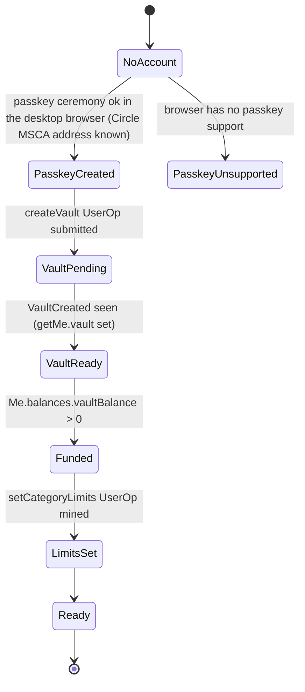

# The Czar app and notifications (spec 04)

- **Date:** 2026-10-18. **Status:** draft for review. Conventions: `cross-cutting.md`. Shapes: docs/specs/02 only (OpenAPI `operationId`s, `mcp/czar-mcp-tools.md` §7 push payloads, stage 2). Contracts: docs/specs/03 only.
- **Components:** CZ-22 app (Phase 1, desktop browser, D69), CZ-23 notifications (**moved to stage 2, D69**; outline only, see `docs/specs/05-build-plan/stage-2-backlog.md` §2 M-4).

---

## CZ-22 Czar app (desktop web app in Phase 1)

### 1. Identity

| Item | Value |
|---|---|
| CZ ID, name | CZ-22, Czar app |
| Phase | 1 |
| Product / roadmap | product §9.1 surfaces, §9.2 first-time journey, §9.3 everyday journey, §6.8 envelopes, §6.6 freeze, §6.11 ROI ledger; roadmap 2.1, 2.6 |
| Decisions | D5 (non-crypto user), D69 (Phase 1 runs in a desktop browser; the Home Screen install and the D28 native fallback are stage 2, amending D6 and D28), D26 (Circle Modular Wallets passkey account), D30 (approvals are UserOps from the owner), D31 (wording rule), D34 (no soul in the app), D35 (no credits), D36 (alternates shown) |
| Package | `apps/web` (`@czar/web`), Next.js, React, Tailwind; `@czar/vault-client` for calldata checks |

### 2. Responsibilities and non-responsibilities

- **Does:** sign-up with a passkey smart account; create the user's vault; show budget and limits; list pending approvals (the source of truth, FD-32); show a plan and let the owner approve it by building and submitting the UserOp; freeze and unfreeze; receipts, envelopes, monthly statement; privacy explanations. Phase 1 approvals reach the user only through the in-app pending list (D69); there is no push in Phase 1.
- **Does not:** hold any Czar key (K3, K5, K7, K8 never reach the browser); submit owner UserOps through Czar (the app submits through Circle's bundler itself, D30, A6-19); show the Work Soul (D34); show raw merchant text; convert currency on its own (server-provided display strings).

### 3. Runtime

| Item | Value |
|---|---|
| Where | a desktop browser on macOS: Safari or Chrome, where passkeys work (D69, D1-04). Desktop layouts only. **Stage 2:** the phone browser installed to the Home Screen (iOS 16.4+ for push, D2-01; iOS 26 opens any added site as a web app, D1-10) and mobile layouts (`stage-2-backlog.md` §2 M-3, M-5) |
| Hosting | **Phase 1 (D70, D78):** static build served by the local server on Zaryab's Mac at origin `http://localhost`, the same origin as the API (`/v1/...`); WebAuthn RP ID `localhost` (browsers treat `http://localhost` as a secure context, so passkeys work there). **Stage 2:** a public origin with Google Cloud; passkeys are bound to their RP ID, so each testnet owner registers a new passkey on the new origin and points the vault's D30 fallback at it with `setPasskey` (through the smart account). **Superseded by D78 / RV-028:** "static build on a CDN; API at `api.<env>.czar.dev`; app origin `app.<env>.czar.dev`" for Phase 1 |
| Process | single-page app; no service worker in Phase 1 (stage 2: Declarative Web Push needs none, D2-06) |
| Update | Phase 1: the local server serves the new build; the browser picks it up on next load. Stage 2: CDN deploy |
| Resource budget | first load ≤ 300 KB JS gzipped; approval screen interactive ≤ 1.5 s on a mid-range laptop |

### 4. Interfaces

| Direction | Interface | Notes |
|---|---|---|
| App → server | `createSession` (`SessionRequest` WebAuthn assertion → `SessionResponse`), `getMe` (`Me`), `listApprovals` (`ApprovalSummary` page), `getApproval` (`Plan`), `createApprovalIntent` (`ApprovalIntent`), `notifySubmitted` (`SubmittedNotice`), `listEnvelopes`, `getEnvelope` (`EnvelopeDetail`), `createFreezeIntent` (`FreezeIntent`), `listReceipts` (`LedgerReceipt`), `getMonthlyStatement` (`MonthlyStatement`), `getSoulPointer` (`SoulPointer`); `createPushSubscription` / `deletePushSubscription` stay defined in 02 but are **stage 2** (D69) and not called in Phase 1. Route: `getSoulPointer` (`SoulPointer`) | 02 §9.2 app surface; bearer `AppSession` |
| App → Circle | `@circle-fin/modular-wallets-core` 1.0.16: `toPasskeyTransport` for the passkey, `toModularTransport(clientUrl + "/arcTestnet", clientKey)` as bundler transport (A6-06, A6-19); `K2` client key is a public-facing credential | A6-05, A6-06 |
| App → Arc (through the bundler) | UserOps that call `CzarVaultFactory.createVault(ownerAccount, salt)` (03 `czar-vault-factory.md` §5), `ICzarVault.openEnvelope(p)`, `freeze()`, `unfreeze()`, `setCategoryLimits(categoryId, userMax, autoLimit)`, `withdraw(to, amount)`, USDC `transfer` into the vault | calldata comes from the server intents for approvals and freeze; the app re-encodes `ApprovalIntent.decoded` with `@czar/vault-client` and refuses if it differs from `calldata` |
| App → secondary bundlers | Pimlico, Alchemy, ZeroDev (all support Arc testnet and mainnet, A6-15 to A6-17) when Circle's transport fails | `SubmittedNotice.bundler` records which one |
| Events consumed | none directly; the server mirrors chain state from CZ-19 (`EnvelopeOpened`, `Frozen`, …) into `Me`, `Envelope`, `LedgerReceipt` |

### 5. Internal design

#### 5.1 Screens

| Screen | Route | Data | Actions |
|---|---|---|---|
| Welcome | `/` | — | "Create your account" |
| Create account | `/onboarding/passkey` | Circle passkey ceremony | passkey create |
| Create vault | `/onboarding/vault` | `getMe` (vault address predicted by the factory) | submit `createVault` UserOp |
| Add money | `/onboarding/fund` | `Me.balances`, faucet or onramp outline | copy address, open onramp |
| Set limits | `/onboarding/limits` | categories, amounts in USD (D51) | `setCategoryLimits` UserOp per category |
| Home | `/home` | `Me`, pending count, last receipts | approve, freeze |
| Pending approvals | `/approvals` | `listApprovals?status=pending` | open one |
| Approval | `/approve/{planId}` | `getApproval` (`Plan`), `createApprovalIntent` | approve, decline |
| Envelopes | `/envelopes`, `/envelopes/{envelopeRef}` | `listEnvelopes`, `getEnvelope` | close (owner, after expiry) later phase |
| Receipts | `/receipts` | `listReceipts` | — |
| Monthly statement | `/statement/{yyyy-mm}` | `getMonthlyStatement` | — |
| Settings: privacy | `/settings/privacy` | — | read-only text (§12) |
| Settings: devices | `/settings/devices` | device list (pairing code) | show 8-digit pairing code (02 §9.1), revoke |
| Settings: Work Soul | `/settings/soul` | `getSoulPointer` | pointer text only (D34) |
| Frozen | banner on every screen | `Me.frozen`, `Me.paused` | unfreeze |

#### 5.2 Onboarding state machine



- **Stage 2 (D69, `stage-2-backlog.md` §2 M-1, M-3, M-4):** the states `Installed` (Home Screen install), `PushOn` and `PushOff` (permission after a tap, `createPushSubscription`), and the `PasskeyUnsupported` branch for the installed iPhone web app (D1-11, the D28 native switch) are added back when mobile ships.
- `PasskeyCreated`: the Circle MSCA address is counterfactual until its first UserOp (p1-W2 for Agent Wallets; AR-2 for MSCA). The vault must exist before any payment (A1-13, A1-19), which is why `createVault` is the first UserOp.
- `VaultPending`: gas is paid in native USDC by the MSCA; whether Circle sponsors MSCA gas on Arc is a GAP (A6-08 lists no Arc paymaster; A6-19 says the client URL is bundler and paymaster). If the UserOp is rejected for gas, the app sends the user to "Add money" first (a small amount to the MSCA, then the vault).
- `Funded`: on testnet the faucet gives 20 USDC per request (p1-A11) but whether it can target an MSCA address is a GAP (A6-26, AR-6); the app shows the address and the faucet link and polls `getMe`. Onramp (Phase 2): the Arc Onramp Kit widget decides availability; the app never promises a country (F5-02 to F5-05, FD-36).
- `PasskeyUnsupported`: the desktop browser has no platform passkey (rare on current Safari and Chrome on macOS, D1-01, D1-04). The app tells the user to switch to Safari or Chrome on macOS and reports the event.

#### 5.3 Approval flow

```mermaid
sequenceDiagram
  autonumber
  participant U as User
  participant A as App
  participant S as Server (CZ-12)
  participant B as Bundler (Circle; fallback Pimlico/Alchemy/ZeroDev)
  participant M as MSCA
  participant V as CzarVault
  U->>A: open /approve/{planId} from the pending list
  A->>S: getApproval → Plan
  A->>A: render goal, "Czar will look up" subject list (D84), steps, payees, cap, fee, expiry
  opt person edits subjects
    U->>A: remove or add subjects
    A->>S: revisePlanSubjects → new Plan (old plan superseded)
    A->>A: re-render with the new cap and planHash
  end
  U->>A: tap "Approve" (with the "Fill {fileName} when done" choice, D85)
  A->>S: createApprovalIntent(ApprovalIntentRequest) → ApprovalIntent
  A->>A: rebuild payeeRoot from the payee leaves it displays and planHash from the displayed plan (@czar/hashing); re-encode with @czar/vault-client; refuse unless both equal the calldata's (RV-044)
  A->>B: UserOp {to: vault, data: calldata, value: 0} signed by the passkey
  B->>M: handleOps
  M->>V: openEnvelope(p)
  A->>S: notifySubmitted {userOpHash, bundler}
  S-->>A: 202; state "Approved, waiting for the network"
  Note over S: CZ-19 sees EnvelopeOpened → approval leaves the pending list
```

- Step 5–6 (RV-044): the app never trusts server data to check server data. It recomputes, on the device with `@czar/hashing`, `payeeRoot` from exactly the payee leaves it shows the user (payees, alternates, the pocket leaf if any, each with its step and cap) and `planHash` from the plan fields it shows, then re-encodes `openEnvelope` with `@czar/vault-client` and refuses unless the result equals `ApprovalIntent.calldata` byte for byte (`czarCode: validation` shown as "Something changed in this plan. Please reload."). So a compromised server cannot show three known merchants while the calldata commits an extra attacker leaf. It also checks `ApprovalIntent.expiresAt`. **Superseded:** "re-encode decoded args …; compare payeeRoot to the Plan's payeeRoot" (both came from the server).
- Step 7: the passkey signs the UserOp hash; Czar never sees the private key (K1).
- Step 10–11: until `EnvelopeOpened` is indexed, the approval shows "Approved, waiting for the network". If nothing is seen within `app.approvalConfirmTimeoutSeconds` (120), the app offers "Check again" and "Resubmit" (same calldata; the vault rejects a second open only by the envelope counter, so a resubmit after a silent success would open a second envelope: the app therefore first asks `getEnvelope` by the expected `envelopeRef` from `Me` counters before resubmitting).

#### 5.4 Freeze flow

- Tap "Freeze" → confirm sheet → `createFreezeIntent` (`{action: "freeze"}`) → UserOp with the returned `calldata` (ABI `freeze()`) → "Freezing…" → `Me.frozen` true → banner. Unfreeze is the same with `unfreeze()` (owner only, 03 `czar-vault.md` §5.1).
- A frozen vault still lets pullbacks and refunds finish (03 `czar-vault.md` §8.1), so the banner says payments cannot *start*. On freeze, Czar also stops every pocket nanopayment and evaluator payout at the signer and pulls back every pocket at once (D72); payments signed just before the freeze can still settle, so the app never claims "nothing was spent" (RV-007).
- Freeze is two steps, not atomic (D63): the `frozen` flag set by `freeze()` already blocks every spending path; then, after `Frozen` is indexed, the server (CZ-24) runs a follow-up agent step that calls `lowerAutoLimit(category, 0)` for each category (D60; 03 `czar-vault.md` §5.6). An atomic contract version is stage 2 (`stage-2-backlog.md` §3 P2-15). The `Me.limits[]` rows then show 0 and the wording "Limits reset after your freeze. They grow back as objectives succeed." Unfreezing does not restore them.

#### 5.5 Storage (browser)

| Store | Content | Class | Rule |
|---|---|---|---|
| session storage | `AppSession` bearer, expiry | server-only token | cleared on sign-out; expires 24 h (02 §9.1) |
| `localStorage` | display preferences, last-viewed tab, onboarding step | local | no money data; wrapped in try/catch |
| none | plans, receipts, balances | — | always fetched; the pending list is never cached as truth |

#### 5.6 Named parameters

| Parameter | Default | Reason |
|---|---|---|
| `app.approvalConfirmTimeoutSeconds` | 120 | 0.5 s blocks (p1-A6) plus bundler latency; well past normal |
| `app.pendingPollSeconds` | 15 | the pending list is the only Phase 1 approval channel (D69, FD-32); polled while open |
| `app.sessionHours` | 24 | 02 §9.1 |
| `app.newPayeeWarnThreshold` | 1 | any new payee gets a warning (phished-approval mitigation, spec 01 §13) |
| `app.largeCapWarnBps` | 5000 | warn when a cap is above 50% of the category `userMax` |
| `app.bundlerOrder` | `circle, pimlico, alchemy, zerodev` | A6-15 to A6-19 |
| display currency | USD only (D51) | the server supplies `capDisplay` / `amountDisplay` as USD strings, USDC 1:1 (for example `"$0.88"`); no exchange-rate provider in Phase 1; local currency is a later option |
| `app.pairingCodeTtlMinutes` | 5 | 02 §9.1 |

### 6. Behaviour

**Everyday (product §9.3):** the user opens Czar in the desktop browser → the pending list shows new approvals (badge count in the tab title) → open approval → approve or decline → the result is written back on the computer (CZ-11) → receipt visible. Push is stage 2 (D69). Objectives under the earned auto-limit run without the app (agent-opened envelopes, 03 `czar-vault.md` §5.2) and appear in Envelopes with "Auto-approved within your limit".

**Alternate paths**
- Decline: `POST` nothing on-chain; the plan expires server-side (`plan-expired`); the daemon learns the dismissal through `getObjective`.
- Plan expired before the tap: `createApprovalIntent` returns `plan-expired` → "This plan expired. Czar will re-price it if the need is still open."
- Insufficient free balance: the vault would revert `InsufficientFree`; the server pre-checks `Me.balances.free` and shows "Add money" before the UserOp.
- Bundler rejects the UserOp: try the next bundler in `app.bundlerOrder`; after all fail, "The network is busy. Your approval was not sent. Try again in a minute."
- Frozen or paused: approvals are disabled with the banner text; `createApprovalIntent` returns `frozen` / `paused`.
- Session expired: `session-expired` → passkey sign-in sheet; the pending list reloads after.

### 7. AI usage

None. The app renders server strings; it never calls a model.

### 8. Privacy

| Data | Class | Handling |
|---|---|---|
| redacted goal text (`ApprovalSummary.goal`, `Plan` steps) | redacted-to-server | displayed; never cached beyond the view |
| payees | public | shown as origin hosts (`LedgerReceipt.merchantLabel` is the host only) and, on tap, the address |
| balances, limits, envelopes, receipts | public (chain) / server-only | displayed |
| passkey | K1 | platform authenticator only (D1-02); synced passkeys give no device proof (D1-12) |
| Work Soul | local-only | never requested by the app (D34) |

Privacy screen text follows D31 (§12).

### 9. Security

| Item | Detail |
|---|---|
| Keys | K1 (user passkey, signs UserOps), K2 (Circle client key, public-facing). No Czar signing key in the browser. |
| Permissions | the owner's MSCA is `msg.sender` on the vault (D30); the app cannot act for the agent, autonomy, guardian or evaluator roles |
| Phished approval (spec 01 §13) | the approval screen always shows: goal, every step's amount, the cap in USD and USDC, each payee host with "New payee" badges when `ApprovalSummary.newPayees > 0`, the number of alternates (D36), the category and its remaining `userMax`, expiry. Warnings above `app.largeCapWarnBps`. The bound even after a bad approval is that envelope's cap. |
| Calldata tampering | the app re-encodes `decoded` and compares to `calldata`; mismatch blocks the tap |
| Session | 24 h bearer, passkey-backed; WebAuthn assertion over a server challenge (02 §9.1) |
| Origin | the RP ID is the app origin; the D30 fallback (`OwnerAction`) is not used in Phase 1 unless AR-2 fails |
| Untrusted content | the app renders only server-provided, already-labelled strings; merchant text appears only inside `Result.provenance`-labelled spans in the result file written by the daemon (CZ-11), never in the app |

### 10. Failure handling

| Failure | App behaviour | User sees | Notes |
|---|---|---|---|
| browser has no passkey support | record `passkey-unsupported`; ask the user to use Safari or Chrome on macOS | §12 "Passkeys did not work here" | the installed-iPhone gate (D1-11, D28) is stage 2 (D69) |
| Circle transport error | next bundler (A6-15 to A6-17) | "Sending…" then success or the busy message | `SubmittedNotice.bundler` |
| `createVault` reverts `VaultExists` | treat as success; `getMe` | — | idempotent by design (FAC-1) |
| `openEnvelope` reverts (`InsufficientFree`, `AllowanceExceeded`, `FrozenVault`, `Paused`, `BadParams`) | decode name via `@czar/vault-client`; map to wording | §12 table | never shown raw |
| network offline | cached last `Me` shown with "Offline — balances may be stale"; approvals disabled | — | |
| indexer lag | "Syncing…" badge from `Me.balances.asOfBlock` age > `app.staleBlocks` (120) | — | spec 01 §14.1 |

Idempotency: every creating call sends `Idempotency-Key`; `notifySubmitted` with the same `userOpHash` is a no-op; UserOps are idempotent on the vault only for `createVault`, so the app guards `openEnvelope` resubmits (§5.3).

### 11. Observability

- Client events (no personal data): screen views, onboarding step reached, `passkey-unsupported`, bundler used, approval latency to `EnvelopeOpened`. Sent to the server as counts.
- Server metrics: `czar_app_approvals_total{outcome}`, `czar_app_approval_confirm_seconds`, `czar_app_passkey_unsupported_total`.
- Alert: `passkey-unsupported` rate > 10% of sign-ups (triggers a browser-support review).

### 12. Interface wording

**Money and limit states**

| State / source | Exact text |
|---|---|
| `Me.balances.free` | "Available: {amount}" |
| `Me.balances.committed` | "Committed to objectives: {amount}" |
| pocket funds (`Me.balances.pocketOutstanding`, 02 api/openapi.yaml, AM-03) | "In pocket wallets: {amount}" |
| `Me.balances.mscaBalance` | "Network fee reserve: {amount}" (shown as its own balance until Circle gas sponsorship on Arc is confirmed, D52; A6-08, A6-19 GAP) |
| limit row | "{category}: up to {autoLimit} per week without asking, max {userMax}" |
| frozen banner (`Me.frozen`) | "Frozen. No payments can start until you unfreeze. Money already on its way back to you still arrives." |
| paused banner (`Me.paused`) | "Czar paused all spending for safety. Nothing can start. Your money stays in your vault." |
| approval card | "Spend up to {capDisplay} ({cap} USDC) on \"{goal}\"" |
| subject list (D84) | "Czar will look up {fields} for: {subject 1}, {subject 2}, …" with "Edit list"; source line "From {fileName}, {topic}" |
| subject edit saved | "List updated. New estimate: {capDisplay}." |
| fill option (D85) | checkbox "Fill {fileName} when done", ticked by default; sent as `ApprovalIntentRequest.fillInPlace` |
| delivered, filled | "Filled {cellsFilled} of {n} in {fileName}." plus "{cellsNotFound} not found" / "{cellsSkippedClash} skipped because the file changed" when non-zero; "Undo from the Czar viewer on your Mac." |
| step, x402 or nanopayment | "Paid per call, checked before the next step" |
| step, ERC-8183 job | "Held in escrow, money back if rejected" |
| payee | "{host}" plus badge "New payee" when never paid before |
| payee is a lab service (D83) | badge "Czar test merchant" next to the host |
| real-market panel (D83, objective detail and shadow summary, from `Plan.marketReference` or `getMarketView`) | header "Real market (Arc mainnet)"; line "{ready} listed services do this from {low} per call. Czar has not paid or checked them."; never a button to pay |
| alternates (D36) | "If a service fails, Czar may use up to 2 backup services under the same step limit." |
| network fee line | "Network fee: about {feeDisplay}, paid from your network fee reserve" (≈ $0.001, p1-A6) |
| expiry | "This plan expires {expiresAt}" |
| approve button | "Approve {capDisplay}" |
| after approve | "Approved, waiting for the network" → "Approved. Czar is working on it." |
| auto-approved envelope | "Auto-approved within your weekly limit for {category}" |
| `LedgerReceipt.status = reserved` | "Reserved" |
| `settled` | "Paid" |
| `pending` | "Paid, settling (up to 16 minutes)" (A2-26) |
| `completed` | "Paid" |
| `released` | "Not charged" |
| `refunded` | "Refunded" (Czar service: "Refunded by Czar (Czar service)") |
| `failed` | "Failed, not charged" |
| x402 step failed after payment | "Paid {amount}; the result failed Czar's check. This merchant was rated down. Third-party calls are not refundable." (D35) |
| job rejected | "Rejected by Czar's check. {amount} returned to your vault." |
| monthly statement | "Czar saved you {hours} hours for {totalSpentDisplay} in {month}." |
| decline | "Declined. Czar won't spend on this." |
| plan expired | "This plan expired. Czar will re-price it if the need is still open." |
| insufficient free balance | "Not enough available money for this plan. Add money or lower the plan." |
| `AllowanceExceeded` (agent path only; shown in envelopes) | "Needed your approval: above your weekly limit for {category}." |

**Onboarding and privacy**

| Screen | Exact text |
|---|---|
| Create account | "Create your account with Face ID or Touch ID. No passwords, no seed phrases." |
| Create vault | "Setting up your vault on Arc. This takes a few seconds." |
| Add money | "Add USDC to your vault. On the test network, use the faucet link below." (never a country promise) |
| Set limits | "How much may Czar spend per week without asking? You can change this any time." |
| Passkeys unsupported | "Passkeys did not work in this browser. Please open Czar in Safari or Chrome on your Mac." |
| Pending approvals | "Czar needs your approval for these. Nothing is spent until you approve." |
| Stage 2 (D69) | Home Screen install, notifications and the native-app notice keep their wording for stage 2: "Add Czar to your Home Screen to get approval requests as notifications."; "Turn on notifications"; "Passkeys did not work in the installed app on this phone…" (D28) |
| Privacy | "Raw work data stays on your computer. Only redacted excerpts are sent to compile your Work Soul, through a Czar relay that stores nothing. Objectives sent to Czar's server are redacted first." (D31 wording rule; never "never leaves") |
| Work Soul | "Your Work Soul is viewable on your computer. Open the Czar viewer there to read, edit or delete any line." (D34) |
| Devices | "Pair your computer: enter this code in the Czar daemon within 5 minutes: {code}" |

### 13. Performance and cost budgets

- Approval screen: ≤ 2 API calls before render; UserOp build ≤ 200 ms on-device.
- Pending list → approve → `EnvelopeOpened`: target ≤ 30 s median on testnet.
- Infrastructure: Phase 1 the local server only (D70); stage 2 a CDN.

### 14. Tests and definition of done

- **Phase 1 passkey test:** passkey create and assert in desktop Safari and desktop Chrome on macOS. Pass = `PasskeyCreated` reached and a later `createSession` succeeds in each browser. **Stage 2 (D69):** the installed iPhone Home Screen test (D1-11, D28).
- **Unit:** calldata re-encode check; wording map covers every `LedgerReceipt.status` and every decoded vault error; currency strings come only from the server.
- **Integration (Playwright, local `arc-anvil` + mocked bundler):** onboarding end to end; approval → `EnvelopeOpened`; freeze/unfreeze; decline; expired plan; frozen and paused banners; session expiry. All on desktop layouts.
- **Injection/phishing:** a plan with an unknown payee shows the "New payee" badge; a tampered `calldata` is refused; a cap above the warn threshold shows the warning.
- **Browser matrix (Phase 1):** Safari and Chrome on macOS (D1-01, D1-04). **Stage 2:** iOS 16.4, 18.4 (Declarative Web Push, D2-06), 26 (D1-10); Android Chrome (D1-03).
- **Definition of done:** the desktop passkey test passes in Safari and Chrome on macOS; every wording row rendered in a snapshot test; one testnet approval opened an envelope through Circle's bundler and one through a secondary bundler.

### 15. Dependencies

| Dependency | Version | Fact |
|---|---|---|
| `@circle-fin/modular-wallets-core` | 1.0.16 | A6-06 |
| Circle Modular Wallets client URL `…/arcTestnet` (bundler) | — | A6-05, A6-19 |
| Pimlico, Alchemy, ZeroDev bundlers | — | A6-15, A6-16, A6-17 |
| EntryPoint | v0.7 `0x0000000071727De22E5E9d8BAf0edAc6f37da032` (what Circle's wallet used in A1 funding; confirm MSCA's EntryPoint at build) | A6-09, A6-10; a1 README |
| Next.js, React, Tailwind | pinned in the build plan | spec 01 §17 |
| WebAuthn | platform authenticators, synced passkeys | D1-01, D1-02, D1-08 |

Open questions: Circle gas sponsorship for MSCA UserOps on Arc (GAP); faucet to an MSCA address (AR-6); which EntryPoint version the MSCA factory `0x0000000DF7E6…9AdD` targets (A6-07; GAP).

**Mainnet differences:** chain `eip155:5042`, Circle transport `…/arc`; onramp with KYB and a Circle API key (F5-01, F5-02); real money so the large-cap warning defaults may tighten; passkeys (desktop browser) and bundlers unchanged. No mainnet deployment is a step in this spec.

---

## CZ-23 Notifications (stage 2, D69)

> **Moved to stage 2 (D69).** Phase 1 has no push: the in-app pending-approvals list is the only approval channel and the source of truth (FD-32). This section is kept as a stage-2 outline (sections 1–4, 9, 14 in full; the rest outlined below). Backlog: `docs/specs/05-build-plan/stage-2-backlog.md` §2 M-4. The 02 shapes (`createPushSubscription`, `deletePushSubscription`, `PushSubscription`, `mcp/czar-mcp-tools.md` §7 payloads) stay defined and are tagged stage 2.

### 1. Identity

CZ-23, notification service; **stage 2** (D69); product §9.2 step 4 ("approve your first objective with one tap"), §6.8; decisions D28 (installed web app), D2 facts; package `apps/server` (push sender) plus the app's subscription screen.

### 2. Responsibilities and non-responsibilities

- **Does:** send `approval-needed` and `result-delivered` pushes exactly as `mcp/czar-mcp-tools.md` §7; keep subscriptions; retire revoked ones; set badge counts; never send a silent push.
- **Does not:** carry merchant text, payee addresses, or anything beyond the redacted title and the USD amount; act as the source of truth (that is `listApprovals`, FD-32); retry forever.

### 3. Runtime

Server worker in `apps/server`; outbound to Apple's push service (`*.push.apple.com`, D2-03) and browser push endpoints; no Apple Developer Program membership needed for web push (D2-03).

### 4. Interfaces

| Direction | Interface |
|---|---|
| In | internal events `approval.created(planId)`, `result.delivered(objectiveId, resultId)` from CZ-12/CZ-15 |
| Out | Declarative Web Push JSON `{"web_push": 8030, "notification": {"title", "body", "navigate", "app_badge"}}` (D2-06; keys exactly as 02 mcp §7) to each active `PushSubscription` of the user |
| API | `createPushSubscription`, `deletePushSubscription` (02 §9.2) |
| Keys | K17 VAPID key (`cross-cutting.md` §3.3) |

### 5–8, 10–13, 15. Outline (stage 2)

- **Design:** subscription states `Active → Retrying → Dead`, `Active → Revoked` on 404/410 or `deletePushSubscription`; never a silent push (D2-04); Declarative Web Push so a deleted service worker does not stop delivery (D2-07); `app_badge` = pending approvals at send time.
- **Parameters (stage 2):** `notify.maxAttempts` 5, `notify.backoffBaseSeconds` 30, `notify.ttlSeconds` 86,400, `notify.dedupeWindowSeconds` 300, `notify.bodyMaxChars` 120.
- **Behaviour:** `approval.created` and `result.delivered` events become the two payloads of 02 mcp §7; duplicates in the dedupe window are dropped; no subscription means nothing is sent and the pending list still shows the approval.
- **AI usage:** none. **Privacy:** body = redacted goal title and USD amounts only (D51); no merchant text or payee addresses.
- **Failures:** push service down → retry, the pending list is unaffected; revoked → marked and the app offers the tap again; iOS < 16.4 or no Home Screen install → no push (D2-01).
- **Observability:** `czar_notify_sent_total{kind,outcome}`, `czar_notify_revoked_total`; no bodies in logs.
- **Wording:** title "Czar needs your approval", body "Spend up to {capDisplay} on \"{goal}\""; title "Result delivered", body "{goal}: {summary}, {amountDisplay}".
- **Budgets:** send within 5 s of the event; at most one push per plan per 5 minutes.
- **Dependencies:** Apple Web Push (D2-01, D2-03, D2-06); a VAPID Web Push library (GAP on the exact package); K17.

### 9. Security

K17 VAPID private key in the secret store; a leak lets an attacker spam notifications but not spend (spec 01 §7.2). Push bodies cannot trigger spending: approval always needs the owner's UserOp (D30). `navigate` is always on the app origin.

### 14. Tests and definition of done

- Unit: payload equals the 02 mcp §7 JSON byte for byte except the variable fields; body never exceeds `notify.bodyMaxChars`; no address or merchant text can enter the body (corpus test).
- Integration: mocked push service returning 201 / 410 / 503; state machine transitions.
- Device: a real iPhone on iOS 18.4+ receives `approval-needed` after a Home Screen install and a tapped permission; tapping it opens `/approve/{planId}`.
- Definition of done: both kinds delivered on a real iPhone; a revoked subscription is detected and cleaned; no silent push path exists in code.

---

## Change log

| Date | ID | Change |
|---|---|---|
| 2026-10-18 | D51 | USD-only display; removed `app.fxSource` and local-currency wording |
| 2026-10-18 | D52 | network fee reserve shown as its own balance |
| 2026-10-18 | D60 | freeze flow lowers every category's `autoLimit` to 0 |
| 2026-10-18 | AM-03 | pocket funds read from `Me.balances.pocketOutstanding` |
| 2026-10-19 | D69 | CZ-22 Phase 1 is a desktop web app (Safari or Chrome on macOS); Home Screen, push and mobile states moved to stage 2; desktop passkey test replaces the iPhone gate; CZ-23 reduced to a stage-2 outline (sections 1–4, 9, 14 kept). |
| 2026-10-19 | D63 | freeze lowering described as a follow-up agent step, not atomic; atomic version is stage 2. |
| 2026-10-19 | D69 | Header marks the push payload reference as stage 2. |
| 2026-10-19 | RV-028 / D78 | Phase 1 origin `http://localhost`, RP ID `localhost`, served by the local server; CDN and `czar.dev` hosts are stage 2. |
| 2026-10-19 | RV-044 | approval integrity check recomputes `payeeRoot` and `planHash` on the device from the displayed leaves. |
| 2026-10-19 | RV-007 / D72 | freeze wording: payments cannot start; pockets pulled back. |
| 2026-10-20 | D83 | Wording: Czar test merchant badge; real-market panel (read-only). |
| 2026-10-20 | D84 | Approval shows the subjects Czar will look up and lets the person edit them (`revisePlanSubjects`). |
| 2026-10-20 | D85 | Approval screen fill-in-place checkbox; delivered wording. |
