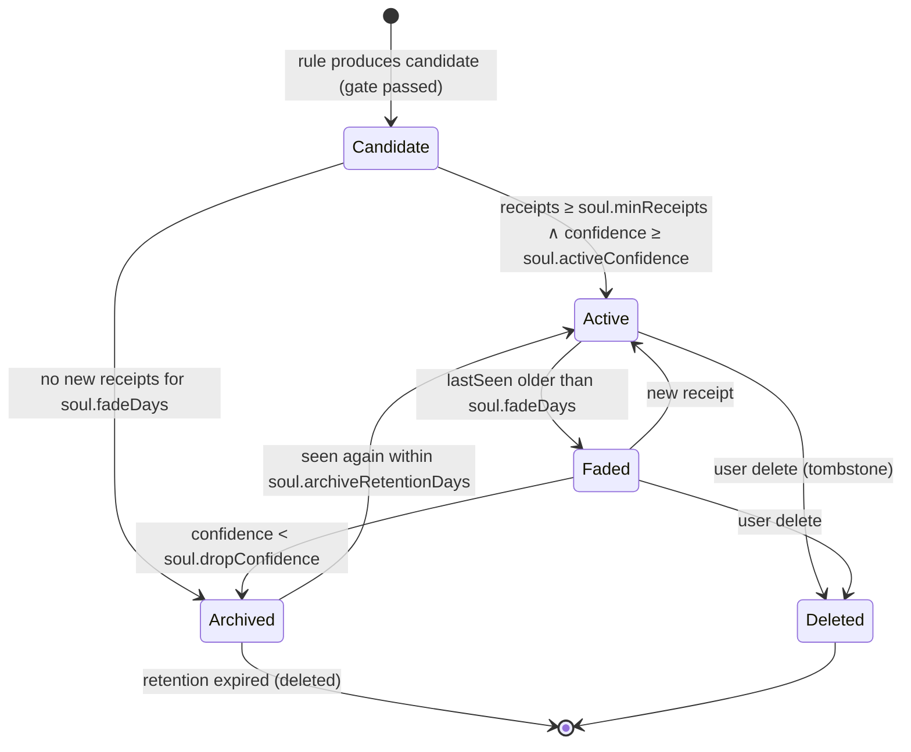
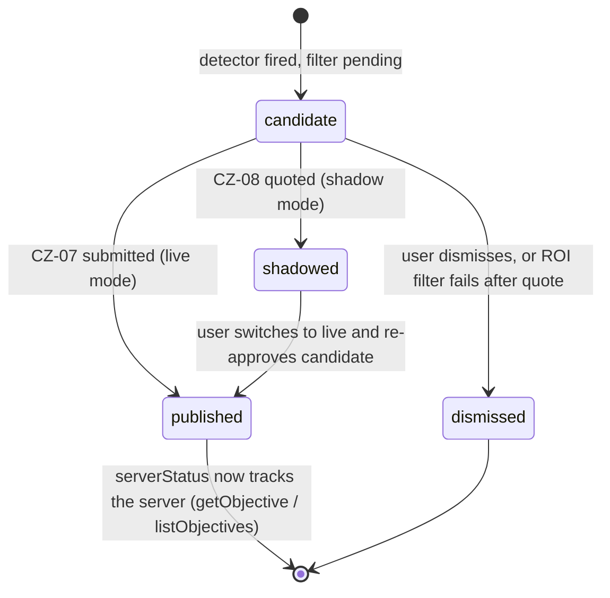

# Local soul and drives (spec 04)

- **Date:** 2026-10-18. **Status:** draft for review. Conventions: `cross-cutting.md`. Data shapes: only `docs/specs/02-data-and-protocol/` (cited "02 §n", schema files by name, OpenAPI `operationId`s). Prompts: `ai-prompts.md` (P-01, P-04, P-05, P-06).
- **Components:** CZ-04 soul compiler, CZ-05 soul store and viewer, CZ-06 drives engine, CZ-07 objective publisher, CZ-08 shadow mode. All run inside the daemon process (`@czar/daemon`, CZ-02) on the user's machine.
- **Wording rule (D31):** raw work data stays on the user's machine; only redacted excerpts are sent for soul compilation, through a Czar proxy that stores nothing. Never claim that nothing leaves the machine.

---

## CZ-04 Soul compiler

### 1. Identity

| Item | Value |
|---|---|
| CZ ID | CZ-04 |
| Phase | 1 (v0, Claude Code observations only) |
| Product | §6.3 Work Soul; §7.2 `soul.json`; §10 trust |
| Roadmap | 1.1 Work Soul file with receipts |
| Decisions | D7, D25, D31, D34 |
| Facts | C2-01 to C2-06 (redaction), C3-02 ASI06, C3-04, B5-06 (injection hygiene), B6-12 (storage) |

### 2. Responsibilities and non-responsibilities

- **Does:** turn the shared memory (CZ-03) into a new `soul.json` version (02 §4.2) with beliefs in eight sections, each carrying receipts, confidence, first/last seen; fade and archive stale beliefs; keep user edits; produce the weekly diff; compute `soulVersionHash` (02 §5.2) and hand it to CZ-07 for `submitSoulVersion`.
- **Does not:** send belief text anywhere except the redacted excerpt to the hosted model through the Czar proxy (D31); create objectives (CZ-06); render exports (CZ-10, Phase 2); decide spending.

### 3. Runtime

- In-process module of the daemon. Runs on a schedule (`soul.compileCron`, default `02:00` local) and on demand from the viewer ("Compile now"). One compile at a time (mutex); a running compile is cancelled on daemon shutdown and resumes from the last committed version on restart (versions are atomic).
- Resource budget: ≤ 2 CPU-seconds of rule work per compile, ≤ 150 MB RAM, one model call ≤ 24,000 tokens (`models.soulMonthlyTokens`, `cross-cutting.md` §6.2), ≤ 60 s wall time (`models.soul-compiler.timeoutMs`).

### 4. Interfaces

| Direction | Interface | Shape |
|---|---|---|
| in | shared memory query (CZ-03) | `ActivityEvent` rows (02 §4.1) since the previous compile's cursor, plus the current `soul.json` |
| in | viewer edits (CZ-05) | belief operations on the local store |
| in | redaction layer 2 (CZ-26 sidecar) | excerpt text in → marked text out (02 §3.1) |
| in | P-01 `screen` and P-04 `soul-compiler` via the Czar model proxy (`completeModelCall`, AM-02) | `ai-prompts.md` |
| out | `soul_versions` row (new `soul.json`) | 02 §4.2 (`soul.schema.json`) |
| out | `soulVersionHash` to CZ-07 | `submitSoulVersion` (`POST /v1/soul-versions`, `SoulVersionSubmission`) |
| out | weekly diff (local only) | §5.6 below |
| events | emits `soul.compiled` (version, counts), `soul.compile_failed` (reason) on the local event bus; consumes `memory.appended` | counts only |

### 5. Internal design

#### 5.1 From observations to the eight sections

Each compile runs **rules first, then the model**. Rules produce "belief candidates" from structured event fields; the model (P-04) only writes or refines plain-language belief text for candidates the rules already found, and may propose `support`/`fade` operations. The model never creates a belief from text alone (§5.4 gate).

| Section | Rule source (structured fields of `ActivityEvent`) | Example belief (invented) |
|---|---|---|
| `place` | OS locale, time zone, currency from daemon settings (not from events); working-hours histogram from `occurredAt` | "Works in Europe/Berlin, mostly 09:00–18:00" |
| `mission` | `projectRef` activity volume over `soul.missionWindowDays`; file names in `summary` of `file-write` events with `provenance.trusted = true`; `deadline`-shaped dates found by the `placeholder`/deadline rule in trusted summaries | "Pricing refresh due Friday" |
| `rituals` | recurring (`projectRef`, `eventType`, weekday, hour) patterns with ≥ `soul.ritualMinRepeats` occurrences at the same weekday/hour slot across ≥ `soul.ritualMinWeeks` weeks | "Monday morning pipeline review" |
| `friction` | `repeated-error` and `agent-refusal` clusters (same inputs as CZ-06 detectors); repeated `search` events with the same normalized query; long `durationMs` on the same tool | "Manual competitor price checks repeat" |
| `drives` | open loops: `placeholder` hits in trusted file-write summaries; `stale-work` (project untouched ≥ `soul.staleDays` after heavy activity) | "Competitor price table still has placeholders" |
| `taste` | preferred formats from `file-write` extensions in `fileRefs` counts (hashed paths carry no names; the extension is kept as a separate field in `summary` prefix by CZ-01); tool preferences from `toolName` frequency | "Prefers Markdown tables" |
| `constraints` | daemon settings (budget, tools the user marked off-limits, privacy limits); never inferred from text in Phase 1 | "Never send customer names to merchants" (user-set) |
| `spendingPosture` | the app's approval/rejection history mirrored from `getObjective` statuses (counts only); hourly value setting | "Approved 4 of 5 research objectives under $1" |

- A belief candidate has `section`, a normalized `key` (for dedupe), `receipts[]` (event ids), and a `draftText` built from a template. P-04 may rewrite `draftText` into clearer wording; it may not change the key, section or receipts.
- Phase 1 scope: `mission`, `friction`, `drives`, `rituals`, `taste` from events; `place`, `constraints`, `spendingPosture` from settings and app status only.

#### 5.2 Confidence formula (`soul.*` parameters)

For a belief with receipts `r_1 … r_n` (event timestamps `t_i`, ages `a_i` days at compile time) and `s` distinct sources (distinct `host` or `provenance.hookEvent` classes):

- `evidence = Σ_i 0.5^(a_i / soul.confidenceHalfLifeDays)` (default half-life 14 days).
- `diversity = min(1, s / soul.diversityTarget)` (default target 2).
- `confidence = clamp(0, 1, (1 − 0.5^(evidence / soul.evidenceScale)) × (0.7 + 0.3 × diversity))` (default `evidenceScale` 3).
- A belief becomes `Active` only when `n ≥ soul.minReceipts` (default 2) and `confidence ≥ soul.activeConfidence` (default 0.5). Below that it stays `Candidate` and is not rendered.
- `userEdited = true` beliefs keep whatever confidence the user left and are never recomputed (§5.5).

| Parameter | Default | Reason |
|---|---|---|
| `soul.confidenceHalfLifeDays` | 14 | matches the Selection Layer's 14-day half-life for drift (SL-C9) and a two-week work rhythm |
| `soul.minReceipts` | 2 | one observation is a coincidence; two is a pattern |
| `soul.diversityTarget` | 2 | two independent signals (e.g. a file edit and a search) |
| `soul.evidenceScale` | 3 | three fresh receipts reach ≈ 0.5 evidence weight → about 0.5 confidence |
| `soul.activeConfidence` | 0.5 | the viewer shows only beliefs at least as likely as not |

#### 5.3 Decay and archive

- Every compile recomputes `confidence` for non-edited beliefs from receipt ages, so a belief not seen again fades by itself (half-life above).
- `lastSeen` older than `soul.fadeDays` (default 30) marks the belief `Faded` (shown greyed in the viewer).
- `confidence < soul.dropConfidence` (default 0.15) moves it to `Archived`: hidden, kept for `soul.archiveRetentionDays` (default 180) so it can revive with its history if seen again, then deleted with its receipts links.
- A revived belief keeps its `beliefId`.

#### 5.4 ASI06 gate: what may enter the soul (C3-02)

| Rule | Detail |
|---|---|
| Provenance allowlist | only events whose `provenance.hookEvent` is in `soul.allowedProvenance` (default: `PreToolUse`, `PostToolUse`, `PostToolUseFailure`, `UserPromptSubmit`, `UserPromptExpansion`, `SessionStart`, `SessionEnd`, `SubagentStop`, `Stop`) may **create** a candidate, and only through a rule in §5.1 |
| Trusted vs untrusted text | an event with `provenance.trusted = false` (tool output, page text, `last_assistant_message`) can only **support** an existing belief's receipts; it can never create one and its text never reaches a `draftText` template |
| Per-session cap | at most `soul.maxCandidatesPerSession` (default 10) new candidates from any one `sessionRef` per compile; excess is dropped with a counter |
| Content hygiene | a candidate whose text matches the P-01 `screen` injection classifier (run on the excerpt, §5.5) is dropped and counted; the viewer shows "n items were ignored as suspicious" |
| Deny-list patterns | before any model call, `draftText` lines matching imperative instruction shapes ("ignore previous", "you must", "run ", "install ", "pay ", "send ", hex addresses `0x[0-9a-fA-F]{40}`) are rejected by regex; this also keeps Hermes's injection scanner from blocking exports later (B5-06) |
| Model output gate | P-04 may return `add` only for a candidate id the rules produced; `support`/`fade` only for existing `beliefId`s; any other id is discarded |

#### 5.5 Redaction and the hosted model call (D31)

1. Layer 1 (secrets) already ran at intake (CZ-26, CZ-01), so stored `summary` text carries `[[R:S:…]]` markers only.
2. Build the excerpt: current beliefs in the sections listed by `excerptPolicy.allowSections` (02 §4.2, default `mission`, `friction`, `drives`) with their `text`, `confidence`, `lastSeen`; plus the new candidates' `draftText` and up to `soul.excerptReceiptsPerCandidate` (default 3) receipt summaries each, trusted summaries only. Total ≤ `excerptPolicy.maxChars` (default 20,000).
3. Layer 2 (Presidio sidecar, CZ-26) runs on the whole excerpt; entities become `[[R:P:…]]` markers (02 §3.1). If the sidecar is down, the compile runs **rules only** (no model call); it never sends an un-redacted excerpt.
4. P-01 `screen` runs on the excerpt; flagged lines are removed (§5.4).
5. The excerpt goes to the Czar model proxy with the P-04 prompt. The proxy forwards to the hosted model and stores nothing (D31); the daemon logs only token counts and the prompt hash.
6. The response (belief operations, `ai-prompts.md` P-04 schema) is validated against the gate (§5.4) and applied.
7. Retention of the excerpt on the machine: it is not stored; only the resulting beliefs are.

#### 5.6 Versioning and the weekly diff

- `version` increases by one per successful compile; `compiledAt`; `previousHash` = previous `soulVersionHash`. `soulVersionHash` per 02 §5.2 (section hashes over belief `text`, `confidence`, `firstSeen`, `lastSeen`, sorted receipts). The daemon stores every version row (`soul_versions`) and the current beliefs (`beliefs`).
- The weekly diff compares the newest version with the one closest to 7 days earlier: **added** (new `Active`), **strengthened** (confidence up ≥ `soul.diffDelta` 0.15), **faded** (state `Faded` or confidence down ≥ 0.15), **removed** (`Archived` or user-deleted). Rendered in the viewer under "What Czar learned about you this week"; stored locally; never sent.

#### 5.7 User edits always win

| User action in the viewer | Effect | Compiler rule |
|---|---|---|
| Edit text | `text` replaced, `userEdited = true`, confidence kept | may only append receipts; never changes `text` or `confidence` |
| Pin | `userEdited = true` | never fades or archives |
| Delete | tombstone row (`beliefs.deletedAt`), `beliefId` blocked | the same normalized `key` can never re-create a belief; the tombstone is kept for `soul.archiveRetentionDays` then purged |
| Set confidence | value stored, `userEdited = true` | as edit |
| Un-pin | `userEdited = false` | normal rules resume from the next compile |

#### 5.8 Belief state machine

| From | To | Trigger | Who |
|---|---|---|---|
| — | Candidate | rule in §5.1 with gate §5.4 | compiler |
| Candidate | Active | thresholds met | compiler |
| Active | Faded | `lastSeen` age > `soul.fadeDays` | compiler |
| Faded / Candidate | Archived | confidence below `soul.dropConfidence` or no receipts | compiler |
| any | Deleted | user delete | viewer |
| Archived | Active | revival | compiler |

#### 5.9 Storage (daemon SQLite, encrypted; tables shared with CZ-02)

| Table | Fields | Notes |
|---|---|---|
| `beliefs` | `beliefId` PK, `section`, `key`, `text`, `confidence`, `state`, `firstSeen`, `lastSeen`, `userEdited`, `deletedAt`, `createdVersion`, `updatedVersion` | current beliefs; `key` unique per section |
| `belief_receipts` | `beliefId`, `eventId`, `addedVersion` | many-to-many; `eventId` → `events` |
| `soul_versions` | `version` PK, `compiledAt`, `previousHash`, `soulVersionHash`, `soulJson` (02 §4.2 blob), `modelUsed` (bool), `tokens`, `excerptChars` | full snapshot per compile |
| `soul_diffs` | `version`, `baseVersion`, `added`, `strengthened`, `faded`, `removed` (json of beliefIds) | weekly diff cache |
| `compile_log` | `version`, `startedAt`, `endedAt`, `status`, `reason`, counts | local audit |

#### 5.10 Parameters

| Parameter | Default | Reason |
|---|---|---|
| `soul.compileCron` | `02:00` local | overnight, machine usually idle |
| `soul.missionWindowDays` | 14 | projects active in two weeks are "missions" |
| `soul.ritualMinRepeats`, `soul.ritualMinWeeks` | 3, 3 | three weeks of the same slot |
| `soul.staleDays` | 5 | roadmap 1.2 "untouched for days" |
| `soul.fadeDays` | 30 | one month unseen |
| `soul.dropConfidence` | 0.15 | archive threshold |
| `soul.archiveRetentionDays` | 180 | revival window |
| `soul.maxCandidatesPerSession` | 10 | ASI06 flood cap |
| `soul.allowedProvenance` | list in §5.4 | ASI06 allowlist |
| `soul.excerptReceiptsPerCandidate` | 3 | enough context, small excerpt |
| `soul.diffDelta` | 0.15 | visible change |
| `excerptPolicy.maxChars` | 20,000 | 02 §4.2; keeps the call within 24,000 tokens |
| `models.soul-compiler.timeoutMs` | 60,000 | `cross-cutting.md` §6.2 |

### 6. Behaviour

**Main path (nightly compile):**
1. Acquire the compile mutex; read `events` since `compile_log.lastEventId`.
2. Run §5.1 rules → candidates; apply §5.4 gate; dedupe by `(section, key)` against `beliefs` (including tombstones).
3. Recompute confidence and states for non-edited beliefs (§5.2, §5.3).
4. Build the excerpt (§5.5 steps 2–4). If the token or monthly cap is reached, or the sidecar is down, skip to step 6 with `modelUsed = false`.
5. Call P-04; validate the operations; apply allowed ones.
6. Write `beliefs`, `belief_receipts`, a new `soul_versions` row (atomic transaction), `compile_log`.
7. Compute `soulVersionHash`; enqueue `SoulVersionSubmission` for CZ-07.
8. If 7 days passed since the last diff, compute `soul_diffs`.
9. Emit `soul.compiled`.

**Alternate paths:** on demand from the viewer (same steps, `reason = manual`); first run with no previous version (version 1, all candidates, no diff); daemon restart mid-compile (the transaction in step 6 is all-or-nothing; a rerun starts from the cursor); user edits during a compile (edits are applied after the transaction; a conflicting compiler update to an edited belief is discarded).

### 7. AI usage

- P-04 `soul-compiler` (`ai-prompts.md`): inputs: current beliefs (trusted, redacted), candidates with receipt summaries (untrusted text, redacted and screened), section list (trusted). Output: belief operations.
- P-01 `screen` on the excerpt (untrusted).
- Fallback with no model: rules-only compile (`draftText` from templates is used verbatim). The viewer labels such versions "compiled without the language model".

### 8. Privacy

| Data | Class | Note |
|---|---|---|
| events, beliefs, versions, diffs | `local-only` | encrypted SQLite |
| excerpt | `redacted-to-server` for the duration of one call | layers 1 and 2 applied; proxy stores nothing (D31) |
| `soulVersionHash` | `hash-on-chain` | via CZ-07 → CZ-17 |
| token counts, prompt hash | `server-only` (proxy metrics) | no text |

Retention: beliefs until archived + 180 days; versions `soul.versionRetention` (default 52) newest kept; diffs 12 weeks.

### 9. Security

- Keys: none. Uses the device token (K15) only through CZ-07.
- Threats (spec 01 §13): **malicious observer input / memory poisoning (ASI06)** → §5.4 gate, provenance tags, per-session caps, screen, deny-list, user edit/delete; **hijacked model** → the model can only choose among rule-made candidates and existing ids; it cannot invent payees, raise limits or create objectives; **poisoned text in beliefs reaching other agents** → deny-list and B5-06 hygiene before any export (CZ-10).

### 10. Failure handling

| Failure | Behaviour | User sees | Retry |
|---|---|---|---|
| model proxy down / timeout | rules-only compile, `modelUsed=false` | "Compiled without the language model tonight" | next schedule |
| monthly token cap hit | rules-only | same | next month |
| redaction sidecar down | rules-only; no excerpt leaves | "Redaction service unavailable; compiled locally" | next schedule |
| P-01 flags > `soul.maxScreenFlags` (default 20) lines | compile aborted for safety, counted | "Compile skipped: too much suspicious text" | manual |
| SQLite write error | transaction rolled back; previous version stands | "Compile failed; your soul is unchanged" | next schedule |
| hash mismatch from server (`422 hash-mismatch` on `submitSoulVersion`) | CZ-07 recomputes from the stored version; if still mismatched, the version is flagged and the next compile re-submits | nothing (background) | CZ-07 |

Idempotent: a version is written once; re-running the same cursor produces no new version.

### 11. Observability

Local logs (counts only): candidates by section, gate drops by rule, screen flags, model used, tokens, duration, version. Metrics shown in the viewer's "What left this machine" panel: excerpt characters sent, redaction counts, time.

### 12. Interface wording (viewer; see CZ-05)

Shown with the version: "Version 12, compiled 18 Oct 02:00 · raw data stays on this Mac; a redacted excerpt of 7,400 characters was sent for compilation." When rules-only: "Version 12 · compiled locally, no excerpt was sent."

### 13. Performance and cost

≤ 24,000 tokens per compile, one per night (`cross-cutting.md` §6.2: 0.72 M tokens per month). Rules run under 2 s for 50,000 events (indexed by `occurredAt`, `projectRef`).

### 14. Tests and definition of done

- Unit: each §5.1 rule on fixtures; confidence formula properties (monotone in evidence; decays with age; edited beliefs untouched); state machine transitions; gate rules (untrusted text never creates; provenance outside allowlist dropped; per-session cap; deny-list).
- Integration: full compile on a 30-day synthetic event set (invented data); hash reproduces 02 §5.2 from the stored version; `submitSoulVersion` payload validates against `SoulVersionSubmission`.
- Injection: P-04 eval cases in `ai-prompts.md` (≥ 3) run against the gate; the mutation "model returns add for an unknown id" is rejected.
- Privacy: a test asserts the excerpt contains no unmarked secret from a seeded corpus and no `local-only` field names.
- Definition of done: all above green; rules-only compile works with the model disabled; the weekly diff renders; a deleted belief never returns in 10 compiles.

### 15. Dependencies

`@czar/schemas`, `@czar/hashing`, `@czar/redaction`, the `czar-redact` sidecar (Presidio 2.2.364, C2-01), `better-sqlite3-multiple-ciphers` 13.0.3 (B6-12), the Czar model proxy (`completeModelCall`, `POST /v1/models/complete`, 02 api/openapi.yaml, AM-02). Open: quota headers.

---

## CZ-05 Soul store and viewer

### 1. Identity

CZ-05 · Phase 1 (desktop viewer only, D34) · product §6.3 ("the person can read, edit or delete any line"), §9.1 · roadmap 1.1 · D25, D34 · facts D3-08 (local HTTP rules), B6-12.

### 2. Responsibilities

- **Does:** keep the belief and version tables (§5.9 above); serve a local web viewer on the daemon's Unix socket or `127.0.0.1:<port>` with an `Origin` check and the viewer token; show sections, receipts counts, confidence, last seen; allow edit, pin, delete, set confidence; show the weekly diff, the shadow report (CZ-08) and "What left this machine".
- **Does not:** expose the soul to the web app (D34; `getSoulPointer` returns `available: false` and the desktop URL); send belief text anywhere.

### 3. Runtime

Static viewer assets served by the daemon; opened from the menu bar or `czar soul`. Listens only on loopback; token in the URL fragment on first open, then a session cookie scoped to `127.0.0.1` (D3-08). Idle timeout `viewer.sessionIdleMin` (default 30).

### 4. Interfaces

| Interface | Shape |
|---|---|
| `GET /local/soul` (loopback) | current `soul.json` (02 §4.2) |
| `POST /local/soul/beliefs/{beliefId}` | `{op: edit|pin|unpin|delete|setConfidence, text?, confidence?}` → updated belief |
| `GET /local/soul/diff` | `soul_diffs` newest |
| `GET /local/soul/receipts/{beliefId}` | receipt summaries (local text) |
| `GET /local/shadow/report` | CZ-08 report |
| `GET /local/audit/egress` | counts and hashes of what left the machine |
| server | `getSoulPointer` (app shows "Open on your computer") |

These loopback routes are daemon-internal; their shapes live in `02-data-and-protocol/api/local-openapi.yaml` (AM-16), separate from `api/openapi.yaml`, which covers only daemon ↔ server and app ↔ server.

### 5. Internal design

- Storage: §5.9 tables. Edits write `beliefs` and an `audit_local` row.
- Access: every request must carry `Origin` equal to the viewer's own origin (`http://127.0.0.1:<port>`) or none (same-origin fetch), and the token/cookie; otherwise `403` (D3-08).
- Parameters: `viewer.port` (default `0` = ephemeral, written to the socket dir), `viewer.sessionIdleMin` 30, `viewer.maxBeliefTextChars` 500 (02 §4.2).

### 6. Behaviour

Open → list sections → tap a belief → see "This belief came from N observations" with dates and hook events (never raw payloads) → edit/pin/delete → changes take effect immediately and are honoured by the next compile (§5.7 above).

### 7. AI usage

None.

### 8. Privacy

All `local-only`. Receipt summaries shown are the redacted `summary` fields. Nothing in the viewer is sent to the server.

### 9. Security

No keys. Threats: a local web page trying to read the soul through the loopback server → `Origin` check and token (D3-08); another local user → socket mode 0600 and the OS keychain DB key (K14, B6-17).

### 10. Failure handling

Daemon down → the viewer page fails to load; the menu bar shows "Czar is not running". DB locked by a compile → reads succeed (WAL), edits queue for `viewer.editRetryMs` (500) up to 10 s then show "Try again in a moment".

### 11. Observability

Local counts: views, edits, deletes. No belief text in logs.

### 12. Interface wording

| State | Text |
|---|---|
| Section header | "Mission (4 beliefs)" |
| Belief row | "<text> · 82% · last seen 18 Oct" |
| Receipts | "This belief came from 3 observations in Claude Code" |
| Edit | "Edit this line" / "Save" / "Czar will keep your wording" |
| Pin | "Pin: Czar will never fade this line" |
| Delete | "Delete: Czar will not learn this again" |
| Weekly diff | "What Czar learned about you this week" with lists "New", "Stronger", "Fading", "Removed" |
| Egress panel | "What left this Mac: 1 redacted excerpt (7,400 characters) for soul compilation; 2 objectives; 0 raw observations." |
| Web app (`getSoulPointer`) | "Your Work Soul is viewable in the Czar viewer on your computer only." |

### 13. Performance

Page load < 500 ms for 1,000 beliefs.

### 14. Tests and definition of done

Origin/token negative tests; edit → next compile keeps text; delete → tombstone honoured; web-app pointer returns `available:false`. Done when all pass and a manual review confirms no raw payload text is reachable through any route.

### 15. Dependencies

Daemon HTTP/socket server (CZ-02), `@czar/schemas`.

---

## CZ-06 Drives engine

### 1. Identity

CZ-06 · Phase 1 (three detectors) · product §6.4 · roadmap 1.2 · spec 01 CZ-06 · D5 (value-of-time), D25 · facts B1-05 (`PostToolUseFailure.error`), B1-06 (`last_assistant_message`), C3-02.

### 2. Responsibilities

- **Does:** scan shared memory for open loops with three detectors; dedupe and rate-limit; turn a loop into an `Objective` (02 §4.3) with `observationHashes`; apply the value-of-time filter using `shadowQuote` prices; hand candidates to CZ-07 (live mode) or CZ-08 (shadow mode).
- **Does not:** write goal text from untrusted text (P-05 sees structured detector output only); spend; rank services.

### 3. Runtime

In-process; runs after each compile and every `drives.scanIntervalMin` (default 60); ≤ 1 s per scan; shares the daemon DB.

### 4. Interfaces

In: `events`, `beliefs`, settings (hourly value, mode). Out: `objectives` rows (02 §4.3) with `status = candidate`; `shadowQuote` requests (through CZ-08/CZ-07 only). Events: `drives.candidate` (detector, counts). P-05 and P-06 prompts.

### 5. Internal design

#### 5.1 Detectors (Phase 1)

| Detector | Trigger rule | Parameters (defaults) | Normalized key |
|---|---|---|---|
| `placeholder` | **(D84)** any `file-write` or `file-read` event (any provenance) naming a file in a known project triggers a **disk read** of that file through the local `file_paths` map (text files with an allowlisted extension, ≤ `drives.fileReadMaxBytes`); the file on disk is `user-file` trust. The detector fires when the file contains a placeholder token: `TODO`, `FIXME`, `TBD`, `XXX`, or a bracket placeholder matching `\[(Add|Insert|Fill|Link|Cite)[^\]]{0,60}\]`, and the same `(projectRef, fileRef, token)` was seen in ≥ `drives.placeholderMinSeen` (2) disk reads at least `drives.placeholderMinAgeHours` (24) apart. Files with a known placeholder are re-read once a day (`drives.placeholderRescanHours` 24), so edits made outside Claude Code are seen. **Superseded by D84:** "`file-write` event with `provenance.trusted = true` whose `summary` contains" (no such event exists in Claude Code: `tool_response` is always untrusted, 02 §8.2) | `drives.placeholderMinSeen` 2, `drives.placeholderMinAgeHours` 24, `drives.placeholderMaxPerProject` 3 | `placeholder:<fileRef>:<token-hash>` |
| `repeated-error` | ≥ `drives.repeatedErrorMin` (3) `tool-failure` or `error` events with the same normalized `errorClass` and `projectRef` within `drives.repeatedErrorWindowHours` (24) | `drives.repeatedErrorMin` 3, `drives.repeatedErrorWindowHours` 24 | `error:<projectRef>:<errorClass>` |
| `agent-refusal` | ≥ `drives.refusalMin` (2) `agent-refusal` events (P-06 or regex) in one `sessionRef`, or ≥ `drives.refusalMinProject` (3) in a project within 7 days; the refusal reason class (from P-06: `no-tool`, `no-access`, `cannot-browse`, `cannot-pay`, `other`) becomes a capability hint | `drives.refusalMin` 2, `drives.refusalMinProject` 3 | `refusal:<projectRef>:<reasonClass>` |

Later detectors (`stale-work`, `repeated-search`, `copy-paste-loop`, `deadline`) are Phase 2 and share the same pipeline.

#### 5.1a Building the `TaskSpec` (D84; code only, no model)

Every objective carries a `TaskSpec` (02 §4.3.1) with the task's real subject. Rules per detector:

| Detector | Source (trust) | `kind` | `subjects[]` | `fields[]` / `columns[]` | `topic` | `context` |
|---|---|---|---|---|---|---|
| `placeholder`, Markdown or CSV table | the file on disk (`user-file`) | `table-fill` | the first-column cell of every row that holds a placeholder, in file order, with `sourceLine` | `fields` = header of each column that holds a placeholder; `columns` = the full header row | nearest heading above the table, else the file name | the heading line, header row and separator (≤ 2,000) |
| `placeholder`, list item or plain line | the file on disk (`user-file`) | `list-fill` | the line text with the placeholder removed, trimmed, ≤ 200 chars, one per line | the placeholder's inner text with the verb removed (`[Add price]` → `price`) | nearest heading | ± `drives.contextLines` (3) lines around each hit |
| `placeholder`, `TODO`/`FIXME` comment in code | the file on disk (`user-file`) | `line-fill` | the comment text after the token | `[]` | the enclosing function or class name when a regex finds one, else the file name | ± 3 lines |
| `repeated-error` | error events (`tool-output`) | `error-fix` | one subject: the normalized `errorClass` | `[]` | `errorClass` | the latest error text after layer 1, plus `toolName` and file base name (≤ 2,000) |
| `agent-refusal` | the person's last `prompt` event before the refusal (`user-prompt`) | `refused-task` | one subject: the prompt, ≤ 200 chars | `[]` | the refusal `reasonClass` | the full prompt after layer 1 (≤ 2,000) |

- Limits: `drives.maxSubjects` 50 (extra rows are left out and counted in `context`); a subject that is empty after trimming is dropped.
- Layer 1 runs on every string. Layer 2 does not replace `TaskSpec` values (D84 point 3).
- `fileName` is the base name only; paths never leave the Mac.

#### 5.2 Dedupe and rate limits

- One candidate per normalized key within `drives.dedupeWindowDays` (7); a dismissed candidate's key is blocked for `drives.dismissBlockDays` (30); a delivered objective's key is blocked for `drives.deliveredBlockDays` (90).
- At most `drives.maxCandidatesPerDay` (5) new candidates per day and `drives.maxCandidatesPerProjectPerDay` (2); overflow waits for the next day in priority order (ROI ratio descending).

#### 5.3 Capability taxonomy (fixed tags; `capabilities` field, 02 §4.3)

`web-search`, `page-extract`, `table-build`, `summarize`, `translate`, `data-lookup`, `price-lookup`, `email-lookup`, `company-lookup`, `image-generate`, `transcribe`, `code-review`, `chart-build`. A detector maps to a default tag set; P-05 may reorder or drop tags, never add outside the taxonomy.

#### 5.4 Minutes-saved estimates (`drives.minutes.*`)

| Detector | Estimate | Reason |
|---|---|---|
| `placeholder` (data placeholders: prices, links, numbers) | 20 min per placeholder, max 120 per objective | typical manual lookup time (design assumption, moderate) |
| `repeated-error` | 15 min × occurrences (cap 90) | time lost per retry (assumption) |
| `agent-refusal` | 30 min per refusal class (cap 120) | the person would do the step by hand (assumption) |

The user can override the estimate per objective in the app; actual minutes come back through `report_outcome.minutesSavedActual` and tune these tables in Phase 2.

#### 5.5 Value-of-time filter and hourly bands

- Hourly value from settings (`soul.json.hourlyValue`); default by role/locale template when unset (`drives.defaultHourlyValue`, e.g. $40/h), always editable.
- Band (`hourlyBand`, 02 §4.4): A < $25/h, B $25–50, C $50–100, D $100–200, E > $200. Only the band leaves the machine.
- Show a candidate only when `minutesSaved / 60 × hourlyValue ≥ drives.roiMultiple (5) × expectedPrice`, where `expectedPrice` is the `Plan.cap` returned by `shadowQuote` (shadow mode) or by the server's status after `submitObjective` (live mode; the server replies with a plan summary and the daemon applies the filter before the objective is shown as a candidate in the app). If no quote is available, the candidate waits.

#### 5.6 From open loop to `Objective`

1. Collect the triggering events; `observationHashes = keccak256(jcs(preimage))` per 02 §5.2 for each (the daemon keeps the preimages).
2. Build the detector output `{detector, keyKind, tokens[], counts, errorClass?, reasonClass?, fileExt?, capabilitiesDefault[], taskSpec}` with the `TaskSpec` from §5.1a (D84). **Superseded by D84:** "no free text … the surrounding line is never included": the subject is the point of the task.
3. P-05 writes `goal` (≤ 1,000 chars) naming the topic and subjects, and orders `capabilities`; fallback template without a model: "Find {fields} for {n} {topic} rows ({first 5 subjects}…) and fill the table in {fileName}" for `table-fill`, and the matching templates in `ai-prompts.md` P-05.
4. Layer 2 redaction on `goal` (CZ-26), with every `TaskSpec` value on the allow list (D84) → `objective.goal`; the marker → value pairs for this objective are stored in the local marker map (02 §4.6.1, D82), never sent.
5. `minutesSaved` from §5.4; `deadline` only from a `deadline`-type trusted match (Phase 2) or the mission belief's deadline if present.
6. `roi` computed in §5.5; status `candidate`; row in `objectives`.
7. Live mode → CZ-07 publishes when the filter passes; shadow mode → CZ-08.

#### 5.7 Objective state machine (local)

Two fields, one enum each (RV-027): the local `status` (`objective.schema.json`: `candidate`, `dismissed`, `shadowed`, `published`) covers the objective until it is published; after that the daemon stores the server's status in `serverStatus`, whose values are exactly `ObjectiveStatusValue` in `02/api/openapi.yaml` (`received`, `planning`, `no-supplier`, `awaiting-approval`, `opening`, `executing`, `replanning`, `delivered`, `failed`, `expired`, `dismissed`). MCP `get_objectives` shows `candidate` for unpublished objectives and `serverStatus` for published ones.

- **Superseded by RV-027:** the earlier diagram that moved the local status itself through `awaiting_approval`, `executing`, `delivered` and `failed` (underscore spellings that matched no API value).

#### 5.8 Storage

| Table | Fields |
|---|---|
| `objectives` | `objectiveId` PK, `detector`, `key`, `goal`, `capabilities` (json), `deadline`, `minutesSaved`, `evidence` (json), `observationHashes` (json), `roiBand`, `roiRatio`, `status`, `planCap`, `createdAt`, `updatedAt`, `serverStatus` |
| `detector_state` | `key` PK, `detector`, `projectRef`, `firstSeen`, `lastSeen`, `count`, `blockedUntil` |

### 6. Behaviour

Scan → detectors → dedupe → candidates (cap) → structured output → P-05 or template → redact → store → quote (CZ-08) or publish (CZ-07) → filter → notify the app through the server (live) or the local report (shadow).

Alternate: hourly value unset → use default and mark `roi.setByUser=false` so the app asks once; quote unavailable → candidate stays pending up to `drives.quoteWaitHours` (24) then is dropped.

### 7. AI usage

P-05 `drives-helper` (inputs: structured detector output, trusted; taxonomy, trusted). P-06 `refusal-classifier` (input: `last_assistant_message` or `error` text, **untrusted**, redacted). Fallback: templates and regex only.

### 8. Privacy

`objectives` rows are `local-only` until published; the published subset is `ObjectiveSubmission` (02 §4.4) with no `local-only` field. `evidence` (event ids) never leaves; only `observationHashes` do.

### 9. Security

No keys. Threats: **memory poisoning → fake objectives** (ASI06): the placeholder detector reads the person's own file on disk (D84); a placeholder planted only in tool output cannot trigger, but text an agent wrote into a project file can. Accepted (D84): such text can choose what Czar looks up, never who is paid or how much; the subjects are shown and editable on the approval screen; refusal text goes through P-06 with injection cases; every objective still needs approval or an earned allowance (spec 01 §13). **Hijacked P-05**: it cannot add capabilities outside the taxonomy or set payees; goal text is redacted and shown to the user before any spend.

### 10. Failure handling

| Failure | Behaviour | User sees |
|---|---|---|
| P-05 down / cap | template goal | normal |
| sidecar down | candidate held (never published unredacted) | "Waiting for redaction service" in the viewer |
| quote unavailable | held up to `drives.quoteWaitHours` | nothing |
| too many candidates | queued by ROI | nothing |

### 11. Observability

Counts per detector, dedupe drops, filter pass/fail, queue depth.

### 12. Interface wording

Candidate card (viewer and app): "Fill Competitor pricing in pricing.md: Billora, InvoiceKite, Ledgerline, PayStub Pro, Quillbill · about 95 min of your time · Czar estimate $0.88 · Why: 2 edits to pricing.md left placeholders." (D84: the card names the subjects) Dismiss: "Not useful" / "Not now (ask again in 30 days)".

### 13. Performance

Scan ≤ 1 s on 50,000 events; ≤ 2,000 tokens per P-05 call.

### 14. Tests and definition of done

Each detector: fixtures that fire and near-misses that do not (thresholds ± 1); **`TaskSpec` golden tests (D84):** a Markdown table with 5 named rows and 5 `[Add price]` cells yields `kind = table-fill`, those 5 subjects in order, `fields = [the price column header]` and the full `columns`; a list file, a code `TODO`, a repeated error and a refusal each yield the §5.1a shape; a placeholder edited in an outside editor is found by the daily rescan; a path never appears in `TaskSpec`; dedupe windows; rate caps; untrusted placeholder never fires; P-05/P-06 injection evals (`ai-prompts.md`); `objectiveHash` matches the server's recomputation. Done when a 7-day synthetic corpus yields the expected candidate set exactly.

### 15. Dependencies

`@czar/hashing`, `@czar/redaction`, model proxy, CZ-07/CZ-08.

---

## CZ-07 Objective publisher

### 1. Identity

CZ-07 · Phase 1 · product §6.4/§7.3 · spec 01 CZ-07 · D25, D31 · facts C2-03 (best-effort redaction).

### 2. Responsibilities

The only path from the machine to the server for objectives and soul-version hashes: redaction layer 2 on `goal`, `objectiveHash` and `soulVersionHash` recompute, `submitObjective` and `submitSoulVersion` with idempotency, outbox with retries, status polling with `getObjective`/`listObjectives`, result fetch with `getResult` for CZ-11, counts via `ingestReport`. Does not: send any `local-only` field (02 §4.4 invariant, enforced by `@czar/schemas` sender guard).

### 3. Runtime

In-process; outbox worker loop every `publisher.pollIntervalSec` (30); device token K15 from the keychain.

### 4. Interfaces

| Operation | Use |
|---|---|
| `submitObjective` (`POST /v1/objectives`, `ObjectiveSubmission` → `ObjectiveStatus`) | publish |
| `getObjective`, `listObjectives` | status sync (plan summary for the ROI filter, `resultId`) |
| `getResult` | fetch `Result` for CZ-11 |
| `ackResult` | after write-back |
| `submitSoulVersion` (`SoulVersionSubmission` → 202) | hash only |
| `ingestReport` | aggregate counts |

### 5. Internal design

- Outbox table `outbox`: `id`, `kind` (objective|soul-version|ack|report), `payload`, `idempotencyKey` (UUID, fixed at enqueue), `attempts`, `nextAt`, `lastError`, `state` (queued|sent|failed).
- Before enqueueing an objective: layer 2 on `goal` → markers; `redaction.layer2` counts; recompute `objectiveHash` over the 02 §5.2 preimage (with the redacted goal); schema validation; sender guard rejects any `local-only` key.
- Retries: exponential backoff `publisher.retryBackoffMs` (base 5,000, factor 2, max 1 h), `publisher.maxAttempts` 50; `422 hash-mismatch` → recompute once from stored fields; if it persists, `failed` and shown in the viewer; `401 device-revoked` → stop and show re-pair; `429` → honour `RateLimit-Reset`.
- Status sync: poll `listObjectives?status=` for non-terminal objectives every `publisher.statusPollSec` (60); store `serverStatus`, `planCap`; when `resultId` appears, fetch `getResult` and hand to CZ-11.

### 6. Behaviour

Enqueue → send with `Idempotency-Key` → store `ObjectiveStatus` → poll → result → CZ-11 → `ackResult`. Soul versions: enqueue hash after each compile. Reports: daily counts.

### 7. AI usage

None.

### 8. Privacy

Sends only `ObjectiveSubmission` and `SoulVersionSubmission` fields (`redacted-to-server`, `hash-on-chain`); every send is logged in `audit_local` with sizes and hashes for the egress panel.

### 9. Security

K15 device token; threats: token theft → attacker can submit objectives for this user (bounded: approvals and allowances still apply) and read results; revoke in the app (02 §9.1).

### 10. Failure handling

Server down → queue; laptop off → resume; duplicate send → idempotent replay; schema drift → `validation` problem shown in the viewer as "Czar needs an update".

### 11. Observability

Queue depth, attempts, latency, `czarCode` counts.

### 12. Interface wording

"Sent to Czar (redacted goal, 2 hashes)"; "Waiting for connection"; "Czar needs an update to send this".

### 13. Performance

≤ 10 KB per submission; ≤ 1 request/min typical.

### 14. Tests and definition of done

Sender guard test (a `local-only` field in a payload fails); idempotent replay; backoff schedule; `422` path; result fetch → CZ-11 handoff. Done when an objective round-trips on the testnet environment with the server mock and the real server.

### 15. Dependencies

`@czar/schemas`, `@czar/hashing`, `@czar/redaction`, keychain (K15).

---

## CZ-08 Shadow mode

### 1. Identity

CZ-08 · Phase 1 · product §6.7 · roadmap 1.5 · D25, D31, D35 (no credits) · spec 01 CZ-08.

### 2. Responsibilities

For the first `shadow.days` (7) of a user (or whenever the user chooses "watch only"): price every candidate with `shadowQuote` and show the local "what you missed" report; spend nothing; open no envelope. Does not: publish objectives for execution; send anything beyond the `ObjectiveSubmission` inside `ShadowQuoteRequest`.

### 3. Runtime

In-process; uses CZ-07's outbox for `shadowQuote` calls (kind `shadow-quote`).

### 4. Interfaces

`shadowQuote` (`POST /v1/shadow/quotes`, `ShadowQuoteRequest{submission}` → `Plan` with `shadow: true`); local `GET /local/shadow/report`; the app's `Me` shows `mode` (`shadow`|`live`) and `shadowEndsAt` (02 api/openapi.yaml, AM-03); the web app's summary card reads `IngestReport.shadowTotals` (AM-04).

### 5. Internal design

- Report rows: one per candidate: minutes (from §5.4 of CZ-06, summed over the detector's events), `Plan.cap` as the price (the testnet plan), plus the market line from `Plan.marketReference` when present (D83), `Plan.steps[].kind` for path labels, timestamp.
- Totals: minutes, price, count; the ratio "hours of your time per dollar".
- Transition: the app's "Start Czar" tap sets `mode = live` on the server (`Me.mode`); the daemon reads it on the next sync and re-offers shadowed candidates (`shadowed → candidate` with a fresh quote).
- Parameters: `shadow.days` 7 (roadmap 1.5 "first week"), `shadow.maxReportRows` 50, `shadow.quoteTtlHours` 24.

### 6. Behaviour

Candidate → `ShadowQuoteRequest` → `Plan(shadow:true)` → report row → weekly summary: there is no push in Phase 1 (D69); the shadow summary is shown in the web app when opened and in the viewer.

### 7. AI usage

None (planner runs on the server for the quote).

### 8. Privacy

Same as CZ-07 (the submission is the redacted objective); the report is `local-only`.

### 9. Security

No keys. No money can move: no envelope exists in shadow mode (the server refuses `createPayRequest` for a shadow user with `approval-required`).

### 10. Failure handling

Quote fails → row shows "price unavailable"; after `shadow.quoteTtlHours` the quote is refreshed.

### 11. Observability

Rows, quotes, failures (counts).

### 12. Interface wording

| Place | Text |
|---|---|
| Report header | "What you missed this week" |
| Row | "You spent 3h 10m on competitor research. Czar could have done it for $0.62." |
| Row market line (D83, when `Plan.marketReference` exists) | "On the real market (Arc mainnet), 4 listed services do this from $0.04 per call. Czar has not paid or checked them yet." |
| Row path label | "Paid per call (checked before the next step)" / "Escrowed job (money back if rejected)" |
| Totals | "This week: 6h 20m of your time · Czar estimate $2.14 · nothing was spent" |
| Transition | "Start Czar: approve objectives one tap at a time. Nothing is spent until you approve." |
| D31 line | "Raw work data stays on this Mac. Only redacted goals were sent to price them." |

### 13. Performance

One quote per candidate; ≤ 5 per day.

### 14. Tests and definition of done

A 7-day synthetic run produces a report with correct totals; no `createPayRequest`, no envelope, no reservation events on the test vault during shadow mode (asserted on `arc-anvil`); transition re-offers candidates. Done when those pass.

### 15. Dependencies

CZ-06, CZ-07, server planner (CZ-13 in dry-run).

## Change log

| Date | ID | Change |
|---|---|---|
| 2026-10-18 | AM-16 | viewer routes now in `api/local-openapi.yaml` |
| 2026-10-18 | AM-03, AM-04 | `Me.mode`, `shadowEndsAt`, `IngestReport.shadowTotals` referenced |
| 2026-10-18 | AM-02 | model proxy is `completeModelCall` |
| 2026-10-19 | D69 | soul pointer and shadow summary wording refer to the desktop web app; no push in Phase 1. |
| 2026-10-19 | RV-027 | §5.7: local `status` and `serverStatus` are separate; `serverStatus` uses the one canonical enum. |
| 2026-10-20 | D82 | Objective publisher stores the local marker map at layer 2. |
| 2026-10-20 | D83 | CZ-08 shadow rows show the real-market price line from `Plan.marketReference`. |
| 2026-10-20 | D84 | CZ-06 placeholder detector reads the file from disk; new §5.1a `TaskSpec` rules for all three detectors; §5.6 record carries `TaskSpec`; goal names subjects; security, wording and tests updated. |
