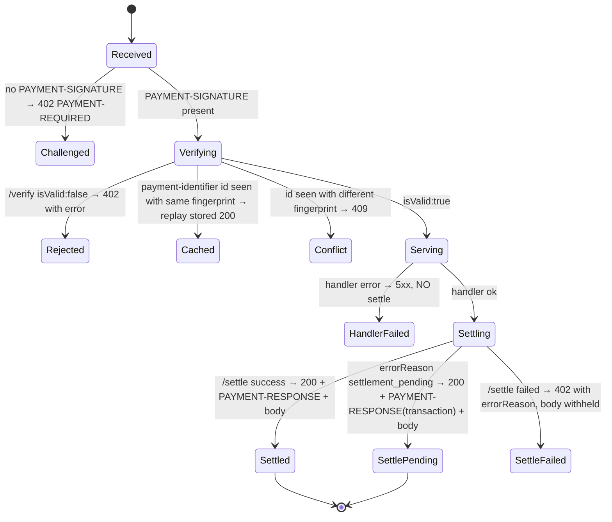

# Server supply side: Czar's x402 merchants and the claim server (spec 04)

- **Date:** 2026-10-18. **Status:** draft for review. Conventions: `cross-cutting.md`. Shapes: docs/specs/02 only. Contracts: docs/specs/03 only.
- **Components:** CZ-20 Czar x402 merchants (Phase 1, full template), CZ-21 claim server (Phase 2, outline).

---

## CZ-20 Czar x402 merchants

### 1. Identity

| Item | Value |
|---|---|
| CZ ID, name | CZ-20, Czar x402 merchants |
| Phase | 1 |
| Product / roadmap | product §8.5 (testnet merchants), §6.21 sources ("merchants registering directly with Czar"); roadmap §3 Phase 1 proof loop |
| Decisions | D13 (testnet), D14 (Czar runs its own merchants with Circle's seller SDK), D15 (index serves both shapes), D22 (both payment paths must be exercised), D35 (no Czar-paid credits for third parties) |
| Package | `apps/merchants` (`@czar/merchants`), uses `@czar/x402` |

### 2. Responsibilities and non-responsibilities

- **Does:** run three small paid HTTP services on Arc testnet so the full loop (plan → pay → accept → prove) runs against real sellers; expose each service on **both** rails (vanilla x402 settled by Circle's Facilitator, and Gateway nanopayments) so vault-direct and pocket paths are both exercised; publish discovery-index entries in the 02 §12.2 shape; sweep Gateway balances to the payout wallets; refund Czar's own bad sales by policy.
- **Does not:** rank itself above others (CZ-18 applies the same evidence rules to Czar's merchants, SL §10 operator-misconduct row); hold the agent, evaluator or publisher keys; read any user data (it sees only the structured `input` of a step, never user text, 02 §4.6 `inputTemplate`, spec 01 §11.2 layer 3); pay anyone.

### 3. Runtime

| Item | Value |
|---|---|
| Where | Czar server, one container per environment, behind the API gateway on its own hostname (`merchants.<env>.czar.dev`) |
| Process | Node 22, Fastify or Hono; one process, three route groups; stateless except the idempotency store (Postgres) and the sweep cursor |
| Start / stop | `pnpm --filter @czar/merchants start`; graceful stop drains in-flight handlers for `merchants.drainTimeoutMs` (default 30,000 ms: a handler never outlives a Facilitator `/settle` call) |
| Update | rolling; idempotency store survives restarts |
| Resource budget | ≤ 256 MB RAM, ≤ 0.25 vCPU idle; p95 handler latency ≤ 2 s excluding the Facilitator round trip |

### 4. Interfaces

**Inputs**
- HTTP requests from buyers (Czar's paying agent CZ-15, Circle's CLI, any x402 client). Protocol: x402 v2 headers `PAYMENT-REQUIRED` / `PAYMENT-SIGNATURE` / `PAYMENT-RESPONSE` (A3-02); v1 `X-PAYMENT` is **not** accepted by the seller (A3-03: the server reads only `payment-signature`).
- Buyer `input`: query parameters or JSON body as declared in the service's `extensions.bazaar.info.input` (02 §12.2). Untrusted data.

**Outputs**
- `PaymentRequired` (402) exactly per 02 §11.1; `SettlementResponse` in `PAYMENT-RESPONSE` (A3-08); the service body (JSON).
- Discovery-index items (02 §12.2) registered with CZ-18 through its internal submit call (SL-C2 source 1, `extensions.czar.source = "czar-registered"`).

**External services**
- Circle Facilitator `POST /v1/facilitator/x402/verify` and `/settle` with `network: "eip155:5042002"` (A1-15, p1-F3). Keyless trial: `Facilitator-Seller-Proof` header signed by the `payTo` key (p1-F4). After the trial: Console API key K11.
- Gateway nanopayment seller middleware `createGatewayMiddleware({ sellerAddress, facilitatorUrl: "https://gateway-api-testnet.circle.com", networks })` from `@circle-fin/x402-batching/server` 3.5.0, then `gateway.require(...)` (p1-G11, F2-01). The facilitator URL is always explicit: omitting it means mainnet (p1-G11).
- Gateway API `POST /v1/transfer` and `GatewayMinter.gatewayMint` for sweeps (A2-16, A2-17). Hand-built burn intents as in `a2-gateway-e2e/withdraw.ts`, never `GatewayClient.withdraw()` (A2-12, A2-31).

**Events consumed / emitted**
- Emits application events (not chain events): `merchant.request`, `merchant.verified`, `merchant.served`, `merchant.settled`, `merchant.settle_failed`, `merchant.sweep` (field allowlist, `cross-cutting.md` §4).
- CZ-19 indexes the on-chain side: USDC `Transfer`/`AuthorizationUsed` to the `payTo` addresses (vanilla) and `BatchProcessed` deltas (Gateway).

### 5. Internal design

#### 5.1 The Phase 1 service set (and why)

| Service | Route | Returns | Why this one | Price (vanilla / Gateway) |
|---|---|---|---|---|
| `czar-spot` | `GET /v1/spot?pair=` | `{pair, price, asOf, source}` | the 02 §12.4 example; deterministic, cheap, structurally checkable by CZ-16 (`price` is a decimal string, `asOf` RFC 3339) | `merchants.spotPriceAtomic` = 50000 / `merchants.gatewayNanoPriceAtomic` = 1000 |
| `czar-extract` | `POST /v1/extract` body `{url}` | `{title, text, links[]}` with `text ≤ merchants.extractMaxChars` (20,000) and `links ≤ 50` | the planner's `page-extract` capability; exercises untrusted-input handling | `merchants.extractPriceAtomic` = 100000 / 1000 |
| `czar-search` | `GET /v1/search?q=` | `{results: [{title, url, snippet}] ≤ 10}` from a fixed index Czar controls | the planner's `web-search` capability; deterministic results make the Phase 1 acceptance scenario repeatable | `merchants.searchPriceAtomic` = 50000 / 1000 |

- **Testnet honesty:** `czar-spot` on testnet serves either a server-side cache of one public free price source refreshed every `merchants.spotRefreshSeconds` (300) or, when that source is unreachable, a deterministic synthetic series flagged `source: "synthetic-testnet"`. The `source` field is always present so acceptance checks and users are never misled. Decided by D49 (public source, cache, synthetic fallback, always a `source` field); which free source is used is chosen in the build plan.
- **Why both rails per service:** D22 names two payment paths; the Phase 1 scenario (`phase-1-acceptance-scenario.md`) needs a vault-direct payment and a pocket payment against real sellers. Each service therefore has two resource URLs: `/v1/<svc>` (vanilla `exact`, `payTo` = K10 key) and `/nano/v1/<svc>` (Gateway `gateway.require`). They share the handler.
- Prices are named parameters, not facts; the catalog median is $0.10 (research snapshot), so 0.05–0.10 USDC keeps Czar in the normal range. The Gateway route price 0.001 USDC exercises sub-cent batching (D10, D37).

#### 5.2 Request lifecycle (vanilla x402, `authorization` flow)

- `Challenged`: the 402 carries exactly the 02 §11.1 fields; `maxTimeoutSeconds` = `merchants.maxTimeoutSeconds` (300, never above 600 so the vault's reservation TTL covers it, 03 `czar-vault.md` §3 `MAX_RESERVATION_TTL`).
- `Verifying`: `/verify` does not consume the keyless-trial allowance (A1-15). The seller checks that `accepted` equals one of its own `accepts` entries (scheme, network, amount, asset, payTo) before calling the Facilitator, so a buyer cannot pay a different payee for this resource.
- `Serving` then `Settling`: the handler runs first; a handler failure means **no** `/settle`, so the buyer is not charged (A3-09 default flow; 02 §11.1). The body is held until settlement reports success or `settlement_pending`.
- `SettlePending` (A3-11): non-terminal. The seller returns the body (the authorization was valid and broadcast) and records the `transaction` hash; CZ-19 confirms it through `AuthorizationUsed`. If it never confirms within `merchants.settlePendingTimeoutMinutes` (30), the request is logged as `unsettled-served` and counted for the ROI of being honest; no retry can re-charge the buyer (USDC single-use nonce, 02 §7.2).
- `SettleFailed`: body withheld; the buyer's reservation index releases after `validBefore` (03 `czar-vault.md` §5.3).

#### 5.3 Gateway nanopayment route

- `createGatewayMiddleware` verifies and settles **before** the handler runs; there is no refund call (p1-G6, A2-24). The handler therefore must be deterministic and fast; on handler failure the seller returns 5xx and records `served: false` so Czar's refund policy (§5.6) can act.
- Settlement states for the buyer: `received` (about 1.2 s, A2-24) → `batched` → `completed` 0–16 min later (A2-25, A2-26). The seller's balance is credited in its **Gateway balance**, not its wallet (A2-28).

#### 5.4 Idempotency store (`payment-identifier`)

| Field | Type | Meaning |
|---|---|---|
| `id` | string 16–128 `[A-Za-z0-9_-]` | from `extensions["payment-identifier"].info.id` (F1-06) |
| `fingerprint` | `Hash32` | keccak256 of `jcs({scheme, network, asset, amount, payTo, route, method, inputHash})` per `payment_identifier.md` "Request Binding" |
| `response` | bytes (≤ `merchants.cacheMaxBytes` 1 MiB) | the stored 200 body and `PAYMENT-RESPONSE` |
| `storedAt` | timestamp | TTL `merchants.paymentIdTtlHours` = 24 |

- Same `id`, same fingerprint → replay the stored response without calling the Facilitator again. Same `id`, different fingerprint → `409 Conflict`. The store is scoped per service route (the spec warns against a single global key).
- A request without an id is processed normally; Czar's 402 advertises `required: false`.

#### 5.5 Payout keys and sweeps

| Item | Rule |
|---|---|
| K10 keys | one `payTo` EOA per service, held in the KMS (`cross-cutting.md` §3.3); signing policy: Facilitator `SellerRequest` proofs (keyless trial, p1-F4) and Gateway burn intents for sweeps only |
| K11 | Console API key after the trial ends (`403 registration_required`, p1-F4); stored in the secret store; `upto` needs it anyway in Phase 3 (A3-17) |
| Vanilla settlement | USDC lands directly in `payTo` (one on-chain transfer per payment, A1-18); nothing to sweep |
| Gateway settlement | credited to the `payTo`'s Gateway balance (A2-28); a same-chain burn intent moves it to the wallet (A2-16): fee 0.0035 USDC per intent (A2-17), attestation valid about 1,196 blocks, mint permissionless when `destinationCaller = 0` |
| Sweep rule | run `merchants.gatewaySweepCron` (daily 03:00 UTC) and only when `availableBalance ≥ merchants.gatewaySweepMinAtomic` (1,000,000 = 1 USDC) so the fee stays under 0.35% of the sweep; `maxFee` = `merchants.sweepMaxFeeAtomic` (10,000) |
| Sweep failure | attestation issued but mint fails (as in A2-31 when the RPC host failed): the balance is re-credited after `expirationBlock` (A2-18); retry next run with a new salt |

#### 5.6 Refund policy (Czar's own sales only)

- Refunds of Czar's own sales are automatic with a daily cap (D50). Spec 01 §8.8: "Czar-run merchant delivered badly → Czar refunds by policy (a new transfer)". D35 forbids **Czar-paid credits for failed third-party steps**; it does not forbid Czar refunding its **own** sales. Wording in every interface: "Refund for a Czar service" never "credit".
- Trigger: CZ-16 `delivery` or `structural` fail on a Czar service, or `report_outcome` with `wrong` plus a matching server-side failure log (`served: false` or `unsettled-served`).
- Action: a plain USDC transfer from the service's `payTo` to the buyer `payer` (the vault, or the pocket's Gateway balance via `depositFor` for nanopayments) for exactly the charged `amount`, with the `paymentRefHash` in the audit log. One refund per `paymentRefHash`. Cap `merchants.refundDailyAtomic` (5,000,000 per service per day) with alerting above it.
- The refund is itself evidence: CZ-17 records a `correction` row (SL §5.7, kind `merchant-response`) so the merchant's own posterior is not laundered.

#### 5.7 Untrusted buyer input

| Rule | Detail |
|---|---|
| Input is data | parsed strictly against the declared `bazaar` schema; unknown keys rejected (400); never interpolated into shell, SQL or prompts |
| `czar-extract` URL allowlist | every fetch goes through the shared `safeFetch` in `@czar/x402` (`cross-cutting.md` §2.1, RV-022: https only, pinned DNS, private/loopback/link-local/ULA/CGNAT blocked, redirects re-checked); on top of that the hostname must match `merchants.extractAllowlist` (a short list of public documentation and news domains chosen in the build plan) or be a Czar-owned test page; max `merchants.extractMaxRedirects` 3; response ≤ `merchants.extractMaxBytes` 2 MiB; timeout `merchants.extractTimeoutMs` 8,000. **Superseded by RV-022:** the guard living only here |
| Returned text | plain text (tags stripped), truncated; it is **untrusted** to the buyer and is labelled so in the response (`"untrusted": true`) |
| Agent-directed text in fetched pages | returned verbatim as data (for example Circle and Arc doc headers, FL-1, FL-2); the seller never acts on page content |
| Rate limits | per `payer` address: `merchants.perPayerPerMin` 60; global per route `merchants.perRoutePerMin` 600 |

#### 5.8 Discovery-index entries

- One item per route (vanilla and Gateway), exactly the 02 §12.2 shape with both the spec fields and Circle's `metadata` object; `metadata.supportsVanillax402` / `supportsCircleGateway` are set from the live 402 of each route, not typed by hand (p1-D7); `extensions.czar.source = "czar-registered"`; `extensions.bazaar.info.input` declares the query or body schema used in §5.7.
- Registered with CZ-18 at startup and re-crawled by CZ-18 every 24 h (SL-C2 refresh). `/.well-known/agent-registration.json` (A5-05) and ERC-8004 registration (A5-03, A5-04) are Phase 2.

#### 5.9 Named parameters

| Parameter | Default | Reason |
|---|---|---|
| `merchants.spotPriceAtomic` | 50000 | normal catalog range |
| `merchants.extractPriceAtomic` | 100000 | matches the catalog median |
| `merchants.searchPriceAtomic` | 50000 | |
| `merchants.gatewayNanoPriceAtomic` | 1000 | sub-cent to exercise batching (D10) |
| `merchants.maxTimeoutSeconds` | 300 | ≤ vault `MAX_RESERVATION_TTL` 600 |
| `merchants.paymentIdTtlHours` | 24 | matches API idempotency (02 §9.3) |
| `merchants.cacheMaxBytes` | 1,048,576 | bounded replay store |
| `merchants.settlePendingTimeoutMinutes` | 30 | the x402 reconciliation window used by CZ-15 |
| `merchants.gatewaySweepCron` | `0 3 * * *` | daily |
| `merchants.gatewaySweepMinAtomic` | 1,000,000 | fee 0.0035 stays ≤ 0.35% |
| `merchants.sweepMaxFeeAtomic` | 10,000 | matches the vault's `MAX_PULLBACK_FEE` |
| `merchants.refundDailyAtomic` | 5,000,000 | bounds a refund-policy abuse |
| `merchants.extractMaxChars` / `extractMaxBytes` / `extractMaxRedirects` / `extractTimeoutMs` | 20,000 / 2 MiB / 3 / 8,000 | bounded fetch |
| `merchants.spotRefreshSeconds` | 300 | |
| `merchants.perPayerPerMin` / `perRoutePerMin` | 60 / 600 | abuse bound |
| `merchants.drainTimeoutMs` | 30,000 | never abandon a settle mid-flight |

### 6. Behaviour

**Main path (vanilla):** request without payment → 402 (02 §11.1) → buyer retries with `PAYMENT-SIGNATURE` → seller validates `accepted` against its own offer → idempotency check → `/verify` → handler → `/settle` → 200 with body and `PAYMENT-RESPONSE`.

**Alternate paths**
- v1 client: a `402` body-only client or an `X-PAYMENT` header is answered with the v2 402 again and `error: "x402 v2 required"` (A3-03; Czar's sellers are v2-only).
- `/verify` says `insufficient_funds` or `invalid_exact_evm_payload_signature` (the A1-16 control cases): 402 with that `errorReason`; no handler run.
- Facilitator unreachable: `503` with `Retry-After: 30`; the buyer's reservation is unaffected.
- Handler failure after `/verify`: 5xx, no settle, `served: false` logged.
- `/settle` returns `success: false` after the handler ran: body withheld, 402 with the reason; the service's own evidence row records `http-error` (SL outcome vocabulary).
- Gateway route, API down: the middleware fails verification → the buyer sees "Payment verification failed" (A2-10 wording from the SDK); 503 with `Retry-After`.

### 7. AI usage

None. The merchants run no model. (`czar-search` is a fixed index; `czar-extract` strips HTML with a parser, not a model.)

### 8. Privacy

| Data | Class | Handling |
|---|---|---|
| buyer `payer` address, amounts, nonces, tx hashes | public | on-chain anyway (p1-G10) |
| buyer `input` (`pair`, `url`, `q`) | server-only | logged as a hash only; retained with the idempotency entry for 24 h, then deleted |
| fetched page content (`czar-extract`) | server-only, transient | not stored after the response; the response cache keeps it 24 h under the payment id |
| seller proofs, Console key | secret | KMS / secret store |

No user text ever reaches a merchant: CZ-13 sends only the structured `inputTemplate` (spec 01 §11.2 layer 3).

### 9. Security

| Item | Detail |
|---|---|
| Keys | K10 (`payTo` per service, KMS: seller-proof and sweep-intent signing only), K11 (Console API key after the trial) |
| Permissions | the merchant container has no access to K3/K5/K7/K8 and cannot call the vault |
| Threats (spec 01 §13) | **Malicious merchant** row applies to Czar itself: the same evidence rules rank it (SL §10 operator row). **Poisoned text:** fetched pages are returned as data, labelled untrusted. **Server compromised:** a compromised merchant can at most settle valid authorizations it received (bounded by each buyer's reservation) and drain its own `payTo` balances; it cannot touch vaults. **Reentrancy / replay:** USDC nonces are single-use; the idempotency store prevents double service. **SSRF** through `czar-extract`: allowlist on top of the shared `safeFetch` (RV-022). |
| Agent-directed text | FL-1, FL-2 style headers in fetched pages are data (§5.7) |

### 10. Failure handling

| Failure | Behaviour | Buyer sees | Idempotent? |
|---|---|---|---|
| Facilitator down | 503 + `Retry-After` | retry per 02 §7.5 with the same header and id | yes |
| `/verify` false | 402 with `errorReason` | `verify-rejected` | yes |
| handler error | 5xx, no settle | `unpaid` → re-plan | yes |
| `/settle` `settlement_pending` | 200 + body; reconcile via CZ-19 | `settlement-pending` then `settled` | yes |
| `/settle` failed | 402, body withheld | `unpaid` | yes |
| sweep mint fails | re-credit after expiry (A2-18); retry | — | yes (new salt) |
| idempotency conflict | 409 | `price-or-payee-drift` or hard stop | yes |
| Gateway API down | 503 | `upstream-unavailable` | yes |

Timeouts: handler ≤ `merchants.handlerTimeoutMs` (10,000); Facilitator calls ≤ `merchants.facilitatorTimeoutMs` (15,000); never retried for `/settle` (one authorization, one settle attempt; reconciliation handles the rest).

### 11. Observability

- Metrics: `czar_merchants_requests_total{route,outcome}`, `czar_merchants_settle_latency_ms`, `czar_merchants_unsettled_served_total`, `czar_merchants_sweep_amount_atomic`, `czar_merchants_refunds_total`.
- Alerts: `unsettled-served` > 5/h; refunds above `refundDailyAtomic`; sweep failures 2 runs in a row; Facilitator error rate > 10% over 5 min.
- Logs: allowlisted fields only (`cross-cutting.md` §4); input hashes, never inputs.

### 12. Interface wording

Merchant responses are machine-facing. Human-facing text appears only through CZ-22 receipts: a Czar service shows `merchantLabel` = its origin host and, on refund, the ledger line "Refunded by Czar (Czar service)".

### 13. Performance and cost budgets

- p95 end-to-end (excluding Facilitator) ≤ 2 s; Facilitator `/verify` ≈ 0.5–0.7 s and `/settle` ≈ 2.6 s observed (A1-17).
- Gas: paid by Circle's relayer on vanilla settles (A1-18); sweeps cost one `gatewayMint` ≈ 100k gas plus the 0.0035 USDC fee.
- Infrastructure cost: one small container.

### 14. Tests and definition of done

- **Unit:** 402 builder matches 02 §11.1 field by field; `accepted` validation; idempotency store semantics (replay, 409, TTL); allowlist and private-range checks; HTML stripping limits.
- **Integration (local `arc-anvil` fork + mocked Facilitator/Gateway):** full `authorization` flow; handler failure → no settle; `settlement_pending` path; Gateway route through the real middleware against a mocked API.
- **Fixtures:** `a1-erc1271-usdc/x402-flow.mjs` (seller side, keyless proof, 402 shape; A1-17) and `a2-gateway-e2e/seller.ts` (Gateway seller) are the reference encodings.
- **Testnet smoke (read-mostly):** one keyless `/verify` against the deployed 402 (costs nothing, A1-15); one real nanopayment of 0.001 USDC in the Phase 1 scenario with Zaryab's approval.
- **Definition of done:** all three services answer 402 on both routes with valid shapes; CZ-15 can pay each on both paths in the Phase 1 scenario; index items validate against 02 §12.2; a sweep moved a Gateway balance on testnet; refund policy exercised once end to end; no raw input in logs (log corpus test).

### 15. Dependencies

| Dependency | Version | Fact |
|---|---|---|
| `@x402/core`, `@x402/evm` | 2.28.0 | F2-02 |
| `@circle-fin/x402-batching` (server + client for sweeps) | 3.5.0 | F2-01, p1-G11 |
| viem | 2.57.x | A9-05 |
| Circle Facilitator (keyless trial, then Console key) | — | A1-15, p1-F4 |
| Gateway API testnet | — | A2-30 |

Open questions: keyless-trial allowance size is undocumented (part 2 GAP A1); the free price source for `czar-spot` is a build-plan choice.

**Mainnet differences:** Console API key required (p1-F4; `403 registration_required` ends the trial); Facilitator registration is needed to sell, KYB is not a prerequisite for selling (only for onramp, F5-02); real prices; Gateway API key slot K12; sweeps on mainnet GatewayWallet `0x7777…00eE` (p1-G1). No mainnet deployment is a step in this spec.

---

## CZ-21 Claim server (Phase 2 outline)

### 1. Identity

CZ-21, claim server and relayer; Phase 2 (D24, D29); product §6.23; decisions D17 (Czar runs it), D19 (unclaimed stays claimable), D23 (GitHub sign-in default, `FUNDING.json` fallback), D44 (48 h release delay, 0.01 USDC minimum tip). Package `apps/claim-server`.

### 2. Responsibilities and non-responsibilities

- **Does:** verify that a GitHub account has admin rights on a repo, or that the repo's default branch holds a `FUNDING.json`-style file with Czar's one-time code (A8-08 shape idea, Czar's own checker, A8-09); schedule `BuilderEscrow.scheduleRelease(repoId, wallet)` with K9 after approval (03 `builder-escrow-and-recipe-splits.md`); expose claim status.
- **Does not:** release funds without the 48 h on-chain delay; store GitHub personal data beyond the check (E1-12); rank builders (D24 defers vetting).

### 3. Runtime

Czar server, small container; K9 relayer key in the KMS with a policy limited to `scheduleRelease` / `executeRelease`.

### 4. Interfaces

OpenAPI `claim` tag: `startGithubClaim`, `finishGithubClaim`, `startFileClaim`, `verifyFileClaim`, `getClaim` (02 §9.2). GitHub REST: repo collaborator permission read and one default-branch file read; rate limits 5,000/h per token, secondary limits (E1-09, E1-10). Contract: `IBuilderEscrow` (03 interfaces). `repoId` = `keccak256("github:<numeric id>")` (02 §7.1).

### 9. Security

K9 blast radius = misdirecting unclaimed tips, bounded by the timelock and admin cancel (spec 01 §13 "claim server lies"); GitHub OAuth secret K13; `FUNDING.json` code is single-use and expires in `claims.fileCodeTtlHours` (72).

### 14. Tests and definition of done (outline)

Mocked GitHub API fixtures for admin / non-admin / renamed repo; `arc-anvil` test that a scheduled release cannot execute before the delay; definition of done = one end-to-end claim on testnet with a tip released after 48 h.

### Outline of the rest

- §5 state machine: `Started → Verified → Scheduled → Released | Cancelled`; storage `claims` (repoId, method, wallet, status, scheduledAt).
- §6 flows per route; §8 privacy: GitHub token discarded after the check; §10 failures: GitHub 403/429 → `429` with mapped retry; §11 metrics per method; §12 wording: "Claim submitted. Funds release in 48 hours unless Czar cancels for a verification problem."; §13 budget: a few GitHub calls per claim; §15 dependencies: GitHub REST (E1-06 to E1-12), `IBuilderEscrow`.

## Change log

| Date | ID | Change |
|---|---|---|
| 2026-10-18 | D49 | `czar-spot` source rule cited |
| 2026-10-18 | D50 | automatic refunds of Czar's own sales with a daily cap |
| 2026-10-19 | RV-022 | `czar-extract` uses the shared `safeFetch`; the guard is no longer local to this merchant. |
