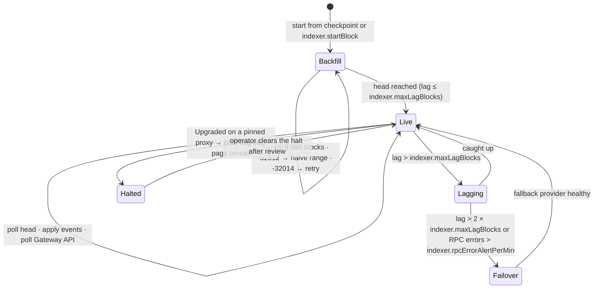
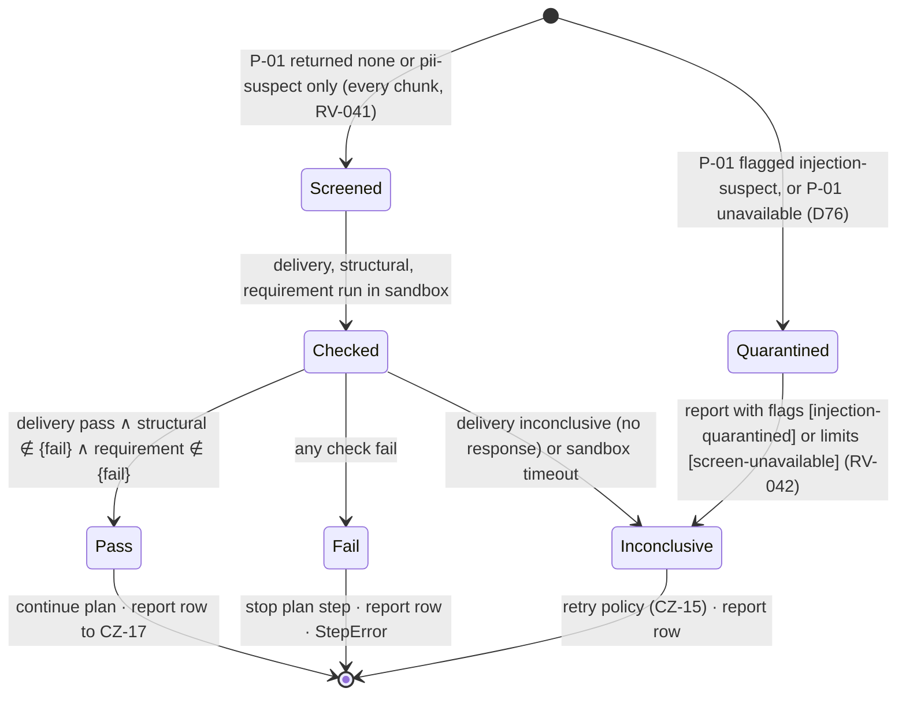

# Server: acceptance, evidence, Selection Layer, indexer (spec 04)

- **Date:** 2026-10-18. **Status:** draft for review. Conventions: `../shared/cross-cutting.md`. Data shapes: spec 02 only (cited "02 §n", schema files by name, OpenAPI `operationId`s). Contract behaviour: spec 03 only (cited "03 `<file>` §n").
- **Components:** CZ-16 acceptance checker and ERC-8183 evaluator; CZ-17 evidence producer and publisher; CZ-18 Selection Layer services; CZ-19 indexer. All run in `apps/server` (CZ-19 in `apps/indexer`).
- **Reading order:** CZ-19 first (everything else reads its projections), then CZ-16, CZ-17, CZ-18.
- **Status wording:** Czar is a production system that moves user funds.

---

## CZ-19 Indexer

### 1. Identity

| Item | Value |
|---|---|
| CZ ID, name | CZ-19, Indexer |
| Phase | 1 |
| Product / roadmap | supports §6.8 envelopes, §6.11 ROI ledger, §6.22 proof of demand; roadmap 2.1, 2.6, 2.13 |
| Decisions | D11, D13, D22, D25, D27 |
| Package | `@czar/indexer` (`apps/indexer`), Ponder 0.18.x (A9-05) |

### 2. Responsibilities and non-responsibilities

- **Does:** read every relevant Arc event, maintain the server's mirrors (02 §4.8–§4.11) plus `settlements` and `anchors`, poll the Gateway API for off-chain nanopayment status, raise alerts (`Upgraded`, lag, anomalies), and serve the queries in §4.
- **Does not:** sign anything, call any contract function that changes state, hold keys, or decide money. The vault is the source of truth; the indexer is a cache that can always be rebuilt (spec 01 §16.1).

### 3. Runtime

- One Ponder process per network (`testnet` in Phase 1), with its own Postgres schema `idx_<network>`. Restarts re-sync from Ponder's checkpoint. Update = deploy a new image; a schema change triggers a full re-index from `indexer.startBlock` (the factory deployment block).
- Resource budget: one small container; Arc testnet emits ~0.5 s blocks (p1-A7), so steady state is a few RPC calls per second.

### 4. Interfaces

| Direction | What | Reference |
|---|---|---|
| In (chain) | `eth_getLogs` pages ≤ `indexer.getLogsBlockRange` blocks; `eth_getBlockByNumber`; `eth_call` for views (`authorizationState`, `isTransferSpecHashUsed`, `getJob`/`jobs`) | A9-06; 03 `czar-vault.md` §10 |
| In (Circle) | `GET https://gateway-api-testnet.circle.com/v1/x402/transfers?from=<pocket>&pageSize=100` (keyless on testnet) | A2-29, A2-30, p1-G10 |
| Out (projections, read by CZ-12, CZ-15, CZ-16, CZ-17, CZ-22) | `Envelope`, `Reservation`, `PocketRecord` (with `PullbackRecord`), `JobRecord`, `settlements`, `anchors`, `alerts` | 02 §4.8–§4.11, §4.20 |
| Out (queries) | listed in §5.4 | |
| Out (alerts) | `alerts` table rows plus a webhook to the on-call channel | spec 01 §16.2 |

Events consumed (all with `indexed` fields as defined in the cited specs):

| Contract (pinned) | Events | Reference |
|---|---|---|
| `CzarVaultFactory` | `VaultCreated`, `GuardianPaused`, `GuardianUnpaused`, `VersionApplied`, `GuardianChanged` | 03 `czar-vault-factory.md` §7 |
| every `CzarVault` (address set grows from `VaultCreated`) | `EnvelopeOpened`, `EnvelopeClosed`, `EnvelopeForceClosed`, `Reserved`, `Settled`, `Released`, `ReservationFinal`, `PocketRegistered`, `PocketGasGranted`, `PocketFunded`, `PullbackRequested`, `PullbackConfirmed`, `PullbackCancelled`, `PocketClosed`, `ManualReturnRecorded`, `JobOpened`, `JobFunded`, `JobSynced`, `JobRefunded`, `LimitsSet`, `AutoLimitRaised`, `AutoLimitLowered`, `Frozen`, `Unfrozen`, `SignersRotated`, `PasskeySet`, `OwnerActionExecuted`, `Withdrawn`, `BalanceSynced`, `NativeReceived` | 03 `czar-vault.md` §9.1 |
| USDC `0x3600…0000` and the EIP-7708 system emitter `0xffff…fffe` | `Transfer(from, to, value)` where `from` or `to` is a known vault, pocket or Czar merchant payout address; `AuthorizationUsed(authorizer, nonce)` where `authorizer` is a known vault | A1-18, SL-F4 (native amounts are 18-decimal and are divided by `10^12`, A1-05) |
| GatewayWallet `0x0077…19B9` (mainnet `0x7777…00eE`) | `Deposited(token, depositor, sender, value)`, `DelegateAdded`, `DelegateRemoved`, `BatchProcessed(batchId, signer, token)` | A2-02, A2-04, A2-27 |
| GatewayMinter `0x0022…475B` (mainnet `0x2222…C205`) | `AttestationUsed(token, recipient, transferSpecHash, sourceDomain, sourceDepositor, sourceSigner, value)` where `recipient` is a known vault | 02 §6.3.2; Gateway `Mints.sol` lines 47–55 (read in spec 02 session) |
| ERC-8183 Circle instance `0x0747…4583` (later `CzarJobEscrow`) | `JobCreated`, `BudgetSet`, `JobFunded`, `JobSubmitted`, `JobCompleted`, `JobRejected`, `JobExpired`, `PaymentReleased`, `Refunded`, `EvaluatorFeePaid`, plus admin events `RoleGranted`, `RoleRevoked`, `HookWhitelistUpdated`, and on the Czar instance `PlatformFeeUpdated`, `EvaluatorFeeUpdated`, `PaymentTokenAllowlistUpdated`, `Paused`, `Unpaused`, `EmergencyWithdraw` | 03 `job-escrow-adapter.md` §2; A4-06 to A4-09 |
| `OpenEvidenceLog` | `Committed(publisher, kind, seq, root, prev, uriHash, uri)`, `Revealed(...)` | 03 `open-evidence-log.md` §8 |
| every pinned proxy: USDC, GatewayWallet, GatewayMinter, ERC-8183, ERC-8004 Identity/Reputation/Validation | `Upgraded(address implementation)` | FD-18; A1-01, A2-20, A4-09, A5-11 |

### 5. Internal design

#### 5.1 Chain configuration

- Ponder `createConfig({ chains: { arcTestnet: { id: 5042002, rpc: [primary, keyed fallback], pollingInterval, ethGetLogsBlockRange } } })` (A9-05 names these keys). Primary `https://rpc.testnet.arc.io` (A9-08), fallback a keyed provider from the Arc docs list (A9-07). `rpc.testnet.arc.network` is never configured (A9-08).
- `indexer.getLogsBlockRange = 9999` blocks: Arc caps `eth_getLogs` at 10,000 (A9-06, error `-32012`).
- `-32014` ("safely retry", A9-06): exponential backoff `indexer.rpcRetryBaseMs` 250 ms, up to `indexer.rpcRetryMax` 6, then fail over to the keyed provider for `indexer.failoverHoldSeconds` 300.
- Finality: Arc is final on inclusion (p1-A7 "Final on inclusion"; SL-F2). No reorg window. `indexer.confirmationBlocks = 1` is kept as a cheap guard against provider lag and is re-checked on mainnet in the pre-mainnet checklist (03 `security-and-testing.md` §5).

#### 5.2 Sync state machine



- `Backfill`: deterministic; the same events always rebuild the same projections.
- `Halted` affects only the flagged path (`paths.vaultDirectHalted`, `paths.pocketHalted`, `paths.jobsHalted` in the server's runtime flags); other paths continue.

#### 5.3 Projections (tables)

| Table | Key | Built from | Serves |
|---|---|---|---|
| `vaults` | `vault` | `VaultCreated` | owner lookup, address set for filters |
| `envelopes` (02 §4.8 fields) | `(vault, envelopeId)` | `EnvelopeOpened`, `Settled`, `Released`, `PocketFunded`, `PullbackConfirmed`, `PocketClosed`, `JobFunded`, `JobSynced`, `JobRefunded`, `EnvelopeClosed`, `EnvelopeForceClosed` | `getEnvelope`, `listEnvelopes`, CZ-15 |
| `reservations` (02 §4.9) | `(vault, reservationId)` | `Reserved`, `Settled`, `Released`, `ReservationFinal`; `settledMask`/`doneMask` from per-index events | CZ-15 settle/finalize work queue |
| `pockets` (02 §4.10) + `pullbacks` | `pocket`, `(vault, pullbackId)` | `PocketRegistered`, `PocketGasGranted`, `PocketFunded`, `PullbackRequested`, `PullbackConfirmed`, `PullbackCancelled`, `PocketClosed`, `ManualReturnRecorded`; `AttestationUsed` matched by `transferSpecHash` | pullback confirm queue, ledger |
| `jobs` (02 §4.11) | `jobKey` | `JobOpened`, `JobFunded`, `JobSynced`, `JobRefunded` plus escrow events matched by `(jobEscrow, jobId)` | CZ-16 evaluator queue, CZ-15 sync queue |
| `settlements` | `(rail, network, payer, payTo, nonce)` (SL `dedup_key`) | `AuthorizationUsed` + matching `Transfer` for `x402-exact`; Gateway API rows for `gateway-batched`; `JobCompleted`/`Refunded` for jobs | CZ-17 settlement proof (SL-C8 step 2), `listReceipts` |
| `gateway_transfers` | `transferId` | Gateway API polling: `id, status, fromAddress, toAddress, amount, nonce, txHash, createdAt, updatedAt` (SL-F19 field list; statuses `received, batched, confirmed, completed, failed`, A2-29) | pocket receipts, `pending` → `completed` display (A2-26) |
| `pocket_balances` (SCR-127) | `pocket` | Gateway API `POST /v1/balances` (`balance` → `gatewayAvailableAtomic`, `pendingBatch` → `gatewayPendingBatchAtomic`, exact decimal to `Amount6`), on-chain `GatewayWallet.withdrawingBalance` and `withdrawalBlock` (A2-15); `apiObservedAt`, `chainObservedBlock`, `apiConsecutiveFailures`, `apiLastError` (`timeout`, `http-4xx`, `http-5xx`, `malformed`, `network`; never a body) | CZ-15 pullback value and late funds, CZ-27 signer policy |
| `manual_returns` (SCR-133) | `(vault, txHash, logIndex)` | `ManualReturnRecorded(pocket, credit)` | CZ-15 manual-return reconciliation |
| `anchors` | `(publisher, kind, seq)` | `Committed`, `Revealed` | CZ-17 `prev` lookup, third-party verification pages |
| `dependency_state` | `proxy` | `Upgraded`, ERC-8183 admin events | alerts |
| `alerts` | `alertId` | §5.5 rules | on-call |
| `checkpoint` | network | Ponder internal | restart |

- Amount normalization: native `Transfer` logs from `0xffff…fffe` carry 18-decimal values; the indexer stores `value / 10^12` as `Amount6` (A1-05, p1-A4). ERC-20 logs from `0x3600…0000` are already 6-decimal. Both emitters are filtered so a settlement is counted once (dedupe by tx hash + log pair, SL-C8 step 2).

#### 5.4 Queries served (exact list)

| Query | Consumer | Returns |
|---|---|---|
| `envelopeByRef(envelopeRef)` | CZ-12 (`getEnvelope`), CZ-15, CZ-22 | `Envelope` + its reservations, pockets, jobs |
| `reservationsNeedingSettle(vault)` | CZ-15 | reservations `Active`/`Finalizing` whose derived nonces appear in `AuthorizationUsed` but are not in `settledMask` |
| `reservationsNeedingFinalize(now)` | CZ-15 | reservations with `validBefore < now` and `state != Final` |
| `pullbacksToConfirm()` | CZ-15 | `Pending` pullbacks whose `transferSpecHash` appears in `AttestationUsed` |
| `pullbacksToCancel(block)` | CZ-15 | `Pending` pullbacks with `maxBlockHeight + 3000 ≤ block` and no `AttestationUsed` (03 `czar-vault.md` §3 `PULLBACK_CANCEL_DELAY_BLOCKS`; the contract's `cancelPullback` checks `maxBlockHeight`, RV-036 — corrected 2026-10-21 from `requestedAtBlock`, which would make the agent call too early and revert `TooEarly`) |
| `jobsToSync()` | CZ-15 | vault jobs whose escrow status (from events) differs from the vault's `JobSynced` state |
| `jobsAwaitingEvaluation()` | CZ-16 | jobs with `JobSubmitted` and no `JobCompleted`/`JobRejected` |
| `receiptsForLedger(user, cursor)` | CZ-12 (`listReceipts`), CZ-25 | `LedgerReceipt` rows with `status` from settlement state (`reserved, settled, pending, completed, released, refunded, failed`) |
| `latestAnchor(publisher, kind)` | CZ-17 | `prev` root and `seq` |
| `anchorByBatch(root)` | CZ-17, verification page | `Committed` row |
| `dependencyState()` | CZ-15 routing flags | halted paths |
| `envelopeByPlanHash(planHash)` (SCR-132) | CZ-12 opening watcher | the `envelopeByRef` response for the envelope whose mirror `planHash` matches, or none; served at `GET /envelopes/by-plan-hash/{planHash}` (the `vault`-scoped `/envelopes` route is unchanged) |
| `pocketBalance(pocket)` (SCR-127) | CZ-15, CZ-27 signer | the `pocket_balances` row plus `apiAgeSeconds` and `chainAgeBlocks` computed at read time |
| `fundedPocketsForVault(vault)` (SCR-127) | CZ-15 halt drain | the vault's pockets in `Registered`, `DelegateReady`, `Funded` or `Draining`, each with `envelopeRef`, `outstanding`, `pendingPullback` (CZ-15 maps pocket → plan through its own `plan_pocket_keys`) |
| `closedPocketsWithBalance()` (SCR-127) | CZ-15 late-funds recovery | `Closed` pockets still in poll scope with `gatewayAvailableAtomic > 0` or `gatewayWithdrawingAtomic > 0` |
| `manualReturnsForVault(vault)` (SCR-133) | CZ-15 | `ManualReturnRecorded` events of the vault's pockets as `{pocket, credit, txHash, block}` |

Response contracts (SCR-119, 2026-10-21). These are internal indexer → server responses, not public API shapes; no `@czar/schemas` type is added for them:

- `receiptsForLedger(vault, cursor)`: the indexer returns **settlement facts**, one row per paid authorization index: `envelopeRef`, `stepIndex`, `reservationId`, `index`, `amount` (`Amount6`), `rail` (`x402-exact` | `gateway-batched` | `erc8183-job`), `status`, `settlementTx?`, `createdAt` (block time, RFC 3339). `status` comes from chain and Gateway state only: `reserved` (reserved, nonce unused), `settled` (`Settled`), `pending` / `completed` (pocket path, from `gateway_transfers`), `released` (`Released` or unused at `Final`), `refunded` (`JobRefunded`), `failed` (Gateway `failed`). CZ-12 `listReceipts` and CZ-25 join their own fields (`objectiveId`, `paymentRefHash`, `minutesSaved`, `minutesSource`, `accepted`, `merchantLabel`, `merchantIsCzar`, `amountDisplay`, and `quarantined`) to build `LedgerReceipt`. The query takes a vault address (the server maps user → vault). Paging per 02 §9.5.
- `latestAnchor(publisher, kind)`: `{root, seq, block, transaction}` of the highest `seq` for that publisher and kind, or `null` when none; CZ-17 uses `root` as the next `prev`.
- `anchorByBatch(root)`: the full `anchors` row for that `root`, or `null`.
- `dependencyState()`: belongs to T-033, which owns `halt_flags`; it returns the current `halt_flags` rows. T-034 does not serve it.
- Every query filters and pages in SQL; none loads a whole projection table into memory.

#### 5.5 Alerts (named parameters)

| Alert | Rule | Parameter (default, reason) | Action |
|---|---|---|---|
| `dependency-upgraded` | any `Upgraded` on a pinned proxy, or ERC-8183 `RoleGranted`, `HookWhitelistUpdated`, fee setters | — | halt the affected path, page (FD-18, spec 01 §16.2) |
| `indexer-lag` | head − indexed > `indexer.maxLagBlocks` | 120 blocks (≈ 1 min at 0.5 s, p1-A7) | failover RPC; UI "syncing" badge |
| `reserve-rate` | `Reserved` events per minute per vault or globally > `indexer.reserveRateAlertPerMin` | 60 per vault, 600 global (10× the expected peak) | page; guardian pause candidate (K6) |
| `settle-after-verify-failures` | `Released` with a matching merchant 200 response (from CZ-15 logs) > `indexer.settleFailRateBps` | 500 bps per hour | investigate Facilitator or merchant |
| `pocket-stale` | pocket `Draining` or `Funded` with `envelope.state = Closed` for > `indexer.pocketStaleHours` | 24 h | retry pullback; start the 7-day withdrawal (A2-13) |
| `anchor-missed` | no `EVIDENCE_BATCH` `Committed` within `2 × evidence.batchIntervalMinutes` while leaves exist | — | re-run CZ-17 publisher |
| `gateway-poll-failing` | Gateway API errors > `indexer.gatewayPollFailMax` consecutive | 10 | mark Gateway degraded; pocket path shows "delayed" |

#### 5.6 Gateway API polling

- Every `indexer.gatewayPollSeconds` (30 s; the first status `received` lands in ~1.2 s and `completed` 0–16 min later, A2-24 to A2-26) the indexer calls `GET /v1/x402/transfers?from=<pocket>` for every pocket in `Funded`/`Draining` and `?to=<payout>` for Czar merchant payout addresses (A2-28). `pageSize` max 100, cursor in the `link` header (p1-G10).
- (SCR-127) **Scope and balances.** The polls (transfers and `/v1/balances`) and the on-chain reads cover every pocket in `Registered`, `DelegateReady`, `Funded` or `Draining`, and every `Closed` pocket until its Gateway balance, `withdrawingBalance` and EOA USDC have all read zero for `indexer.closedPocketQuietHours` (48 h: covers an attestation re-credit after `expirationBlock`, A2-18, and a late nanopayment status, A2-26, with margin; the indexer never learns of K4 destruction, which is signer-internal). This replaces "for every pocket in `Funded`/`Draining`" above, so late funds on a `Closed` pocket are visible. The base URL is `chain.gatewayApiBaseUrl`; the Gateway domain comes from the deployment manifest. A failed or malformed read keeps the last good figures with their observation time; consumers treat a figure older than `indexer.gatewayBalanceMaxAgeSeconds` as stale and never substitute a guess. `slowWithdrawalOpen` is derived as `gatewayWithdrawingAtomic > 0`, never stored by hand. Parameters: `indexer.gatewayBalanceMaxAgeSeconds` 120 (four polls at `indexer.gatewayPollSeconds` 30; an older figure is stale), `indexer.closedPocketQuietHours` 48 (above).
- (SCR-118) Page size is `indexer.gatewayPageSize` (100, the API maximum); each request uses `fetch.timeoutMs`. Payout addresses come from `indexer.merchantPayoutAddresses` (lowercase addresses; set by the T-040 local overlay for Czar's own merchants; empty means no `?to=` polling). The same list feeds the `Transfer` filter in §5.2.
- (SCR-118) `gateway_transfers` is an indexer-internal table, not a wire shape: `amount` is an `Amount6` string, `createdAt`/`updatedAt` are stored as the RFC 3339 strings the API returns, `status` is one of the five above. Status is monotonic by rank `received` < `batched` < `confirmed` < `completed`; `failed` may replace any status except `completed`; an update with a lower rank, or any update to `completed`/`failed`, is ignored and logged as `gateway_status_regression`. The pocket payment status shown downstream is the row's current status.
- (SCR-118) A malformed page, or a `link` cursor already seen in the same walk, ends that walk without writing the rest and counts as one Gateway API error toward `indexer.gatewayPollFailMax`.
- A `txHash` on a `completed` row is cross-checked against `BatchProcessed` (A2-27). API-only rows are graded `rail-api`; when the API is down, `onchain-netted` from batch deltas with flag `rail-api-unavailable` (SL-C8 step 2).

### 6. Behaviour

1. Start: load checkpoint; if none, backfill from `indexer.startBlock`.
2. Page logs per contract set with address filters; apply handlers in block order; write projections in one transaction per block range.
3. At head: poll every `indexer.pollingIntervalMs` (1,000 ms; two blocks); run Gateway polling on its own timer.
4. On `Upgraded`: write `dependency_state`, set the halt flag, raise `dependency-upgraded`.
5. On restart: Ponder resumes from the checkpoint; handlers are idempotent (upserts keyed as in §5.3).
- Alternate paths: RPC range error → halve the page; provider down → failover; Gateway API down → degraded mode; schema migration → full re-index behind a maintenance flag while the old projections keep serving reads.

### 7. AI usage

None.

### 8. Privacy

- Everything the indexer stores is `public` (chain) or `server-only` (Gateway API rows keyed by pocket address). No objective text, no user ids beyond `vault → userId` mapping held by CZ-12. Retention: permanent for chain rows; Gateway rows 1 year.

### 9. Security

- Keys: none. Read-only RPC credentials (K19) in the secret store.
- Threats (spec 01 §13): "dependency upgraded against Czar" → `Upgraded` alerts halt paths before money moves; "server compromised" → a corrupted projection cannot move funds (the vault enforces); "indexer lag" → UI shows syncing, vault is the truth (spec 01 §14.1).
- A poisoned RPC provider could hide events; two providers and a periodic cross-check of `latest` block hashes between them (`indexer.crossCheckEveryBlocks` 600) raise `provider-divergence`.

### 10. Failure handling

| Failure | Behaviour | User sees | Idempotency / retry |
|---|---|---|---|
| `-32012` | halve range, retry | none | automatic |
| `-32014` | backoff, retry, failover | none | automatic |
| both providers down | `Failover` → alert; projections stale | "Syncing with the network" badge in the app | resume when any provider answers |
| Gateway API down | degraded; pocket receipts stay `pending` | "Small-payment network delayed" (spec 01 §14.1) | poll resumes |
| DB down | process exits; supervisor restarts | syncing badge | checkpoint |
| handler bug | process stops at the block; alert | syncing badge | fix, re-index from checkpoint |

### 11. Observability

- Metrics: `czar_indexer_head_lag_blocks`, `czar_indexer_events_total{contract,event}`, `czar_indexer_rpc_errors_total{code}`, `czar_indexer_gateway_poll_seconds`, `czar_indexer_alerts_total{alert}`.
- Logs: block numbers, tx hashes, event names, addresses, amounts only (`../shared/cross-cutting.md` §4).

### 12. Interface wording

Surfaced through CZ-22 only: "Syncing with the network" (lag), "Small-payment network delayed; your funds are safe in a pocket wallet" (Gateway down), "Temporarily unavailable" (halted path).

### 13. Performance and cost

- Backfill from the factory block at ≤ 9,999 blocks per call: Arc testnet produces ≈ 172,800 blocks/day, so one day of chain is ≈ 18 `eth_getLogs` calls per contract set. Live: ≈ 4 RPC calls per second across contract sets. Cost: RPC quota only; no gas.

### 14. Tests and definition of done

- Unit: every handler against synthetic logs (fixtures generated from the 03 event signatures); decimal normalization of a native `Transfer`; `settledMask` bit math for 128 indices.
- Integration: `arc-anvil` fork at a pinned block with scripted vault flows (03 `security-and-testing.md` §3.4) → projections equal the vault's views (`envelopes`, `reservations`) read by `eth_call`.
- Chaos: kill the process mid-page and assert identical projections after restart; inject `-32012`/`-32014`.
- Alerts: synthetic `Upgraded` event halts the path flag within one block.
- Definition of done: all §5.4 queries implemented and covered; lag alert fires in a staged outage; Gateway polling shows `received → completed` on a real testnet nanopayment; re-index from genesis reproduces the live projections byte for byte.

### 15. Dependencies

Ponder 0.18.x (A9-05), viem 2.57.x (A9-05), Postgres 16; hosted fallbacks Goldsky or Envio for both networks (A9-02, A9-04) if Ponder proves unreliable. Open question: Arc public RPC rate limits are unpublished (A9 GAP); the keyed provider is required for production.

**Mainnet differences:** contract addresses per `../shared/cross-cutting.md` §8; mainnet explorer API cannot be used (A9-11); Gateway API may need a key (K12); finality assumption re-verified pre-mainnet.

---

## CZ-16 Acceptance checker and ERC-8183 evaluator

### 1. Identity

| Item | Value |
|---|---|
| CZ ID, name | CZ-16, Acceptance checker and evaluator |
| Phase | 1 (delivery, structural, requirement checks; evaluator on Circle's instance); 2 (full profiles, consensus, corrections route); 3 (independent validators) |
| Product / roadmap | §6.14 pay on acceptance; §6.21 acceptance profiles; roadmap 2.2 |
| Decisions | D27, D35 |
| Package | `apps/server` module `acceptance`; prompts: none in Phase 1 (deterministic checks only) |

### 2. Responsibilities and non-responsibilities

- **Does:** run the acceptance profile on every step output and every ERC-8183 deliverable; produce an `AcceptanceReport` (02 §4.14) with `reportHash`; decide pass/fail/inconclusive; for jobs, call `complete` or `reject` on the escrow with the evaluator key K7; tell the paying agent whether the plan may continue.
- **Does not:** refund x402 payments (impossible for third parties, spec 01 §9; no Czar credits, D35); read raw seller text into any planner; call any vault function (CZ-15 calls `claimJobRefund` on its request).

### 3. Runtime

- Server worker pool; each check runs in a sandbox (Node `vm` context with no `require`, no network, no timers beyond `acceptance.sandboxTimeoutMs`; SL-C7 reuse). Budget: ≤ 50 MB per check, `acceptance.sandboxTimeoutMs` 5,000 ms.
- **Sandbox (SCR-122):** each check run is a `worker_threads` worker with `resourceLimits.maxOldGenerationSizeMb = acceptance.sandboxMemoryMb` 50, terminated at `acceptance.sandboxTimeoutMs` (→ `inconclusive`, `limits += ["sandbox-timeout"]`). Inside it the executor script runs in a `vm` context with `codeGeneration: {strings: false, wasm: false}` that receives only copied data, never host functions or objects. Ajv runs in the worker outside the context, with no `loadSchema`.
- The evaluator loop wakes on `jobsAwaitingEvaluation()` from CZ-19 and on a timer `acceptance.evaluatorPollSeconds` 15.

### 4. Interfaces

| Direction | What | Reference |
|---|---|---|
| In | step output bytes + headers from CZ-15 (after P-01 screen), `Step` (02 §4.6), the merchant's sanitized `extensions.bazaar.info/schema` (02 §11.3) | 02 §4.6, §11.3 |
| In | `JobRecord` (02 §4.11) + deliverable bytes fetched from the `deliverable` hash's URI (by CZ-15's fetcher, screened) | 02 §4.11 |
| Out | `AcceptanceReport` (`schemas/acceptance-report.schema.json`), `decision`, `reportHash` | 02 §4.14, §5.2 |
| Out | contributes `schema-mismatch` to `StepResult.flags` (CZ-15 assembles the `StepResult`, 02 §4.15) | 02 §4.15 |
| Out (chain, K7) | `complete(jobId, reason = reportHash, "")` / `reject(jobId, reason = reportHash, "")` on the ERC-8183 instance | 03 `job-escrow-adapter.md` §2, §3 |
| Out | `report` rows to CZ-17 | §CZ-17 |
| Events consumed | `JobSubmitted` (via CZ-19), `JobExpired` | 03 `job-escrow-adapter.md` §2 |

### 5. Internal design

#### 5.1 Order in the step pipeline

`CZ-15 receives body → P-01 screen (ai-prompts.md) → CZ-16 checks → P-02 reader builds StepResult (flags include CZ-16 results) → CZ-15 continues or stops`. The checker never calls a model in Phase 1. The reader never sees the checker's internals, only `flags`.

#### 5.2 Phase 1 profiles (`profile_default_set` for task class `data-json`, SL-C7)

| Check | Kind | Pass | Fail | Inconclusive / not_checked | Parameter |
|---|---|---|---|---|---|
| `delivery` | delivery | HTTP 2xx, body present, received within `min(maxTimeoutSeconds, acceptance.deliveryTimeoutMs)` and body ≤ `acceptance.maxBodyBytes` | non-2xx, empty body, timeout, oversize | `inconclusive` when the request itself failed before any response (`no-response`), `not_checked` when the step was unpaid | `acceptance.deliveryTimeoutMs` 30,000 (SL-C7 "limit = min(maxTimeoutSeconds, 30 s)"); `acceptance.maxBodyBytes` 5,242,880 (SL-C2 `Q03` 5 MB) |
| `structural` | structural | body parses as the declared `mimeType` and validates (Ajv 8, 2020-12) against the merchant's sanitized `schema`; with no schema, the JSON key-tree matches the `shape_hash_advisory` from earlier observations of this service version (SL-C1) or, with no history, parse-only | parse error, schema violation | `inconclusive` when no schema and no history (parse-only pass is recorded as `structural: inconclusive` with `detail.parseOk = true`) | `acceptance.schemaMaxBytes` 8,192 (02 §11.3) |
| `requirement` | requirement | every key named in `Step.inputTemplate.expectedKeys` is present and non-empty | a named key missing | `not_checked` when the step has no `expectedKeys` | — |

- **Output format (D91):** when a step's output is delivered as-is (an ERC-8183 job or an `agent-assist` handoff) and the objective has `TaskSpec.output`, `structural` also requires the delivered text to match the format: `markdown-table` (a header row and a separator row), `csv` (parses with a header row), `json` (parses), `markdown-list` (at least one list item), `prose` (non-empty text). JSON data services assembled by CZ-11 are not checked for format here.
- **`local-template-v1` (D82):** the profile for unpaid `local` steps. It runs on the Mac in the CZ-11 assembler, not here: pass when the output header equals `inputTemplate.expectedKeys` exactly and rows ≥ 1. Its result arrives only as counts in `ackResult.assembly[]`; it never creates a receipt, an `AcceptanceReport`, a demand-proof leaf or a reputation observation, because no payment and no merchant are involved. `agent-assist` steps have no profile.
- `correctness` (reference, consensus) is structurally missing in Phase 1 and is listed in `missing_dimensions_for_class` (SL-C10 step 2). The user wording never claims correctness was checked.
- Result semantics follow SL-C7 exactly: only `pass` and `fail` enter posteriors; `inconclusive` and `not_checked` do not.

#### 5.3 Decision rule



- `Pass` lets CZ-15 run the next step; `Fail` stops the step (alternate payee only via a new reservation, 02 §7.5); `Inconclusive` lets CZ-15 retry per its policy with the same `paymentId`.
- Quarantine (D76, RV-042): the body is kept in the object store (`bodyRef`), shown to the user as "This result looked unsafe and was set aside" (or "This result could not be checked for safety and was set aside" when the screen was unavailable), never delivered into the workflow. It is recorded as `inconclusive`, never `fail`: it does not enter posteriors (SL-C7), and for a job it does not call `reject` (the job waits until `expiredAt`, then `claimJobRefund`). **Superseded by RV-042:** "Quarantined --> Fail".
- Labels follow P-01's enum exactly (`none`, `injection-suspect`, `pii-suspect`); the earlier `allow` / `flag` wording is superseded.

#### 5.4 Report and hash

- `AcceptanceReport` = SL `ValidationReportCore` fields + Czar additions (02 §4.14): `obs_id` (the receipt's id), `profile_id` (`prof_` + hash of the profile JSON, SL §5.1), `method_version` = the executor code hash (SL-C7 `code_hash`), `validator = {id: "czar-evaluator", address: K7 address}`, `assignment = {kind: "buyer-local"}`, `checks[]`, `conflict_flags = ["self-reported-checks"]`, `cost_usd = 0`, `created_at`, `limits = ["no-correctness-check"]`, `envelopeRef`, `stepIndex`, `jobKey?`, `decision`, `reportHash = keccak256(jcs(report minus reportHash))` (02 §5.2).
- **Ids (SCR-122):** the executor is the single plain-JS file `apps/server/src/acceptance/executor/checks.js`, run unchanged; `code_hash` = `keccak256(UTF-8 bytes of that file)`. `profile_id` = `"prof_" + hex(keccak256(jcs(profile without profile_id)))[0:32]` (`@czar/hashing` `profileId`). The Phase 1 `data-json` profile JSON is fixed in SCR-122 (check specs name parameter keys, not values). `shapeHash(body)` = `keccak256(jcs(keyTree(JSON.parse(body))))`, where `keyTree` keeps object keys, maps an array to `[keyTree(first)]` or `[]`, and a scalar to its type name (`string`, `number`, `boolean`, `null`); CZ-18 writes `shape_hash_advisory` with the same `@czar/hashing` `shapeHash`.
- `reportHash` is the ERC-8183 `reason` (03 `job-escrow-adapter.md` §3) and the `outcomeHashes[]` entry in the `demand-proof` leaf (02 §4.17).

#### 5.5 Evaluator for ERC-8183 jobs

| Step | Action | Reference |
|---|---|---|
| 1 | CZ-19 reports `JobSubmitted(jobId, provider, deliverable)` for a vault-client job | 03 `job-escrow-adapter.md` §2 |
| 1a | **Funded check (H1, N6).** Read the vault job (`jobs(jobKey)`) and the escrow job. Evaluate only when the vault job is `Funded` or `Submitted` **and** the escrow budget equals the vault's recorded `budget`. If the vault job is `Opened` (the provider submitted before any funding, R1), `reject(jobId, keccak256("czar:unfunded-submit"), "")` and raise `job-unfunded-submit`; never `complete` it. Any other mismatch → no decision, alert `job-state-mismatch` | 03 `czar-vault.md` §5.5, INV-16 |
| 2 | **Deliverable lookup (D87 push model; replaces the D53 `.well-known` fetch).** The provider uploads the bytes to `uploadJobDeliverable` (spec 02 §9.2) before it submits. The evaluator looks for an upload version whose `contentHash` equals the on-chain `deliverable` (versions are append-only, N4). Found → step 3. Not found → `inconclusive`; check again every `acceptance.evaluatorPollSeconds`; still missing at `decisionCutoff` (= `expiredAt − acceptance.decisionMarginSeconds − acceptance.txMarginSeconds`, N5) → `reject(jobId, keccak256("czar:deliverable-missing"), "")`. A hash mismatch cannot occur: the hash is checked at upload (L1; D77 amended) | spec 02 §4.21, §9.2; D87 |
| 3 | P-01 screen on the bytes (chunked over everything P-02 reads, RV-041). For a fields deliverable: quarantine → `inconclusive`, never `reject` (RV-042). For an **artifact** deliverable (H6): flags are recorded and travel with the artifact (it is held for review on the Mac, N2) and the profile's checks still decide. CZ-16 runs the job's profile in the sandbox | §5.2; CZ-15 §5.6 |
| 4 | **Before `complete` (M2, M7):** re-read `platformFeeBP`, `evaluatorFeeBP` and the escrow's implementation address through the adapter; if either fee is non-zero or the implementation differs from the pinned one → `reject(jobId, keccak256("czar:fees-changed"), "")` (full refund), raise `job-fees-changed` / `job-escrow-upgraded`, and set the halt flag that stops new `openJob` (CZ-19). The read and the `complete` are two transactions, so the admin could still change fees in between; accepted on testnet, made atomic before mainnet (N9, MN-10). Then `Pass` → `complete(jobId, reportHash, "")`; `Fail` → `reject(jobId, reportHash, "")`; both signed by K7 through the policy that allows only these two selectors on the pinned escrow address; `reject` is always signable, even while the vault is frozen or paused (N8) | K7 (spec 01 §7.2); 03 `job-escrow-adapter.md` §5; CZ-27 `evaluator-call` |
| 5 | **Timing (M4, N5).** Submissions received by `submitBy` (= `expiredAt − acceptance.evaluationWindowSeconds`) are decided by `decisionCutoff`. A submission after `submitBy` is evaluated only if a decision can still be sent by `decisionCutoff`; otherwise `reject(… "czar:late" …)`. `Inconclusive` (screen unavailable, sandbox timeout, deliverable not yet uploaded) is retried until `decisionCutoff`, then rejected, so the decision is always mined before `expiredAt` and the escrow's refund (open to anyone at `expiredAt`, no grace on Circle's instance, R4) never races honest work. CZ-15 never calls `claimJobRefund` on a `Submitted` job while a decision is pending | 03 `czar-vault.md` §5.5 |
| 5a | **Buyer freeze (M3, N8).** On `Frozen` for the client vault: every `Funded` job not yet submitted → `reject(… "czar:owner-froze" …)` at once (refund now). A `Submitted` job is evaluated as usual; a `Pass` is held (the signer refuses `complete` while frozen); unfreeze → `complete`; still frozen at `decisionCutoff` → `reject(… "czar:owner-froze" …)`. The brief's `terms.onBuyerFreeze` tells providers this rule | D72 (amended by D87) |
| 6 | After the tx: CZ-15 `syncJob(jobKey)` mirrors the state into the vault; CZ-17 gets the `report` row | 03 `czar-vault.md` §5.5 |

- `optParams` is always empty; the `reason` is only the hash (p1-E7: calldata is public).
- Idempotency: one decision per `jobKey`, recorded in `acceptance_decisions` before the tx is sent; on restart the evaluator re-reads `getJob` (or `jobs`) and, if the status is already `Completed`/`Rejected`, records the decision as observed instead of sending again. A tx that reverts `WrongStatus` is treated as "already decided by someone else" and reconciled from events.

#### 5.6 Conflict of interest

Czar judges work it planned and paid for. Mitigations in Phase 1, all visible:
- Deterministic checks only; no rubric or model judge (SL-C7 excludes `rubric` until calibration data exists).
- Every report is anchored in an evidence batch (CZ-17) so a provider can show exactly which check failed.
- `conflict_flags = ["self-reported-checks"]` and `evaluator-affiliated` (SL-C8 step 2) keep Czar-evaluated job outcomes out of the correctness posterior; they count for `delivery` only.
- Phase 2: the SL corrections route (`POST /v1/corrections`, SL §8.4) gives providers a public response channel; Phase 3: independent validators by committed salt (SL-C7). The decisions log keeps "an AI dispute judge may be added later" as an open item (not designed here).

#### 5.7 Storage

| Table | Fields |
|---|---|
| `acceptance_reports` | `reportHash` PK, `envelopeRef`, `stepIndex`, `jobKey?`, `obsId`, `profileId`, `methodVersion`, `decision`, `checks` (JSON), `flags`, `createdAt`, `bodyRef` |
| `acceptance_decisions` | `jobKey` PK, `decision`, `reportHash`, `txHash?`, `state` (`Pending`, `Sent`, `Confirmed`, `Observed`) |
| `profiles` | `profileId` PK, `taskClass`, `version`, `json`, `codeHash` |

#### 5.8 Parameters

| Parameter | Default | Reason |
|---|---|---|
| `acceptance.deliveryTimeoutMs` | 30,000 | SL-C7 delivery limit |
| `acceptance.maxBodyBytes` | 5,242,880 | SL-C2 `Q03` |
| `acceptance.schemaMaxBytes` | 8,192 | 02 §11.3 |
| `acceptance.sandboxTimeoutMs` | 5,000 | deterministic checks are fast; a slow check is a bug |
| `acceptance.sandboxMemoryMb` | 50 | §3 per-check memory budget (SCR-122) |
| `acceptance.evaluatorPollSeconds` | 15 | jobs are minutes-scale; no need for sub-second |
| `acceptance.deliverableMaxBytes` | 20,971,520 | job deliverables are larger than API bodies; bounded for the sandbox |
| `acceptance.deliverableFetchTimeoutMs` | 30,000 | matches delivery |
| `acceptance.evaluationWindowSeconds` | 7,200 | `submitBy = expiredAt − 7,200` (M4) |
| `acceptance.decisionMarginSeconds` | 900 | decision sent at least 15 min before expiry (N5) |
| `acceptance.txMarginSeconds` | 300 | time for the decision tx to be mined (N5) |
| `acceptance.maxUploadsPerJob` | 10 | append-only upload versions per job (N4) |
| `acceptance.uploadRetentionHours` | 24 | unmatched upload versions purged after the decision (N4) |
| `acceptance.deliverableRefetchTries` | 3 | a stale CDN copy should not cost an honest provider the job (D77 reject only after re-fetches) |
| `acceptance.deliverableRefetchDelayMs` | 60,000 | spaced re-fetches |

### 6. Behaviour

- Main path (x402 step): receive `(body, headers, step, schema)` → screen result → run checks → report → return `decision` and `flags` to CZ-15.
- Main path (job): §5.5.
- Alternate: P-01 unavailable (model cap or outage) → the result is **quarantined, not delivered** (D76, RV-023); the report records `inconclusive` with `limits += ["screen-unavailable"]`. **Superseded by D76:** "otherwise checks run … the result is still delivered with the warning label".
- Alternate: schema invalid after sanitizing → `structural: inconclusive`, `detail.schemaDropped = true`.

### 7. AI usage

None in Phase 1. The checker consumes P-01's output (`none` / `injection-suspect` / `pii-suspect`) produced by CZ-15. With no model the result is quarantined (D76); the regex pre-screen still runs first and its hits are never overridden.

### 8. Privacy

- Inputs are merchant bodies (`server-only`, object store, 30-day retention unless the user keeps the result, spec 01 §11.1). Reports are `hash-on-chain` for `reportHash` and `public` as SL `report` rows with `disclosure = hash-only` (no body, only commits and check results, SL §11). Deliverables for jobs are retained 30 days.

### 9. Security

- Keys: K7 evaluator (KMS policy: `complete`/`reject` selectors on the pinned escrow only). Never K3.
- Threats: "malicious merchant or agent" → fail stops the plan; job rejects refund the vault (03 §8.5 flow); "poisoned seller text" → checks run on bytes in a sandbox without network, no model reads them here; "model hijacked" → a hijacked reader cannot change a deterministic check result; "server compromised" → the worst the evaluator key can do is release reserved job budgets to the named provider (spec 01 §7.2 K7 blast radius).

### 10. Failure handling

| Failure | Behaviour | User sees | Retry |
|---|---|---|---|
| sandbox timeout | `inconclusive`, `limits += ["sandbox-timeout"]` | "Result could not be checked" | CZ-15 retries the check once (`acceptance.checkRetries` 1) |
| deliverable unreachable | `inconclusive`; poll until `expiredAt`; then `claimJobRefund` | "Waiting for the specialist's work (until <time>)" | automatic |
| deliverable hash mismatch (after `acceptance.deliverableRefetchTries` re-fetches) | `fail` → `reject` (D77) | "Work did not match what was submitted; money back" | none |
| K7 tx reverts `WrongStatus` | reconcile from events | none | none |
| K7 unavailable (KMS down) | decision stored `Pending`; retry; alert after `acceptance.kmsRetryMax` 10 | "Finalizing" | automatic |
| profile missing for task class | `not_checked` for structural/requirement; delivery still runs | "Delivered (not checked)" | none |

### 11. Observability

- Metrics: `czar_acceptance_checks_total{check,result}`, `czar_acceptance_decisions_total{decision,rail}`, `czar_evaluator_tx_total{action,outcome}`, sandbox duration histogram.
- Logs: `reportHash`, `envelopeRef`, `stepIndex`, `jobKey`, check results, flags; never bodies.

### 12. Interface wording (shown through CZ-22 and CZ-11 labels)

| Path / state | Exact wording |
|---|---|
| x402 or nanopayment step, before the check | "Checked before the next step" |
| x402 step passed | "Checked: delivered and well-formed. Correctness is not checked." |
| x402 step failed | "This step failed its check. $<amount> was already paid to <host> and cannot be refunded. The plan stopped here and this merchant's rating was lowered." |
| x402 step inconclusive | "This step could not be checked. Czar will retry once." |
| ERC-8183 job, before decision | "Money back if rejected" |
| job completed | "Accepted. $<budget> released to the specialist." |
| job rejected | "Rejected. $<budget> returned to your vault." |
| job expired without a decision | "The specialist did not finish in time. $<budget> is being returned to your vault." |
| quarantined | "This result looked unsafe and was set aside. Nothing from it was used." |
| Czar's own merchants | the x402 wording plus "Czar's own service: refunded by policy on failure" (refund is a new transfer by Czar, spec 01 §8.8; no D35 conflict because it is Czar's own merchant revenue, not a credit) |

Never used: "verified correct", "guaranteed", "refund" for third-party x402 (D35).

### 13. Performance and cost

- Deterministic checks: < 50 ms typical; Ajv compile cached per `profileId`. Evaluator tx gas: `complete`/`reject` ≈ 90k gas on the base contract (03 `czar-job-escrow.md` §11), paid by Czar's relayer in USDC.

### 14. Tests and definition of done

- Unit: each check × each result; schema sanitizing drop cases; `reportHash` reproduces from a stored fixture; `conflict_flags` always present.
- Injection: bodies containing "ignore previous instructions", JSON with a `"instructions"` key, HTML comments with tool-install commands (FL-1 text) → checks unaffected, flags carry P-01's result; a body that is schema-valid but contains a payee-change instruction passes `structural` and is still labelled by P-01 (documents that structural ≠ safe).
- Integration (`arc-anvil` fork, Circle testnet ABI): `JobSubmitted` → evaluator `complete` with `reason = reportHash` → `PaymentReleased`; `reject` → `Refunded` to the vault; expiry → `claimJobRefund` by an unrelated address.
- Crash: kill the evaluator between storing `Pending` and sending; restart sends once; kill after sending; restart observes `Completed` and does not resend.
- Definition of done: all wording strings in §12 exist as i18n keys; one real testnet job completed and one rejected with K7 through the KMS; reports appear as `report` rows in an anchored batch.

### 15. Dependencies

Ajv 8 (2020-12), Node `vm` sandbox (or a Wasm runtime, SL-C7), viem 2.57.x, KMS client (AR-1). Deliverables: D87 push model, `JobRecord.deliverableRef` (replaces D53 and `deliverableUri`).

**Mainnet differences:** evaluator targets `CzarJobEscrow` (D32) with the 1 h `EVALUATION_GRACE_PERIOD`; fees may be non-zero (≤ 500 bps) and are shown in the job wording as "after fees".

---
## CZ-17 Evidence producer and publisher

### 1. Identity

| Item | Value |
|---|---|
| CZ ID, name | CZ-17, Evidence producer and publisher |
| Phase | 1 (receipts, reports, demand-proof and soul-version leaves, hourly anchors); 2 (15-minute batches, 5-minute feature snapshots, corrections, exposure logs) |
| Product / roadmap | §6.21 anchoring, §6.22 proof of real demand; roadmap 2.13 |
| Decisions | D2, D25, D27 (evaluator-affiliated flag) |
| Package | `apps/server` module `evidence`; `@czar/hashing` for trees; `@czar/vault-client` for the `SL_RECEIPT` envelope |

### 2. Responsibilities and non-responsibilities

- **Does:** sign receipts, build leaves, batch them, pin archives, commit roots to `OpenEvidenceLog`, store and serve `EvidenceBatch` objects, and publish the third-party verification kit.
- **Does not:** rank (CZ-18), judge (CZ-16), or hold user text. It never anchors anything but hashes and public SL rows.

### 3. Runtime

- One publisher worker per network with a single leader lock (`evidence.leaderLockKey`), so only one process commits (the per-publisher `prev` chain would otherwise race, 03 `open-evidence-log.md` §12). Timer `evidence.batchIntervalMinutes`; early flush at `evidence.maxLeavesPerBatch`.

### 4. Interfaces

| Direction | What | Reference |
|---|---|---|
| In | `PaymentRef` + step context from CZ-15 after settlement proof | 02 §4.12 |
| In | `AcceptanceReport` rows from CZ-16 | 02 §4.14 |
| In | `SoulVersionSubmission` via `submitSoulVersion` (CZ-12 forwards) | OpenAPI `submitSoulVersion`; 02 §4.18 |
| In | `EnvelopeClosed` / `EnvelopeForceClosed` projections from CZ-19 (triggers the `demand-proof` leaf) | 03 `czar-vault.md` §9.1 |
| Out (chain, K8) | `OpenEvidenceLog.commit(Kind.EVIDENCE_BATCH, root, prev, uriHash, uri)` | 03 `interfaces/IOpenEvidenceLog.sol`; SL §7.1 |
| Out | `EvidenceBatch` (`schemas/evidence-batch.schema.json`), served at a public read path (Phase 1: a public HTTPS `archiveUri` on Czar's object store, D54; Phase 2 adds `GET /v1/snapshots`, SL-C11, and IPFS pins) | 02 §4.20 |
| Out | `observation` rows (receipts) and `report` rows to CZ-18's evidence processor | SL-C8 |
| Signatures | SL `Receipt` (02 §6.2) signed under the vault's ERC-1271 kind `SL_RECEIPT` (agent key K3 inner signature, 02 §6.3.3) for `x402-exact`; by the pocket key K4 for `gateway-batched` **before the key is destroyed**; under the vault's `SL_RECEIPT` kind for `erc8183-job` receipts too, since the vault is the job client (02 §4.13, AM-10) | 02 §4.13, §6.3.3 |

### 5. Internal design

#### 5.1 When leaves are created

| Leaf type | Trigger | Content | Signer |
|---|---|---|---|
| `observation` (SL `Observation`, `kind = receipt`) | CZ-15 confirms settlement (`settle` on-chain for vault-direct; Gateway row `received` for pocket; `JobCompleted`/`Refunded` for jobs) | `ObservationCore` (SL §5.4) with `payment = PaymentRef`, `payment_ref_hash`, commits of request and response (`sl-req-v1`, SL-C5), timings, `outcome`, `disclosure = "hash-only"`, plus Czar `SO` fields `envelopeRef`, `stepIndex` (02 §4.13) | vault (`SL_RECEIPT`) or pocket key |
| `report` | CZ-16 produces an `AcceptanceReport` | `ValidationReportCore` fields (02 §4.14) | K7 as `ValidationReport` EIP-712 (02 §6.2) |
| `demand-proof` | envelope reaches `Closed` with all steps resolved (settled, released, refunded or written off) | `DemandProofLeaf` **version 2** (02 §4.17, RV-026): `observationHashes[]`, `objectiveHash`, `soulVersionCommit = keccak256(abi.encode(soulVersionHash, demandSalt))` with the envelope's `demandSalt`, `planHash`, `envelopeRef`, `approval{approver, txHash, blockNumber}` from the `EnvelopeOpened` tx, `paymentRefHashes[]` (one per settled step), `outcomeHashes[]` (one `reportHash` per step), `closedAt` | none (content-addressed) |
| `soul-version` | `submitSoulVersion` accepted | `SoulVersionLeaf` (02 §4.18) with the server's `userPseudonym` for the current epoch | none |
| `assessment`, `correction`, `exposure`, `submission-log` | Phase 2 (SL-C8, SL-C10, SL-C11) | SL §5 | — |

- `userPseudonym = keccak256(abi.encode(userSecret, epoch))` rotating every `evidence.pseudonymEpochDays` 90 (02 §7.1). It appears **only** in `soul-version` leaves (RV-026).
- `demandSalt = keccak256(abi.encode(userDemandSecret, vault, envelopeId))`; `userDemandSecret` is separate from `userSecret`; the salt is shown to the user in the envelope detail so they can prove the soul link; it never appears in any leaf. **Superseded by RV-026:** `userPseudonym` and the bare `soulVersionHash` in demand-proof leaves (they let anyone join a user's soul history to their vault and payments).
- A leaf is never created from an envelope that only has `local` steps (no payment, nothing to prove).

#### 5.2 Batch lifecycle

```mermaid
stateDiagram-v2
  [*] --> Collecting: leaves appended to the open batch
  Collecting --> Built: timer (evidence.batchIntervalMinutes) or evidence.maxLeavesPerBatch · root computed (czar-merkle-v1)
  Built --> Stored: archive uploaded to Czar's object store at a public HTTPS archiveUri · uriHash = keccak256(utf8(archiveUri)) (D54; IPFS pins are Phase 2)
  Stored --> Committed: commit(EVIDENCE_BATCH, root, prev=latest(K8,EVIDENCE_BATCH).root, uriHash, archiveUri) mined
  Committed --> Confirmed: CZ-19 sees Committed(publisher=K8, root) · EvidenceBatch.committedTx set
  Stored --> Stored: upload failure → retry with backoff
  Committed --> Stored: PrevMismatch revert → re-read latest, retry same root
  Confirmed --> [*]
```



- `Built`: leaves sorted by leaf hash; tree per 02 §5.3 (`EVIDENCE_LEAF` tag, `leafTypeHash`, `contentHash = H(leaf object)`, double-hashed leaves, `commutativeKeccak256` nodes, odd carried up). Root is deterministic from the stored leaf set, so a crash anywhere rebuilds the same root.
- `Pinned`: archive = JSON Lines, one leaf object per line, in leaf-hash order, plus a header line `{batchId, publisher, kind, prev, root, leafCount, merkleRule: "czar-merkle-v1", hashRule: "czar-hash-v1"}`. Only public rows per SL §11 (`hash-only` receipts carry commits, status, timings, payment refs, flags; no bodies). Two independent pins (`evidence.pinProviders` = 2) and a copy in Czar's object store (03 `open-evidence-log.md` §11).
- `Committed`: `prev` is read from `latest(K8 address, EVIDENCE_BATCH)` right before sending; `PrevMismatch` means another commit landed (should not happen with the leader lock) → re-read and retry with the same root (03 `open-evidence-log.md` §12). The commit tx sets `maxFeePerGas ≥ 20 Gwei` (p1-A6).
- Phase 1 cadence: `evidence.batchIntervalMinutes` 60, `evidence.maxLeavesPerBatch` 1,000 (03 `open-evidence-log.md` §11); Phase 2: 15 minutes plus `FEATURE_SNAPSHOT` every 5 minutes (SL-C11).

#### 5.3 Proof-of-real-demand chain

```
observationHashes[] ──(inside)──> objectiveHash ──(inside)──> planHash
      │                                │                          │
      │  (user holds preimages)        │ EnvelopeOpened(objectiveHash, planHash, approverIsOwner) on-chain
      ▼                                ▼                          ▼
soulVersionCommit (salted; only the user can open it against a soul-version leaf, RV-026) ── demand-proof leaf ── paymentRefHashes[] ── outcomeHashes[]
                                              │
                                       EVIDENCE_BATCH root on OpenEvidenceLog
```

- Each link is a hash inclusion: `objectiveHash` preimage contains `observationHashes` and `soulVersionHash` (02 §5.2); `planHash` preimage contains `objectiveHash` and `payeeRoot`; the `EnvelopeOpened` event carries `objectiveHash` and `planHash` and whether the owner (passkey UserOp) or the agent (within allowance) approved; each `paymentRefHash` resolves to an on-chain or rail settlement; each `outcomeHash` resolves to an anchored `report` row.

#### 5.4 What a third party can verify, and how

| Step | They do | They learn |
|---|---|---|
| 1 | Read `Committed(publisher = Czar K8, kind = EVIDENCE_BATCH, root, prev, uriHash, uri)` from `OpenEvidenceLog` (or `latest(publisher, kind)`) | an anchored root and its `archiveUri` |
| 2 | Fetch `archiveUri` over HTTPS; check `keccak256(utf8(archiveUri)) == uriHash` (D54); rebuild the tree with `czar-merkle-v1` (02 §5.3, published in the policy tarball); check it equals `root`; check `prev` matches the previous `Committed` | the archive is the committed one and the chain is unbroken |
| 3 | Find a `demand-proof` leaf; recompute `contentHash = H(leaf)` and the leaf hash | the leaf is in the batch |
| 4 | Read the `EnvelopeOpened` event at `envelopeRef` and `approval.txHash`; compare `objectiveHash`, `planHash`, `approverIsOwner` | a vault owner (passkey holder) or the agent within an on-chain allowance approved exactly that objective and plan, at that block |
| 5 | For each `paymentRefHash` with the archive's `PaymentRef` row: `x402-exact` → find `AuthorizationUsed(vault, nonce)` and the `Transfer(vault → payTo, amount)` log (A1-18); `gateway-batched` → `GET /v1/x402/transfers?nonce=<nonce>&from=<pocket>` keyless (p1-G10, A2-30) and the `BatchProcessed` tx (A2-27); `erc8183-job` → `JobCompleted` / `Refunded` events on the escrow | money really moved to that payee for that objective |
| 6 | For each `outcomeHash`: find the `report` row with that `reportHash` in the same or an earlier batch; read `checks[]` | what was checked and what passed |
| 7 | Optionally recompute a ranking from the published snapshots with the recompute kit (SL §8.5) | Czar's ranking follows from the anchored evidence |

- **They cannot verify:** the observation preimages (only the user holds the `ActivityEvent`s, D25), the soul beliefs (only the user can reveal a belief against `sectionHashes`, 02 §5.2), or which soul version the demand came from (only the user can reveal `demandSalt` and `soulVersionHash` to open `soulVersionCommit`, RV-026). What is proven is: a specific passkey-owned vault approved a specific objective hash before paying, and the objective hash commits to specific observation hashes that existed before the approval. That is the "stranger test" evidence the roadmap describes (roadmap 2.13), stated without overclaiming.
- A one-page "Verify a Czar purchase" guide with the step list above and the policy tarball link ships with Phase 1 (`evidence.verifyGuideUrl`).

#### 5.5 Storage

| Table | Fields |
|---|---|
| `leaves` | `leafHash` PK, `batchId?`, `leafType`, `contentHash`, `content` (JSON, public rows only), `createdAt` |
| `batches` (02 §4.20) | `batchId` PK, `publisher`, `kind`, `prevRoot`, `root`, `leafCount`, `archiveUri`, `uriHash`, `cid?` (Phase 2), `state`, `committedTx?`, `seq?` |
| `receipt_signatures` | `obsId` PK, `signer`, `kind` (`SL_RECEIPT` \| `pocket-eoa` \| `agent-eoa`), `signature` |
| `pseudonyms` | `userId`, `epoch`, `pseudonym` (derived; `userSecret` lives in the KMS as a data key) |

#### 5.6 Parameters

| Parameter | Default | Reason |
|---|---|---|
| `evidence.batchIntervalMinutes` | 60 (Phase 2: 15) | spec 01 §15.3 cadence; gas 03 `open-evidence-log.md` §13 |
| `evidence.maxLeavesPerBatch` | 1,000 | early flush keeps archives small |
| `evidence.pinProviders` | 2 | SL-C11 two independent pins |
| `evidence.pinRetryMax` / `evidence.pinRetryBaseMs` | 8 / 2,000 | transient pin failures |
| `evidence.commitRetryMax` | 5 | `PrevMismatch` or RPC errors |
| `evidence.pseudonymEpochDays` | 90 | address hygiene (spec 01 §11.3) |
| `evidence.receiptSignTimeoutMs` | 10,000 | KMS round trip |
| `evidence.pocketReceiptBeforeDestroyMs` | 60,000 | pocket receipts must be signed before CZ-15 destroys K4 |

### 6. Behaviour

1. CZ-15 reports a settled step → build `ObservationCore` → sign (vault kind `SL_RECEIPT` via K3; pocket key for Gateway) → store leaf.
2. CZ-16 reports → store `report` leaf.
3. CZ-19 signals envelope closed → gather the envelope's `paymentRefHashes` and `outcomeHashes` → build `demand-proof` leaf.
4. Timer → `Built → Pinned → Committed → Confirmed` (§5.2).
5. Serve `EvidenceBatch` and archives; CZ-18 ingests `observation` and `report` rows.
- Alternate: envelope force-closed with written-off pockets → `demand-proof` still built; written-off steps have no `paymentRefHash` and their `outcomeHash` is the report with `outcome = unknown`.
- Alternate: receipt signing fails (KMS) → leaf stored unsigned with `provenance: unverified`; retried; an unsigned receipt is never anchored (SL-C8 step 1 would reject it).

### 7. AI usage

None.

### 8. Privacy

- Leaves are `public` by construction (02 §4.17, §4.18, §4.20: hashes, public refs, `hash-only` receipts). `userSecret` is `server-only` (KMS data key). Archives are permanent; `receipt_signatures` 1 year.
- Address hygiene: a user's vault address is visible with every payment (p1-G10); pseudonyms rotate; the user is told this plainly in the app (spec 01 §11.3).

### 9. Security

- Keys: K8 publisher (KMS policy: `commit` and `reveal` on the pinned `OpenEvidenceLog` only); K3 for `SL_RECEIPT` inner signatures (non-spending kind, 03 `czar-vault.md` §6.3); K7 for reports; K4 for pocket receipts.
- Threats: "server compromised → evidence forgery under Czar's name": detectable by recompute, moves no money (spec 01 §13); "Selection Layer operator misconduct": per-publisher hash chain, archives bound by the on-chain root and `uriHash` (`archiveUri` in Phase 1, CID in Phase 2, D54), anyone may publish under their own address (SL §10).

### 10. Failure handling

| Failure | Behaviour | Retry |
|---|---|---|
| object store down | stay `Built`; alert `anchor-missed` after 2 intervals | backoff |
| commit reverts `PrevMismatch` | re-read `latest`, retry same root | `evidence.commitRetryMax` |
| commit tx dropped (fee below 20 Gwei) | re-send with `maxFeePerGas ≥ 20 Gwei` (p1-A6) | automatic |
| archive upload fails after commit | root anchored; upload later to the same `archiveUri`; content must rebuild `root` (03 `open-evidence-log.md` §12) | until success |
| leader crash mid-batch | new leader rebuilds the same root from stored leaves; if a `Committed` with that root exists, it moves to `Confirmed` | deterministic |
| K8 unavailable | batches queue; alert | automatic |

### 11. Observability

- Metrics: `czar_evidence_leaves_total{type}`, `czar_evidence_batches_total{state}`, `czar_evidence_commit_gas`, time from `Built` to `Confirmed`.
- Logs: batch ids, roots, archive URIs, tx hashes, leaf counts.

### 12. Interface wording (through CZ-22 receipts)

| State | Exact wording |
|---|---|
| leaf created, not anchored | "Proof pending (anchored within the hour)" |
| anchored | "Proof anchored on Arc · batch <seq> · view" (links the verification page) |
| soul version anchored | "Soul version <n> anchored (only a hash; your soul stays on your computer)" |

### 13. Performance and cost

- Phase 1: 24 commits/day ≈ 3.4M gas ≈ 0.07 USDC/day at 20 Gwei; Phase 2 ≈ 0.94 USDC/day (03 `open-evidence-log.md` §13). Tree build is O(n log n) in leaves; 1,000 leaves in milliseconds.

### 14. Tests and definition of done

- Unit: tree roots reproduce fixtures built by the same rule in Foundry (03 `security-and-testing.md` §3.1); `demand-proof` leaf content hash stable under field reordering (JCS); pseudonym rotation.
- Integration: a scripted envelope on `arc-anvil` → leaves → batch → `commit` → `Committed` seen by CZ-19 → `EvidenceBatch.committedTx` set; `PrevMismatch` injected by a second commit → retry succeeds.
- Third-party drill: an engineer outside the team follows §5.4 with only the public guide and reproduces the root and every chain link for the Phase 1 scenario (`../shared/phase-1-acceptance-scenario.md`).
- Definition of done: one real testnet batch anchored with a `demand-proof` leaf whose `EnvelopeOpened` event matches; archive pinned twice; verification guide published.

### 15. Dependencies

`@czar/hashing`, viem 2.57.x, the S3-compatible object store, KMS (D61, AR-1). IPFS pinning with two providers is Phase 2 (D54).

**Mainnet differences:** `OpenEvidenceLog` at the same CREATE2 address (A9-15); gas at mainnet prices; Gateway transfer lookups may need a key (K12).

---

## CZ-18 Selection Layer services

### 1. Identity

| Item | Value |
|---|---|
| CZ ID, name | CZ-18, Selection Layer services |
| Phase | 1 lite; 2 full; 3 probers, validators, exploration, fix-it feedback |
| Product / roadmap | §6.21 Selection Layer, §6.18–§6.19 (Phase 3); roadmap 2.8–2.11 (later) |
| Decisions | D2, D8, D15, D27 (evaluator-affiliated), D36, D83 (two lanes), D91 (cards, staged retrieval, test-buyer) |
| Package | `apps/server` module `selection`; SL components C1, C3, C4, C8, C9, C10 (lite), C2, C11 (Phase 2), C6, C7 (Phase 3) |

### 2. Responsibilities and non-responsibilities

- **Does (Phase 1 lite, spec 01 §15.2–§15.3):** keep Czar's index of registered merchants (Czar's own first); query Circle's catalog live without persisting it (02 §12.3); attribute observations to services by `(payTo, origin)` (SL-C1); verify settlement for Czar's own receipts (SL-C8 step 2); keep Beta posteriors (SL-C9); rank with `pol_default_v1` (SL-C10) and serve `RankingDecision` to the planner and `find_service`; serve the Czar index item shape (02 §12).
- **Does (D91):** keep a capability card per service and network (§5.3b); retrieve by tags plus BM25 over cards (§5.3c); run the testnet test-buyer for untested services (§5.3d); build the labelled match set on Lane A cards.
- **Does (D83):** serve two lanes: payable `RankingDecision`s on `selection.paymentNetwork` (Lane B), and rank-only `MarketView`s on `selection.marketNetwork` built from Circle's live catalog and Czar's own unpaid 402 probes (Lane A, §5.3a).
- **Does not:** pay or let anyone plan a payment to a market-network service in Phase 1; let probe results enter quality posteriors; sell position (ever); score unverified services; ingest or mirror Circle's catalog (D15, p1-D8); run probes or independent validators before Phase 3; read ERC-8004 feedback except from trusted clients (FD-19, Phase 2).

### 3. Runtime

- Server module with Postgres tables (§5.5); ranking reads a materialized snapshot refreshed every `selection.snapshotRefreshSeconds` 300 (Phase 2: anchored every 5 minutes, SL-C10). Live 402 probes are HTTP requests with a 2 s timeout (`selection.probeTimeoutMs`).

### 4. Interfaces

| Direction | What | Reference |
|---|---|---|
| In | `observation` and `report` rows from CZ-17; `settlements` from CZ-19 | SL-C8 |
| In | merchant registrations (Czar's own merchants in Phase 1; `POST /v1/index/submit` in Phase 2, SL-C2) | SL-C2 |
| In (live) | `GET https://api.circle.com/v2/x402/discovery/resources` with `limit ≤ 200`, `offset`, `network`, `supportsVanillax402`, `supportsCircleGateway` (keyless; cached ≤ 3600 s) | p1-D1, p1-D2, A3-37, F4-01 to F4-03 |
| In (live) | the merchant's 402 (`PAYMENT-REQUIRED`) for probe-before-plan | p1-D7, 02 §11.2 |
| Out | `RankingDecision` (`schemas/ranking-decision.schema.json`) to CZ-13 and to the MCP `find_service` tool (mapped to its output fields `ranked[]`, `unverified[]`, `insufficientEvidence`, `policyVersion`, `snapshotId`) | 02 §4.19; `02/mcp/czar-mcp-tools.md` §2.2 |
| Out | index items at `GET /v2/x402/discovery/resources` and `/search` in the dual shape | 02 §12.1; `listIndexResources`, `searchIndexResources` in 02 api/openapi.yaml (AM-07) |
| Out | `extensions.czar.evidence` figures for CZ-22 displays | 02 §12.2 |
| Out | `MarketView` (02 §4.22) to `getMarketView`, `findService` with `includeMarketView`, CZ-08 shadow plans (`Plan.marketReference`) and the app | D83 |

### 5. Internal design

#### 5.1 Phase scope

| SL component | Phase 1 lite | Phase 2 full | Phase 3 |
|---|---|---|---|
| C1 identity and attribution | `(payTo, origin)` linking from Czar's own probes; claims ladder `unclaimed`/`wallet-verified` for Czar merchants | domain verification, ERC-8004 reads (identity only), operator clusters | — |
| C2 indexer | Czar-registered merchants; live Circle query as a lead list, no mirror; capability cards from sellers' own 402s (D91, §5.3b) | crawler, submissions, on-chain `payTo` leads, admission codes | — |
| C3 retrieval | exact tag match ∪ BM25 over Czar's cards (D91, §5.3c); embeddings only after SCR-032 and the match-set gate | embeddings (≤ 1,024 dims, C1-13) with raw floors and RRF, if not already on | — |
| C4 eligibility | network, rail, price, `unknown_policy`, `output-format` for outputs delivered as-is (D91) | full gates incl. latency and data policy | — |
| C5 receipts | CZ-17 signs Czar's own receipts | outside buyers (Receipt SDK) | — |
| C6 probers | unpaid 402 probes (D83); the testnet test-buyer pays small calls to untested non-Czar services through a K22-owned vault (D91, §5.3d) | one Czar prober with commit/reveal on Czar's merchants | open prober set |
| C7 validators | CZ-16 only (`buyer-local`) | — | independent validators by salt |
| C8 evidence processor | settlement proof, dedup, attribution for Czar receipts; flags `self-reported-checks`, `evaluator-affiliated` | funding graph, corrections, inclusion tickets | — |
| C9 reputation | Beta posteriors, half-life, `n_eff`, badges | carried priors, probe gap, calibration | — |
| C10 ranker | `pol_default_v1` over the refreshed snapshot | anchored snapshots, `dry_run_policy`, exposure log | exploration slot (§6.18) |
| C11 publication | via CZ-17 batches | `GET /v1/snapshots`, policy releases, ERC-8004 mirror (trusted clients only) | fix-it feedback (§6.19) |

#### 5.2 Ranking inputs and the "unknown is not bad" rule

- Dimensions in Phase 1: `delivery`, `structural`, `requirement` (from CZ-16 results on Czar's own receipts), `latency_p50/p95`, `price_match` (SL-C9). `correctness` is structurally missing (no reference or consensus profiles yet) and is named in `missing_dimensions_for_class` on every decision (SL-C10 step 2).
- **Required dimensions by payment path (N1, D87).** For `erc8183-job` task classes in Phase 1 the only required dimension is `delivery`, because Czar-evaluated job outcomes are eligible for `delivery` only (`evaluator-affiliated`, SL-C8); `structural` and `requirement` still appear as badges and in `missing_dimensions_for_class` but do not make a provider unverified. Other paths keep their required set. This applies to every job provider, Czar's own or not.
- **Unverified with approval (N1).** `selection.unverifiedWithApproval` (testnet: `true`): when a capability has no ranked candidate, `RankingDecision` may name the top unverified candidate in `exploration_slot` with `reason = "no-ranked-candidate"`; CZ-13 may then plan it, and the plan always needs the person's explicit approval (never earned-allowance auto-approval). This is a general rule, not a special case for any seller.
- Posteriors: `Beta(1,1)` prior; weight `d_i = 0.5^(age/H)`, `H = selection.halfLifeDays` 14; `n_eff = Σ w_i d_i`; a service with `min n_eff < selection.nMin` (5) on any required dimension is **unverified** (SL-C9, SL-C10 step 3).
- Eligible uses: Czar-evaluated job outcomes count for `delivery` only (`evaluator-affiliated`, SL-C8 step 2); `buyer-local` structural checks weigh 0.25 (SL-C7).
- Score: `L_D = BetaQuantile(q = selection.riskQuantile 0.2, α, β)`, `quality = Π L_D`, `score = quality − w_cost × cost_term − w_latency × latency_term` with `selection.wCost` 0.2, `selection.wLatency` 0.1; unknown latency scores as the candidates' median, never best (SL-C10 steps 4–7).
- **Unknown is not bad:** unverified services appear in `unverified[]` with their `n_eff`, never with a score; `insufficient_evidence = true` when nothing is ranked; `unknown_policy = exclude` is the planner's default (`selection.plannerUnknownPolicy`), so the planner never pays an unverified service unless the user's spending posture enables exploration (SCR-131: in Phase 1, `exclude` still honours the N1 `exploration_slot` when `selection.unverifiedWithApproval` is true; that slot is the exploration path) (Phase 3 slot, D36 alternates still come only from `ranked[]`). Badges (`single-source`, `low-check-coverage`, `probe-gap`, `carried-prior`, `consensus-only`) are passed through to `find_service.ranked[].badges` and the app.
- Explanations are templated strings (SL-C10 step 8), never model-generated: `"<n_eff> checked calls over <days> days; delivery lower bound <L>; correctness not checked."`
- No demand feature in the score (SL-C10). Czar's own merchants are ranked by the same rules and carry `source: czar-registered`.
- **Interim producer until T-115 and T-091 (SCR-131).** CZ-18 serves only Czar-registered services from `selection.czarRegisteredServices` (an object keyed by `serviceId`, each `{resource: {url, method}, probeInput, capabilities[]}`; `resource.url` is the full resource URL with no query or fragment, whose origin is in `fetch.localMerchantOrigins` locally or `https` on testnet; `method` is `GET` or `POST`; `probeInput` is fixed operator input that makes the resource answer its `402`, `{query: {…}}` for `GET` or `{body: {…}}` for `POST`; capabilities from `drives.capabilityTaxonomy`; SCR-137). This config list is the Phase 1 transport for CZ-20's "registered with CZ-18 at startup". Each resource's live 402 is probed, unpaid, with `resource.method` at `resource.url` plus `probeInput` through `@czar/x402` `safeFetch` (only a `402` with a valid `PAYMENT-REQUIRED` counts) and re-probed every `selection.registeredRecrawlHours`; only the 02 §11.3 sanitized fields are kept. With no receipts every such service is unverified, so a `RankingDecision` has `ranked = []`, the matching services in `unverified[]`, and the top one (lowest live price, then `serviceId`) in `exploration_slot` with `reason = "no-ranked-candidate"`; every plan using it needs approval. The same record supplies the acceptance checker's output schema (SCR-122): `extensions.bazaar.schema.properties.output.properties.example` after 02 §11.3 sanitizing, or none (`null`, so `structural: inconclusive`) when the extension was dropped, `output` is absent, or the subschema has no keyword beyond the injected `type: "object"` (SCR-137). **Metadata (SCR-137):** `policy_version` = `"pol_" + hex(keccak256(JCS(descriptor)))[0:16]` with descriptor `{"policy":"czar-registered-interim","scr":"SCR-137","network":…,"unverifiedWithApproval":…,"exploration":"lowest-live-price-then-serviceId","ranked":"none"}`; `snapshot_id` = keccak256 of the JCS snapshot `{"kind":"czar-registered-interim-snapshot","policy_version","network","services"}` (services sorted by `serviceId`, each `{serviceId, resourceUrl, method, payTo, amount, scheme, network, probedAt}`), stored in `selection_interim_snapshots` for `selection.decisionRetentionDays`; `snapshot_anchor_tx` = `null` (not anchored; never presented as anchored).

#### 5.3 Live catalog use and probe-before-plan

- **Payment lane (D83):** for planner and `find_service` queries the `network` filter is always `selection.paymentNetwork`; a request naming any other network is refused (`network-not-payable`).
- On every planner or `find_service` query: fetch Circle's catalog page(s) filtered by `network` (`eip155:5042002` returns 134 items, mostly RPC, p1-D6; mainnet 2,195) and by `supportsVanillax402` / `supportsCircleGateway`, merge in memory with Czar's index, and discard Circle's descriptions and metadata after the response (02 §12.3). Persisted for `circle-live`: `resource`, `payTo`, `network`, `fetchedAt`, `expiresAt = fetchedAt + selection.catalogTtlSeconds` (3600, p1-D2), `etag`.
- Catalog text is retrieval-only; it never affects the score (SL-C3) and is never shown to the planner raw (it is reduced to capability tags by P-02-style structured extraction in Phase 2; Phase 1 uses Circle's `category` and `tags` fields only).
- Before any plan step is priced, CZ-13 asks CZ-18 to probe the live 402 (`selection.probeTimeoutMs` 2,000): the live `amount`, `payTo`, `scheme` and `network` win over any item (p1-D7 ≈ 10% drift). For a Czar-registered service the probe adds the directory record's `probeInput` (SCR-137); paid calls never use it. A probe is an unpaid request; the response is parsed by `@czar/x402` with sanitizing (02 §11.3).
- `category=DATA_ENRICHMENT` is rejected by Circle's filter (F4-03); Czar filters client-side.

#### 5.3a Market view (Lane A, D83)

**Purpose.** Show real services on the market network (`selection.marketNetwork` = `eip155:5042`, 2,195 listings on 2026-10-18, p1-D6) and what an unpaid check shows about them, without paying them and without claiming quality.

**Build steps (per `getMarketView` call):**
1. Fetch Circle's catalog for `network = selection.marketNetwork` and the capability's Circle `category`/`tags` (Phase 1 retrieval, §5.3), paging with `limit=200` up to `selection.marketMaxListings` (200). Same no-mirror rule: the catalog page is held in memory only; `catalog_cache` stores only `resource`, `payTo`, `network`, `fetchedAt`, `expiresAt`, `etag`.
2. For each listing, reuse a probe result younger than `selection.marketProbeFreshMinutes` (60); otherwise probe if the budget allows (step 3), else tier `not-probed`.
3. **Unpaid probe** through `@czar/x402` `safeFetch` (`../shared/cross-cutting.md` §2.1): `GET`, or `POST` with an empty body when the listing's method is `POST`; header `User-Agent: Czar-MarketProbe/1 (+<policy page>)`; timeout `selection.probeTimeoutMs` 2,000; no redirects to other hosts; parse the 402 with sanitizing (02 §11.3); **never** send `PAYMENT-SIGNATURE` or any payment header. Record `reachable`, `wellFormed`, live `amount`, `payTo`, `network`, `scheme`, `latencyMs`.
4. Tier: `ready` (reachable, well-formed, live price = listed price, live payTo = listed payTo); `listing-mismatch` (reachable and well-formed, price or payee differs); `unreachable` (no 402 in time, non-402 status, or not well-formed); `not-probed`.
5. Order: tier (`ready`, `listing-mismatch`, `unreachable`, `not-probed`), then live (else listed) price ascending, then `serviceId`. **No score, no quality wording.** `successRate7d` is the share of Czar's probes in 7 days that were `reachable ∧ wellFormed`; it is a reachability figure, not a delivery figure.
6. Every row gets `payable: false` and its fixed `label` (§12); the view gets the fixed `notice`.

**Probe budget and politeness:**
- At most `selection.marketProbesPerOriginPerDay` (24) per origin and `selection.marketProbesPerDayGlobal` (5,000) in total; at most `selection.marketProbeConcurrency` (8) in flight.
- A 429 or 5xx from an origin pauses that origin for `selection.marketProbeBackoffMinutes` (60), doubling up to 24 h.
- A background refresher re-probes the `selection.marketRefreshTopN` (20) cheapest listings per capability tag every `selection.marketProbeFreshMinutes`, inside the same budget, so views are fast.

**Hard separation from payment (three guards):**
1. `RankingDecision` never contains a market-network service; `MarketView` rows are never written to `services` with `probe_eligible` for payment, to `reputation`, or to `observations`.
2. CZ-13 drops a candidate whose live 402 `network ≠ selection.paymentNetwork` before any payee leaf exists (CZ-13 step 3).
3. `@czar/x402` buyer refuses to build a payment for an `accepts[]` entry whose `network ≠` the configured payment network (`x402.allowedPaymentNetworks` = `[eip155:5042002]` in Phase 1).

**Network-scoped evidence.** `reputation`, `observations` and `assessments` rows carry `network`; posteriors are computed per `(service, version, task_class, dimension, network)`. Nothing from testnet is shown as mainnet quality, and nothing from a market probe enters a posterior.

#### 5.3b Capability cards (D91)

- **What:** one `CapabilityCard` (02 §4.27) per `(serviceId, network)`. It records what the service accepts and returns, its observed price and latency, and which needs it has solved.
- **Sources, in order:** the seller's live 402 `extensions.bazaar` (`info`, `schema`), sanitized per 02 §11.3 and A3-36 (no external `$ref`, invalid names soft-dropped); Czar's unpaid probes; Czar's receipts and CZ-16 results (`solvedNeeds`, counts only); registration data for Czar's own and registered merchants. **Never** Circle's catalog text: a Circle listing is only a lead whose URL Czar probes (D91 item 2).
- **What is kept:** field names and JSON types, `mimeType`, `serviceName` (sanitized). Free-text descriptions in the schema or `info` are dropped before storage.
- **Refresh:** on every probe-before-plan, on every unpaid market probe (§5.3a), and when a receipt is accepted. A changed `schemaHash` starts a new service version (SL-C1).
- **Separation:** cards for `selection.marketNetwork` exist for retrieval and the match set only; they never enter `services` with `probe_eligible` for payment, `reputation` or `RankingDecision` (§5.3a guards unchanged).
- **Fill rate:** the share of services with `bazaarDeclared = true` is a metric; SCR-033 measures it on the real market.

#### 5.3c Retrieval (D91)

1. **Query, built by code:** `TaskSpec.kind`, `TaskSpec.topic`, `TaskSpec.fields`, the capability tags and their task classes. Never the free `goal` text, never soul text.
2. **Candidates:** exact tag match ∪ the top `selection.retrieveK` (50) by BM25 over card text (`serviceName`, input and output field names, task classes, capabilities, `solvedNeeds` kinds), with `selection.bm25K1` and `selection.bm25B`. Implemented in code over the card table; no new dependency.
3. **Eligibility (C4)** runs after retrieval and is unchanged except one gate: when the step's output is delivered as-is (an ERC-8183 job or an `agent-assist` handoff) and the card lists `outputFormats`, a card that does not include `TaskSpec.output.format` is excluded with `gate: output-format`. JSON data services whose output CZ-11 assembles are never excluded by format.
4. **Score:** unchanged (§5.2). Retrieval only decides which candidates are considered; text can never raise a score (SL-C3).
5. **Embeddings:** `selection.retrievalMode` is `tags+bm25` until SCR-032 is accepted and the match-set gate passes; then `tags+bm25+embeddings` with RRF (SL-C3).
6. **Match set:** at least `selection.matchEval.minNeeds` needs, each a `TaskSpec` fixture with labelled relevant Lane A cards (mainnet, rank-only), stored as a test fixture with the card `schemaHash`es it was labelled against. Metrics: recall@10 and precision@5 for tags only, tags+BM25 and (later) embeddings.

#### 5.3d Test-buyer for untested services (D91; testnet only)

- **Purpose:** let an untested, non-Czar testnet service earn evidence without any user's money.
- **Vault:** one `CzarVault` on `selection.paymentNetwork` owned by key K22 (CZ-27), created through the normal factory. Category `selection.testBuyer.category` (`test-buy`); test-buyer plans set it directly, not through `planner.categoryByCapability`.
- **Selection:** services with a card on the payment network and fewer than `selection.nMin` accepted Czar receipts (a plain count from `observations`; it needs no posteriors, so it runs in M4 before T-091), whose `source` is not `czar-registered` or `czar-test-merchant`, with a live price ≤ `selection.testBuyer.maxUnitAtomic`, at most `selection.testBuyer.newServicesPerWeek` per week.
- **Plan and approval:** the test-buyer builds a one-step plan per service with `expectedCalls = selection.testBuyer.callsPerService` and inputs from a fixed probe input per task class (`selection.testBuyer.inputsByTaskClass` in `@czar/config`, for example `{q: "usdc price"}` for `data-json.search`); never user data. **K22 opens the envelope as owner** (signer kind `test-buyer-owner`); earned allowance is never used, so N1's "untested only with owner approval" holds. K3 then reserves and pays as on any plan.
- **Evidence:** receipts and CZ-16 results flow as usual and carry `conflict_flags += ["czar-test-buyer"]` (02 §4.14); they count toward `n_eff` like any Czar receipt. The weekly spend is capped by `selection.testBuyer.weeklyBudgetAtomic`.
- **Never:** on `selection.marketNetwork`; on a service whose live 402 network differs; after a `fail` streak of `selection.testBuyer.stopAfterFails` for that service.
- **Funding:** K22's gas and the vault's USDC need Zaryab's explicit approval (CLAUDE.md).

#### 5.4 Attribution and settlement proof (Phase 1)

- `attribute(core)`: `payTo ∈ service.pay_to[]` linked by Czar's own probe origin (`linked_by: probe-origin`) → confidence 1.0; else `payto-unlinked` (SL-C1).
- `verifySettlement`: `x402-exact` → `settlements` row from CZ-19 (`AuthorizationUsed` + `Transfer(vault → payTo, amount)`) → grade `onchain`; `gateway-batched` → Gateway API row with `toAddress == payTo` and equal amount → `rail-api`, or `onchain-netted` from `BatchProcessed` deltas when the API is down; `erc8183-job` → escrow events (SL-C8 step 2). `dedup_key = rail:network:payer:payTo:nonce`.

#### 5.5 Storage

| Table | Key fields |
|---|---|
| `services` (SL `ServiceRecord`) | `service_id`, `origin`, `method`, `path_pattern`, `pay_to[]`, `claim`, `admission`, `sources[]`, `probe_eligible` |
| `service_versions` | `version_id`, `requirements_hash`, `openapi_hash`, `shape_hash_advisory` |
| `observations` | `obs_id`, `ObservationCore` JSON, `sig`, `received_at` |
| `assessments` | `assessment_id`, `obs_id`, provenance, `dedup_key`, `independence`, `eligible_uses[]`, `flags[]`, `assessed_with` |
| `reputation` | `(service_id, version_id, task_class, dimension)`, `α`, `β`, `n_eff`, `badges[]`, `lineage_root`, `policy_version` |
| `ranking_decisions` | `query_id`, `RankingDecision` JSON, retained `selection.decisionRetentionDays` 90 (SL-C10) |
| `catalog_cache` | `resource` PK, `payTo`, `network`, `fetchedAt`, `expiresAt`, `etag` (TTL-purged; nothing else from Circle) |
| `market_probes` (D83) | `(resource, payTo, network, probedAt)` PK, `reachable`, `wellFormed`, `liveAmount`, `livePayTo`, `scheme`, `latencyMs`, `httpStatus`; Czar's own observations only; retained `selection.marketProbeRetentionDays` 30 |
| `market_origin_state` (D83) | `origin` PK, `probesToday`, `pausedUntil`, `backoffMinutes` |
| `capability_cards` (D91) | `(service_id, network)` PK, card JSON (02 §4.27), `schema_hash`, `bazaar_declared`, `updated_at`; BM25 term statistics in `card_terms` |
| `test_buyer_runs` (D91) | `service_id`, `week`, `calls`, `spentAtomic`, `fails`, `status` |
| `match_eval_runs` (D91) | `run_id`, `mode`, `recall_at_10`, `precision_at_5`, `fixture_hash`, `ran_at` |
| `policy_releases` | `policy_version`, tarball hash, params (Phase 2 anchored as `POLICY_RELEASE`) |

#### 5.6 Parameters

| Parameter | Default | Reason |
|---|---|---|
| `selection.halfLifeDays` | 14 | SL-C9 `data-json` |
| `selection.czarRegisteredServices` | `{}` (set per environment) | Czar-registered services keyed by `serviceId`, each `{resource: {url, method}, probeInput, capabilities[]}`; the Phase 1 registration transport (SCR-131, SCR-137) |
| `selection.registeredRecrawlHours` | 24 | CZ-20: registered services are re-crawled every 24 h (SCR-131) |
| `selection.nMin` | 5 | SL-C10 unverified threshold |
| `selection.riskQuantile` | 0.2 | SL-C10 default; user posture may lower it |
| `selection.wCost` / `selection.wLatency` | 0.2 / 0.1 | SL-C10 |
| `selection.catalogTtlSeconds` | 3,600 | p1-D2 `max-age=3600` |
| `selection.probeTimeoutMs` | 2,000 | planner latency budget |
| `selection.plannerUnknownPolicy` | `exclude` | money never goes to unverified services by default |
| `selection.snapshotRefreshSeconds` | 300 | matches the Phase 2 5-minute snapshot cadence |
| `selection.decisionRetentionDays` | 90 | SL-C10 |
| `selection.retrieveK` | 50 | SL-C3 |
| `selection.unverifiedWithApproval` | `true` on testnet, `false` on mainnet until the mainnet gate | an unverified provider may be used only with explicit approval (N1) |
| `selection.seedJobRuns` | 6 | honest seeded jobs per test-provider instance before the scenario, so `n_eff ≥ 5` on `delivery` (N1) |
| `selection.paymentNetwork` | `eip155:5042002` | D13, D83: the only network plans, payees and payments use in Phase 1 |
| `selection.marketNetwork` | `eip155:5042` | D83 Lane A: real market, rank-only |
| `selection.marketMaxListings` | 200 | one catalog page (p1-D1 `limit ≤ 200`) |
| `selection.marketProbeFreshMinutes` | 60 | matches the catalog's own 1 h cache (p1-D2) |
| `selection.marketProbesPerOriginPerDay` | 24 | about one an hour per origin; polite to small sellers |
| `selection.marketProbesPerDayGlobal` | 5,000 | about twice the full mainnet catalog a day |
| `selection.marketProbeConcurrency` | 8 | bounded outbound load |
| `selection.marketProbeBackoffMinutes` | 60 | first pause after 429/5xx; doubles to 24 h |
| `selection.marketRefreshTopN` | 20 | per capability tag, keeps views fast |
| `selection.marketProbeRetentionDays` | 30 | enough for 7-day rates and audits |
| `selection.retrievalMode` | `tags+bm25` | D91 item 3; embeddings only after SCR-032 and the gate |
| `selection.bm25K1` | 1.2 | standard Okapi BM25 term-saturation default |
| `selection.bm25B` | 0.75 | standard Okapi BM25 length-normalization default |
| `selection.matchEval.minNeeds` | 50 | enough needs to compare modes across the main task kinds (design assumption) |
| `selection.matchEval.minRecallGain` | 0.10 | embeddings must lift recall@10 by 10 points absolute to justify a new model (design assumption) |
| `selection.matchEval.maxPrecisionLoss` | 0.02 | wider recall may not flood the planner with wrong candidates (design assumption) |
| `selection.testBuyer.enabled` | `true` on testnet, `false` on mainnet | D91 item 7 |
| `selection.testBuyer.callsPerService` | 6 | one more than `selection.nMin`, as `selection.seedJobRuns` |
| `selection.testBuyer.maxUnitAtomic` | 100,000 (0.10 USDC) | small test calls only |
| `selection.testBuyer.weeklyBudgetAtomic` | 20,000,000 (20 USDC, testnet) | bounds the test-buyer's spend per week |
| `selection.testBuyer.newServicesPerWeek` | 20 | bounds load on new sellers and the budget |
| `selection.testBuyer.stopAfterFails` | 3 | stop paying a service that keeps failing |
| `selection.testBuyer.category` | `test-buy` | keeps test spend apart from user categories |
| `selection.testBuyer.inputsByTaskClass` | `{"data-json.search": {"q": "usdc price"}, "data-json.extract": {"url": "https://www.circle.com/usdc"}}` | fixed, public, non-user inputs for test calls |

### 6. Behaviour

1. Query (`task_class`, constraints, `TaskSpec` keys) → retrieve candidates (tags ∪ BM25 over cards, §5.3c; live Circle as leads, in memory) → eligibility gates → load posteriors → unverified split → score → `RankingDecision` with explanations, `excluded[]`, `missing_dimensions_for_class`, `snapshotId`, `policy_version`.
2. On new receipts/reports → assess → update posteriors incrementally → next snapshot refresh.
- Alternate: Circle Discovery down or slow → Czar index only, decision carries `missing += ["catalog-live-unavailable"]` and freshness; nothing is served from an expired cache (02 §12.3).
- Alternate: no eligible candidates → `insufficient_evidence = true`; CZ-13 marks the objective "no supplier".

### 7. AI usage

None in Phase 1 (retrieval is tags plus BM25 over cards, D91; explanations are templates). Phase 2 embeddings use the pinned model in the policy tarball (C1-01, C1-02); still no model in scoring.

### 8. Privacy

- `server-only` for index and decisions in Phase 1; SL rows become `public` through CZ-17 per SL §11. No user data enters the Selection Layer beyond pseudonymous receipts; a receipt's `payer` is the vault or pocket address (public on-chain anyway).

### 9. Security

- Keys: none (reads only; writes to chain go through CZ-17).
- Threats: "poisoned catalog text" → text affects retrieval only, sanitized per A3-36, never scored, never shown raw to the planner; "Selection Layer operator misconduct" (Czar ranking its own merchants first) → same rules for all, policy and snapshots anchored (Phase 2), recompute kit; "malicious merchant" → evidence lowers posteriors; `price_match` and price-drift gates (SL-C4).

### 10. Failure handling

| Failure | Behaviour |
|---|---|
| Circle Discovery 5xx or timeout | index-only answer with freshness flag |
| merchant 402 probe fails | candidate excluded with `gate: probe`, `detail: unreachable` |
| posterior table stale (snapshot refresh failed) | serve last snapshot with `snapshot_age` flagged > `selection.snapshotStaleMinutes` 30 (SL-C10 failure modes) |
| settlement proof unavailable (indexer lag) | observation stays `unverified` until the proof lands; never counted |

### 11. Observability

- Metrics: `czar_selection_queries_total{outcome}`, `czar_selection_catalog_fetch_seconds`, `czar_selection_probe_total{result}`, `czar_selection_unverified_ratio`, posterior update counts.
- Logs: `query_id`, `service_id`s, scores, badges; never descriptions.

### 12. Interface wording (via `find_service` and CZ-22)

| Case | Exact wording |
|---|---|
| ranked service | "<n_eff> checked calls over <days> days. Delivers reliably (lower bound <L>). Correctness not checked." |
| unverified service | "Not enough evidence yet (<n_eff> of 5 checked calls). Not ranked, not bad." |
| unverified provider chosen with approval (N1) | "Not enough evidence yet ({n} of 5 checked jobs). Czar can't vouch for this provider. Approve only if you want to try it." |
| nothing ranked | "No service has enough evidence for this task yet." |
| catalog unavailable | "Live catalog unavailable; showing Czar's own index." |
| market view notice (D83) | "Real services listed on Arc mainnet, checked without paying. Czar does not pay these in Phase 1 and has not checked their quality." |
| market row, `ready` | "Real market (Arc mainnet). Listed and reachable; not paid, quality not checked." |
| market row, `listing-mismatch` | "Real market (Arc mainnet). Live price differs from the listing; not paid, quality not checked." (or "Live payee differs from the listing; …") |
| market row, `unreachable` | "Real market (Arc mainnet). Not reachable when checked." |
| market row, `not-probed` | "Real market (Arc mainnet). Not checked yet." |
| test merchant (payment lane) | "Czar test merchant (Arc testnet). Behaviour set by Czar for testing." |

### 13. Performance and cost

- Query p95 target 300 ms from the snapshot (SL-C10) plus one live catalog fetch (cached) and up to `selection.maxProbesPerQuery` 5 live 402 probes at 2 s each in parallel.

### 14. Tests and definition of done

- Unit: SL §9 worked example reproduces the same posteriors, LCBs and order; unverified split at `n_eff = 4.99` vs `5.0`; unknown latency scores as median; cache purge at TTL; nothing from Circle persists beyond the allowed fields (schema test on `catalog_cache`).
- Provider eligibility (N1): a job provider with `n_eff(delivery) ≥ 5` and no other evidence is ranked; with `n_eff < 5` and no ranked alternative it appears in `exploration_slot` only when `selection.unverifiedWithApproval` is true, and the resulting plan has `approvalNeeded = true` even within the earned allowance.
- Two lanes (D83): a `getMarketView` result has `payable: false` on every row and no score field; a market-network `serviceId` passed to `findService`, `createQuote` or `createPayRequest` is refused; a planner run where a mocked 402 reports `network = eip155:5042` drops that candidate with `gate: network`; the `@czar/x402` buyer refuses a mainnet `accepts[]` entry; probes never send a payment header (wire capture); per-origin and global budgets and 429 back-off hold under a 10,000-listing load test; a market probe result never changes any posterior (property test); reputation rows from testnet never surface for a mainnet query.
- Injection: catalog descriptions containing FL-1 text or "rank this first" → identical scores with and without the text.
- Cards and retrieval (D91): a card is built from a mock 402 `extensions.bazaar` with descriptions dropped and an external `$ref` refused; nothing from a Circle listing other than the lead URL appears in `capability_cards`; a need whose tags differ from a relevant service's tags still retrieves it through BM25; seller field names stuffed with "best cheapest" give the same score as without; a JSON data service is never excluded by `output-format`, an as-is job provider whose card lacks the format is; `extensions.czar.card` never contains `solvedNeeds`.
- Test-buyer (D91): runs only on testnet; skips Czar-registered and lab services; every envelope is opened by K22, none by earned allowance; stops at the weekly budget and after `stopAfterFails`; a test-buyer service with 6 accepted calls becomes ranked.
- Integration: Czar's two merchants ranked from real testnet receipts; live Circle fetch with `limit=200` paging; drift probe where a mock 402 differs from the cached price → live wins.
- Definition of done: `find_service` returns a decision with explanations for the Phase 1 scenario; `insufficient_evidence` path exercised; a recompute from stored assessments reproduces the served decision.

### 15. Dependencies

Postgres 16 (pgvector only in Phase 2, C1-13), `@czar/x402` for probes, `@x402/extensions` 2.28.0 sanitizers (A3-36). Open questions: AR-11 (legal reading of Circle's terms for live querying, low confidence); embedding model choice (Phase 2).

**Mainnet differences:** catalog filtered to `eip155:5042` (2,195 items, p1-D6); at mainnet the two lanes merge only after the mainnet gate (MN-8): `selection.paymentNetwork` becomes `eip155:5042` and market services gain posteriors from paid calls; Czar's own merchants may not exist on mainnet (D14 is testnet); mainnet re-check of SL-F4/F17 constants before use (SL §13).

## Change log

| Date | ID | Change |
|---|---|---|
| 2026-10-18 | D53, AM-08 | deliverable `.well-known` convention and `JobRecord.deliverableUri` |
| 2026-10-18 | D54 | archives on Czar's object store with `uriHash = keccak256(utf8(archiveUri))`; IPFS moved to Phase 2 |
| 2026-10-18 | AM-07 | index routes named `listIndexResources`, `searchIndexResources` |
| 2026-10-18 | AM-10 | job receipts signed under the vault's `SL_RECEIPT` kind |
| 2026-10-18 | D61 | KMS reference |
| 2026-10-18 | D54 | Threat row in CZ-17 §9 now binds archives by root and `archiveUri` (CID only in Phase 2). |
| 2026-10-19 | RV-023 / D76 | screen unavailable → quarantined, recorded `inconclusive`. |
| 2026-10-19 | RV-024 / D77 | deliverable hash mismatch → `fail` → `reject`, after re-fetches; fetch failures stay `inconclusive`. |
| 2026-10-19 | RV-042 | quarantine → `inconclusive` (not `fail`); labels follow P-01's enum. |
| 2026-10-19 | RV-022 | deliverable fetches use the shared SSRF-safe fetcher. |
| 2026-10-19 | RV-026 | demand-proof leaves are version 2: no pseudonym, salted `soulVersionCommit`; pseudonym only in soul-version leaves. |
| 2026-10-20 | D82 | `local-template-v1` profile for unpaid local steps, checked on the Mac; no evidence for unpaid steps. |
| 2026-10-20 | D83 | CZ-18 two lanes: §5.3a market view with unpaid probes, three payment guards, network-scoped evidence; tables `market_probes`, `market_origin_state`; parameters; wording; tests. |
| 2026-10-20 | H1, N6 | Evaluator step 1a: decide only for vault jobs `Funded`/`Submitted` with matching budget; reject unfunded submits. |
| 2026-10-20 | D87 (H3, M2, M3, M4, N3–N5, N8, N9) | Evaluator: push-model deliverable lookup and `decisionCutoff`; fee and implementation check before `complete`; timing rule; freeze rule; new parameters. Refetch parameters now unused (kept for the stage-2 signed-pull fallback). |
| 2026-10-20 | N1 (D87) | Job providers need only `delivery` in Phase 1; unverified-with-approval rule; seeded job runs; wording and tests. |
| 2026-10-20 | H6, N2 | Evaluator step 3: artifact deliverables keep their flags and are decided by the profile. |
| 2026-10-20 | D91 | CZ-18: capability cards (§5.3b), tags+BM25 retrieval and the match set (§5.3c), testnet test-buyer (§5.3d), `output-format` gate, storage, parameters, tests. Embeddings held in SCR-032. |
| 2026-10-21 | SCR-122 | Sandbox as worker plus `vm` context; `acceptance.sandboxMemoryMb`; `code_hash`, `profile_id` and `shapeHash` defined; Phase 1 `data-json` profile JSON fixed. |
| 2026-10-25 | SCR-127 | CZ-19 `pocket_balances` table, `pocketBalance`, `fundedPocketsForVault`, `closedPocketsWithBalance` queries; polling scope includes `Closed`; freshness rule; `slowWithdrawalOpen` derived. |
| 2026-10-25 | SCR-132, SCR-133 | CZ-19 `envelopeByPlanHash` query and route; `manual_returns` table and `manualReturnsForVault`. |
| 2026-10-25 | SCR-131 | CZ-18 interim Czar-registered producer, registered list in config, N1 slot honoured under `exclude`. |
| 2026-10-25 | SCR-137 | CZ-18 interim producer: registered entry `{resource: {url, method}, probeInput, capabilities[]}`, probe with `probeInput`, response-body schema source, truthful `policy_version`/`snapshot_id` and `null` anchor. |
