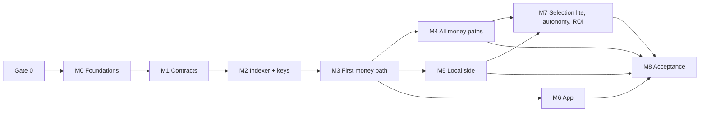
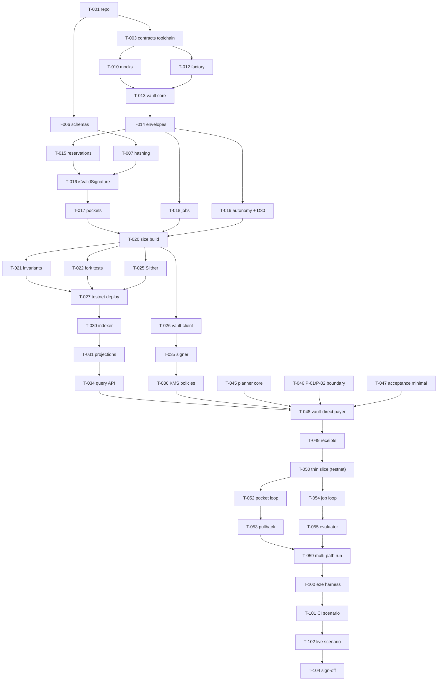

# Czar Phase 1 build plan (spec 05)

## 0. Header

- **Date:** 2026-10-18. **Author:** Claude, lead technical planner, for Zaryab. **Status:** ready for Gate 0.
- **Inputs:** `README.md`; `docs/product/decisions-log.md` (D1–D62); `docs/product/czar-product.md` §11; `docs/product/feature-roadmap.md` §3; specs 01–04 (as amended, see `amendment-verification.md`); `docs/specs/00-ground-truth/part2.md` and `circle-arc.md`.
- **Decisions relied on most:** D13, D14, D22, D25–D30, D33, D37–D39, D42, D45–D62.
- **Companion files:** `gate-0-checks.md`, `phase-1-tasks.md` (T-001 to T-104), `builder-agent-rules.md`, `spec-change-request-template.md`, `amendment-verification.md`.
- **Network:** Arc testnet only. The only mainnet content is the unexecuted checklist in §10.

## 1. Summary

- Gate 0 (13 checks; G0-02 and G0-15 moved to stage 2 by D69) runs before any production code: an independent spec review, the Circle and Arc assumptions that could change a design choice, and the repo security baseline.
- Nine milestones, M0 to M8, with 87 Phase 1 tasks (T-083 moved to stage 2, D69). Each milestone ends in a gate of commands that pass or fail; a failed gate blocks the next milestone.
- **Guardrails first:** contracts (M1) pass unit, fuzz, invariant, fork and Slither checks and are deployed before the indexer and signer (M2). No server code calls a vault before both.
- **Thin slice early:** M3 ends with one real reserve → x402 → settle → finalize on Arc testnet against `czar-search`, with evidence recorded. M4 widens to the pocket and job paths and anchors the proof.
- The local side (M5) and the desktop-browser app (M6, D69) build on a working payment server. Selection Layer lite, earned autonomy and the ROI ledger (M7) come last before acceptance.
- M8 runs `docs/specs/04-components/phase-1-acceptance-scenario.md` end to end, in CI on an `arc-anvil` fork and once on live testnet with Stage 0 in desktop Safari. It is the Phase 1 release gate.
- Every task names its spec sections, outputs, runnable acceptance tests, dependencies, size, parallel group and owner. Steps that need funds, accounts or a real device need Zaryab's approval.
- Agents never change specs. A spec problem becomes a spec change request (SCR), and work on that item stops until Zaryab rules on it.

## 2. Repo and workspace layout

### 2.1 Layout

From `docs/specs/04-components/cross-cutting.md` §1 (one `pnpm` workspace; the specs are linked, never copied):

| Path | Package | Components |
|---|---|---|
| `apps/daemon` | `@czar/daemon` | CZ-02 to CZ-08, CZ-11 |
| `apps/redact-sidecar` | `czar-redact` (Python, `uv`) | CZ-26 layer 2 (D45) |
| `apps/mcp` | `@czar/mcp` | CZ-09 |
| `plugins/claude-code` | `czar-observer` | CZ-01 |
| `apps/server` | `@czar/server` | CZ-12 to CZ-18, CZ-23 to CZ-25 |
| `apps/signer` | `@czar/signer` | CZ-27 signer service |
| `apps/indexer` | `@czar/indexer` | CZ-19 |
| `apps/merchants` | `@czar/merchants` | CZ-20 |
| `apps/web` | `@czar/web` | CZ-22 |
| `packages/schemas`, `hashing`, `redaction`, `x402`, `vault-client`, `config`, `logging` | `@czar/*` | shared (cross-cutting §2) |
| `contracts/` | Foundry project | `CzarVault`, `CzarVaultFactory`, `OpenEvidenceLog` |
| `models/` | prompt files and eval fixtures | P-01 to P-06 |
| `docs/specs/` | link to this specs folder (read-only) | — |

`apps/signer` is the signer service that `cross-cutting.md` places under `apps/server`'s key management (CZ-27). It runs as its own process so its network policy can be stricter (spec 04 `server-autonomy-roi-keys.md` CZ-27). Confidence: moderate.

### 2.2 Toolchain pins

| Tool | Pin | Fact / decision |
|---|---|---|
| Arc Foundry (`arc-forge`, `arc-cast`, `arc-anvil`) | release `v0.8.0-2`, installed from the tarball with its `.sha256` checked; never `foundryup` or `foundry-toolchain` | A9-12, A9-13 |
| Solidity | `0.8.30`, `evm_version = "prague"`, optimizer on | spec 03 `czar-vault.md` header |
| OpenZeppelin | `v5.7.0` | spec 03 |
| Node.js | 22 LTS (≥ 22.18 for the Gateway buyer SDK) | p1-G13, cross-cutting §7 |
| Package manager | `pnpm`, exact versions, `minimumReleaseAge 1440`, `ignore-scripts true` | CLAUDE.md supply-chain rules |
| Python helper | Python 3.13 with `uv`, bundled into the daemon installer; Presidio `2.2.364` | D45, C2-01 |
| Other pins | as `cross-cutting.md` §7 (viem 2.57.x, `@x402/*` 2.28.0, `@circle-fin/x402-batching` 3.5.0, `@circle-fin/modular-wallets-core` 1.0.16, Ponder 0.18.x, `better-sqlite3-multiple-ciphers` 13.0.3, `@napi-rs/keyring` 2.1.1, gitleaks rules v8.30.1) | cross-cutting §7 |
| MCP SDK | version that speaks `2026-07-28` and legacy `initialize` | **GAP**: chosen in T-072 and recorded |
| Slither | version pinned in CI by T-025 | spec 03 `security-and-testing.md` §3.6 |

## 3. Environments

| Name | What it is | Runs | Funds |
|---|---|---|---|
| `local` | `arc-anvil --network arc --chain-id 5042002`; Circle services mocked by the test harness | unit, integration, contract unit/fuzz/invariant tests, all CI jobs | dev accounts (native balance `1e24`, A9-14) |
| `fork` | `arc-anvil --fork-url https://rpc.testnet.arc.io --fork-block-number <pinned>` | fork tests against live USDC, GatewayWallet and Circle's ERC-8183 instance (spec 03 §3.4); the acceptance scenario in CI (T-101) | balances overridden in the fork; no real funds |
| `testnet` | live Arc testnet, `https://rpc.testnet.arc.io` plus one keyed provider (A9-07, A9-08); Circle Facilitator with `network: eip155:5042002` (A1-15); Gateway `https://gateway-api-testnet.circle.com` (A2-30) | contract deployment, thin slice, multi-path run, live acceptance run, merchants, server, indexer | testnet USDC from Zaryab |

- **How test funds are obtained:** Circle's CLI faucet gives 20 testnet USDC per request, only to Zaryab's own Circle wallets (p1-A11, A6-26). Zaryab transfers small amounts to approved test addresses with `circle wallet transfer` (the A1 and A2 experiment pattern).
- **Approval rule:** every task that spends testnet funds names a cap and waits for Zaryab's written approval in its task report. Expected total for Phase 1: under 40 testnet USDC (Gate 0 ≈ 2, deployment ≈ 1, thin slice ≈ 1, multi-path ≈ 3, live acceptance ≈ 6, plus margin).
- **No mainnet** in any environment. `rpc.mainnet.arc.io` is used only for read-only calls in G0-08.

## 4. Gate 0

Full procedures: `gate-0-checks.md`.

| ID | Check | Owner | Blocks |
|---|---|---|---|
| G0-01 | Independent review of specs 01–05 | reviewer agent | all milestones |
| G0-02 | ~~Passkeys inside the installed iPhone web app~~ — moved to stage 2 (D69, `stage-2-backlog.md` §2 M-1) | — | nothing in Phase 1 |
| G0-03 | AR-2: MSCA UserOp calls an arbitrary contract | agent, after Zaryab supplies a client key and ≤ 0.1 USDC | M6 |
| G0-04 | AR-3: Facilitator `/verify` with the long ERC-1271 signature | agent, after Zaryab approves ≤ 0.1 USDC | T-048 mode setting |
| G0-05 | AR-5 / AR-14: pullback through a vault-style signer | agent, **after Zaryab approves about 1 USDC** | M4 pocket path |
| G0-06 | AR-6: funding an MSCA address | agent with Zaryab | M6 onboarding |
| G0-07 | AR-7: pocket EOA with gas calls `addDelegate` | agent, after Zaryab approves ≤ 0.6 USDC | M4 pocket path |
| G0-08 | Arc block gas limit and contract size limit | agent (read-only) | T-020 |
| G0-09 | AR-15 / AR-25: `isTransferSpecHashUsed` and `AttestationUsed` on the testnet minter | agent (read-only) | T-017 |
| G0-10 | `arc-forge` with solc 0.8.30 | agent (local) | M1 |
| G0-11 | Host checks: plugin validation, `http` hook to loopback (D46, AR-18), MCP env substitution (AR-20), MCP revision | agent (local) | M5 |
| G0-12 | Repo security baseline (`.gitignore`, secret scan, no keys) | agent | M0 |
| G0-13 | Signer backend check: `local-keystore` in Phase 1 (D70); Google Cloud KMS in stage 2 | agent | M2 |
| G0-14 | Bundlers, EntryPoint, gas sponsorship (AR-26, A6-07, A6-08, A6-19) | agent | M6 |
| G0-15 | ~~Declarative Web Push to the installed app~~ — moved to stage 2 (D69, `stage-2-backlog.md` §2 M-4) | — | nothing in Phase 1 |

- **Rule:** a result that changes a spec choice produces an SCR before any task that depends on it starts.
- **Order:** G0-12 first (it unblocks M0). G0-01, G0-08, G0-09, G0-10 and G0-11 are free and can run in parallel. G0-02 and G0-15 are stage 2 (D69); the desktop passkey check runs in T-082. G0-03 to G0-07 and G0-13 wait for Zaryab's approvals.

## 5. Milestones

Task details are in `phase-1-tasks.md`. "Exit gate" commands run in CI unless marked testnet.

### M0 Foundations (T-001 to T-009, 9 tasks)

- **Goal:** a repo where every later task can build, test and lint, with the spec 02 shapes and hashes available as tested packages.
- **Components:** shared packages for CZ-all; CZ-26 layer 1.
- **Specs:** `cross-cutting.md` §1–§5, §7; 02 §2–§7; 02 `schemas/`, `vectors/`.
- **Entry:** G0-12 passed; G0-10 passed for T-003.
- **Exit gate:**
  - `pnpm -r lint && pnpm -r typecheck && pnpm -r test` pass with 0 warnings
  - `pnpm --filter @czar/hashing test` reproduces the six digests and the derived nonce in `02/vectors/eip712-vectors.json`
  - `pnpm --filter @czar/schemas test` validates every 02 §4 example and rejects every `local-only` field in `ObjectiveSubmission`
  - CI secret scan and `zizmor` pass; `arc-forge build` compiles the 7 interface files with 0 warnings
- **Risks:** `$id`-based schema refs need a loader that registers all schemas (follow-up in `amendment-verification.md` §4).

### M1 Contracts (T-010 to T-027 and T-105, 19 tasks)

- **Goal:** `CzarVaultFactory`, `CzarVault` and `OpenEvidenceLog` built to spec 03, proven by tests, deployed to testnet at CREATE2 addresses.
- **Components:** on-chain parts of CZ-15, CZ-17, CZ-24; contracts in spec 03.
- **Specs:** 03 `czar-vault.md` §2–§14, `czar-vault-factory.md`, `job-escrow-adapter.md`, `open-evidence-log.md`, `security-and-testing.md`; 02 §5–§7.
- **Entry:** M0 exit; G0-08, G0-09, G0-10 recorded.
- **Exit gate:**
  - `arc-forge test` passes all unit tests, with one test per row of the role table (`czar-vault.md` §2) and one per custom error
  - `arc-forge test --match-path 'test/invariant/*'` passes INV-1 to INV-16, FAC-1 to FAC-5, JOB-1 to JOB-5, OEL-1 to OEL-6 with `runs ≥ 256`, `depth ≥ 64`
  - `arc-forge test --match-path 'test/fork/*' --fork-url https://rpc.testnet.arc.io --fork-block-number <pinned>` passes (USDC bytes overload, `authorizationState`, `depositFor`, `addDelegate`, Circle ERC-8183)
  - the spec 02 §6.4 vectors are reproduced on-chain (T-023)
  - `arc-forge build --sizes` shows every contract under the limit recorded in G0-08 (D42 decided in T-020)
  - `slither contracts/ --config-file contracts/slither.config.json` with the committed triage file reports 0 untriaged findings
  - **testnet:** factory and evidence log deployed through Arachnid CREATE2 (A9-15); bytecode hashes published; `arc-cast code` non-empty at both addresses
- **Risks:** vault size (D42); `isValidSignature` subtleties (02 §6.3); the AR-3 outcome (both modes are built either way).

### M2 Indexer and key management (T-030 to T-037, 8 tasks)

- **Goal:** the indexer mirrors every vault, factory and external event Czar needs, alerts on upgrades, and the signer service signs only shapes the policy allows.
- **Components:** CZ-19, CZ-27.
- **Specs:** 04 `server-acceptance-evidence-selection.md` CZ-19; 04 `server-autonomy-roi-keys.md` CZ-27; spec 01 §7.2, §16.
- **Entry:** M1 exit (contracts deployed); G0-13 passed; **local hosting ready on Zaryab's Mac** (Docker Postgres, indexer and server processes, `local-keystore` signer; D70). Google Cloud is stage 2 (D66, D70).
- **Exit gate:**
  - indexer integration tests replay a scripted `fork` session and the projections equal the vault's on-chain state field by field
  - a forced `Upgraded` event on a forked proxy raises the alert and sets the halt flag (T-033)
  - signer policy tests: a USDC digest whose `to` is outside the reservation is refused before the key store is used; rate limits enforced; K6 and K20 need an interactive confirmation (dual control is stage 2, D80)
  - **testnet:** the signer signs one `reserve` call and one `USDC_3009` digest with the keystore key; a denied request is refused before the backend; the relayer gas key lives in the local keystore (D62 as amended by D70); K3, K7, K8 hold capped gas balances (RV-017). **Superseded by RV-028:** "with the KMS key … lives in KMS"
- **Risks:** the agent runs only while the Mac is awake (D70); Ponder on 0.5 s blocks (AR-23). KMS vendor limits (AR-1) move to stage 2.

### M3 First money path (T-040 to T-050, 11 tasks)

- **Goal:** one real vault-direct payment on testnet, end to end, crash-safe, with evidence stored.
- **Components:** CZ-12, CZ-13 (rule-based core), CZ-14, CZ-15 (vault-direct), CZ-16 (minimal), CZ-17 (receipts), CZ-20 (`czar-search` vanilla route); P-01, P-02.
- **Specs:** 04 `server-planning-and-payment.md` (all); 04 `ai-prompts.md` P-01, P-02; 04 `server-supply-side.md` CZ-20; 02 §11, `api/openapi.yaml`.
- **Entry:** M2 exit; G0-04 recorded (`vaultSignatureMode`).
- **Test owner fixture:** until the app exists (M6), testnet vaults in M3 and M4 are created by the factory with a **test owner account** held in an encrypted test keystore, so the owner can set limits and open envelopes. This is a testnet fixture only, for M3–M4 only; T-082 removes it in M6, and it is never used in M8 or for real users (D64).
- **Exit gate:**
  - OpenAPI contract tests pass for every daemon and app route implemented so far
  - P-01 and P-02 eval suites pass, including every injection case in `ai-prompts.md`
  - the kill-and-resume harness passes for every `step_executions` phase of the vault-direct loop
  - **testnet (T-050):** `Reserved` → HTTP 200 with `PAYMENT-RESPONSE.success` → `AuthorizationUsed(vault, nonce)` → `Settled` → `ReservationFinal`; the `Receipt` is stored; envelope counters match INV-1
- **Risks:** Facilitator keyless-trial limits (part 2 A1 GAP); merchant idempotency store correctness.

### M4 All money paths (T-051 to T-059, 9 tasks)

- **Goal:** pocket and job paths working, all three merchants live on both routes, and an anchored, third-party-verifiable proof.
- **Components:** CZ-15 (pocket, job), CZ-16 (full Phase 1 profiles, evaluator), CZ-17 (publisher), CZ-20 (complete).
- **Specs:** 04 `server-planning-and-payment.md` CZ-15 §5.3, §5.4; 04 `server-acceptance-evidence-selection.md` CZ-16, CZ-17; 03 `czar-vault.md` §5.4, §5.5, §6.2; 03 `job-escrow-adapter.md`; 03 `open-evidence-log.md` §11.
- **Entry:** M3 exit; G0-05 and G0-07 passed (or the SCR they produced is resolved). Testnet vaults still use the test-keystore owner fixture (D64).
- **Daemon platform:** macOS only in Phase 1 (D67); applies to M5.
- **Exit gate:**
  - kill-and-resume tests pass for every pocket and job phase
  - **testnet (T-059):** pocket funded, four nanopayments `received` then `completed`, pullback confirmed, pocket written off; a job completed, a second rejected, a third refunded after expiry; one `EVIDENCE_BATCH` committed; the verification script (T-058) rebuilds the root from the server archive and confirms every payment ref
- **Risks:** pullback depends on Circle's API (A2-06); Circle's ERC-8183 admin EOA (A4-08).

### M5 Local side (T-060 to T-073, 14 tasks)

- **Goal:** on Zaryab's Mac, Claude Code activity becomes redacted memory, a Work Soul, objectives (shadow and live), MCP tools and a write-back file.
- **Components:** CZ-01 to CZ-09, CZ-11, CZ-26; server routes `completeModelCall`, `createQuote`, `reportOutcome`, `createPayRequest`, `shadowQuote`.
- **Specs:** 04 `local-observers-and-daemon.md`, `local-soul-and-drives.md`, `local-agent-surfaces.md`, `ai-prompts.md` P-04 to P-06; 02 §8, §13, `api/local-openapi.yaml`, `mcp/czar-mcp-tools.md`.
- **Entry:** M3 exit (server and payment routes exist); G0-11 recorded.
- **Exit gate:**
  - `claude plugin validate --strict plugins/claude-code` passes
  - host-fixture tests: Claude Code, Codex and Cursor payloads map per 02 §8; Cursor `user_email` never reaches storage
  - redaction corpus: every planted secret becomes a `[[R:S:…]]` marker; Presidio helper starts from the installer bundle without a system Python
  - P-04, P-05, P-06 eval suites pass, including injection cases
  - `ObjectiveSubmission` sender guard: no `local-only` field leaves (schema test); the first five objectives wait for review (D47)
  - MCP server passes the dual-era conformance tests (current `_meta` path and legacy `initialize`) and `pay` returns a URL-mode elicitation when approval is needed
- **Risks:** notarizing the bundled Python helper (AR-19); hook transport under managed policies (AR-18).

### M6 App (T-080 to T-087; 7 Phase 1 tasks, T-083 moved to stage 2)

- **Goal:** the web app, used in a desktop browser (Safari or Chrome on macOS, D69), onboards a user to a passkey smart account and a vault, shows approvals, opens envelopes by UserOp, freezes, and shows receipts in USD.
- **Components:** CZ-22 (desktop). CZ-23 notifications, Home Screen install, mobile layouts and the D28 native fallback are stage 2 (D69, `stage-2-backlog.md` §2).
- **Specs:** 04 `app-and-notifications.md`; 02 `api/openapi.yaml` app surface; 03 `czar-vault-factory.md` §5; D26, D30, D51, D52, D64, D69.
- **Entry:** M3 exit; G0-03, G0-06, G0-14 passed.
- **Approvals:** the in-app pending-approvals list is the only Phase 1 approval channel (D69).
- **D64:** M6 removes the test-keystore owner fixture (T-082).
- **Exit gate:**
  - Playwright flows with a virtual authenticator: onboarding, approval, freeze, unfreeze, receipts
  - the approval page re-encodes `ApprovalIntent.decoded` and refuses to submit if the calldata differs
  - every money state renders the exact wording in spec 04, in USD only (D51); the "Network fee reserve" is shown (D52)
  - Zaryab completes the passkey ceremony in desktop Safari and desktop Chrome on macOS (T-082)
  - **testnet:** an MSCA creates its vault through the factory and opens one envelope by UserOp; no testnet vault is owned by the test keystore (D64)
- **Risks:** desktop passkey behaviour across Safari and Chrome; bundler behaviour (AR-26).

### M7 Selection Layer lite, earned autonomy, ROI ledger (T-090 to T-095, 6 tasks)

- **Goal:** evidence-ranked service choice for the planner and MCP, earned-limit raises, and the ROI statement.
- **Components:** CZ-18 (lite), CZ-13 (P-03), CZ-09 (`find_service`), CZ-24, CZ-25.
- **Specs:** 04 `server-acceptance-evidence-selection.md` CZ-18; 04 `ai-prompts.md` P-03; 04 `server-autonomy-roi-keys.md` CZ-24, CZ-25; SL §5, §6.9, §6.10; D15, D40, D59.
- **Entry:** M4 exit; M5 exit for T-093.
- **Exit gate:**
  - ranking fixtures: unverified services appear only in their own section and are never scored ("unknown is not bad")
  - catalog cache test: no Circle field persists past its TTL (D15, 02 §12.3)
  - P-03 eval suite passes, including injection cases
  - autonomy fuzz: no proposal breaks INV-9 or D40; a second raise in a period reverts `RaiseAlreadyThisPeriod`
  - monthly statement totals equal the ledger rows
- **Risks:** thin evidence early on (single-source badges); catalog terms (AR-11).

### M8 Phase 1 acceptance (T-100 to T-104, 5 tasks)

- **Goal:** the full scenario passes; Phase 1 is released.
- **Specs:** 04 `phase-1-acceptance-scenario.md` (Stages 0–8 and its definition of done).
- **Entry:** M3 to M7 exits.
- **Exit gate:**
  - `pnpm --filter e2e test:phase1 --env fork` passes Stages 1–8 in CI
  - **testnet (T-102):** the scenario passes once on live testnet, including Stage 0 in desktop Safari on macOS, with the run report attached
  - the security gates in §8 pass for the release commit
  - Zaryab signs the definition of done (§9)

### Task counts

| Milestone | Tasks |
|---|---|
| M0 | 9 |
| M1 | 18 |
| M2 | 8 |
| M3 | 11 |
| M4 | 9 |
| M5 | 14 |
| M6 | 7 (+ T-083 in stage 2) |
| M7 | 6 |
| M8 | 5 |
| **Total** | **87** Phase 1 (+ 1 stage 2) |

## 6. Critical path and dependency graph

### 6.1 Milestones

- M5 and M6 can run in parallel with M4 once M3 exits; they share no files.
- M7 needs M4 (evidence to rank) and M5 (the MCP server for `find_service`).

### 6.2 Critical path (task level)

### 6.3 Parallel groups

| Group | Tasks that can run together |
|---|---|
| M0-a / M0-b / M0-c | T-001→(T-002, T-003); (T-004, T-005, T-006, T-008); (T-007, T-009) |
| M1-a | T-010, T-011, T-012 |
| M1-d | T-017, T-018, T-019 |
| M1-e | T-021 to T-026 |
| M2-a / M2-b / M2-c | T-030 with T-035; T-031 with T-032; T-033, T-034, T-036, T-037 |
| M3-b | T-043 to T-047 |
| M4-a / M4-b | (T-051, T-056, T-057); (T-052→T-053, T-054) |
| M5-b to M5-e | T-061, T-062, T-064, T-065 together; then T-063, T-071; then T-066, T-068, T-072, T-073; then T-067, T-069, T-070 |
| M6-a to M6-c | (T-080, T-081); T-082; (T-084 to T-087). T-083 is stage 2 |
| M7-a / M7-b / M7-c | (T-090, T-094, T-095); T-091; (T-092, T-093) |
| M8-b | T-101 with T-103 |

Each parallel agent works in its own worktree (CLAUDE.md worktree rule).

## 7. Test strategy

| Layer | What | Where defined | Runs in |
|---|---|---|---|
| Unit | every function and error path; table-driven routing; state-machine transitions | each task | `local`, CI |
| Contract fuzz | reservation and envelope math, pocket accounting, autonomy periods, rounding | 03 `security-and-testing.md` §3.2 | CI |
| Contract invariants | INV-1 to INV-16, FAC-1 to FAC-5, JOB-1 to JOB-5, OEL-1 to OEL-6 with faithful USDC, Gateway and ERC-8183 mocks | 03 §2, §3.3 | CI |
| Contract fork | live testnet USDC, GatewayWallet, Circle ERC-8183 on a pinned fork | 03 §3.4 | CI (`fork`) |
| Gas | `forge snapshot`; fail on > 5% regression; feeds routing parameters | 03 §3.5 | CI |
| Vectors | the 02 §6.4 digests in TypeScript and Solidity from one fixture | 02 `vectors/` | CI |
| Schema contract | every API request/response validated against `openapi.yaml` and `local-openapi.yaml`; every object against `schemas/` | 02 | CI |
| Crash recovery | kill-and-resume at every `step_executions` phase on all three paths | 04 CZ-15 §5.2–§5.4 | CI (`fork`) |
| AI prompt evals | P-01 to P-06 cases, every injection case; a protected field changing fails the build | 04 `ai-prompts.md` | CI (model calls; budget per `cross-cutting.md` §6.2) |
| End to end | Playwright (app), daemon + plugin fixtures, server against `fork` | M5, M6 tasks | CI |
| Live testnet | thin slice (T-050), multi-path (T-059), acceptance (T-102) | tasks | testnet, with approval |
| Release gate | the Phase 1 acceptance scenario, Stages 0–8 | 04 `phase-1-acceptance-scenario.md` | `fork` in CI, then testnet |

## 8. Security gates (each must pass for the release commit)

| Gate | Command or check | Task |
|---|---|---|
| Static analysis | `slither contracts/ --config-file contracts/slither.config.json` with the committed triage file: 0 untriaged; custom checks: no `tx.origin`, no `block.prevrandao`, no unbounded loops | T-025 |
| Secret scanning | gitleaks (pinned rules) on every push and pull request; `git ls-files` has no `*.key`, `*.key.json`, `.env*` | T-002, G0-12 |
| CI hygiene | GitHub Actions pinned to SHAs with version comments, `persist-credentials: false`; `zizmor` clean; `arc-foundry` from the checksummed release | T-002, T-003 |
| Plugin | `claude plugin validate --strict plugins/claude-code` | T-062 |
| Key policies | signer policy tests on testnet: wrong payee refused before the key store; rate limits; interactive confirmation for K6/K20 (dual control stage 2, D80); relayer gas key in the local keystore (D70); keys created by T-105 before T-027 (RV-016) | T-036, T-105, D61, D62, D80 |
| Injection | every injection eval case in `ai-prompts.md` passes; scenario step 7.1 passes | T-046, T-066, T-068, T-092, T-101 |
| Logs | automated scan of all logs from the acceptance run: no objective text, soul text, merchant body, path or email (cross-cutting §4) | T-103 |
| Dependencies | `pnpm audit --audit-level=moderate`; `uv` hashes for the Python helper | T-002, T-064 |

## 9. Definition of done for Phase 1

- [ ] Gate 0 complete; every SCR it raised is resolved.
- [ ] All 87 Phase 1 tasks done, each with a task report and passing acceptance tests.
- [ ] Contract invariants, fuzz, fork and Slither gates pass on the release commit.
- [ ] Contracts deployed on testnet through CREATE2; bytecode hashes published; `Upgraded` alerts live for every pinned dependency.
- [ ] All three payment paths work on testnet, with crash recovery tested at every step.
- [ ] Every injection eval case passes; the planner and paying agent never receive raw merchant text (log assertion in T-101).
- [ ] The acceptance scenario passes in CI (`fork`) and once on live testnet, including Stage 0 in desktop Safari on macOS (D69).
- [ ] A third party can verify the anchored proof from the `Committed` event alone (T-058 script, run by someone other than its author).
- [ ] All money text is USD (D51); the gas reserve is shown (D52); D31 wording is used wherever soul compilation is described.
- [ ] No log contains personal data (T-103).
- [ ] No mainnet deployment, key or transaction exists.
- [ ] Zaryab signs off (T-104).

## 10. Pre-mainnet checklist (listed, not executed)

- [ ] External audit of `CzarVault`, `CzarVaultFactory`, the job adapter, and the `CzarJobEscrow` configuration with the pinned `erc-8183/base-contracts` commit (03 §5).
- [ ] HSM decision for K3, K6, K7, K8, K20 at the audit (D61, AR-1).
- [ ] Gateway gaps: A2-G2 (mainnet code hash differs) and A2-G3 (delegate burns on mainnet).
- [ ] AR-4: `authorizationState` on mainnet USDC; AR-3 `/verify` on `eip155:5042`; AR-5 pullback with ≤ 1 USDC after the audit.
- [ ] Deploy `CzarJobEscrow` (D27, D32) and a factory version that targets it; adapter kind `CzarBase`.
- [ ] Re-pin every mainnet address (GatewayWallet `0x7777…00eE`, GatewayMinter from the SDK constant after an on-chain code check, ERC-8004, USDC implementation) and their implementation hashes; `Upgraded` alerts on each.
- [ ] Facilitator Console API key (K11) and Gateway API key slot (K12).
- [ ] Confirm the test-keystore vault owner fixture used in M3–M4 is gone from code and from every deployment (D64; backlog MN-7).
- [ ] Measured mainnet gas table; routing thresholds recomputed.
- [ ] Guardian and admin keys in separate custody; pause drill.
- [ ] Mainnet explorer API is blocked for scripts (A9-11): own indexer only, keyed RPC.
- [ ] Review Circle's catalog terms for live querying (AR-11).

## 11. Phase 2 and 3 outline (scope only)

| Milestone | Scope | Source |
|---|---|---|
| P2-M1 More observers | Codex, Cursor, Chrome | spec 01 §18; 04 CZ-01 outlines |
| S2-M0 Mobile (stage 2, first after Phase 1) | iPhone Home Screen install, iPhone passkey test (G0-02), web push / Declarative Web Push (G0-15, CZ-23, T-083), mobile layouts, native-app fallback (D28) | D69; `stage-2-backlog.md` §2 |
| P2-M2 Soul injection and phone soul | CZ-10 exports; end-to-end encrypted soul sync to the phone (D34; backlog M-6) | 02 §13; D34 |
| P2-M3 Recipes and builders | `RecipeSplits` over 0xSplits v2.2, `BuilderEscrow` (48 h delay, 0.01 USDC minimum, D44), claim server CZ-21 | D29, D23, 03 `builder-escrow-and-recipe-splits.md` |
| P2-M4 Full Selection Layer | crawler, publication, 15-minute batches, 5-minute snapshots, IPFS pinning (D54) | spec 01 §15; 04 CZ-18 |
| P2-M5 Growth features | standing objectives, full ROI ledger, full context minimization, pocket top-ups | spec 01 §18 |
| P3 | team vault, demand radar, unmet-demand jobs, exploration budget, fix-it feedback, signed quotes and `upto`, probers and validators | spec 01 §18 |

## 12. Risk register

| # | Risk | Harm | Owner | Mitigation task |
|---|---|---|---|---|
| R-1 | Passkeys fail in a desktop browser for the Modular Wallets SDK (Safari or Chrome on macOS) | onboarding and approvals blocked | Zaryab + agent | T-082 manual check early in M6. (iPhone passkeys are a stage-2 risk, D69) |
| R-2 | A vault accounting or `isValidSignature` bug | loss of user funds | agent + external audit | T-016, T-021, T-022, T-025; audit before mainnet |
| R-3 | Pullback depends on Circle's API (A2-06); outage locks pocket funds up to 7 days | ≤ 25% of an envelope stuck | agent | G0-05, T-053 (API-down fallback, D41) |
| R-4 | Signer-service policy gap lets K3 sign an unintended digest | bounded by the vault, but money can move inside open envelopes | agent | T-035, T-036 policy tests; vault invariants |
| R-5 | Prompt injection steers the planner | spend inside envelopes on wrong services | agent | T-046, T-092 evals; plan built from structured candidates only |
| R-6 | Circle's ERC-8183 instance changes fees or upgrades (A4-08) | job path halted | agent | T-018 fee check; T-033 alerts |
| R-7 | The Python helper cannot be notarized inside the app bundle (AR-19) | layer-2 redaction falls back to regex with forced review | agent | T-064; `launchctl` install path |
| R-8 | Vault exceeds the contract size limit (D42) | redesign before deployment | agent | G0-08, T-020 |
| R-9 | Facilitator rejects long signatures (AR-3) | more gas per payment (digest mode) | agent | G0-04; both modes built in T-015/T-016 |
| R-10 | Testnet funds and approvals depend on Zaryab's time | schedule slips | Zaryab | batch approvals per milestone (§3) |

## 13. Open decisions for Zaryab

| # | Decision | Options | Recommendation | Confidence | Status |
|---|---|---|---|---|---|
| OD-35 | How D60 (freeze lowers every `autoLimit` to 0) is enforced | (a) agent calls `lowerAutoLimit(categoryId, 0)` per used category after `Frozen` (as now specified, no contract change); (b) make it atomic in the contract with a `limitsEpoch` counter bumped by `freeze()` (a spec 03 change) | (a): a frozen vault already blocks agent-opened envelopes, so (a) is a second guard; revisit at the audit | moderate | **Decided** D63 |
| OD-36 | Test owner fixture for M3–M4 | (a) testnet vaults owned by a test keystore account until the app ships (M6); (b) wait for M6 before any money path | (a), testnet only, never in M8 | moderate | **Decided** D64 |
| OD-37 | Spec 01 and the product doc lag D51 (this job may not edit them): spec 01 §4.3 (CZ-22 "budget in local currency") and §8.2 (push "cap in local currency"); product §4.1 and §9.2 ("a budget in your own currency") | (a) a doc-only update pass to spec 01 and the product doc citing D51; (b) leave them, since the decisions log wins | (a), before G0-01 so the reviewer reads consistent docs | high | **Decided** D65 |
| OD-38 | Cloud provider for the server, indexer and KMS (D61 leaves the vendor open) | one cloud for all / KMS separate | one cloud, chosen before M2 | unknown | **Decided** D66 (provider still open) |
| OD-39 | Phase 1 daemon platforms | macOS only for the Phase 1 release; Linux and Windows later / all three | macOS only (spec 04 says macOS first; G0 and M5 test on macOS) | moderate | **Decided** D67 |
| OD-40 | Model provider account and price check before M3 (budgets are in tokens, prices were never read) | read prices now / during M3 | during T-046, before eval suites run in CI | low | **Decided** D68 |

## 14. Gaps and flags

### 14.1 Gaps

| Gap | Closed by |
|---|---|
| MCP SDK version that speaks `2026-07-28` and legacy | T-072 |
| Model and KMS prices | OD-40; G0-13 |
| Circle gas sponsorship for MSCA on Arc (A6-08, A6-19) | G0-14 |
| Faucet to an MSCA (A6-26, AR-6) | G0-06 |
| Arc block gas limit and size limit | G0-08 |
| MCP revision each host negotiates (D3 GAP) | G0-11 |
| Facilitator keyless-trial allowance size (A1 GAP) | observed in T-043; Console key if exhausted |
| Arc public RPC rate limits (A9-06) | keyed provider from T-040 |
| Presidio non-English models (C2-04) | Phase 2 |
| Windows service model (B6-20) | Phase 2 (OD-39) |

### 14.2 Flags

- No new agent-directed text was met while writing this plan. Known cases stay in force: Circle and Arc doc headers telling agents to install skills and add MCP servers (FL-1, FL-2), Circle skill text telling agents to pay small amounts without confirmation (p1-W10), and `AGENTS.md` files in vendor repos (FL-4). `builder-agent-rules.md` tells every coding agent to treat them as data.
- No secrets were opened. Key files seen by name only: `docs/research/evidence/experiments/a1-erc1271-usdc/{owner,seller}.key`, `docs/research/evidence/experiments/a2-gateway-e2e/{buyer,delegate,merchant}.key`. The code repo must never contain such files (G0-12).

## Change log

| Date | ID | Change |
|---|---|---|
| 2026-10-19 | D69 | Gate 0 drops G0-02 and G0-15 (stage 2); M6 is the desktop-browser app, CZ-23 and mobile work are stage 2; task total 87; DoD and R-1 updated. |
| 2026-10-19 | D69 | §11 adds the stage-2 mobile milestone row. |
| 2026-10-19 | D63–D68 | OD-35..OD-40 marked Decided; D64 fixture limited to M3–M4 and removed in M6 (plus pre-mainnet check); D66 cloud choice added to M2 entry; D67 macOS-only note. |
| 2026-10-19 | D70 | Phase 1 runs on Zaryab's Mac with a local software signer (encrypted keystore); Google Cloud (KMS, Cloud Run, e2-micro VM) moves to stage 2. |
| 2026-10-19 | G0-01 review | M2 exit and §8 for the local keystore (RV-028, D80); T-105 before T-027 (RV-016); T-086 depends on T-095 and the M5 exit, so M6 starts T-086 last (RV-053). |
| 2026-10-20 | D88 | M1 task count (19, with T-105); invariant ranges INV-1..16, FAC-1..5, JOB-1..5, OEL-1..6; one `slither` command. |
