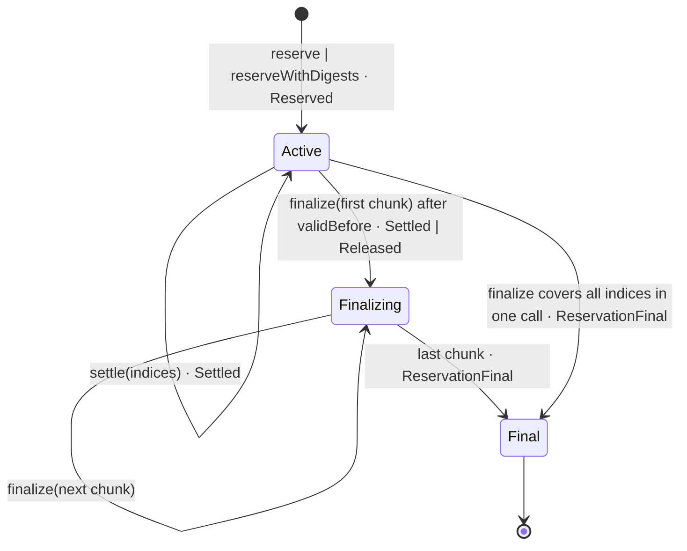
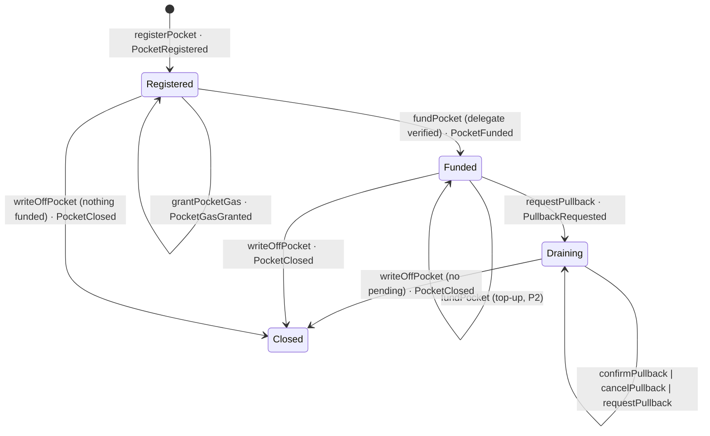
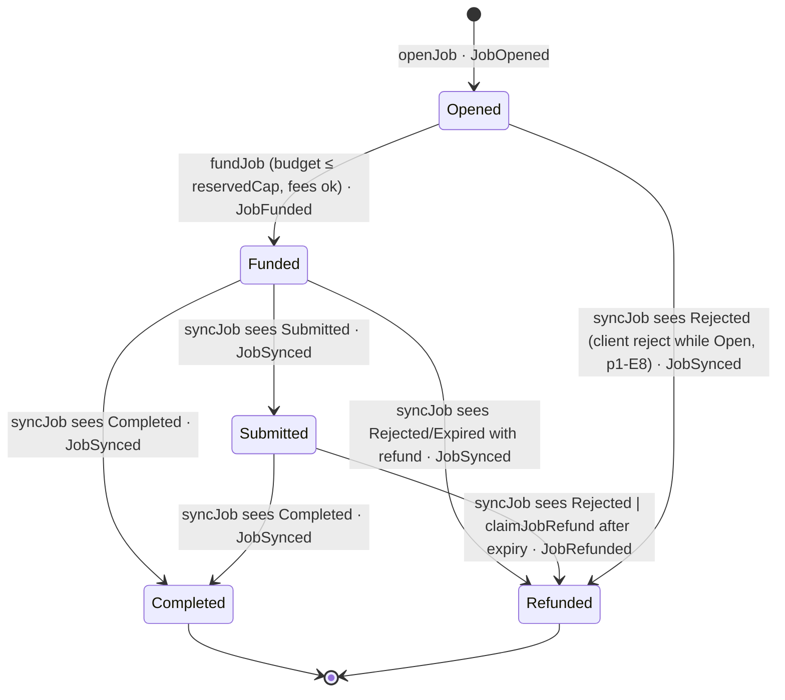

# `CzarVault` (spec 03)

- **Date:** 2026-10-18. **Status:** draft for review. Shared types, hashes, EIP-712 types and ids are defined in `specs/02-data-and-protocol/data-and-protocol.md` (cited as "02 §n"). Interface: `interfaces/ICzarVault.sol`.
- **Solidity:** `0.8.30`, pinned. Reason: the ERC-1271 payer that Circle's Facilitator settled live on Arc testnet was compiled with `solc_version = "0.8.30"`, `evm_version = "prague"`, optimizer on (`a1-erc1271-usdc/foundry.toml`, A1-12, A1-17), so that toolchain is proven on Arc; 0.8.30 has transient storage and is below the newest release `0.8.37` (2026-09-10), leaving a margin for audit tooling. EVM target `prague` for the same reason (Arc is Osaka-based, p1-A7; `prague` is the highest target the proven run used). **GAP:** `arc-forge` v0.8.0-2's bundled solc list was not checked; `forge` downloads solc per `solc_version`.
- **OpenZeppelin:** `openzeppelin-contracts` v5.7.0 (2026-07-29): `MerkleProof`, `Hashes`, `ECDSA`, `MessageHashUtils`, `IERC1271`, `SafeERC20`, `ReentrancyGuardTransient`, `P256`, `WebAuthn`.

## 1. Purpose and phase

- One vault per user. Holds the user's USDC, enforces envelopes and limits, is the ERC-1271 payer for vanilla x402 (A1-17), funds and drains pocket wallets (A2-02, A2-19), is the ERC-8183 job client (D27), and emits every change for the indexer.
- **Phase 1.** Immutable; no proxy (D33). Migration = owner withdraws to a new vault.

## 2. Roles and permissions

Matches spec 01 §7.1 exactly.

| Action | Owner (MSCA) | `agentSigner` | `autonomySigner` | `guardian` | anyone |
|---|---|---|---|---|---|
| deposit USDC | yes (plain transfer; any sender's transfer counts as free balance) | — | — | — | send only |
| withdraw to any address | yes | no | no | no | no |
| open envelope above auto-limit | yes | no | no | no | no |
| open envelope within auto-limit allowance | yes | yes | no | no | no |
| set `userMax[category]`, payee rules | yes | no | no | no | no |
| raise `autoLimit[category]` (≤ `userMax`, ≤ weekly step) | yes | no | yes (signed, relayed) | no | no |
| lower `autoLimit` | yes | yes | yes | no | no |
| freeze / unfreeze | yes / yes | freeze only | no | pause only (via factory) | no |
| rotate `agentSigner`, `autonomySigner`, `evaluator` | yes | no | no | no | no |
| reserve / settle / fund pocket / open job / fund job | yes (recovery) | yes | no | no | no |
| release expired reservation / close expired envelope | yes | yes | no | no | yes |
| claim ERC-8183 refund to vault; confirm pullback; sync job | yes | yes | no | no | yes |
| set passkey (D30 fallback) | yes | no | no | no | no |
| execute a passkey-signed `OwnerAction` | relayed by anyone with a valid WebAuthn assertion | | | | |

- `owner` is `msg.sender` on owner calls (D30). `guardian` is read from `CzarVaultFactory.guardianPaused()` on every spending path.

## 3. Constants and immutables

| Name | Value | Reason / source |
|---|---|---|
| `USDC` | `0x3600000000000000000000000000000000000000` (immutable) | A1-01 |
| `USDC_DOMAIN_SEPARATOR` | computed in the constructor from `block.chainid`: `keccak256(abi.encode(EIP712_DOMAIN_TYPEHASH, keccak256("USDC"), keccak256("2"), chainid, USDC))` | A1-03 (`eip712Domain()` reverts); equals `0x3611…c6b0` on 5042002 and `0x9405…df84` on 5042 (02 §6.1) |
| `TRANSFER_WITH_AUTHORIZATION_TYPEHASH` | `0x7c7c6cdb67a18743f49ec6fa9b35f50d52ed05cbed4cc592e13b44501c1a2267` | `EIP3009.sol` line 35; 02 §6.2 |
| `GATEWAY_WALLET`, `GATEWAY_MINTER` | immutables; testnet `0x0077777d7EBA4688BDeF3E311b846F25870A19B9` / `0x0022222ABE238Cc2C7Bb1f21003F0a260052475B`; mainnet `0x77777777Dcc4d5A8B6E418Fd04D8997ef11000eE` / `0x2222222d7164433c4C09B0b0D809a9b52C04C205` | p1-G1, A2-20; minter addresses from `@circle-fin/x402-batching` 3.5.0 `dist/client/index.mjs` constants (CONFIRMED by use on testnet, A2-16; mainnet minter is SDK-declared only: STRONG SIGNAL) |
| `GATEWAY_DOMAIN` | `26` (immutable, constructor arg) | p1-G14, A2-23 |
| `GATEWAY_DOMAIN_SEPARATOR` | `0x23a37920eca61226c76d13c4462857a362147e4b18da665dba894fa297ae4f34` | 02 §6.1; `EIP712Domain.sol` lines 37–42 |
| `BURN_INTENT_TYPEHASH`, `TRANSFER_SPEC_TYPEHASH` | `0x8b99d17a…a37c`, `0x44409c7b…089b` | `BurnIntents.sol` line 61, `TransferSpec.sol` line 87 |
| `TRANSFER_SPEC_MAGIC`, `TRANSFER_SPEC_VERSION` | `0xca85def7`, `1` | `TransferSpec.sol` lines 21–24 (byte encoding for the replay hash) |
| `SL_DOMAIN_SEPARATOR` | computed in constructor (`SelectionLayer`, `1`, chainid, no contract) | 02 §6.1 |
| `KIND_USDC_3009`, `KIND_GATEWAY_BURN`, `KIND_SL_RECEIPT` | 02 §6.3 tags | |
| `NONCE_TAG` | `keccak256("czar.vault.nonce.v1")` | 02 §7.2 |
| `PAYEE_LEAF` | `0xabf82537…62fe` | 02 §5.3 |
| `EIP1271_MAGIC` / `EIP1271_INVALID` | `0x1626ba7e` / `0xffffffff` | A1-09 |
| `MAX_AUTHORIZATIONS_PER_RESERVATION` | `128` | bounds `finalize` loops and the exposure math (§6.5) |
| `MAX_DIGEST_MODE_COUNT` | `8` | fallback mode costs one cold `SSTORE` per index (02 §6.3.4) |
| `MIN_RESERVATION_TTL`, `MAX_RESERVATION_TTL` | `30 s`, `600 s` | spec 01 §10.1; above `maxTimeoutSeconds` seen in practice (A3-06) |
| `FINALIZE_CHUNK` | `32` | per-call loop bound |
| `MAX_ENVELOPE_DURATION` | `30 days` | standing objectives later (P2) |
| `DEFAULT_POCKET_CAP_BPS`, `MAX_POCKET_CAP_BPS` | `2500`, `5000` | D22 |
| `MAX_PULLBACK_FEE` | `10000` (0.01 USDC) | measured 0.0035 USDC (A2-17) with margin |
| `PULLBACK_CANCEL_DELAY_BLOCKS` | `3000` (≈ 25 min at 0.5 s) | > attestation validity ≈ 1,196 blocks (A2-17) |
| `GAS_GRANT_UNIT_WEI` | `1e12` | one 6-decimal unit = `10^12` wei (A1-05 `DECIMALS_SCALING_FACTOR`) |
| `MAX_GAS_GRANT_PER_POCKET` | `50000` units (0.05 USDC) | one `addDelegate` tx ≈ 50k gas × 20 Gwei = 0.001 USDC; 50× margin for fee spikes (p1-A6 cap 20,000 Gwei would need more; then the pocket path is paused) |
| `PERIOD_LENGTH` | `604800` s (7 days) | earned autonomy period (product §6.6) |
| `MAX_RAISE_STEP_BPS` | `2000` | one raise per period, ≤ 20% of `userMax` (spec 01 CZ-24; default, moderate confidence) |
| `BPS` | `10000` | |
| `MAX_JOB_FEE_BPS` | `500` | Czar instance only; Circle's instance must report 0 (A4-07) |
| `MIN_JOB_EXPIRY_LEAD` | `6 minutes` | ERC-8183 reverts `ExpiryTooShort` under 5 min (p1-E7) |
| `SECP256K1_HALF_N` | `0x7FFFFFFF…1B20A0` | low-s rule (as `OwnerSig1271.sol`) |

## 4. Storage layout

| Variable | Type | Meaning | Writer |
|---|---|---|---|
| `owner` | `address` (immutable) | the user's MSCA | constructor |
| `factory` | `address` (immutable) | reads `guardianPaused()` | constructor |
| `jobEscrow`, `jobEscrowKind` | `address`, `uint8` (immutables) | ERC-8183 instance and adapter kind (`job-escrow-adapter.md`) | constructor |
| `agentSigner`, `autonomySigner`, `evaluator` | `address` | roles | owner (`rotateSigners`), constructor |
| `passkey` | `struct {bytes32 qx; bytes32 qy; bytes32 rpIdHash; bool set}` | D30 fallback | owner |
| `frozen` | `bool` | user freeze | owner, agent (set only) |
| `autonomyNonce`, `ownerActionNonce` | `uint256` | replay protection for 02 §6.2 types | vault |
| `envelopeCount`, `reservationCount`, `pullbackCount` | `uint64` | counters | vault |
| `committedTotal` | `uint256` | Σ over open envelopes of `cap − spent − pocketOutstanding − jobEscrowed` | vault |
| `limits[categoryId]` | `struct {uint256 userMax; uint256 autoLimit; uint64 periodId; uint256 usedInPeriod; uint64 lastRaisePeriod}` | earned autonomy | owner, autonomy, agent (lower) |
| `envelopes[envelopeId]` | `Envelope` (02 §4.8 fields: `cap, maxStepAmount, pocketCapBps, expiresAt, categoryId, objectiveHash, planHash, payeeRoot, spent, reserved, pocketOutstanding, jobEscrowed, state, approverIsOwner, openReservations, openPockets, openJobs`) | | vault |
| `reservations[reservationId]` | `struct {uint64 envelopeId; uint32 stepIndex; address payee; uint256 unitAmount; uint32 count; uint64 validBefore; uint8 mode; uint128 settledMask; uint128 doneMask; uint32 settledCount; uint8 state}` | | vault |
| `digestSlot[digest]` | `struct {uint64 reservationId; uint32 index; bool set}` | fallback mode lookup (02 §6.3.4) | `reserveWithDigests` |
| `pockets[pocket]` | `struct {uint64 envelopeId; uint8 state; uint256 funded; uint256 gasGranted; uint256 outstanding; uint256 pendingPullback}` | 02 §4.10 | vault |
| `pullbacks[pullbackId]` | `struct {address pocket; uint256 value; uint256 maxFee; uint256 maxBlockHeight; bytes32 salt; bytes32 transferSpecHash; uint64 requestedAtBlock; uint8 state}` | 02 §4.10 | vault |
| `jobs[jobKey]` | `struct {uint64 envelopeId; uint32 stepIndex; uint256 jobId; address provider; uint256 reservedCap; uint256 budget; uint8 state}` | 02 §4.11 | vault |

- No arrays indexed by user input. Every loop is bounded by a constant (`FINALIZE_CHUNK`, `MAX_AUTHORIZATIONS_PER_RESERVATION`).
- Reentrancy: `ReentrancyGuardTransient` on every function that calls USDC, GatewayWallet, GatewayMinter or the job escrow. `isValidSignature` is `view` and makes no external calls except `view` reads, so it needs no guard.

## 5. Functions

Format: signature; caller; preconditions in order; state changes; external calls; events; errors; reentrancy; gas (estimate at 20 Gwei; measured values replace these in the build plan). `notPausedOrFrozen` = `!frozen && !factory.guardianPaused()`.

### 5.1 Balance and owner functions

| Function | Caller | Preconditions | State changes | External calls | Events / errors | Gas (est.) |
|---|---|---|---|---|---|---|
| `freeBalance() → uint256` (view) | anyone | — | — | `USDC.balanceOf(this)` (6-dec view, A1-05) | — | 5k |
| `sync()` | anyone | — | none (free balance is live: `balanceOf − committedTotal`) | `balanceOf` | `BalanceSynced(balance, committedTotal)` | 10k |
| `receive()` payable | anyone | — | none | — | `NativeReceived(sender, weiValue)` | 3k |
| `withdraw(address to, uint256 amount)` | owner | `to != 0` (p1-A8); `amount ≤ freeBalance()` | none (balance drops) | `USDC.safeTransfer(to, amount)` | `Withdrawn(to, amount)`; `ZeroAddress`, `InsufficientFree(free, amount)` | 45k |
| `setCategoryLimits(bytes32 categoryId, uint256 userMax, uint256 autoLimit)` | owner | `autoLimit ≤ userMax` | `limits[categoryId].userMax/autoLimit` | — | `LimitsSet(categoryId, userMax, autoLimit, by=owner)`; `AutoLimitAboveUserMax` | 48k |
| `freeze()` | owner or agent | — | `frozen = true` | — | `Frozen(by)` | 25k |
| `unfreeze()` | owner | — | `frozen = false` | — | `Unfrozen()` | 25k |
| `rotateSigners(address agent, address autonomy, address evaluator_)` | owner | none zero | roles | — | `SignersRotated(agent, autonomy, evaluator_)`; `ZeroAddress` | 30k |
| `setPasskey(bytes32 qx, bytes32 qy, bytes32 rpIdHash)` | owner | `qx,qy` non-zero; `rpIdHash` non-zero | `passkey` | — | `PasskeySet(qxHash)` (hash of key only) | 70k |
| `executeOwnerAction(uint8 action, bytes calldata payload, uint256 deadline, WebAuthnAuth calldata auth)` | anyone (relayer) | `passkey.set`; `deadline ≥ now`; digest = EIP-712 `OwnerAction(action, keccak256(payload), ownerActionNonce, deadline)` (02 §6.2); WebAuthn verification per §7 below; then dispatch per `action` | `ownerActionNonce++`; the dispatched action's changes | per action | `OwnerActionExecuted(action, nonce)`; `PasskeyNotSet`, `Expired`, `InvalidPasskeyAssertion`, `UnknownAction` | 40k + 6,900 (P-256, A6-02) + action |

Owner-only functions are also reachable through `executeOwnerAction`; the dispatcher calls the internal form with the owner context.

### 5.2 Envelopes

| Function | Caller | Preconditions | State changes | Events / errors | Gas (est.) |
|---|---|---|---|---|---|
| `openEnvelope(OpenEnvelopeParams p)` where `p = {cap, maxStepAmount, pocketCapBps, expiresAt, categoryId, objectiveHash, planHash, payeeRoot}` | owner, or agent within allowance | `notPausedOrFrozen`; `cap > 0`; `maxStepAmount ≤ cap`; `pocketCapBps ≤ MAX_POCKET_CAP_BPS`; `now < expiresAt ≤ now + MAX_ENVELOPE_DURATION`; `payeeRoot != 0`; `cap ≤ freeBalance()`; **if caller is agent:** `limits[categoryId]` period rolled (`periodId = now / PERIOD_LENGTH`, reset `usedInPeriod` on change); `cap ≤ autoLimit − usedInPeriod` | `envelopeCount++`; store; `committedTotal += cap`; if agent: `usedInPeriod += cap` | `EnvelopeOpened(envelopeId, cap, categoryId, objectiveHash, planHash, payeeRoot, maxStepAmount, pocketCapBps, expiresAt, approverIsOwner)`; `Paused`, `Frozen`, `InsufficientFree`, `AllowanceExceeded(categoryId, remaining, cap)`, `BadParams` | 160k |
| `closeEnvelope(uint64 envelopeId)` | owner or agent any time; anyone after `expiresAt` | state `Open`; `openReservations == 0`, `openPockets == 0`, `openJobs == 0` (else `EnvelopeBusy`) | `state = Closed`; `released = cap − spent − pocketOutstanding − jobEscrowed` (the last two are 0 here); `committedTotal −= released` | `EnvelopeClosed(envelopeId, spent, released)`; `EnvelopeBusy`, `NotAuthorized` | 40k |
| `forceCloseEnvelope(uint64 envelopeId)` | owner only, after `expiresAt + 1 day` | state `Open`; no open reservations (finalize first); pockets may be open (written off: `spent += pocketOutstanding`); jobs may be open (stay tracked by `jobKey`; their refunds credit free balance later) | as above plus write-offs | `EnvelopeForceClosed(envelopeId, spent, released, writtenOffPockets)` | 60k |

- "Fund on approval" = `committedTotal += cap`; no transfer. "Refund" at close = `committedTotal −= released`; no transfer (spec 01 §8.2).

### 5.3 Reservations (vault-direct x402)

| Function | Caller | Preconditions | State changes | Events / errors | Gas (est.) |
|---|---|---|---|---|---|
| `reserve(uint64 envelopeId, uint32 stepIndex, address payee, uint256 stepCap, bytes32[] proof, uint256 unitAmount, uint32 count, uint64 validBefore) → uint64 reservationId` | agent (owner for recovery) | `notPausedOrFrozen`; envelope `Open` and `now < expiresAt`; `1 ≤ count ≤ MAX_AUTHORIZATIONS_PER_RESERVATION`; `MerkleProof.verify(proof, payeeRoot, leaf(payee, kind=1, stepIndex, stepCap))` (02 §5.3); `total = unitAmount × count`; `total ≤ stepCap`; `unitAmount ≤ maxStepAmount`; `now + MIN_TTL ≤ validBefore ≤ now + MAX_TTL`; `spent + reserved + pocketOutstanding + jobEscrowed + total ≤ cap` | `reservationCount++`; store (`mode = envelope`); `reserved += total`; `openReservations++` | `Reserved(reservationId, envelopeId, stepIndex, payee, unitAmount, count, validBefore, mode)`; `PayeeNotInPlan`, `StepCapExceeded`, `CapExceeded`, `BadTtl`, `BadCount` | 110k + 400/proof node |
| `reserveWithDigests(... same ...)` | agent | same; `count ≤ MAX_DIGEST_MODE_COUNT` | same, `mode = digest`; for each `i < count`: `digestSlot[digest_i] = (id, i)` where `digest_i = toTypedDataHash(USDC_DOMAIN_SEPARATOR, structHash(this, payee, unitAmount, 0, validBefore, nonce_i))` | same event with `mode = 1` | 110k + 24k × count |
| `derivedNonce(uint64 reservationId, uint32 index) → bytes32` (pure/view) | anyone | — | — | — | 1k |
| `settle(uint64 reservationId, uint32[] indices)` | anyone | reservation `Active` or `Finalizing`; `indices.length ≤ FINALIZE_CHUNK`; each `index < count`, bit not yet in `doneMask`; `USDC.authorizationState(this, nonce_i) == true` (A1-11, A1-12) | for each: `settledMask |= bit; doneMask |= bit; settledCount++`; `envelope.reserved −= unitAmount; envelope.spent += unitAmount; committedTotal −= unitAmount` | `Settled(reservationId, index, unitAmount)` per index; `NotUsed(index)`, `AlreadyDone(index)` | 30k + 6k × n |
| `finalize(uint64 reservationId, uint32 fromIndex, uint32 toIndex)` | anyone | `now > validBefore` (USDC rejects the authorization after this, `EIP3009.sol` line 323); `toIndex − fromIndex ≤ FINALIZE_CHUNK`; indices in `[fromIndex, toIndex)` not in `doneMask` | for each index: if `authorizationState == true` → treat as settle (above); else → `doneMask |= bit; reserved −= unitAmount; committedTotal` unchanged (money stays committed to the envelope); when `doneMask` covers all `count` bits: `state = Final; openReservations−−`; if `mode == digest`, delete the `digestSlot` entries in the chunk | `Settled` / `Released(reservationId, index, unitAmount)`; `ReservationFinal(reservationId, settledCount, releasedCount)`; `NotExpired` | 30k + 7k × n |

- Owner `withdraw` while reservations are open: allowed only for `freeBalance()`, which excludes every open envelope's cap. Reserved money can never be withdrawn.

### 5.4 Pocket wallets (Gateway)

| Function | Caller | Preconditions | State changes | External calls | Events / errors | Gas (est.) |
|---|---|---|---|---|---|---|
| `registerPocket(uint64 envelopeId, address pocket)` | agent | `notPausedOrFrozen`; envelope `Open`; `pocket != 0`; `pocket.code.length == 0` (must be an EOA: A2-09, A2-10); `pockets[pocket].envelopeId == 0` (one pocket, one envelope, ever) | `pockets[pocket] = {envelopeId, Registered}`; `openPockets++` | — | `PocketRegistered(envelopeId, pocket)`; `PocketExists`, `NotEoa` | 50k |
| `grantPocketGas(address pocket, uint256 units)` | agent | pocket `Registered`; `gasGranted + units ≤ MAX_GAS_GRANT_PER_POCKET`; `spent + reserved + pocketOutstanding + jobEscrowed + units ≤ cap` (gas counts as spent) | `gasGranted += units`; `envelope.spent += units`; `committedTotal −= units` | `pocket.call{value: units × GAS_GRANT_UNIT_WEI}("")` (native USDC; a transfer to `address(0)` would revert, A9-14, but `pocket != 0`) | `PocketGasGranted(pocket, units)`; `GasGrantExceeded`, `NativeSendFailed` | 40k |
| `fundPocket(address pocket, uint256 amount)` | agent | `notPausedOrFrozen`; pocket `Registered` or `Funded`; envelope `Open` and not expired; **`GatewayWallet.isAuthorizedForBalance(USDC, pocket, address(this)) == true`** (`Delegation.sol` lines 137–144; A2-04); `funded + amount ≤ cap × pocketCapBps / BPS` (floor); `spent + reserved + pocketOutstanding + jobEscrowed + amount ≤ cap` | `funded += amount; outstanding += amount; envelope.pocketOutstanding += amount; committedTotal −= amount; state = Funded` | `USDC.forceApprove(GATEWAY_WALLET, amount)`; `GatewayWallet.depositFor(USDC, pocket, amount)` (`Deposits.sol` lines 79–96, pulls from `msg.sender` = vault, A2-02); `forceApprove(…, 0)` after | `PocketFunded(pocket, envelopeId, amount, funded)`; `DelegateNotSet`, `PocketCapExceeded(cap25, funded, amount)` | 130k |
| `requestPullback(address pocket, uint256 value, uint256 maxFee, uint256 maxBlockHeight) → uint64 pullbackId` | agent (owner for recovery) | pocket `Funded` or `Draining`; `0 < value ≤ outstanding − pendingPullback`; `maxFee ≤ MAX_PULLBACK_FEE`; `maxBlockHeight > block.number` | `pullbackCount++`; `salt = keccak256(abi.encode(NONCE_TAG, this, pullbackId))` (02 §7.3); `transferSpecHash = keccak256(bytes.concat(TRANSFER_SPEC_MAGIC, uint32 1, uint32 26, uint32 26, b32(GATEWAY_WALLET), b32(GATEWAY_MINTER), b32(USDC), b32(USDC), b32(pocket), b32(this), b32(this), bytes32(0), uint256 value, salt, uint32 0))` (340 bytes, `TransferSpec.sol` lines 50–67; test vector 02 §6.4); store `Pending`; `pendingPullback += value`; `state = Draining` | — | `PullbackRequested(pullbackId, pocket, value, maxFee, maxBlockHeight, transferSpecHash, salt)`; `PullbackTooLarge`, `FeeTooHigh` | 120k |
| `confirmPullback(uint64 pullbackId)` | anyone | state `Pending` or `Cancelled`; **`GatewayMinter.isTransferSpecHashUsed(transferSpecHash) == true`** (`TransferSpecHashes.sol` line 35; GatewayMinter inherits it via `GatewayCommon`) | `state = Confirmed`; if it was `Pending`: `pendingPullback −= value`; `outstanding −= min(value, outstanding)`; `envelope.pocketOutstanding −= same`; `committedTotal += same` (the USDC was minted to the vault: `Mints.sol` lines 333–349, recipient = `destinationRecipient` = vault, full `value`; the fee was taken from the pocket's balance on the burn side, `Burns.sol` lines 515–559) | `GatewayMinter.isTransferSpecHashUsed` (view) | `PullbackConfirmed(pullbackId, pocket, value)`; `NotMinted` | 45k |
| `cancelPullback(uint64 pullbackId)` | agent or owner | state `Pending`; `block.number ≥ requestedAtBlock + PULLBACK_CANCEL_DELAY_BLOCKS`; `isTransferSpecHashUsed == false` | `state = Cancelled`; `pendingPullback −= value` | view read | `PullbackCancelled(pullbackId)`; `TooEarly`, `AlreadyMinted` | 30k |
| `writeOffPocket(address pocket)` | agent or owner | pocket `Funded` or `Draining`; `pendingPullback == 0`; envelope `Open` | `envelope.spent += outstanding; envelope.pocketOutstanding −= outstanding; outstanding = 0; state = Closed; openPockets−−` | — | `PocketClosed(pocket, writtenOff)`; `PullbackPending` | 35k |

- Partial pullbacks: several `Pending` records may coexist while `Σ pending ≤ outstanding`.
- Never-minted attestations: Circle re-credits `value + fee` to the pocket after `expirationBlock` (A2-18); `cancelPullback` after the delay returns the accounting to `outstanding`, and a new request uses a new salt. The vault's `isValidSignature` for `GATEWAY_BURN` requires state `Pending`, so a cancelled intent can never get a fresh attestation (Circle's TEE simulates the check at request time, A2-08).
- Late mint after cancel: `confirmPullback` still credits (money did arrive) and clamps at `outstanding`.
- Top-ups (Phase 2): allowed while `outstanding + amount ≤ cap × pocketCapBps / BPS`, because `outstanding` only drops on confirmed (trustless) pullbacks. `GatewayWallet.availableBalance(USDC, pocket)` (`Balances.sol` line 60) overstates what the pocket still has, since nanopayments settle off-chain until the batch (A2-29), so it is advisory only.
- Circle API down: no instant pullback (A2-06). The pocket key (held by Czar's KMS) may call `initiateWithdrawal(USDC, value)` then `withdraw(USDC)` after `withdrawalDelay()` = 1,209,600 blocks (`Withdrawals.sol` lines 76, 104; A2-13 to A2-15), then transfer to the vault; `confirmPullback` cannot verify that path, so the agent uses `recordManualReturn(pocket, amount)`: owner-only, credits `outstanding` down and `committedTotal` up by `min(amount, balanceOf delta since the last sync)`. Phase 1 ships the function; the UI calls it rarely.

### 5.5 Jobs (ERC-8183)

See `job-escrow-adapter.md` for the two instance kinds. Vault-side functions:

| Function | Caller | Preconditions | State changes | External calls | Events / errors | Gas (est.) |
|---|---|---|---|---|---|---|
| `openJob(uint64 envelopeId, uint32 stepIndex, address provider, uint256 stepCap, bytes32[] proof, uint64 expiredAt, bytes32 descriptionHash) → bytes32 jobKey` | agent | `notPausedOrFrozen`; envelope `Open`; `MerkleProof.verify(proof, payeeRoot, leaf(provider, kind=2, stepIndex, stepCap))`; `stepCap ≤ maxStepAmount`; `expiredAt ≥ now + MIN_JOB_EXPIRY_LEAD` and `≤ envelope.expiresAt`; `provider != evaluator` (base-contracts `ProviderCannotBeEvaluator`); cap room for `stepCap` | `reserved += stepCap`; `openJobs++`; `jobs[jobKey] = {…, reservedCap = stepCap, Opened}` | adapter `createJob(provider, evaluator, expiredAt, "czar:" + hex(descriptionHash), hook = 0, …)` | `JobOpened(jobKey, envelopeId, stepIndex, jobEscrow, jobId, provider, evaluator, reservedCap, descriptionHash)` | 230k |
| `fundJob(bytes32 jobKey)` | agent | job `Opened`; adapter reads budget `b` and status `Open`; `0 < b ≤ reservedCap`; fee check per adapter (Circle: both fee bps == 0, A4-07; Czar: `platformFeeBP + evaluatorFeeBP ≤ MAX_JOB_FEE_BPS`); `paymentToken == USDC` | `reserved −= reservedCap; jobEscrowed += b; committedTotal −= b` (the budget left the vault into escrow); the unused `reservedCap − b` simply stops being reserved and stays available inside the envelope cap; `budget = b; state = Funded` | `USDC.forceApprove(jobEscrow, b)`; adapter `fund(jobId, b)`; `forceApprove(jobEscrow, 0)` | `JobFunded(jobKey, budget)`; `BudgetExceedsReserved`, `UnexpectedFees`, `WrongToken`, `JobNotOpen` | 150k |
| `syncJob(bytes32 jobKey)` | anyone | job `Funded` or `Submitted`; adapter reads status | `Submitted` → `state = Submitted`; `Completed` → `jobEscrowed −= budget; spent += budget; state = Completed; openJobs−−`; `Rejected` or `Expired` with refund observed (`balanceOf` ≥ before + budget, or `Refunded` event seen by the caller) → `jobEscrowed −= budget; committedTotal += budget; state = Refunded; openJobs−−` | adapter `getJob` | `JobSynced(jobKey, state)`; `NoChange` | 50k |
| `claimJobRefund(bytes32 jobKey)` | anyone | job `Funded` or `Submitted`; `now ≥ expiredAt` (+ grace on the Czar instance, `EVALUATION_GRACE_PERIOD` 1 h, `ERC8183.sol` line 78) | as `syncJob` refund branch | adapter `claimRefund(jobId)` (never hookable, A4-03; EIP reference has no caller restriction, `erc-8183.md` line 690) | `JobRefunded(jobKey, budget)` | 90k |

- Refund after the envelope closed: `syncJob`/`claimJobRefund` still work; `jobEscrowed` is tracked per job, the credit goes to `committedTotal` only if the envelope is `Open`, else to free balance (no change to `committedTotal`), and the event says which.
- The evaluator key (K7) calls `complete`/`reject` directly on the escrow; the vault never does.

### 5.6 Earned autonomy

| Function | Caller | Preconditions | State changes | Events / errors |
|---|---|---|---|---|
| `raiseAutoLimit(bytes32 categoryId, uint256 newLimit, uint64 periodId, uint256 deadline, bytes sig)` | anyone (relayer) with a signature from `autonomySigner` over `AutonomyRaise(categoryId, newLimit, periodId, autonomyNonce, deadline)` (02 §6.2); or owner directly, in which case `msg.sender == owner` and an **empty `sig` is accepted** (no signature check; AM-20) | `now ≤ deadline`; `periodId == now / PERIOD_LENGTH`; `lastRaisePeriod < periodId`; `newLimit ≤ userMax`; `newLimit − autoLimit ≤ userMax × MAX_RAISE_STEP_BPS / BPS` | `autoLimit = newLimit; lastRaisePeriod = periodId; autonomyNonce++` | `AutoLimitRaised(categoryId, old, new, periodId)`; `RaiseTooLarge`, `RaiseAlreadyThisPeriod`, `BadSigner`, `Expired` |
| `lowerAutoLimit(bytes32 categoryId, uint256 newLimit)` | owner, agent, or autonomy (msg.sender) | `newLimit < autoLimit` | `autoLimit = newLimit` | `AutoLimitLowered(categoryId, old, new, by)` |

- **D60 (freeze lowers limits):** `freeze()` itself only sets `frozen` (a loop over every category would be unbounded; categories are a mapping). D60 is carried out by the agent: after the indexer sees `Frozen`, it calls `lowerAutoLimit(categoryId, 0)` for every category the vault has used (`LimitsSet` / `AutoLimitRaised` history), and each change is an on-chain `AutoLimitLowered` event. While frozen, `openEnvelope` by the agent reverts anyway, so the lowering is a second guard. D63 decided this: the lowering is a follow-up agent step, not atomic; an atomic contract version is in the stage-2 backlog (`specs/05-build-plan/stage-2-backlog.md` §3, P2-15).
- `autoLimit` is a per-period (weekly) allowance for envelopes the agent opens by itself; `usedInPeriod` resets when `periodId` changes. A frozen vault keeps its limits; freeze blocks opening.

## 6. `isValidSignature(bytes32 digest, bytes calldata signature) → bytes4` (view)

Dispatcher over three digest kinds plus the 65-byte fallback. Returns `EIP1271_MAGIC` or `EIP1271_INVALID`; never reverts (USDC's `SignatureChecker.isValidERC1271SignatureNow` treats a revert as invalid anyway, A1-09).

```
if signature.length == 65 → §6.4 fallback
kind = bytes32(signature[0:32])
if kind == KIND_USDC_3009   → §6.1
if kind == KIND_GATEWAY_BURN → §6.2
if kind == KIND_SL_RECEIPT  → §6.3
else → INVALID
```

Common helper `_agentSigned(digest, sig65) → bool`: length 65, `s ≤ SECP256K1_HALF_N`, `v ∈ {27,28}`, `ecrecover(digest, v, r, s) == agentSigner && != address(0)`.

### 6.1 `USDC_3009` (02 §6.3.1)

Decode `(kind, reservationId, index, to, value, validAfter, validBefore, nonce, agentSig)`. Checks, in order; any failure → `INVALID`:

1. `!frozen && !factory.guardianPaused()` (freeze and pause block every spending digest).
2. `r = reservations[reservationId]`; `r.state == Active` (not `Finalizing`/`Final`).
3. `index < r.count` and bit `index` not in `r.doneMask`.
4. `nonce == derivedNonce(reservationId, index)` (02 §7.2).
5. `to == r.payee`; `value ≤ r.unitAmount`; `validAfter == 0`; `validBefore == r.validBefore`; `block.timestamp < validBefore`.
6. `digest == toTypedDataHash(USDC_DOMAIN_SEPARATOR, keccak256(abi.encode(TRANSFER_WITH_AUTHORIZATION_TYPEHASH, address(this), to, value, validAfter, validBefore, nonce)))` (A1-09: the digest USDC passes is exactly this).
7. `_agentSigned(digest, agentSig)`.

Returns `MAGIC`. USDC then checks `block.timestamp < validBefore` and the unused nonce itself (`EIP3009.sol` lines 313–324) and moves `value` (A1-11, A1-12). The check runs again at settle; a change in 1–3 between verify and settle makes settle revert, which is the designed safe outcome (A1-09).

### 6.2 `GATEWAY_BURN` (02 §6.3.2)

Decode `(kind, pullbackId, agentSig)`. `p = pullbacks[pullbackId]`, `k = pockets[p.pocket]`. Checks:

1. `p.state == Pending`; `k.state == Draining`; `k.envelopeId != 0`.
2. Freeze and pause do **not** block this kind (pullbacks return money to the vault; spec 01 §7.3). The owner can still stop it by `cancelPullback` after the delay.
3. Rebuild the `BurnIntent` struct hash exactly per `TransferSpec.sol` lines 68–87 and `BurnIntents.sol` lines 53–61:

| `TransferSpec` field | Required value | Why |
|---|---|---|
| `version` | `1` | `TRANSFER_SPEC_VERSION` |
| `sourceDomain` | `GATEWAY_DOMAIN` (26) | same-chain only (A2-16) |
| `destinationDomain` | `GATEWAY_DOMAIN` (26) | same-chain only; a cross-chain intent is rejected |
| `sourceContract` | `bytes32(uint160(GATEWAY_WALLET))` | `Burns.sol` lines 466–469 require it anyway; the vault pins it |
| `destinationContract` | `bytes32(uint160(GATEWAY_MINTER))` | the mint must happen on Arc's minter (`Mints.sol` lines 303–309) |
| `sourceToken`, `destinationToken` | `bytes32(uint160(USDC))` | only USDC |
| `sourceDepositor` | `bytes32(uint160(p.pocket))` | only a pocket this vault funded |
| `destinationRecipient` | `bytes32(uint160(address(this)))` | **value can only come back to the vault** (`Mints.sol` line 340, `recipient = destinationRecipient`) |
| `sourceSigner` | `bytes32(uint160(address(this)))` | the vault is the signer of record (TEE-vouch path returns `sourceSigner`, `Burns.sol` lines 335–339; `_wasEverAuthorizedForBalance(USDC, pocket, vault)` must hold, lines 487–492, which `fundPocket` guaranteed) |
| `destinationCaller` | `bytes32(0)` | permissionless mint so any relayer can finish (A2-16) |
| `value` | `p.value` | fixed at request |
| `salt` | `p.salt` | fixed at request |
| `hookData` | empty (`keccak256("")` in the struct hash) | no composition |
| `maxBlockHeight` | `p.maxBlockHeight` | fixed at request |
| `maxFee` | `p.maxFee ≤ MAX_PULLBACK_FEE` | bounded fee (`Burns.sol` lines 424–434 enforce `fee ≤ maxFee` on-chain) |

   `structHash = keccak256(abi.encode(BURN_INTENT_TYPEHASH, maxBlockHeight, maxFee, keccak256(abi.encode(TRANSFER_SPEC_TYPEHASH, version, …, value, salt, keccak256(hookData)))))`; `digest' = toTypedDataHash(GATEWAY_DOMAIN_SEPARATOR, structHash)`.
4. `digest == digest'`.
5. `_agentSigned(digest, agentSig)`.

Because every field is fixed by the stored record and the immutables, the agent cannot route a burn anywhere but the vault, cannot name another depositor, cannot exceed `outstanding − pending`, and cannot raise the fee above `MAX_PULLBACK_FEE`.

### 6.3 `SL_RECEIPT` (02 §6.3.3)

Decode `(kind, structHash, agentSig)`. Checks: `digest == toTypedDataHash(SL_DOMAIN_SEPARATOR, structHash)`; `_agentSigned`. Not gated by freeze. Moves no money.

### 6.4 Fallback: 65-byte signature (02 §6.3.4)

`slot = digestSlot[digest]`; require `slot.set`; then run §6.1 steps 1–3 with `(slot.reservationId, slot.index)`, skip 4–6 (the digest was computed on-chain at reserve time from the same fields), and step 7 with the 65 bytes. `r.mode == digest` is required so an envelope-mode reservation can never be used through the fallback.

### 6.5 Exposure bound (problem 1)

**Claim:** for a reservation `R = (payee, unitAmount, count N, validBefore)`, the total USDC that can ever leave the vault through signatures the agent produces against `R` is at most `N × unitAmount = reserved(R)`, no matter how many signatures the agent produces.

**Proof.**
1. USDC moves funds from the vault only through `transferWithAuthorization` / `receiveWithAuthorization` with `from = vault`, and only when `isValidSignature` returns `MAGIC` for the digest of `(from, to, value, validAfter, validBefore, nonce)` (`EIP3009.sol` lines 117–143; `SignatureChecker.sol` lines 59–76; A1-09).
2. The vault returns `MAGIC` for a `USDC_3009` digest only if `nonce = derivedNonce(R, i)` for some `i < N` (§6.1 step 4) and `value ≤ unitAmount` (step 5) and the digest equals the recomputation over those fields (step 6). So every accepted authorization against `R` is tied to exactly one index `i ∈ [0, N)` and moves at most `unitAmount`.
3. USDC marks each `(authorizer, nonce)` used on the first successful transfer and rejects any later use (`_requireUnusedAuthorization`, lines 296–303; `_markAuthorizationAsUsed`, lines 332–335). So each index `i` can move funds at most once.
4. Therefore total ≤ Σ_{i<N} unitAmount = N × unitAmount. ∎
5. The same digest kind cannot be reused under another reservation, because the nonce binds `reservationId` (02 §7.2) and reservations are never reused.
6. Across reservations, `reserve` requires `spent + reserved + pocketOutstanding + jobEscrowed + N × unitAmount ≤ cap`, so the sum over all reservations of an envelope is bounded by `cap`.
7. The agent signing a `value < unitAmount` for index `i` only lowers the total. `finalize` releases the unused difference after `validBefore`, when USDC can no longer honour the authorization (`EIP3009.sol` line 323).

Nothing in the proof depends on counting inside `isValidSignature`; counting happens in USDC's nonce map and in the vault's `reserve`.

### 6.6 Batched settle and release, and gas per payment

Per-payment on-chain cost on the vault-direct path for a reservation of `n` authorizations (estimates at 20 Gwei; `1 gas = 2 × 10⁻⁸ USDC`; Circle pays the `/settle` transaction itself, ≈ 96,739 gas, A1-18):

| Item | Gas (est.) | Basis |
|---|---|---|
| `reserve` (envelope mode) | 110,000 | 21k base + 3 new storage slots (≈ 66k) + envelope updates + proof + event |
| `settle` base per call | 30,000 | 21k base + reservation/envelope updates |
| `settle` per index | 6,000 | staticcall `authorizationState` (warm after the first) + mask update |
| `finalize` per index | 7,000 | as settle plus release branch |

| Batch size `n` | Gas per payment | USDC per payment |
|---|---|---|
| 1 | 110,000 + 30,000 + 6,000 = 146,000 | 0.00292 |
| 10 | (110,000 + 30,000 + 60,000) / 10 = 20,000 | 0.00040 |
| 100 | (110,000 + 30,000 + 600,000) / 100 = 7,400 | 0.000148 |

These are estimates to be measured in the Foundry gas tests (`security-and-testing.md`); the routing parameters are updated from the measured table.

## 7. D30 fallback approval path (passkey, P-256)

- `setPasskey(qx, qy, rpIdHash)` stores the user's P-256 public key and `sha256(rpId)` (the app's RP ID, for example the Czar domain).
- `OwnerAction` digest (02 §6.2) is the WebAuthn challenge, as raw 32 bytes.
- `WebAuthnAuth` struct (OpenZeppelin v5.7.0 `WebAuthn.sol` lines 46–57): `{challengeIndex, typeIndex, r, s, authenticatorData, clientDataJSON}`.
- Verification (`WebAuthn.verify(challenge, auth, qx, qy, requireUV = true)`, lines 93–110): type is `"webauthn.get"`; `"challenge":"<base64url(digest)>"` at `challengeIndex`; flags byte `authenticatorData[32]` has UP (bit 0) and UV (bit 2) set (W3C WebAuthn L3 §6.1: `rpIdHash` 32 bytes, `flags` 1 byte, `signCount` 4 bytes); BE/BS relationship valid; signature over `sha256(authenticatorData ‖ sha256(clientDataJSON))` verified by `P256.verifyNative` which `staticcall`s `0x100` with 160 bytes and treats empty return as invalid (`P256.sol` lines 73–78, 115–131; A6-01 to A6-03; gas 6,900, A6-02).
- Czar adds: `authenticatorData[0:32] == passkey.rpIdHash` (the OZ library lists RP ID hash validation as a feature at line 26; the vault enforces it explicitly), and `signCount` is ignored (synced passkeys, D1-12).
- Relayer: anyone (Czar's relayer in practice) submits `executeOwnerAction`. Gas is paid by the relayer; the user signs nothing but the WebAuthn assertion. Replay: `ownerActionNonce`; expiry: `deadline`.
- Payload encodings per action (`payloadHash = keccak256(payload)`): `OPEN_ENVELOPE` → `abi.encode(OpenEnvelopeParams)`; `SET_LIMITS` → `abi.encode(categoryId, userMax, autoLimit)`; `FREEZE`/`UNFREEZE` → empty; `WITHDRAW` → `abi.encode(to, amount)`; `ROTATE_SIGNERS` → `abi.encode(agent, autonomy, evaluator)`; `SET_PASSKEY` → `abi.encode(qx, qy, rpIdHash)`; `CLOSE_ENVELOPE` → `abi.encode(envelopeId)`.
- Ships as part of the Phase 1 contract (immutable vaults cannot add it later); the app uses it only if AR-2 fails.

## 8. State machines

### 8.1 Envelope

```mermaid
stateDiagram-v2
  [*] --> Open: openEnvelope (owner | agent within allowance) · EnvelopeOpened
  Open --> Open: reserve / settle / finalize / fundPocket / pullback / openJob / fundJob / syncJob
  Open --> Closed: closeEnvelope (owner | agent; anyone after expiry) when no open reservations, pockets, jobs · EnvelopeClosed
  Open --> Closed: forceCloseEnvelope (owner, expiry + 1 day) · EnvelopeForceClosed
  Closed --> [*]
```



| From | To | Trigger | Who | Event |
|---|---|---|---|---|
| — | Open | `openEnvelope` | owner; agent within allowance | `EnvelopeOpened` |
| Open | Open | any step function | agent / anyone per table | per function |
| Open | Closed | `closeEnvelope` | owner, agent; anyone after `expiresAt` | `EnvelopeClosed` |
| Open | Closed | `forceCloseEnvelope` | owner after `expiresAt + 1 day` | `EnvelopeForceClosed` |

- Freeze: state unchanged; `reserve`, `fundPocket`, `openJob`, `fundJob`, `openEnvelope` revert; `settle`, `finalize`, pullbacks, refunds, `closeEnvelope` keep working.
- Expiry: no new spending; `finalize` and `closeEnvelope` by anyone.

### 8.2 Reservation



### 8.3 Pocket



Pullback sub-machine: `Pending → Confirmed` (`confirmPullback`), `Pending → Cancelled` (`cancelPullback` after delay), `Cancelled → Confirmed` (late mint).

### 8.4 Job



## 9. Events and errors

### 9.1 Events (indexed fields chosen for the indexer queries in spec 01 §16)

| Event | Signature |
|---|---|
| `EnvelopeOpened` | `(uint64 indexed envelopeId, bytes32 indexed categoryId, bytes32 indexed objectiveHash, uint256 cap, bytes32 planHash, bytes32 payeeRoot, uint256 maxStepAmount, uint16 pocketCapBps, uint64 expiresAt, bool approverIsOwner)` |
| `EnvelopeClosed` | `(uint64 indexed envelopeId, uint256 spent, uint256 released)` |
| `EnvelopeForceClosed` | `(uint64 indexed envelopeId, uint256 spent, uint256 released, uint256 writtenOffPockets)` |
| `Reserved` | `(uint64 indexed reservationId, uint64 indexed envelopeId, address indexed payee, uint32 stepIndex, uint256 unitAmount, uint32 count, uint64 validBefore, uint8 mode)` |
| `Settled` | `(uint64 indexed reservationId, uint32 index, uint256 amount)` |
| `Released` | `(uint64 indexed reservationId, uint32 index, uint256 amount)` |
| `ReservationFinal` | `(uint64 indexed reservationId, uint32 settledCount, uint32 releasedCount)` |
| `PocketRegistered` | `(uint64 indexed envelopeId, address indexed pocket)` |
| `PocketGasGranted` | `(address indexed pocket, uint256 units)` |
| `PocketFunded` | `(address indexed pocket, uint64 indexed envelopeId, uint256 amount, uint256 fundedTotal)` |
| `PullbackRequested` | `(uint64 indexed pullbackId, address indexed pocket, uint256 value, uint256 maxFee, uint256 maxBlockHeight, bytes32 indexed transferSpecHash, bytes32 salt)` |
| `PullbackConfirmed` | `(uint64 indexed pullbackId, address indexed pocket, uint256 value)` |
| `PullbackCancelled` | `(uint64 indexed pullbackId)` |
| `PocketClosed` | `(address indexed pocket, uint256 writtenOff)` |
| `ManualReturnRecorded` | `(address indexed pocket, uint256 amount)` |
| `JobOpened` | `(bytes32 indexed jobKey, uint64 indexed envelopeId, address indexed provider, uint32 stepIndex, address jobEscrow, uint256 jobId, address evaluator, uint256 reservedCap, bytes32 descriptionHash)` |
| `JobFunded` | `(bytes32 indexed jobKey, uint256 budget)` |
| `JobSynced` | `(bytes32 indexed jobKey, uint8 state, bool creditedToEnvelope)` |
| `JobRefunded` | `(bytes32 indexed jobKey, uint256 budget, bool creditedToEnvelope)` |
| `LimitsSet` | `(bytes32 indexed categoryId, uint256 userMax, uint256 autoLimit)` |
| `AutoLimitRaised` | `(bytes32 indexed categoryId, uint256 oldLimit, uint256 newLimit, uint64 periodId)` |
| `AutoLimitLowered` | `(bytes32 indexed categoryId, uint256 oldLimit, uint256 newLimit, address by)` |
| `Frozen` / `Unfrozen` | `(address by)` / `()` |
| `SignersRotated` | `(address agent, address autonomy, address evaluator)` |
| `PasskeySet` | `(bytes32 keyHash)` |
| `OwnerActionExecuted` | `(uint8 indexed action, uint256 nonce)` |
| `Withdrawn` | `(address indexed to, uint256 amount)` |
| `BalanceSynced` | `(uint256 balance, uint256 committedTotal)` |
| `NativeReceived` | `(address indexed sender, uint256 weiValue)` |

**`JobSynced.state` and `JobRefunded` mapping (AM-19).** `state` is the `uint8` value of `ICzarVault.JobState`: `0 None`, `1 Opened`, `2 Funded`, `3 Submitted`, `4 Completed`, `5 Refunded`. The 02 §4.11 `JobRecord.state` mirror adds two escrow-side states that the vault folds into `Refunded`: the indexer sets `Rejected` when the escrow emitted `JobRejected` and `Expired` when it emitted `JobExpired` (or `claimRefund` ran after expiry), and `Refunded` once the vault's `JobSynced(state = 5)` or `JobRefunded` is seen.

### 9.2 Errors

`NotOwner()`, `NotAgent()`, `NotAuthorized()`, `Paused()`, `FrozenVault()`, `ZeroAddress()`, `BadParams()`, `InsufficientFree(uint256 free, uint256 wanted)`, `AllowanceExceeded(bytes32 categoryId, uint256 remaining, uint256 wanted)`, `EnvelopeNotOpen()`, `EnvelopeExpired()`, `EnvelopeBusy(uint32 reservations, uint32 pockets, uint32 jobs)`, `PayeeNotInPlan()`, `StepCapExceeded()`, `CapExceeded()`, `BadTtl()`, `BadCount()`, `ReservationNotActive()`, `NotUsed(uint32 index)`, `AlreadyDone(uint32 index)`, `NotExpired()`, `PocketExists()`, `NotEoa()`, `DelegateNotSet()`, `PocketCapExceeded(uint256 cap, uint256 funded, uint256 wanted)`, `GasGrantExceeded()`, `NativeSendFailed()`, `PullbackTooLarge()`, `FeeTooHigh()`, `NotMinted()`, `AlreadyMinted()`, `TooEarly()`, `PullbackPending()`, `BudgetExceedsReserved()`, `UnexpectedFees(uint256 platformBp, uint256 evaluatorBp)`, `WrongToken()`, `JobNotOpen()`, `JobWrongState()`, `NoChange()`, `AutoLimitAboveUserMax()`, `RaiseTooLarge()`, `RaiseAlreadyThisPeriod()`, `BadSigner()`, `Expired()`, `PasskeyNotSet()`, `InvalidPasskeyAssertion()`, `UnknownAction()`.

## 10. External dependencies

| Contract | Pinned (spec 01 §6.2) | Functions used | Facts | Trusted for | If it upgrades |
|---|---|---|---|---|---|
| USDC `0x3600…0000` | impl `0xC6AD…3cA6`, `SignatureChecker` lib `0xfcFf…20Df` | `balanceOf`, `transfer`, `approve`/`forceApprove`, `authorizationState(address,bytes32)`; it calls our `isValidSignature` | A1-01 to A1-12 | correct ERC-1271 dispatch and nonce bookkeeping | vault-direct path halted by the server on `Upgraded`; funds stay in the vault; owner can still `withdraw` if `transfer` works |
| GatewayWallet | testnet impl `0xa33d…6e28`, mainnet `0xd150…57de` | `depositFor`, `isAuthorizedForBalance`, `availableBalance` (advisory), `initiateWithdrawal`/`withdraw` (pocket key fallback) | A2-02, A2-04, A2-13 to A2-15 | holding pocket balances; honouring delegate burns | pocket path halted; outstanding pockets at risk (bounded 25%) |
| GatewayMinter | testnet `0x0022…475B`, mainnet `0x2222…C205` (SDK constant) | `isTransferSpecHashUsed` | `TransferSpecHashes.sol` line 35; A2-16 | mint to recipient; replay set | pullback confirmation halted; manual return path remains |
| ERC-8183 (Circle testnet) | proxy `0x0747…4583`, impl `0xA316…351a`, admin EOA `0xcBe5…620D` | per `job-escrow-adapter.md` | A4-05 to A4-09 | escrow, refund | new jobs halted on `Upgraded`, `RoleGranted`, fee setters; `claimRefund` after expiry |
| `CzarJobEscrow` | Czar-owned (pre-mainnet) | same via adapter | D32 | same | Czar controls upgrades (timelock) |
| `CzarVaultFactory` | Czar | `guardianPaused()` | spec 01 K6 | pause only | immutable |

## 11. Invariants (testable; ids reused in `security-and-testing.md`)

| Id | Invariant |
|---|---|
| INV-1 | For every envelope: `spent + reserved + pocketOutstanding + jobEscrowed ≤ cap`. |
| INV-2 | `committedTotal = Σ_{open envelopes} (cap − spent − pocketOutstanding − jobEscrowed)` and `committedTotal ≤ USDC.balanceOf(vault)` after every state-changing call (except when USDC itself moved funds out through a settled authorization that the vault has not yet observed; then `settle` restores it, and the inequality holds for `balanceOf + Σ unsettled-but-used`). |
| INV-3 | No USDC leaves the vault except to: `withdraw.to` (owner), a `payee` proven under an open envelope's `payeeRoot` (through a USDC authorization or ERC-8183 budget), `GatewayWallet` via `depositFor` for a registered pocket, or a registered pocket as native gas. |
| INV-4 | When `frozen || guardianPaused`, `isValidSignature` returns `INVALID` for every `USDC_3009` digest and `reserve`, `fundPocket`, `openJob`, `fundJob`, `openEnvelope` revert. |
| INV-5 | For every reservation `R`: Σ over all authorizations USDC accepts with nonce in `{derivedNonce(R,i)}` of `value ≤ R.count × R.unitAmount` (§6.5). |
| INV-6 | Every `GATEWAY_BURN` digest the vault accepts has `destinationRecipient = vault`, `sourceDepositor` = a pocket of this vault, `sourceDomain = destinationDomain = 26`, `value ≤ outstanding − pending(before)`, `maxFee ≤ MAX_PULLBACK_FEE`. |
| INV-7 | `Σ pendingPullback(pocket) ≤ outstanding(pocket)`; `outstanding(pocket) ≤ funded(pocket) ≤ envelope.cap × pocketCapBps / BPS`. |
| INV-8 | `envelope.reserved = Σ_{active or finalizing reservations of the envelope} (count − |doneMask|) × unitAmount + Σ_{opened, unfunded jobs} reservedCap`. |
| INV-9 | `autoLimit[c] ≤ userMax[c]` and `usedInPeriod[c] ≤ autoLimit[c]` for every category. |
| INV-10 | Counters (`envelopeCount`, `reservationCount`, `pullbackCount`, nonces) only increase. |
| INV-11 | `isValidSignature` never returns `MAGIC` for a digest that is not the recomputation of a registered kind (no bare `ecrecover` acceptance). |

## 12. Edge cases

| Case | Behaviour |
|---|---|
| 6 vs 18 decimals | All accounting is in the 6-decimal ERC-20 view (`balanceOf`, A1-05). Native sends use `units × 10^12` wei. Dust below `10^12` wei never appears in the ERC-20 view and is ignored. |
| USDC paused or vault blacklisted | `transferWithAuthorization` reverts (`FiatTokenV2.sol` line 106 modifiers); `/settle` fails after `/verify`; reservations expire and `finalize` releases them. `withdraw`, `fundPocket`, `fundJob` revert; accounting unchanged. |
| Plain transfers and `sync()` | Free balance is computed live from `balanceOf − committedTotal`; a plain transfer in is free at once; `sync()` only emits. No deposit function is needed. |
| Expiry races | A reservation's `validBefore` is checked by both USDC (line 323) and the vault; `finalize` requires `now > validBefore`, so a settle landing in the same block as the expiry is impossible to release wrongly: `finalize` reads `authorizationState` and settles anything used. |
| Verify passes, settle fails | Normal (A1-09). Nothing moves; the reservation index is released at `finalize`. |
| Unminted attestation | Pending record; `cancelPullback` after 3,000 blocks; Circle re-credits the pocket (A2-18); new request with a new salt. A cancelled intent cannot be re-attested (§6.2 step 1). |
| Job refund after the envelope closed | `syncJob` credits free balance (no `committedTotal` change) and emits `creditedToEnvelope = false`. |
| Agent key rotation mid-envelope | Signatures by the old key fail from the next block; open reservations expire and release; `/settle` after rotation fails (expected). Pending pullbacks must be re-requested only if the TEE has not yet attested; already-attested burns still mint to the vault. |
| Owner withdraw while reservations are open | Allowed up to `freeBalance()`, which excludes all open envelopes; reserved and envelope money cannot be withdrawn. To recover everything, the owner freezes, waits for reservations to expire, closes envelopes, then withdraws. |
| Transfer to `address(0)` | Rejected by Arc (A9-14) and by `ZeroAddress` checks. |
| A pocket EOA that turns into a contract later (EIP-7702, A6-22) | `registerPocket` requires no code at registration; a later delegation does not change Gateway's rules; nanopayments then fail at Circle (A2-09) and the pullback still works. |
| Fee spike above 20 Gwei | Pocket gas grants may be insufficient (`MAX_GAS_GRANT_PER_POCKET`); the server pauses the pocket path above a gas-price threshold (`routing.maxGasPriceWei`). |

## 13. Gas budget and the D37 threshold (problem 2)

All at the 20 Gwei floor (p1-A6), `1 gas = 2 × 10⁻⁸ USDC`. Estimates; measured values replace them.

| Function | Gas (est.) | USDC |
|---|---|---|
| `openEnvelope` | 160,000 | 0.0032 |
| `closeEnvelope` | 40,000 | 0.0008 |
| `reserve` (n=1..128) | 110,000 | 0.0022 |
| `reserveWithDigests` (n=8) | 300,000 | 0.0060 |
| `settle` (k indices) | 30,000 + 6,000k | 0.0006 + 0.00012k |
| `finalize` (k indices) | 30,000 + 7,000k | 0.0006 + 0.00014k |
| `registerPocket` + `grantPocketGas` + pocket's `addDelegate` + `fundPocket` | 50,000 + 40,000 + 50,000 + 130,000 = 270,000 | 0.0054 |
| `requestPullback` + `gatewayMint` (relayer) + `confirmPullback` + `writeOffPocket` | 120,000 + 100,000 + 45,000 + 35,000 = 300,000 | 0.0060 |
| Gateway instant-transfer fee | — | 0.0035 (A2-17) |
| `openJob` + `fundJob` + `syncJob` | 230,000 + 150,000 + 50,000 | 0.0086 |
| `executeOwnerAction` | 40,000 + 6,900 + action | ≈ 0.0010 + action |

**Pocket path per objective:** `C_pocket = 0.0054 + 0.0060 + 0.0035 = 0.0149 USDC` (one pocket, one pullback), amortized over `M` nanopayments: `C_pocket / M`.

**Vault-direct per payment with batch size `n`:** `c_vd(n) = (G_reserve + G_settle_base + n × G_settle_idx) × gasPrice / n` = `(110,000 + 30,000 + 6,000n) × 2×10⁻⁸ / n` USDC → `n=1: 0.00292`, `n=10: 0.00040`, `n=100: 0.000148` (§6.6).

**Rule (named parameters, server-side `routing.*`):**
- `maxFeeRatioBps = 1000` (10%): the on-chain cost of sending a payment must not exceed 10% of its value (design target; D37's hard rule is 100%).
- `pocketThreshold(n) = ceil(c_vd(n) × BPS / maxFeeRatioBps)`; with the estimates: `n=1: 29,200` (0.0292 USDC), `n=10: 4,000` (0.0040), `n=100: 1,480` (0.00148).
- A step goes to the **pocket** when `unitAmount < pocketThreshold(expectedCalls)` and the merchant accepts Gateway, **and** the objective's total pocket volume `V ≥ C_pocket × BPS / maxFeeRatioBps = 0.149 USDC` (otherwise the pocket setup itself breaks the ratio and the step uses the vault-direct batch anyway, or is skipped if `unitAmount < c_vd(n)` would break D37's hard rule).
- Inputs refreshed live: `gasPrice` from the RPC (floor 20 Gwei), `G_*` from the measured gas table, `C_pocket` from measured gas plus the Gateway fee.
- The vault enforces none of this; it is routing policy. The vault only enforces caps.

## 14. Mainnet differences

| Topic | Testnet | Mainnet |
|---|---|---|
| Immutables | USDC same; GatewayWallet `0x0077…19B9`, Minter `0x0022…475B`, job escrow = Circle's `0x0747…4583` (kind Circle) | GatewayWallet `0x7777…00eE`, Minter `0x2222…C205` (SDK constant; verify code on-chain first), job escrow = `CzarJobEscrow` (kind Czar) |
| USDC domain separator | `0x3611…c6b0` | `0x9405…df84` |
| ERC-1271 settle proof | live (A1-17) | simulation only (A1-11); rerun AR-3/AR-4 on mainnet before any spend |
| Gateway code hash | differs from mainnet (GAP A2-G2) | re-run the pullback fork test on a mainnet fork |
| Delegate burn on mainnet | tested | untested (GAP A2-G3) |
| Gas price | floor 20 Gwei | same floor; thresholds recomputed from live gas |
| Address | CREATE2 same address | same (A9-15) |


## Change log

| Date | ID | Change |
|---|---|---|
| 2026-10-18 | AM-19 | Documented the numeric `JobSynced.state` mapping to 02 §4.11 `JobRecord.state` (§9.1 end). No signature change. |
| 2026-10-18 | D60 | Documented how freeze-lowers-limits is carried out (agent `lowerAutoLimit` per used category after `Frozen`); no signature change. |
| 2026-10-18 | AM-20 | Stated in the §5.6 table that `raiseAutoLimit` accepts an empty `sig` when `msg.sender == owner`. No signature change. |
| 2026-10-19 | D63 | Freeze-lowers-limits note now cites D63 (follow-up agent step, atomic version in stage-2 backlog P2-15). |
