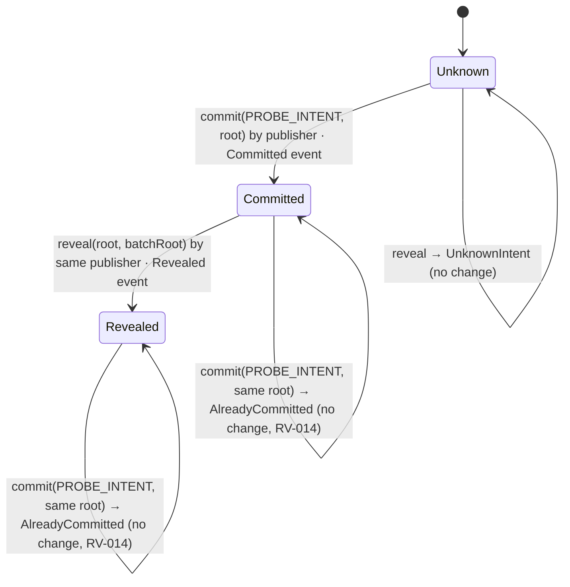

# `OpenEvidenceLog` (spec 03)

- **Date:** 2026-10-18
- **Status:** draft. Adopted from `architecture/selection-layer-architecture.md` §7.1 **verbatim** (quoted in §1 below, as of 2026-10-17), plus Czar's additions in §2 onward. **Amended 2026-10-19 (RV-014):** one rule and one error added; see §1.1. The architecture document carries the same amendment.
- **Phase:** 1 (spec 01 §18).
- **Shared types used:** `czar-merkle-v1` (spec 02 §5.3), `DemandProofLeaf` (spec 02 §4.17), `SoulVersionLeaf` (spec 02 §4.18), `EvidenceBatch` (spec 02 §4.20).

## 1. Selection Layer §7.1, quoted verbatim

The block below is copied character for character from `architecture/selection-layer-architecture.md` lines 817–871 (2026-10-17). It is the normative interface; Czar changes nothing in it.

> ---
> ### 7.1 `OpenEvidenceLog` (deployed by the SL; same address on Arc mainnet and testnet via CREATE2)
> 
> - **Purpose.** A minimal, ownerless, append-only commitment log. Anyone publishes under their own address; readers choose publishers, as ERC-8004 readers choose `clientAddresses`.
> 
> - **Interface.**
>   ```solidity
>   // SPDX-License-Identifier: MIT
>   pragma solidity ^0.8.26;
> 
>   interface IOpenEvidenceLog {
>       enum Kind { PROBE_INTENT, EVIDENCE_BATCH, FEATURE_SNAPSHOT, POLICY_RELEASE, CORRECTION, PROBER_REGISTRATION }
> 
>       struct Commitment {
>           bytes32 root;       // Merkle root or content hash
>           bytes32 prev;       // previous root of the same publisher and kind; 0 for the first
>           bytes32 uriHash;    // keccak256 of the archive's IPFS CID (binds availability)
>           uint64  timestamp;  // block.timestamp at commit
>           uint64  blockNumber;// for seed derivation (blockhash(blockNumber + 1))
>           Kind    kind;
>       }
> 
>       event Committed(address indexed publisher, Kind indexed kind, uint256 indexed seq,
>                       bytes32 root, bytes32 prev, bytes32 uriHash, string uri);
>       event Revealed(address indexed publisher, bytes32 indexed intentRoot, bytes32 batchRoot, bytes32 uriHash, string uri);
> 
>       error PrevMismatch(bytes32 expected, bytes32 given);
>       error UnknownIntent(bytes32 intentRoot);
>       error AlreadyRevealed(bytes32 intentRoot);
> 
>       /// Append a commitment. `prev` MUST equal the publisher's latest root for this kind, or 0 if none.
>       function commit(Kind kind, bytes32 root, bytes32 prev, bytes32 uriHash, string calldata uri) external returns (uint256 seq);
> 
>       /// Link an executed probe batch to an earlier PROBE_INTENT commitment by the same publisher.
>       function reveal(bytes32 intentRoot, bytes32 batchRoot, bytes32 uriHash, string calldata uri) external;
> 
>       function count(address publisher, Kind kind) external view returns (uint256);
>       function get(address publisher, Kind kind, uint256 seq) external view returns (Commitment memory);
>       function latest(address publisher, Kind kind) external view returns (Commitment memory);
>       function intentStatus(address publisher, bytes32 intentRoot)
>           external view returns (bool committed, bool revealed, bytes32 batchRoot);
>   }
>   ```
> 
> - **Storage layout.**
>   - `mapping(address => mapping(uint8 => Commitment[])) private _log;`
>   - `mapping(address => mapping(bytes32 => uint8)) private _intent;` — 0 unknown, 1 committed, 2 revealed
>   - `mapping(address => mapping(bytes32 => bytes32)) private _batchOf;` — intentRoot → batchRoot
> 
> - **Rules.** `commit` reverts on `prev` mismatch (per-publisher hash chain). `commit` with `kind == PROBE_INTENT` sets `_intent[publisher][root] = 1`. `reveal` reverts unless `_intent == 1`, then sets 2 and stores the batch root. The contract does not inspect contents; the timing rule (`t_request ≥ timestamp + 3600`) is enforced off-chain by C8 using the stored `timestamp`.
> 
> - **Access control.** None. No owner, no pause, no upgrade. A new version is a new deployment announced by a `POLICY_RELEASE` on the old one.
> 
> - **Gas.** `commit`: 21k base + 4 new slots (root, prev, uriHash, packed timestamp/blockNumber/kind) + array length + optional `_intent` write + event ≈ 120–135k gas. At the 20 Gwei floor that is ≈ 0.0025 USDC; at the cap ≈ 2.5 USDC (implementability 17 corrected the earlier estimate).
> 
> - **Arc notes.** No `PREVRANDAO`, no native value, `blockhash(n)` readable via EIP-2935 (F4). `uri` is event-only; readers get it from `Committed` logs, and `uriHash` from storage.
> ---

### 1.1 Amendment to the quoted rules (RV-014)

- **Superseded by RV-014:** the quoted sentence "`commit` with `kind == PROBE_INTENT` sets `_intent[publisher][root] = 1`" (unconditional).
- **Rule now:** `commit` with `kind == PROBE_INTENT` sets `_intent[publisher][root] = 1` only when it is `0`; when it is `1` or `2` the call reverts `AlreadyCommitted(bytes32 intentRoot)`.
- **Why:** with the unconditional set, a publisher could commit intent R, reveal batch B1, commit R again (the `prev` check passes because R is the latest root), and reveal a different batch B2 after seeing results. Pre-commitment of probes, the basis of fair probing, would not hold. The contract is ownerless and immutable, so this must be right before deployment.
- `IOpenEvidenceLog.sol` declares the new error; nothing else in the interface changes.

## 2. Purpose and phase (Czar view)

- One ownerless, append-only commitment log on Arc. Czar's evidence publisher (CZ-17, key K8) commits evidence-batch roots, feature snapshots and policy releases under Czar's publisher address. Anyone else may publish under their own address.
- Phase 1: hourly `EVIDENCE_BATCH` commits and daily `FEATURE_SNAPSHOT`; Phase 2: 15-minute batches and 5-minute snapshots as in SL-C11 (spec 01 §15.3). `PROBE_INTENT`, `PROBER_REGISTRATION` and `reveal` are used from Phase 2 (one Czar prober) and Phase 3 (open probers).
- The contract holds no funds, has no owner, no pause and no upgrade (SL §7.1 "Access control"). A new version is a new deployment announced by a `POLICY_RELEASE` on the old one.

## 3. Roles and permissions

| Action | Owner (MSCA) | agentSigner | autonomySigner | guardian | anyone |
|---|---|---|---|---|---|
| `commit` under own address | n/a | yes (as Czar's publisher key K8, a separate key) | no | no | yes |
| `reveal` under own address | n/a | yes (K8) | no | no | yes |
| reads | yes | yes | yes | yes | yes |

- Czar's vault roles (spec 01 §7.1) have no special powers here. The only authority is `msg.sender` as publisher.
- K8 is held in the KMS; a leak lets an attacker forge anchors under Czar's address, which a recompute exposes (spec 01 §7.2 K8).

## 4. Constants and immutables

| Name | Value | Reason |
|---|---|---|
| `Kind` enum | `PROBE_INTENT=0, EVIDENCE_BATCH=1, FEATURE_SNAPSHOT=2, POLICY_RELEASE=3, CORRECTION=4, PROBER_REGISTRATION=5` | SL §7.1 order; stored as `uint8` key |
| intent status | `0` unknown, `1` committed, `2` revealed | SL §7.1 storage |
| none other | | no owner, no fees, no limits; `uri` is event-only |

## 5. Storage layout (SL §7.1, restated)

| Variable | Type | Meaning | Written by |
|---|---|---|---|
| `_log` | `mapping(address => mapping(uint8 => Commitment[]))` | per publisher and kind, append-only | `commit` |
| `_intent` | `mapping(address => mapping(bytes32 => uint8))` | intent status | `commit` (→1), `reveal` (→2) |
| `_batchOf` | `mapping(address => mapping(bytes32 => bytes32))` | intentRoot → batchRoot | `reveal` |

## 6. Functions

| Function | Caller | Preconditions (in order) | State changes | External calls | Events | Errors | Reentrancy | Gas (est., 20 Gwei) |
|---|---|---|---|---|---|---|---|---|
| `commit(Kind kind, bytes32 root, bytes32 prev, bytes32 uriHash, string uri) → uint256 seq` | anyone (publisher = `msg.sender`) | 1. `prev == latest(msg.sender, kind).root`, or `0` if none, else `PrevMismatch`. 2. if `kind == PROBE_INTENT`: `_intent[msg.sender][root] == 0`, else `AlreadyCommitted(root)` (RV-014). 3. no other checks; contents are never inspected. | push `Commitment{root, prev, uriHash, timestamp, blockNumber, kind}`; if `kind == PROBE_INTENT` set `_intent[msg.sender][root] = 1` | none | `Committed(publisher, kind, seq, root, prev, uriHash, uri)` | `PrevMismatch(expected, given)`, `AlreadyCommitted(intentRoot)` | no external calls; none needed | 120–135k gas ≈ 0.0024–0.0027 USDC (SL §7.1 "Gas") |
| `reveal(bytes32 intentRoot, bytes32 batchRoot, bytes32 uriHash, string uri)` | anyone (same publisher as the intent) | 1. `_intent[msg.sender][intentRoot] == 1` else `UnknownIntent` (0) or `AlreadyRevealed` (2) | set status 2; `_batchOf[msg.sender][intentRoot] = batchRoot` | none | `Revealed(publisher, intentRoot, batchRoot, uriHash, uri)` | `UnknownIntent`, `AlreadyRevealed` | none | ≈ 50–60k gas ≈ 0.001 USDC |
| `count(address publisher, Kind kind) → uint256` | anyone (view) | — | — | — | — | — | — | view |
| `get(address publisher, Kind kind, uint256 seq) → Commitment` | anyone (view) | `seq < count` (reverts on out-of-range read) | — | — | — | — | — | view |
| `latest(address publisher, Kind kind) → Commitment` | anyone (view) | returns the zero struct when `count == 0` | — | — | — | — | — | view |
| `intentStatus(address publisher, bytes32 intentRoot) → (committed, revealed, batchRoot)` | anyone (view) | — | — | — | — | — | — | view |

- Gas at the 20 Gwei floor: `1 gas = 2 × 10⁻⁸ USDC` (p1-A6), so 130k gas ≈ 0.0026 USDC; at the 20,000 Gwei cap ≈ 2.6 USDC, at which point Czar drops snapshot anchoring to hourly (SL-C11 rule).

## 7. State machine (probe intents)



| From | To | Trigger | Who | Event |
|---|---|---|---|---|
| Unknown | Committed | `commit` with `kind == PROBE_INTENT` | publisher | `Committed` |
| Committed | Revealed | `reveal` | same publisher | `Revealed` |

Other kinds have no state beyond the per-publisher hash chain (`prev` must equal the latest root of that kind).

## 8. Events and errors

| Event | Indexed | Carries | Used by the indexer for |
|---|---|---|---|
| `Committed(address publisher, Kind kind, uint256 seq, bytes32 root, bytes32 prev, bytes32 uriHash, string uri)` | `publisher`, `kind`, `seq` | root, prev, uriHash, uri (`archiveUri` in Phase 1, CID in Phase 2) | anchor chain projection; missed-anchor alert (spec 01 §16.2) |
| `Revealed(address publisher, bytes32 intentRoot, bytes32 batchRoot, bytes32 uriHash, string uri)` | `publisher`, `intentRoot` | batchRoot, uriHash, uri | probe accountability (Phase 2+) |

| Error | When |
|---|---|
| `PrevMismatch(bytes32 expected, bytes32 given)` | `prev` is not the publisher's latest root for that kind |
| `UnknownIntent(bytes32 intentRoot)` | `reveal` for a root never committed as `PROBE_INTENT` by this publisher |
| `AlreadyRevealed(bytes32 intentRoot)` | second `reveal` |
| `AlreadyCommitted(bytes32 intentRoot)` | `commit` of a `PROBE_INTENT` root this publisher already committed (RV-014) |

## 9. External dependencies

None. The contract calls nothing and reads nothing outside its own storage. `blockhash(blockNumber + 1)` is read **off-chain** by probers for seed derivation (SL-C6; EIP-2935 makes old hashes readable, SL-F4).

## 10. Invariants (Foundry invariant tests)

| Id | Invariant |
|---|---|
| OEL-1 | For every publisher and kind, `get(p, k, i).prev == get(p, k, i-1).root` for all `i ≥ 1`, and `get(p, k, 0).prev == 0` (per-publisher hash chain). |
| OEL-2 | `intentStatus(p, r).revealed` implies `intentStatus(p, r).committed`; status never decreases; once `revealed`, `batchRoot` never changes. |
| OEL-6 | A `PROBE_INTENT` root is committed at most once per publisher: a second `commit(PROBE_INTENT, r)` by the same publisher reverts `AlreadyCommitted`, before or after `reveal` (RV-014). |
| OEL-3 | `count(p, k)` only increases; no commitment is ever modified or removed. |
| OEL-4 | No function changes storage of a publisher other than `msg.sender`. |
| OEL-5 | The contract's USDC balance is irrelevant: it has no payable function and no way to move value. |

## 11. Czar's additions: leaf types inside `EVIDENCE_BATCH`

- Czar adds **no new `Kind`**. Two Czar-specific leaf schemas ride inside `EVIDENCE_BATCH` roots, so the contract is unchanged (spec 01 §15.3).
- Tree rules: `czar-merkle-v1` (spec 02 §5.3). Leaf = `keccak256(bytes.concat(keccak256(abi.encode(EVIDENCE_LEAF, leafTypeHash, contentHash))))` with `EVIDENCE_LEAF = 0x001eebeec2e768ec1a3711bc88cdd151a64d6e886b4ea663df8111ec36edda56`, `leafTypeHash = keccak256(utf8(leafType))`, `contentHash = keccak256(jcs(leaf object))`.

| Leaf type | Object | Content | Who can verify |
|---|---|---|---|
| `demand-proof` | spec 02 §4.17 `DemandProofLeaf` | observation hashes → `objectiveHash` → `soulVersionHash` → `planHash` → `envelopeRef` + approval tx → `paymentRefHashes` → `outcomeHashes` | anyone can check the `EnvelopeOpened` event carries the same `objectiveHash` and `planHash`; only the user can open the observation preimages |
| `soul-version` | spec 02 §4.18 `SoulVersionLeaf` | `userPseudonym`, `soulVersion`, `soulVersionHash`, `previousHash`, `compiledAt` | the user can later reveal any belief against `sectionHashes` (spec 02 §5.2) |
| SL rows | `observation`, `report`, `assessment`, `correction`, `exposure`, `submission-log` | SL §5 objects | per SL §11 disclosure |

- Batch publication (spec 02 §4.20 `EvidenceBatch`): `root` = tree root of all leaves; `prev` = Czar's latest `EVIDENCE_BATCH` root.
  - **Phase 1 (D54, D78):** the archive (JSON Lines of the public leaf objects) is stored and served by Czar's local server (`http://localhost:<port>/v1/archives/<root>.jsonl`). The anchored `archiveUri` is **host-free**: `czar-archive:<root>` (the batch root in lowercase hex), with `uriHash = keccak256(utf8(archiveUri))`. A localhost URL is never anchored: anchors are permanent, and the stable public archive host arrives only with Google Cloud in stage 2 (D78, RV-028). Readers resolve `czar-archive:<root>` against the archive hosts listed in Czar's latest `POLICY_RELEASE` (Phase 1: the local server only; stage 2: the public host, which serves every Phase 1 archive by the same root). The root binds the content, so anyone who fetches the archive can verify it. No IPFS in Phase 1.
  - **Phase 2:** the archive is also pinned to IPFS with two independent pins; `uriHash = keccak256(utf8(cid))` (SL-C11 "content and availability are bound").
- Cadence: Phase 1 hourly, or sooner when a batch holds ≥ 1,000 leaves; Phase 2 every 15 minutes (SL-C11).
- The `uri` string in the event is the `archiveUri` in Phase 1 (`czar-archive:<root>`, D78; `ipfs://<cid>` in Phase 2); readers get it from `Committed` logs, check `keccak256(utf8(uri)) == uriHash`, fetch the archive and rebuild the root.
- Publisher key K8: held by the signer service (local keystore in Phase 1, D70/D78; Cloud KMS in stage 2); signing policy allows only `commit` and `reveal` calldata to the pinned `OpenEvidenceLog` address.

## 12. Edge cases

| Case | Behaviour |
|---|---|
| Two Czar publishers race (`prev` stale) | second `commit` reverts `PrevMismatch`; the publisher re-reads `latest` and retries with the new `prev` |
| Archive upload fails after `commit` | the root is already anchored; the archive is uploaded later at the committed `archiveUri` (Phase 2: the CID must match `uriHash`); a late or missing archive is detectable because the root is on-chain (SL-C11 "Failure modes") |
| Empty batch | never committed (spec 02 §5.3 empty-tree rule) |
| Gas price at the 20,000 Gwei cap (p1-A6) | snapshots drop to hourly; batches continue (SL-C11) |
| `uri` longer than needed | event-only; no storage cost beyond calldata |
| Reorg | none; Arc is final on inclusion (p1-A7) |
| Someone commits garbage under their own address | allowed by design; readers choose publishers (SL §7.1 "Purpose") |

## 13. Gas budget (20 Gwei floor, 1 gas = 2 × 10⁻⁸ USDC)

| Function | Gas (est.) | USDC | Note |
|---|---|---|---|
| `commit` | 120,000–135,000 | 0.0024–0.0027 | 4 new slots + array length + optional `_intent` + event (SL §7.1) |
| `reveal` | ≈ 55,000 | ≈ 0.0011 | one status update, one new slot, event |
| Phase 1 daily total (24 batches + 1 snapshot + occasional policy) | ≈ 3.4M | ≈ 0.07 | spec 01 §15.3 cadence |
| Phase 2 daily total (96 + 288 + few) | ≈ 47M | ≈ 0.94 | SL-C11 figure |

Estimates; measured values go in `security-and-testing.md` gas snapshots.

## 14. Mainnet differences

| Topic | Testnet | Mainnet |
|---|---|---|
| Address | CREATE2 through Arachnid `0x4e59b44847b379578588920cA78FbF26c0B4956C` (A9-15) | same address, same salt, same bytecode |
| Behaviour | identical | identical; no chain-specific code |
| Cost | faucet USDC | real USDC at the same gas figures |
| SL-F4 / SL-F17 re-check | n/a | SL §13 asks for a mainnet re-check of the EIP-7708 emitter and `authorizationState` before mainnet use; neither affects this contract |

## 15. Interface file

`interfaces/IOpenEvidenceLog.sol` (interface only, SL §7.1 unchanged).


## Change log

| Date | ID | Change |
|---|---|---|
| 2026-10-18 | D54 | Phase 1 archives stay on Czar's server; `uriHash = keccak256(utf8(archiveUri))`; IPFS pinning moved to Phase 2 (§11, §12, §13). The verbatim SL quote in §1 is unchanged; §11 states how Czar uses `uriHash`. |
| 2026-10-19 | RV-014 | `commit` of an already-known `PROBE_INTENT` root reverts `AlreadyCommitted` (§1.1, §6, §7, §8); OEL-2 tightened, OEL-6 added (SCR-014). The architecture document's §7.1 carries the same amendment. |
| 2026-10-19 | D78 | §11: Phase 1 `archiveUri` rule (local server; anchors carry the stage-2 public host), see below. |
