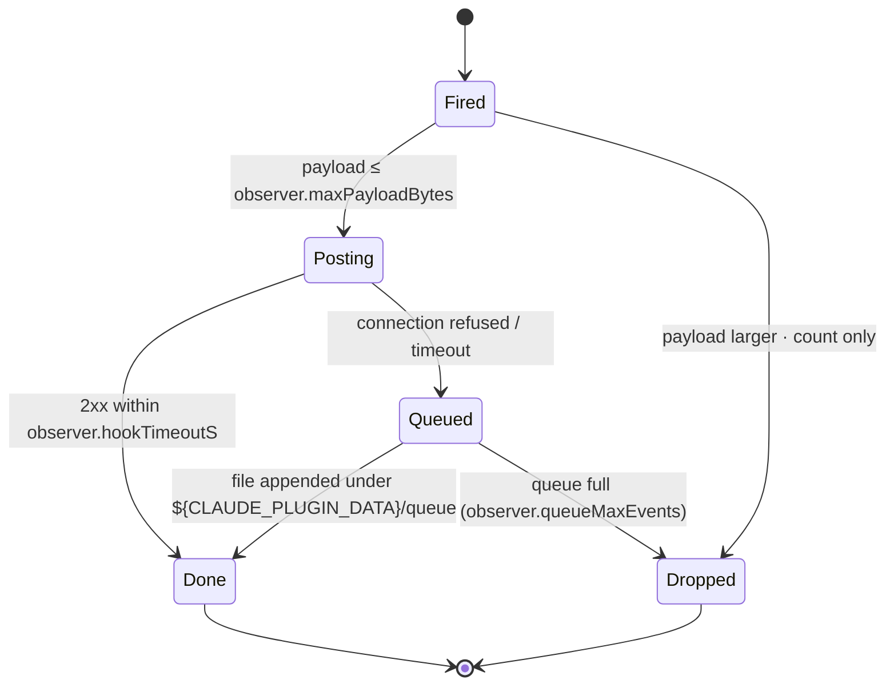
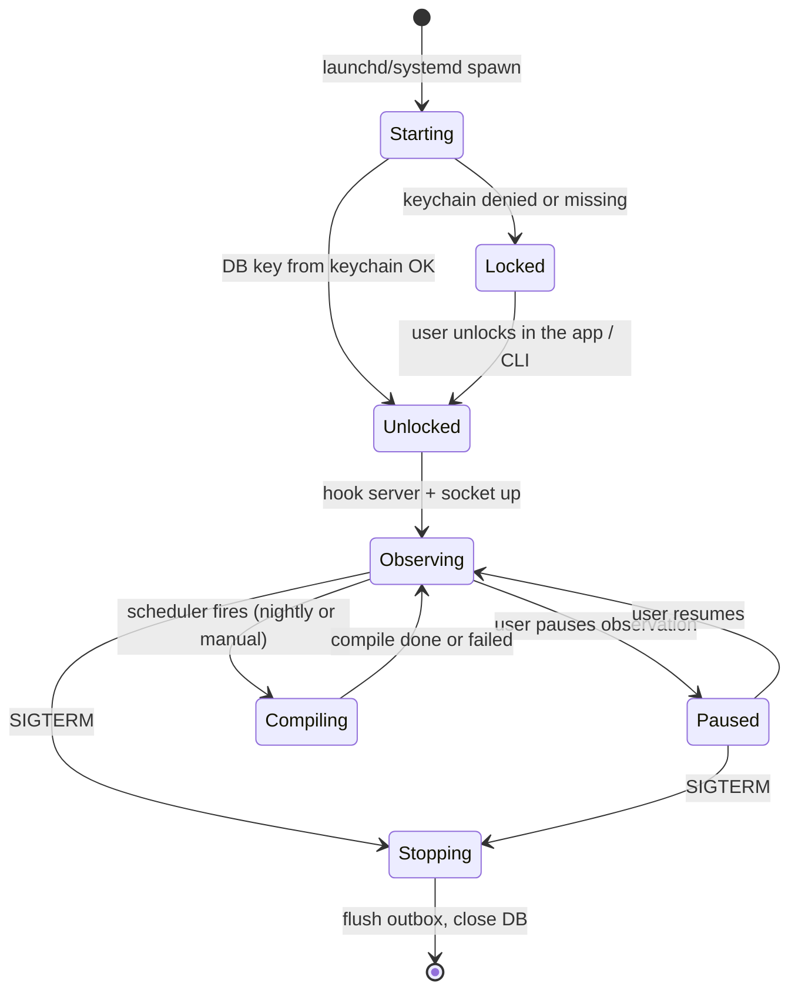
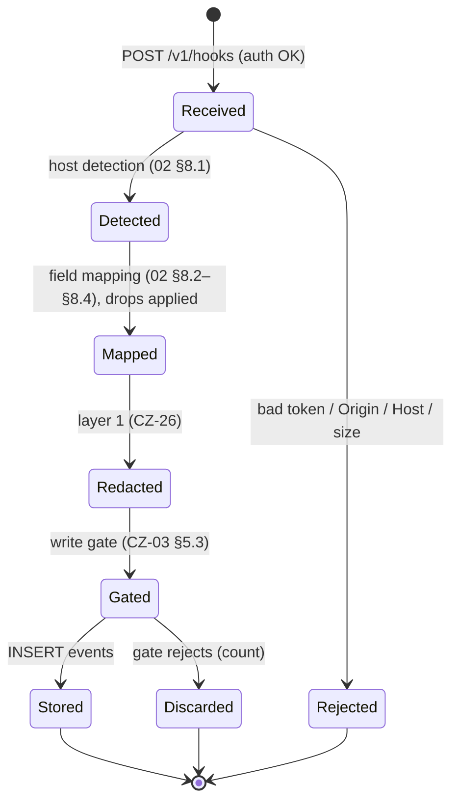

# Local observers and daemon (spec 04)

- **Date:** 2026-10-18. **Status:** draft for review. Conventions: `cross-cutting.md`. Data shapes: spec 02 only (cited "02 §n"). Contract calls: none (nothing in this file touches a key that can spend, D25).
- **Components:** CZ-01 observers (Claude Code full; Codex, Cursor, Chrome outlined), CZ-02 daemon, CZ-03 shared memory, CZ-26 redaction library.
- **Wording rule (D31):** raw work data stays on the machine; only redacted excerpts are sent for soul compilation, and only redacted objectives are sent for planning.

---

## CZ-01 Observers

### 1. Identity

| Field | Value |
|---|---|
| ID, name | CZ-01, Observers |
| Phase | 1: Claude Code plugin. 2: Codex, Cursor, Chrome. |
| Product / roadmap | product §6.1, §7.1; roadmap 1.1 (step 1 of "how it's built") |
| Decisions | D5, D7, D25, FD-20 to FD-25 |

### 2. Responsibilities and non-responsibilities

- **Does:** run inside a work tool as hooks; forward each hook payload to the daemon's intake without slowing the tool; queue payloads locally when the daemon is unreachable; carry the local MCP server definition and a minimal skill (one plugin bundle, B1-34 to B1-38).
- **Does not:** store anything beyond a bounded queue; parse transcripts (B1-03, B1-30, B1-33); redact (the daemon does); spend money (product §6.1 rule); read `transcript_path` contents ever.

### 3. Runtime

| Item | Phase 1 (Claude Code) |
|---|---|
| Where | inside the Claude Code process as hook handlers; the handler is an `http` hook posting to the daemon (B1-08), or a `command` hook running `bin/czar-hook` with `async: true` where `http` is blocked by a managed `allowedHttpHookUrls` policy (B1-09, B1-18) |
| Process model | no long-lived process; each hook invocation is one short HTTP POST (≤ `observer.hookTimeoutS` = 2 s) or one short `czar-hook` run |
| Start / stop | installed and enabled as a plugin; `claude plugin validate --strict` in CI (B1-39); nothing to start |
| Update | plugin update replaces `${CLAUDE_PLUGIN_ROOT}`; state lives in `${CLAUDE_PLUGIN_DATA}` and survives (B1-37) |
| Resource budget | ≤ 50 ms CPU per hook, ≤ 1 MB queue file growth per session; hook payload bodies capped at `observer.maxPayloadBytes` = 256 KiB before posting (the daemon re-caps to the 10,000-char text limits, B1-13) |

### 4. Interfaces

| Direction | What | Reference |
|---|---|---|
| In | hook payloads from Claude Code events: `PreToolUse` (matchers `Skill`, `mcp__.*`, `mcp__plugin_.*`), `PostToolUse` (`*`), `PostToolUseFailure` (`*`), `UserPromptSubmit`, `UserPromptExpansion`, `SubagentStop`, `Stop`, `SessionStart`, `SessionEnd` | B1-02 to B1-06, B1-21, B1-22, B1-25, B1-26; mapping tables 02 §8.2 |
| Out | `POST http://127.0.0.1:<port>/v1/hooks` with `Authorization: Bearer <K16>`; body = the raw hook JSON plus `{"czarHookVersion": 1}` | 02 §8.2 hook config, D3-08 |
| Out (fallback) | append-only queue files under `${CLAUDE_PLUGIN_DATA}/queue/` | B1-37 |
| Bundled | `.mcp.json` for CZ-09 (02 mcp §5), `skills/czar/SKILL.md` | B1-36 |
| Events emitted | none of its own; the daemon emits `hook_received` counters | — |

### 5. Internal design

#### 5.1 Plugin layout (B1-34 to B1-38)

```
plugins/claude-code/
├── .claude-plugin/plugin.json      # {"name": "czar-observer", "version", "description", "author", "hooks": "./hooks/hooks.json", "mcpServers": "./.mcp.json"}
├── hooks/hooks.json                # exactly the shape in 02 §8.2 (http handlers, onFailure: continue, timeout 2)
├── .mcp.json                       # exactly 02 mcp §5 (command ${CLAUDE_PLUGIN_ROOT}/bin/czar-mcp)
├── skills/czar/SKILL.md            # name: czar; description; how to use get_objectives/quote/pay; ≤ 60 lines
├── bin/czar-hook                   # command-handler fallback: reads stdin JSON, posts to the daemon, else queues
└── bin/czar-mcp                    # CZ-09 launcher
```

- Only `name` is required in the manifest; it is kebab-case and does not start with a reserved prefix (`claude-`, `anthropic-`, `cc-plugin-`) (B1-34, B1-39, E2-01, E2-03).
- Components sit at the plugin root, not inside `.claude-plugin/`; a root `CLAUDE.md` is not loaded, so none is shipped (B1-36).
- Hooks from the plugin merge with the user's and project's hooks; identical handlers run once (B1-16).

#### 5.2 Hooks list and why each exists

| Event (matcher) | Why | Facts |
|---|---|---|
| `PreToolUse` (`Skill`) | skill use through the `Skill` tool | B1-21, B1-23 |
| `UserPromptExpansion` | skill use typed as `/skillname`, which bypasses `PreToolUse` | B1-22 |
| `PreToolUse` (`mcp__.*`, `mcp__plugin_.*`) | MCP calls, including plugin-bundled servers; both regexes needed | B1-25 |
| `PostToolUse` (`*`) | file reads/writes, commands, searches, tool results (summaries only) | B1-05 |
| `PostToolUseFailure` (`*`) | repeated errors and refusals | B1-05 |
| `UserPromptSubmit` | the person's own prompts (`trusted = true`) | B1-04 |
| `SubagentStop` | subagent summaries; tool hooks already fire inside subagents with `agent_id` | B1-26 |
| `Stop` | end-of-turn message for the refusal detector | B1-06 |
| `SessionStart` | session record; the only event whose stdout becomes context (used by CZ-11) | B1-04, B1-14 |
| `SessionEnd` | closes the session record; 1.5 s shared budget so it does nothing else | B1-10 |

- `EndConversation` fires no hooks (B1-28); `SessionEnd` closes the record instead.
- Matcher syntax: `Skill` is exact; `mcp__.*` and `mcp__plugin_.*` are unanchored regexes (B1-15).

#### 5.3 Handler behaviour (`http` and `bin/czar-hook`)



- Every path ends with exit 0 and no stdout, except `SessionStart`, where CZ-11 may print one pointer line (B1-14). Hooks are fail-open by design (B1-11); `onFailure` stays `continue`.
- The daemon drains `${CLAUDE_PLUGIN_DATA}/queue` on its next heartbeat through the hook endpoint (the queue file path is in the plugin data dir, so it survives plugin updates, B1-37).

#### 5.4 Named parameters

| Parameter | Default | Reason |
|---|---|---|
| `observer.hookTimeoutS` | 2 | far below the 600 s default; observation must never slow the agent (B1-09, B1-10) |
| `observer.maxPayloadBytes` | 262,144 | large tool outputs are summarized by the daemon anyway; the 10,000-char caps apply to text (B1-13) |
| `observer.queueMaxEvents` | 5,000 | about a day of heavy use; oldest dropped first with a count |
| `observer.queueFlushBatch` | 200 | drain size per daemon heartbeat |
| `observer.sessionEndBudgetMs` | 1,000 | under the 1.5 s shared `SessionEnd` budget (B1-10); the handler only posts the `reason` |

### 6. Behaviour

**Main path.** Claude Code fires a hook → handler posts the payload to `/v1/hooks` with K16 → daemon answers `202` → done.

**Daemon unreachable.** Post fails → append to the queue file (one JSON per line, with a monotonic sequence) → exit 0. On the next successful post the daemon pulls the queue.

**Skill typed as `/name`.** `UserPromptExpansion` fires with `command_name`; the daemon records `skill-use` and de-duplicates against a `PreToolUse:Skill` within 5 s (02 §8.5).

**Inside a subagent.** Tool hooks carry `agent_id` and `agent_type`; the handler forwards them unchanged (B1-26).

**Cursor running the Claude Code hooks** (B3-10): the handler forwards whatever shape arrives; the daemon detects the host (02 §8.1) and drops `user_email` at intake (B3-04).

**Codex running the plugin hooks** (B2-18): same handler; the user must trust the hook in `/hooks`, again after every change (B2-09); `SessionEnd` gets at most 3 s (B2-11), which the 1 s budget respects.

### 7. AI usage

None in the observer. The daemon's refusal classifier (P-06) runs on `Stop` and `PostToolUseFailure` text after redaction.

### 8. Privacy

| Data | Class | Handling |
|---|---|---|
| raw hook payload | `local-only` (transient) | forwarded to the daemon over loopback; never written except to the bounded queue, which is deleted on drain |
| queue file | `local-only` | `${CLAUDE_PLUGIN_DATA}/queue/*.jsonl`, mode 0600, deleted after drain, capped |
| `transcript_path` | never read | B1-03, B1-30 |
| `user_email` (Cursor) | dropped by the daemon at intake | B3-04 |

### 9. Security

- Keys: K16 hook token, read from the plugin's data config (B1-37) and sent as a bearer header; never on a command line (B6-19).
- Threats (spec 01 §13): **malicious observer input / memory poisoning (ASI06)** is handled in the daemon's write gate (CZ-03 §5.3); the observer only transports. **Hook token theft** lets a local process post fake events; mitigation: loopback only, `Origin` check, per-session rate caps, provenance tags, and the user's ability to delete beliefs; the token cannot spend or read memory.
- Relevance suggestions and CLI hints are not used (B1-48, B1-50).

### 10. Failure handling

| Failure | Behaviour | User sees | Notes |
|---|---|---|---|
| daemon down | queue, then drain | menu bar: "Observing: paused (daemon off)" | fail-open (B1-11) |
| queue full | drop oldest, count | "Some activity was not recorded" (once per day) | `observer.queueMaxEvents` |
| hook timeout | handler exits 0 | nothing | B1-11 |
| managed policy blocks `http` hooks (`allowedHttpHookUrls`) | fall back to the `command` handler with `async: true` (D46) | setup note | B1-18 |
| `allowManagedHooksOnly` set by an admin | plugin hooks do not run | "Your organisation's settings block Czar hooks" | B1-18 |
| plugin update | queue and token persist in `${CLAUDE_PLUGIN_DATA}` | nothing | B1-37 |

### 11. Observability

Counters only, in the daemon: `hook_received{host,event}`, `hook_queued`, `hook_dropped{reason}`, `queue_drained`. No payload text in any log.

### 12. Interface wording

Shown by the daemon menu bar for this component: "Observing Claude Code", "Observing: paused (daemon off)", "Some activity was not recorded (queue full)".

### 13. Performance and cost

≤ 50 ms per hook; no model calls; no network beyond loopback.

### 14. Tests and definition of done

- Unit: handler posts, queues on refusal, drops over cap, exits 0 on every path; `SessionStart` prints ≤ 1 line.
- Integration: `claude plugin validate --strict` passes (B1-39); a scripted Claude Code session fires every subscribed event and the daemon receives each (fixtures = recorded payloads with the documented fields only, B1-02 to B1-06).
- Both skill paths produce exactly one `skill-use` event (B1-21, B1-22).
- `mcp__plugin_czar_czar__pay` is matched by `mcp__plugin_.*` (B1-25).
- Cursor-shaped payload fixture → host detected as Cursor, `user_email` absent in storage (B3-04, B3-10).
- Definition of done: all of the above green in CI; the plugin installs from a local marketplace path; the queue survives a plugin update.

### 15. Dependencies

Claude Code ≥ the version with `http` hooks and `onFailure` (v2.1.295+, B1-11); plugin manifest spec (B1-34, B1-35); `${CLAUDE_PLUGIN_DATA}` (B1-37). Open question: the maximum `timeout` value for non-`SessionEnd` hooks is undocumented (part 2 GAP); Czar uses 2 s.

### Phase 2 outlines

- **Codex (CZ-01b):** `hooks.json` next to `~/.codex/config.toml` or a Codex plugin `hooks/hooks.json`; `command` handler with `async: true` (B2-10); events `PreToolUse`, `PostToolUse`, `UserPromptSubmit`, `SubagentStart/Stop`, `Stop`, `SessionStart/End` (B2-07); trust in `/hooks` after every change (B2-09); hosted tools unseen (B2-17); skills inferred (B2-19); mapping 02 §8.3. Interface wording: "Codex needs you to approve the Czar hook in /hooks (again after each update)."
- **Cursor (CZ-01c):** native `~/.cursor/hooks.json` `{"version": 1, ...}` (B3-01) or a Cursor plugin (B3-16); `beforeMCPExecution`/`afterMCPExecution`, `afterShellExecution`, `afterFileEdit`, `beforeReadFile`, `subagentStop`, `sessionStart/End`, `beforeSubmitPrompt`, `afterAgentResponse` (B3-03, B3-06 to B3-08); de-duplicate against the Claude Code hook path (B3-10); drop `user_email` (B3-04); mapping 02 §8.4. Untested on this machine (B3 preamble).
- **Chrome (CZ-01d):** Manifest V3; permissions `tabs` + `webNavigation`, never `history` (B4-03, B4-05); page capture only behind `optional_host_permissions` (B4-08, B4-09); in-extension consent screen before any collection, not only a privacy policy (B4-14, B4-15); single-purpose disclosure covering transfers to the daemon (B4-11, B4-12); `connectNative` to the daemon with host→extension messages under 1 MB (B4-20 to B4-24); host manifest at both Chrome and Chromium user paths with the exact extension id in `allowed_origins` (B4-21). Events → `page-visit` with URL origin hashed.

---

## CZ-02 Daemon (`czard`)

### 1. Identity

| Field | Value |
|---|---|
| ID, name | CZ-02, local daemon `czard` |
| Phase | 1, **macOS only** (D67); Linux and Windows are stage 2 |
| Product / roadmap | product §6.2 (host), §9.2 step 2; roadmap 1.1 |
| Decisions | D7, D25, D31, D34, FD-27 |

### 2. Responsibilities and non-responsibilities

- **Does:** receive hook payloads; run redaction layer 1 and the write gate; store events in encrypted memory; schedule the soul compiler, drives engine and shadow reporter; publish objectives through the outbox; serve the local socket for the MCP server and the desktop viewer; run the write-back adapter; drain the observer queue; keep the local audit of what left the machine.
- **Does not:** hold any spending key; talk to Arc; call merchants; send events, soul text, file paths or emails to the server (02 §9.7).

### 3. Runtime

| Item | Detail | Facts |
|---|---|---|
| Process | one per user session, Node 22; child processes: `czar-redact` sidecar (Python) on demand | spec 01 §17 |
| macOS install (app) | the daemon ships inside `Czar.app/Contents/Library/LaunchAgents/dev.czar.daemon.plist` and registers with `SMAppService.agent(plistName:)`; `status == .requiresApproval` → the app calls `openSystemSettingsLoginItems()` | B6-04 to B6-06 |
| macOS install (CLI) | write `~/Library/LaunchAgents/dev.czar.daemon.plist` then `launchctl bootstrap gui/$UID <plist>`; never `load` | B6-01, B6-03 |
| plist keys | `Label`, `ProgramArguments`, `KeepAlive` (true), `ProcessType = Background`, `StandardOutPath`/`StandardErrorPath` under `~/Library/Logs/Czar/`, `WorkingDirectory`; `RunAtLoad` not set (KeepAlive implies it); crash loops are throttled to one spawn per 10 s | B6-02 |
| macOS uninstall | `launchctl bootout gui/$UID/dev.czar.daemon`, remove the plist, offer to delete `~/Library/Application Support/Czar/` (memory and soul) and the keychain items | B6-03 |
| macOS update | replace the binary, `launchctl kickstart -k gui/$UID/dev.czar.daemon` | B6-03 |
| Linux (**stage 2**, D67; `stage-2-backlog.md` §3 P2-13) | user unit `~/.config/systemd/user/czar-daemon.service`; `loginctl enable-linger` when the user wants it running without a login session | B6-07, B6-08 |
| Windows (**stage 2**, D67; P2-13) | Task Scheduler task "at logon" (Task Scheduler 2.0); SCM service option not researched (B6-20 GAP) | B6-09 |
| Resource budget | idle < 1% CPU, < 150 MB RSS; compile bursts bounded by `daemon.compileCpuSeconds` = 120 per run | — |

### 4. Interfaces

| Interface | Transport | Auth | Used by |
|---|---|---|---|
| hook intake `POST /v1/hooks` | HTTP on `127.0.0.1:<daemon.hookPort>` (default 47011, falls back to a free port written to the plugin data config) | bearer K16; `Origin` header must be absent or `null` (hooks are not browsers) and `Host` must be loopback | CZ-01 |
| control socket | Unix domain socket `~/Library/Application Support/Czar/czar.sock` (macOS) or `$XDG_RUNTIME_DIR/czar.sock` (Linux, stage 2), mode 0600, JSON-RPC 2.0 over newline-delimited frames; Windows (stage 2): named pipe `\\.\pipe\czar` | file permissions (same user) | CZ-09 MCP server, CZ-05 viewer, CZ-11 |
| server API (client) | HTTPS with K15 | `DeviceToken` | `submitObjective`, `listObjectives`, `getObjective`, `getResult`, `ackResult`, `submitSoulVersion`, `shadowQuote`, `ingestReport`, `pairDevice` |
| sidecar | the same Unix socket namespace, `czar-redact.sock`, mode 0600 | file permissions | CZ-26 layer 2 |

Socket methods (local only, not an OpenAPI surface): `memory.query`, `objectives.list`, `objectives.get`, `soul.get`, `soul.editBelief`, `soul.deleteBelief`, `shadow.report`, `writeback.deliver`, `audit.whatLeft`, `status.get`. Their payloads are the 02 objects (`ActivityEvent`, `Objective`, `soul.json`) and never leave the machine.

### 5. Internal design

#### 5.1 Lifecycle



| From | To | Trigger | Effect |
|---|---|---|---|
| Starting | Unlocked | `@napi-rs/keyring` returns K14 | open DB with the key (B6-12, B6-17) |
| Starting | Locked | keychain error | hook server answers `503 locked`; observers queue |
| Observing | Paused | `status.pause` | intake returns `202` but discards with a count; nothing stored |
| Observing | Compiling | `daemon.compileAt` (default 02:00 local) or `soul.compileNow` | runs CZ-04 (see `local-soul-and-drives.md`) |

#### 5.2 Hook ingestion pipeline



- Text fields are cut to the 02 limits (`summary` ≤ 2,000 chars) **after** redaction so a cut cannot split a marker; hook `additionalContext`/stdout limits (10,000 chars, B1-13) only apply to output, and the daemon produces none except the CZ-11 pointer.
- Ingestion is synchronous up to `Mapped` (fast), then enqueued in-process; the HTTP response is `202` within `daemon.ingestAckMs` = 50.

#### 5.3 Storage schema (encrypted SQLite, `better-sqlite3-multiple-ciphers` 13.0.3, B6-12)

| Table | Columns (type) | Notes |
|---|---|---|
| `events` | `event_id` TEXT PK, `host`, `host_version`, `session_ref` BLOB(32), `project_ref` BLOB(32), `event_type`, `occurred_at` INTEGER (ms), `tool_name`, `mcp_server`, `mcp_tool`, `mcp_plugin`, `summary` TEXT, `file_refs` BLOB (packed 32-byte hashes), `error_class`, `duration_ms` INTEGER, `agent_ref` BLOB(32), `provenance_json` TEXT, `redaction_hits` INTEGER, `content_hash` BLOB(32) UNIQUE, `observation_hash` BLOB(32) | = `ActivityEvent` (02 §4.1) plus `observation_hash` (02 §5.2); indexes on `(project_ref, occurred_at)`, `(event_type, occurred_at)`, `(session_ref)`, `(error_class)` |
| `sessions` | `session_ref` BLOB(32) PK, `host`, `started_at`, `ended_at`, `end_reason`, `event_count`, `project_ref` | from `session-start`/`session-end` |
| `soul_versions` | `version` INTEGER PK, `compiled_at`, `previous_hash` BLOB(32), `soul_version_hash` BLOB(32), `soul_json` TEXT, `excerpt_chars` INTEGER, `model_prompt_hash` BLOB(32), `submitted_at` | `soul.json` (02 §4.2) |
| `beliefs` | `belief_id` TEXT PK, `section`, `text`, `confidence` REAL, `first_seen`, `last_seen`, `user_edited` INTEGER, `pinned` INTEGER, `deleted_at`, `current_version` INTEGER | denormalized current beliefs for the viewer; `belief_receipts(belief_id, event_id)` join table |
| `objectives` | `objective_id` TEXT PK, `soul_version`, `detector`, `goal`, `capabilities_json`, `deadline`, `minutes_saved`, `roi_band`, `roi_ratio` REAL, `status`, `objective_hash` BLOB(32), `created_at`, `published_at`, `server_status`, `result_id` | `Objective` (02 §4.3) plus server mirror fields |
| `objective_evidence` | `objective_id`, `event_id`, `belief_id` | evidence links |
| `outbox` | `id` INTEGER PK, `kind` (`objective`, `soul-version`, `ingest-report`, `result-ack`), `payload_json`, `idempotency_key`, `attempts`, `next_attempt_at`, `last_error_code` | durable queue to the server |
| `audit_local` | `id`, `at`, `kind`, `payload_hash` BLOB(32), `bytes`, `destination` (`server`, `model-proxy`), `summary_counts_json` | "what left this machine" |
| `settings` | `key` TEXT PK, `value_json` | hourly value, compile time, pause flag, pairing state |
| `queue_drain` | `plugin_data_path`, `last_seq` | observer queue cursor |

- Retention: `memory.retentionDays` = 90 (user setting 30–365); a nightly job deletes `events` older than that unless referenced by a current belief or an open objective (receipts stay until the belief fades).
- Vectors (Phase 2): `sqlite-vec` 0.1.9 `vec0` table with ≤ 1,024 dims, model id stored with each vector (C1-12, FD-30).
- The DB file: `~/Library/Application Support/Czar/memory.db`, mode 0600; cipher: the binding's default SQLCipher-compatible AES-256 (B6-11); raw 64-hex key from the keychain.

#### 5.4 Key handling

| Key | Store | Creation | Use | Never |
|---|---|---|---|---|
| K14 DB key | OS keychain, `@napi-rs/keyring` `Entry("dev.czar.daemon", "memory-db-key")`; Linux backend pinned to Secret Service, not keyutils (B6-17) | 32 random bytes at first run | opened once at start; held in process memory only | written to disk, logged, passed as an argument (B6-19) |
| K15 device token | keychain `Entry("dev.czar.daemon", "device-token")` | `pairDevice` with the 8-digit code from the app (02 §9.1) | `Authorization` header to the server; exported to the plugin data config for CZ-09 as `CZAR_DEVICE_TOKEN` (02 mcp §5) | shown in the UI; logged |
| K16 hook token | keychain `Entry("dev.czar.daemon", "hook-token")` and the plugin data config | random at install; regenerated on plugin update | bearer on `/v1/hooks` | on a command line |

- If the keychain is unavailable (B6-17 fallback risk on Linux), the daemon refuses to start in `Unlocked` and shows "Czar can't reach your system keychain" rather than falling back to a weaker store.

#### 5.5 Named parameters

| Parameter | Default | Reason |
|---|---|---|
| `daemon.hookPort` | 47011 | loopback-only HTTP for hooks (B1-08); auto-reassigned if busy |
| `daemon.ingestAckMs` | 50 | hooks must return fast (B1-10) |
| `daemon.maxHookBodyBytes` | 262,144 | matches `observer.maxPayloadBytes` |
| `daemon.compileAt` | 02:00 local | nightly compile (roadmap 1.1) |
| `daemon.compileCpuSeconds` | 120 | bounds a runaway compile |
| `daemon.outboxRetryBaseS` | 30 | exponential backoff with jitter, max `daemon.outboxRetryMaxS` = 3,600 |
| `daemon.heartbeatS` | 60 | queue drain, server poll (`listObjectives?status=delivered`), audit flush |
| `daemon.ingestReportIntervalS` | 3,600 | `ingestReport` counts only |
| `daemon.socketPath` | per OS (§4) | 0600 |
| `memory.retentionDays` | 90 | spec 01 §11.1 |
| `memory.maxEventsPerSessionPerMin` | 600 | ASI06 flood cap; a tool loop cannot bury the memory |
| `memory.maxSummaryChars` | 2,000 | 02 §4.1 |
| `memory.dedupeWindowS` | 300 | identical `content_hash` within 5 min is counted, not stored |

### 6. Behaviour

**Start.** Spawn → read K14 → open DB (migrate schema) → start hook server and socket → start sidecar lazily → heartbeat loop.

**Heartbeat (every `daemon.heartbeatS`).** Drain the observer queue → flush `outbox` (oldest first, idempotency keys reused) → `listObjectives?status=delivered` → hand new results to CZ-11 → write `audit_local` rows for anything sent → every hour, `ingestReport` with `{deviceId, periodStart, periodEnd, eventsIngested, redactionHits, hosts}` (02 OpenAPI `IngestReport`, counts only).

**Pairing.** User taps "Pair a computer" in the app (8-digit code, 5 min) → user runs `czar pair <code>` or pastes it in the menu-bar window → `pairDevice {pairingCode, deviceName, platform}` → store K15 → write `CZAR_DEVICE_TOKEN` into the plugin data config for CZ-09.

**Pause / resume.** `status.pause` sets `settings.paused`; intake discards with a count; the menu bar shows the paused state. Compile and publish also pause.

**Unlock.** If the keychain prompt was denied at login, the app's "Unlock Czar" button retries the keychain read.

**Shutdown.** SIGTERM → stop accepting hooks (observers queue) → flush outbox once → close DB.

**Alternate: server unreachable.** Outbox grows (bounded by `daemon.outboxMaxRows` = 10,000); shadow mode keeps working locally; the UI shows "Czar's server is unreachable; your objectives will be sent when it's back".

### 7. AI usage

The daemon hosts P-04 (soul compiler), P-05 (drives helper) and P-06 (refusal classifier) calls through the Czar model proxy; specs in `ai-prompts.md`; inputs are always the redacted excerpt (`redacted-to-server` class) and never raw events. Fallback without a model: compile is skipped (previous soul stands), detectors run rule-only, refusals use regex only.

### 8. Privacy

| Data | Class | Where | Retention |
|---|---|---|---|
| events, sessions | `local-only` | encrypted DB | `memory.retentionDays` |
| soul versions, beliefs | `local-only` (belief text `redacted-to-server` only as an excerpt under D31) | encrypted DB | until deleted; versions kept 1 year |
| objectives (local) | `local-only`; the submission fields `redacted-to-server` | encrypted DB; outbox | 1 year |
| outbox payloads | `redacted-to-server` / `hash-on-chain` | encrypted DB | deleted after `2xx` |
| audit_local | `local-only` | encrypted DB | 1 year |
| logs | `local-only`, counts and hashes only | `~/Library/Logs/Czar/` | 14 days |

What leaves: only `ObjectiveSubmission`, `SoulVersionSubmission`, `IngestReport`, `ResultAck`, `ShadowQuoteRequest` (which embeds an `ObjectiveSubmission`), and the redacted compile excerpt to the model proxy (D31). Each departure writes an `audit_local` row with the payload hash and byte count, shown in "What left this machine".

### 9. Security

- Keys: K14, K15, K16 (§5.4). No K3–K13.
- Loopback hook server: binds `127.0.0.1` only, rejects any request with a browser `Origin`, requires K16 (D3-08). The socket is 0600 (D3-12: local servers should use stdio or unix sockets).
- Threats: **memory poisoning (ASI06)** → write gate (CZ-03 §5.3), provenance, user editing; **hook token theft by a local process** → bounded to fake events, no spend; **DB theft** → encrypted at rest, key in keychain; **malicious plugin update** → plugin comes from Czar's own marketplace pinned by commit `sha` (E2-06, E2-07).
- Vendor "Agent Instructions" (FL-1, FL-2) can arrive in tool outputs; they are stored as `trusted = false` data and never executed (spec 01 §13.1).

### 10. Failure handling

| Failure | Behaviour | User sees | Idempotency / retry |
|---|---|---|---|
| keychain denied | `Locked`; observers queue | "Czar is locked. Unlock to resume observing." | retry on unlock |
| DB corrupt | move aside `memory.db.corrupt-<ts>`, start empty, keep soul export if readable | "Czar's memory could not be opened; a fresh memory was started" | manual |
| disk full | stop storing, count drops | "Disk is full; Czar paused observing" | resume automatically |
| port in use | pick a free port, rewrite the plugin data config | nothing | — |
| server `401 device-revoked` | stop outbox, mark unpaired | "This computer was unpaired. Pair it again from the app." | re-pair |
| server `422 hash-mismatch` on `submitObjective` | recompute `objectiveHash`, resend once, then quarantine the objective | "An objective could not be sent (hash check)" | idempotency key reused |
| sidecar crash | layer 2 unavailable → objectives wait in `candidate` with "needs review" | "Redaction service restarting" | restart with backoff, max 5/min |
| compile timeout | abort, keep previous soul | "Tonight's soul update was skipped" | next night |
| clock skew | timestamps from the host where present | nothing | — |

### 11. Observability

Local metrics: `events_stored`, `events_discarded{reason}`, `redaction_hits{layer}`, `outbox_depth`, `outbox_failures{czarCode}`, `compile_duration_ms`, `sidecar_restarts`. Logs contain no event text (cross-cutting §4). The viewer's "What left this machine" panel reads `audit_local`.

### 12. Interface wording (menu bar / CLI `czar status`)

| State | Text |
|---|---|
| installed, not paired | "Czar is installed. Pair this computer from the Czar app to start." |
| paired, observing | "Observing N tools · last activity 2 min ago" (N = hosts seen in the last 24 h) |
| paused | "Observation paused. Nothing is being recorded." |
| locked | "Czar is locked. Unlock to resume observing." |
| compiling | "Updating your Work Soul…" |
| server unreachable | "Czar's server is unreachable. Your objectives will be sent when it's back." |
| what left this machine | "What left this machine today: 2 objectives (redacted), 1 soul-version hash, 1 usage report (counts only), 1 compile excerpt (redacted, 8.1 KB). Raw activity and your soul text stay here." |
| first-run disclosure (D31) | "Czar keeps your raw activity and your Work Soul on this computer. To build the soul, Czar sends short redacted excerpts to a hosted AI model through Czar's proxy, which stores nothing. You can review every excerpt before it is sent." |

### 13. Performance and cost

Ingest ≤ 5 ms per event after mapping; layer 1 ≤ 20 ms per 10 KB; heartbeat ≤ 200 ms; nightly compile ≤ 60 s wall time and ≤ 24,000 tokens (cross-cutting §6.2).

### 14. Tests and definition of done

- Unit: pipeline stages with recorded payloads for all three hosts; drops applied exactly as 02 §8.2–§8.4 (property test: no stored field outside the `ActivityEvent` schema; `user_email` never stored); write gate caps; retention job.
- Integration: launchd plist loads and restarts after a kill within 10 s (B6-02); keychain round trip on macOS (Secret Service on Linux is stage 2, D67; B6-17); DB opens only with K14; outbox survives a crash mid-flush and replays with the same idempotency key (server returns the stored response).
- End-to-end: a Claude Code session → `events` rows → objective published → `audit_local` row; "What left this machine" matches the server's received bytes.
- Definition of done: all tests green; `pnpm audit` clean; no `local-only` field in any outbound payload (schema guard test); uninstall leaves no files unless the user keeps memory.

### 15. Dependencies

`better-sqlite3-multiple-ciphers` 13.0.3 (single maintainer, SQLite3MC 2.4.0; B6-12); `@napi-rs/keyring` 2.1.1 (B6-17); `SMAppService` macOS 13+ (B6-04); systemd user units (B6-07); Node 22. Open: Windows service model (B6-20 GAP); whether a `cleanupPeriodDays`-style host setting ever deletes the plugin data dir (B1-37 says it survives updates and is deleted on uninstall).

---

## CZ-03 Shared memory

### 1. Identity

CZ-03, Shared memory. Phase 1. Product §6.2, §7.1; roadmap 1.1 step 2. D7, D25, FD-21, C3-02 (ASI06).

### 2. Responsibilities and non-responsibilities

- **Does:** the one local event store every observer feeds; queries for the soul compiler, drives engine and viewer; the write gate; retention.
- **Does not:** leave the machine; accept writes from anything but the daemon's pipeline; store raw payloads, paths, emails or transcripts.

### 3. Runtime

Inside `czard` (§CZ-02); the `events`, `sessions` and related tables in the encrypted DB.

### 4. Interfaces

Socket method `memory.query` with filters `{projectRef?, sessionRef?, eventTypes?, since?, until?, errorClass?, limit ≤ 2,000}` returning `ActivityEvent` rows; internal cursors for CZ-04 (by `occurred_at` since the last compile) and CZ-06 (per detector).

### 5. Internal design

#### 5.1 Model

- One row per `ActivityEvent` (02 §4.1) with its `observation_hash` (02 §5.2) computed at insert, so later evidence links never need the raw row again.
- `content_hash = keccak256(jcs({host, sessionRef, projectRef, eventType, toolName, summary, fileRefs, errorClass}))` for dedupe.

#### 5.2 Write gate (OWASP ASI06, C3-02; spec 01 §13)

| Rule | Check | On fail |
|---|---|---|
| provenance required | `provenance.hookEvent` ∈ subscribed events; `trusted = false` forced for `tool_response`, `last_assistant_message`, `tool_output`, `result_json`, page text | discard |
| rate cap | ≤ `memory.maxEventsPerSessionPerMin` per `session_ref` | discard surplus, count |
| dedupe | same `content_hash` within `memory.dedupeWindowS` | increment `repeat_count` on the stored row, do not insert |
| size | `summary` ≤ 2,000 chars, `fileRefs` ≤ 20 | truncate / cap |
| marker integrity | every `[[R:` has a closing `]]` | re-run layer 1 |
| self-reference | a Czar MCP call (`mcp.server == "czar"`) is tagged so detectors ignore it | tag only |
| injection screen (text that will feed detectors) | P-01 flag on `summary` of `trusted = false` rows is stored as `flags: ["injection-suspect"]` in `provenance_json`; such rows never seed a belief or an objective | tag |

- Beliefs are only ever written by the compiler (CZ-04) from gated rows, and the person can delete any belief (product §6.3); untrusted rows contribute at a lower weight (see `local-soul-and-drives.md`).

#### 5.3 Named parameters

`memory.retentionDays` 90, `memory.maxEventsPerSessionPerMin` 600, `memory.dedupeWindowS` 300, `memory.maxSummaryChars` 2,000, `memory.queryMaxRows` 2,000 (viewer and compiler page through).

### 6. Behaviour

Insert path = CZ-02 §5.2. Query path: read-only, paged. Retention: nightly delete of expired rows not referenced by `belief_receipts` or `objective_evidence`.

### 7. AI usage

None directly; P-01 screen results are stored as tags (above).

### 8. Privacy

All rows `local-only`. Hashes only (`sessionRef`, `projectRef`, `fileRefs`, `agentRef`). Export: the viewer can export the person's own memory as JSON for them; nothing else reads it.

### 9. Security

Encrypted at rest (K14). Write gate as the ASI06 mitigation. No network.

### 10. Failure handling

Insert failure (disk, corruption) → CZ-02 §10. Query over `memory.queryMaxRows` → paged with a cursor.

### 11. Observability

`events_stored`, `events_discarded{reason}`, `events_repeat_merged`, `db_size_bytes`, `retention_deleted`.

### 12. Interface wording

Viewer: "Memory: N events over the last 90 days, on this computer only." Delete action: "Delete this event and any belief that relied only on it."

### 13. Performance

Insert ≤ 2 ms; indexed queries ≤ 50 ms for a 90-day window of 200k rows.

### 14. Tests and definition of done

Gate rules each have a unit test (flood, dedupe, forced `trusted=false`, marker integrity, Czar self-tag); retention keeps referenced rows; export contains no raw payload fields. Done when the schema matches 02 §4.1 field for field (schema guard test) and the gate tests pass.

### 15. Dependencies

As CZ-02. `sqlite-vec` 0.1.9 for Phase 2 only (C1-12).

---

## CZ-26 Redaction library

### 1. Identity

CZ-26, Redaction library. Phase 1 (layers 1 and 2 on objectives and compile excerpts); Phase 2 (layer 3, context minimization before every merchant call, product §6.12). Product §6.12, §10; roadmap 2.7. D31, FD-29, C2-01 to C2-07.

### 2. Responsibilities and non-responsibilities

- **Does:** layer 1 secrets scan on every payload at intake; layer 2 personal-data scan on objective text and compile excerpts before they leave; the marker format (02 §3.1); the allow/deny review hooks; counts for `redaction` fields.
- **Does not:** promise completeness (C2-03); run trufflehog live verification (C2-07); reverse markers.

### 3. Runtime and runtime choice

| Layer | Runtime | Where | When |
|---|---|---|---|
| 1 (secrets) | TypeScript, in-process in `czard` and in `@czar/server` (for defence in depth on anything the server stores) | `@czar/redaction` | every payload, every text field, synchronous |
| 2 (personal data) | Python 3.13 sidecar `czar-redact` with `presidio-analyzer` and `presidio-anonymizer` 2.2.364 (C2-01), packaged with `uv` into a frozen virtual environment shipped inside the daemon installer, so users never install Python (D45); spaCy English model bundled | child process of `czard`, Unix socket `czar-redact.sock` (0600), JSON-RPC | objective publish, compile excerpt, viewer preview |

- **Why a sidecar (confidence: moderate):** Presidio has no Node port and is the ground-truth choice (FD-29, C2-01); layer 2 runs only a few times a day on short texts, so process cost is small; the sidecar has no network and no keys. **Node-only fallback (rejected for Phase 1):** regex-only PII (emails, phones, IBANs) misses names and locations, the two most common leaks in work text; it is kept as `redaction.layer2Fallback = "regex"` for machines where the sidecar cannot start, and the UI then forces "always review" (C2-03; the forced-review fallback of D45).
- Languages: English out of the box (C2-04); other languages need per-language models and recognizers → `redaction.languages` default `["en"]`; non-English text gets the regex fallback plus mandatory review (gap noted in 02 §15.3).
- gitleaks: the rule file `config/gitleaks.toml` at v8.30.1 (222 rules, MIT) is vendored and compiled to JavaScript regexes at build time (C2-06); `detect-secrets` is not used (C2-08); trufflehog is never linked (AGPL) and never run on user data (C2-07).

### 4. Interfaces

- `@czar/redaction`: `redactSecrets(text) → {text, hits: [{rule, count}]}`; `markers.parse/validate`; `layer2.redact(text, {language}) → {text, entities: [{type, count}]}` (calls the sidecar); `review.preview(text)` for the viewer.
- Sidecar JSON-RPC: `analyze_anonymize {text, language, entities?} → {text, entities}` with Presidio's entity names (`PERSON`, `EMAIL_ADDRESS`, `PHONE_NUMBER`, `LOCATION`, `CREDIT_CARD`, `IBAN_CODE`, `IP_ADDRESS`, `URL`, …; C2-05). Layer 2 uses Presidio's operator "replace" with the Czar marker as the replacement text.
- Outputs feed `ActivityEvent.redaction.layer1` and `ObjectiveSubmission.redaction.layer2` (counts and names only, 02 §4.1, §4.4).

### 5. Internal design

| Parameter | Default | Reason |
|---|---|---|
| `redaction.layer1RuleSet` | gitleaks v8.30.1 | pinned (C2-06) |
| `redaction.layer1MaxMs` | 20 per 10 KB | intake budget |
| `redaction.layer2TimeoutMs` | 5,000 | sidecar call bound |
| `redaction.languages` | `["en"]` | C2-04 |
| `redaction.reviewMode` | `first-5-then-auto` (D47) | the person sees the exact outbound text for the first 5 objectives, then can choose `always-review` or `auto` (C2-03) |
| `redaction.layer2Fallback` | `regex` | when the sidecar is unavailable; forces review |
| `redaction.entityAllowlist` | `[]` | user-chosen entities never redacted (for example a company name); stored locally |
| `redaction.markerCounterScope` | per text | `#n` suffix (02 §3.1) |

Marker format: exactly 02 §3.1 (`[[R:S:<rule>]]`, `[[R:P:<ENTITY>#n]]`). Markers are kept through truncation (cut after redaction).

### 6. Behaviour

- **Layer 1 at intake:** run on `summary` sources (`tool_input`, `tool_response`, `prompt`, `last_assistant_message`, `error`), replace matches, count by rule, then truncate.
- **Layer 2 at publish:** run on `Objective.goal` (and on the compile excerpt), replace entities, count; if `reviewMode` requires it, hand the preview to the viewer and wait for "Send" / "Edit" / "Don't send".
- **Review step:** the viewer shows the exact outbound text with markers highlighted; the person can edit it; the edited text is what is hashed into `objectiveHash` (02 §5.2) and sent.
- **Layer 3 (Phase 2):** before each merchant call, only the structured `Step.inputTemplate` fields leave; free text is never a merchant input in Phase 1 (02 §4.6), so layer 3 is a no-op until Phase 2.

### 7. AI usage

None. (The P-01 screen is a separate safety model, not redaction.)

### 8. Privacy

Layer 1 output stays `local-only`; layer 2 output is what becomes `redacted-to-server`. The sidecar keeps no state and writes no files. Review previews are local.

### 9. Security

Best-effort by design (C2-03): the review step is the backstop. The sidecar is sandboxed by having no network and no keys; its socket is 0600. Rules are vendored so a malicious upstream rule change cannot arrive without a Czar release.

### 10. Failure handling

| Failure | Behaviour | User sees |
|---|---|---|
| layer 1 rule compile error at build | build fails | — |
| layer 1 over budget | still runs to completion (never skipped); a count is logged | nothing |
| sidecar down | fallback regex + forced review | "Redaction service is restarting; please review this objective before it's sent" |
| non-English text | regex fallback + forced review | "Czar's personal-data filter is English-only today; please review" |
| timeout | treat as sidecar down | as above |

### 11. Observability

`redaction_hits{layer,rule_or_entity}` counts; `sidecar_up`; `review_decisions{send,edit,drop}`. Never the matched text.

### 12. Interface wording

- Preview header: "This is exactly what will be sent to Czar's server. Secrets and personal details were replaced with [[R:…]] markers. Edit anything before sending."
- Buttons: "Send", "Edit", "Don't send".
- Mode setting: "Review every objective before it's sent" / "Send automatically after the first 5".

### 13. Performance

Layer 1 ≤ 20 ms per 10 KB; layer 2 ≤ 1 s for a 1,000-char goal on a laptop; sidecar RSS ≤ 400 MB (spaCy model), started lazily and stopped after `redaction.sidecarIdleS` = 600.

### 14. Tests and definition of done

- Layer 1: gitleaks test corpus at v8.30.1 (every rule has a positive fixture) → markers present, no secret substring remains; idempotence; marker integrity after truncation.
- Layer 2: Presidio sample set for the English entities (C2-05) → markers; allowlist honoured; fallback path forces review.
- Mutation tests on the marker parser.
- Done when: no fixture secret leaks in any outbound payload across the daemon test suite; the review UI shows the exact bytes that are sent (byte-equality test).

### 15. Dependencies

gitleaks rules v8.30.1 (C2-06); Presidio 2.2.364 at `data-privacy-stack/presidio` (C2-01, C2-02); Python ≥ 3.10 < 3.15; `uv` for the frozen environment; spaCy English model (version pinned in the build plan). Open: packaging size of the sidecar in the macOS app bundle; signing/notarization of the Python runtime.

## Change log

| Date | ID | Change |
|---|---|---|
| 2026-10-18 | D45 | Python helper shipped in the daemon installer; users never install Python |
| 2026-10-18 | D46 | `command` fallback with `async: true` |
| 2026-10-18 | D47 | review mode default cited |
| 2026-10-19 | D67 | Phase 1 daemon is macOS only; Linux and Windows install paths tagged stage 2. |
