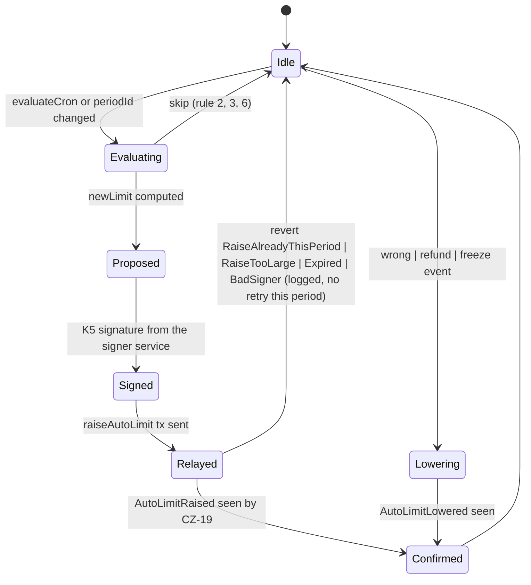

# Earned autonomy, ROI ledger, key management (spec 04)

- **Date:** 2026-10-18. **Status:** draft for review. Conventions: `cross-cutting.md`. Data shapes: only `specs/02-data-and-protocol/` (cited "02 §n", OpenAPI `operationId`s, MCP tool names) and `specs/03-smart-contracts/` (cited "03 `<file>` §n").
- **Components:** CZ-24 earned autonomy, CZ-25 ROI ledger, CZ-27 key management. All Phase 1, all on Czar's server.

---

## CZ-24 Earned autonomy

### 1. Identity

| Item | Value |
|---|---|
| CZ ID, name | CZ-24, earned-autonomy engine |
| Phase | 1 (basic: one global category plus the plan's category); 2 (per-category tuning) |
| Product | §6.6 earned autonomy; roadmap 1.4 |
| Decisions | D11 (limits live in the vault), D25 (server computes, vault enforces), D40 (raise step ≤ 20% of `userMax`, at most once per week), D21 (security for white-collar users) |
| Contract surface | 03 `czar-vault.md` §5.6 `raiseAutoLimit`, `lowerAutoLimit`; events `AutoLimitRaised`, `AutoLimitLowered`, `LimitsSet`; invariant INV-9 |
| Signed message | 02 §6.2 `AutonomyRaise(bytes32 category,uint256 newLimit,uint64 periodId,uint256 nonce,uint256 deadline)`, signed by K5 |

### 2. Responsibilities and non-responsibilities

- **Does:** compute each user's track record per category from receipts and acceptance results; propose bounded raises; sign them with K5 through CZ-27; relay them; lower limits at once on bad outcomes; show the user why a limit changed.
- **Does not:** enforce anything (the vault does, 03 `czar-vault.md` §5.6, INV-9); raise above `userMax` (only the owner sets that, 03 §5.1 `setCategoryLimits`); open envelopes (CZ-15 does, within the allowance); touch K3.

### 3. Runtime

- A scheduled job inside `@czar/server` (`autonomy.evaluateCron`, default daily at 03:00 UTC) plus an event-driven path (lower on `wrong`, refund or freeze) triggered by CZ-12 and CZ-19.
- Stateless between runs except the tables in §5.3; restart-safe (every proposal is idempotent on `(vault, categoryId, periodId)`).
- Resource budget: O(receipts in window) per user per day; no model calls.

### 4. Interfaces

| Direction | What | Where defined |
|---|---|---|
| In | `LedgerReceipt` rows (status `settled`, `completed`, `refunded`, `failed`) | OpenAPI `listReceipts`; CZ-25 tables |
| In | `report_outcome` results (`useful`, `not-useful`, `wrong`, `unused`, `reasonCode`, `minutesSavedActual`) | 02 `mcp/czar-mcp-tools.md` §2.5 |
| In | `AcceptanceReport.decision` per step | 02 §4.14 (CZ-16) |
| In | vault events `AutoLimitRaised`, `AutoLimitLowered`, `LimitsSet`, `Frozen`, `JobRefunded` | 03 `czar-vault.md` §9.1 via CZ-19 |
| In | current `limits[categoryId]` (`userMax`, `autoLimit`, `periodId`, `usedInPeriod`, `lastRaisePeriod`) | 03 `czar-vault.md` §4 via CZ-19 projection |
| Out | `raiseAutoLimit(categoryId, newLimit, periodId, deadline, sig)` relayed by the relayer service | 03 `czar-vault.md` §5.6 |
| Out | `lowerAutoLimit(categoryId, newLimit)` called with K3 (agent) or K5 | 03 `czar-vault.md` §5.6 |
| Out | per-category limit summary for the app | OpenAPI `getMe` (`Me` limits fields) |

### 5. Internal design

#### 5.1 Track-record score

For one `(vault, categoryId)` over the window `autonomy.windowDays`:

- A purchase `i` is **positive** when all hold: its step's `AcceptanceReport.decision = pass`; its `LedgerReceipt.status ∈ {settled, completed}`; no `report_outcome` of `wrong` or `not-useful` for its `paymentId`; it was not refunded.
- A purchase is **negative** when any holds: acceptance `fail`; `report_outcome.outcome ∈ {wrong, not-useful}`; `JobRefunded` after `reject`.
- Recency weight: `d_i = 0.5^(age_days_i / autonomy.halfLifeDays)`.
- Diversity weight: `w_i = 1 / sqrt(k_i)` where `k_i` is the index of purchase `i` among purchases to the same payee in the window (first purchase to a payee counts fully, the tenth a third; stops one merchant from building the whole record).
- Score: `S = Σ_{positive} w_i d_i`. Negatives are not subtracted; a single negative blocks raises (§5.2).

#### 5.2 Raise rule (within D40)

Run once per period per category:

1. `periodId = floor(now / PERIOD_LENGTH)` (`PERIOD_LENGTH` = 604,800 s, 03 `czar-vault.md` §3).
2. Skip if `lastRaisePeriod == periodId` (one raise per period, D40) or `autoLimit == userMax`.
3. Skip if any negative purchase, any `JobRefunded`, any `Frozen` event, or any guardian pause occurred within `autonomy.windowDays`. Skip if `S < autonomy.minScore`.
4. `stepMax = userMax × MAX_RAISE_STEP_BPS / BPS` (= 20% of `userMax`, D40; contract constant `MAX_RAISE_STEP_BPS = 2000`, 03 `czar-vault.md` §3).
5. `f(S) = autonomy.baseAtomic × S` (floored to an integer).
6. `newLimit = min(userMax, autoLimit + min(stepMax, f(S)))`. If `newLimit ≤ autoLimit`, skip.
7. Build `AutonomyRaise{category: categoryId, newLimit, periodId, nonce: vault.autonomyNonce, deadline: now + autonomy.raiseDeadlineSeconds}` (02 §6.2); request a K5 signature from CZ-27 (§CZ-27 5.2); relay `raiseAutoLimit(...)` with the relayer's gas; wait for `AutoLimitRaised` from CZ-19.

#### 5.3 Lower rule

Immediately (event-driven), with K3 or K5 as `msg.sender` (03 `czar-vault.md` §5.6 `lowerAutoLimit` accepts owner, agent or autonomy):

| Trigger | New limit |
|---|---|
| `report_outcome.outcome = wrong` for a purchase in the category | `autoLimit × autonomy.lowerFactorBps / BPS` |
| `JobRefunded` after evaluator `reject`, or acceptance `fail` on a settled x402 step | same |
| `Frozen` event (user freeze) | `0` for every category (D60), as a follow-up agent step and not atomically (D63): the `frozen` flag already blocks spending, then K3 calls `lowerAutoLimit(categoryId, 0)` per category once CZ-19 indexes `Frozen` (atomic contract version is stage 2, `stage-2-backlog.md` §3 P2-15); skipped for categories already at 0 (the vault requires `newLimit < autoLimit`); limits stay at 0 after unfreeze until earned back |
| guardian pause | no on-chain change (the vault reads `guardianPaused()`); evaluation paused |

- Lowering never waits for the period roll and is never blocked by `lastRaisePeriod`.

#### 5.4 Phase 1 categories

- Every plan carries `category` (02 §4.5) hashed to `categoryId`. Phase 1 tracks two keys per user: the plan's category and `general` (`keccak256("general")`), where `general` is the fallback the planner uses when no category fits. Per-category tuning of `autonomy.baseAtomic` and `halfLifeDays` is Phase 2.

#### 5.5 State machine

| From | To | Trigger | Who | Event |
|---|---|---|---|---|
| Idle | Evaluating | cron tick or new `periodId` | scheduler | log `autonomy_evaluate` |
| Evaluating | Proposed | §5.2 steps 1–6 pass | CZ-24 | row in `autonomy_proposals` |
| Proposed | Signed | CZ-27 returns the K5 signature | signer | audit entry |
| Signed | Relayed | relayer submits `raiseAutoLimit` | relayer (gas in USDC, `maxFeePerGas ≥ 20 Gwei`, p1-A6) | tx hash stored |
| Relayed | Confirmed | `AutoLimitRaised(categoryId, old, new, periodId)` | CZ-19 | user notice |
| Idle | Lowering | §5.3 trigger | CZ-12 / CZ-19 | `lowerAutoLimit` tx |
| Lowering | Confirmed | `AutoLimitLowered` | CZ-19 | user notice |

#### 5.6 Storage

| Table | Fields | Notes |
|---|---|---|
| `autonomy_scores` | `vault`, `categoryId`, `periodId`, `score`, `positives`, `negatives`, `computedAt` | rebuilt daily; idempotent |
| `autonomy_proposals` | `proposalId` (ULID), `vault`, `categoryId`, `periodId`, `oldLimit`, `newLimit`, `nonce`, `deadline`, `state`, `txHash?`, `revertName?` | unique on `(vault, categoryId, periodId)` |
| `autonomy_lowerings` | `vault`, `categoryId`, `trigger`, `paymentId?`, `oldLimit`, `newLimit`, `txHash`, `at` | audit |

#### 5.7 Parameters

| Parameter | Default | Unit | Reason |
|---|---|---|---|
| `autonomy.evaluateCron` | `0 3 * * *` (UTC) | cron | once a day is enough for a weekly step |
| `autonomy.windowDays` | 28 | days | four periods of evidence |
| `autonomy.halfLifeDays` | 14 | days | same half-life as the Selection Layer posteriors (SL-C9) |
| `autonomy.minScore` | 3 | score | roughly three fresh positive purchases before any raise |
| `autonomy.baseAtomic` | 500000 (0.50 USDC) | atomic | one unit of score adds half a dollar of weekly allowance; small by design |
| `autonomy.lowerFactorBps` | 5000 | bps | halve on a problem; fast down, slow up |
| `autonomy.raiseDeadlineSeconds` | 3600 | s | a signed raise is useless after an hour |
| `autonomy.relayRetries` | 2 | count | reverts are not retried; only RPC errors |
| `PERIOD_LENGTH`, `MAX_RAISE_STEP_BPS` | 604800, 2000 | contract | read-only mirrors of 03 constants (D40) |

### 6. Behaviour

**Main path (raise):** daily cron → for each `(vault, categoryId)` with activity → compute `S` (§5.1) → rules 1–6 (§5.2) → store proposal → request K5 signature (§CZ-27) → relay `raiseAutoLimit` → on `AutoLimitRaised`, mark `Confirmed` and show a notice in the app (`getMe` shows the new limit).

**Alternate paths:**
- Vault reverts `RaiseAlreadyThisPeriod` (owner raised manually this period): mark proposal `Superseded`; nothing else.
- Vault reverts `RaiseTooLarge` (owner lowered `userMax` between evaluation and relay): recompute next period.
- `Expired` or `BadSigner` (rotation between sign and relay): discard; next period.
- Lower path: any trigger in §5.3 → `lowerAutoLimit` at once with K3 → notice.
- No activity in the window: nothing happens; limits neither rise nor fall (decay is implicit: `S` falls, so the next raise is smaller).

### 7. AI usage

None. Pure rules.

### 8. Privacy

- Handles: `paymentId`s, outcome enums, amounts, category ids, vault addresses (`server-only` / `public`). No goal text, no merchant bodies.
- Retention: `autonomy_scores` 1 year; proposals and lowerings 1 year (audit).

### 9. Security

- Keys: K5 (sign `AutonomyRaise`) through CZ-27 only; K3 for `lowerAutoLimit` (the lowering direction is safe, 03 `czar-vault.md` §2).
- Permissions: the vault enforces `newLimit ≤ userMax`, the 20% step and one raise per period (INV-9); a compromised CZ-24 can at most raise every user to their own `userMax` over several weeks, never above it (spec 01 §13 "Czar server compromised").
- Threats addressed: a hijacked agent cannot raise limits (K3 is not accepted by `raiseAutoLimit`); a merchant cannot farm the score (diversity weight; acceptance must pass; user `wrong` reports block raises).

### 10. Failure handling

| Failure | Behaviour | User sees | Idempotency |
|---|---|---|---|
| RPC down at relay | retry `autonomy.relayRetries` with backoff; then drop until next period | nothing | proposal row keyed by period |
| Indexer lag | evaluation uses the projection; a raise confirmed late still lands in the same period (vault checks `periodId`) | delayed notice | `AutoLimitRaised` is the truth |
| Signer denies K5 | log `kms_denied`; no raise | nothing | — |
| Revert names | as §6 | nothing | — |
| User unfreezes | limits stay lowered until earned back | "Limits start low after a freeze" | — |

### 11. Observability

- Metrics: `czar_autonomy_proposals_total{state}`, `czar_autonomy_lowerings_total{trigger}`, `czar_autonomy_score` histogram.
- Logs: vault, categoryId, periodId, old/new limits, tx hash, revert name. Never outcome reasons in free text.
- Alerts: raise reverts > `autonomy.revertAlertPerDay` (10); any raise relayed without a matching proposal row (should never happen).

### 12. Interface wording (shown by CZ-22 through `getMe`)

| State | Wording |
|---|---|
| raise confirmed | "Czar can now start objectives up to $X per week in <category> without asking. Your maximum stays $Y." |
| lowered after a problem | "Limit lowered after a problem with <merchant host>. Czar will ask before spending in <category> above $X." |
| lowered after freeze | "Limits reset after your freeze. They grow back as objectives succeed." |
| at maximum | "Czar is at the maximum you set for <category> ($Y). Raise it in Settings if you want." |
| no history yet | "Czar asks before every objective until it has a track record in <category>." |

### 13. Performance and cost

- One daily pass over ≤ `autonomy.windowDays` of receipts per user: milliseconds. One `raiseAutoLimit` tx per category per week at most: ≈ 60k gas ≈ 0.0012 USDC at 20 Gwei (03 gas estimates; measure).

### 14. Tests and definition of done

- Unit: score formula with fixed fixtures (positives, negatives, diversity, decay); every rule in §5.2 and §5.3 with one failing input each.
- Fuzz: random receipt histories → `newLimit` always ≤ `userMax`, raise ≤ 20% of `userMax`, at most one raise per period; matches INV-9 on an `arc-anvil` vault.
- Integration: proposal → signer → relay → `AutoLimitRaised` on `arc-anvil`; revert paths produce the right `revertName`.
- Definition of done: all above green; a `wrong` report lowers within one block of the event; the app shows the §12 wording; no model calls; parameters in `@czar/config`.

### 15. Dependencies

`@czar/vault-client` (03 interfaces), `@czar/hashing` (`AutonomyRaise` digest per 02 §6.2 test vector), CZ-27 signer, CZ-19 projections, CZ-25 ledger. Open question: the Phase 2 per-category parameters (OD below).

---

## CZ-25 ROI ledger

### 1. Identity

| Item | Value |
|---|---|
| CZ ID, name | CZ-25, ROI ledger |
| Phase | 1 (simple); 2 (full monthly statement) |
| Product | §6.11 ROI ledger; roadmap 2.6 |
| Decisions | D25 (minutes estimates come from the daemon), D31 wording (statements never claim raw data never left the machine), D35 (no Czar-paid credits appear in the ledger) |
| API | `listReceipts` → `LedgerReceipt`; `getMonthlyStatement` → `MonthlyStatement` (OpenAPI) |

### 2. Responsibilities and non-responsibilities

- **Does:** keep one ledger row per payment with cost and minutes saved; roll them into monthly statements; serve both to the app; feed CZ-24 with outcomes.
- **Does not:** estimate minutes itself (the daemon does, 02 §4.4 `minutesSaved`; the user corrects via `report_outcome.minutesSavedActual`); convert currency (Phase 1 shows USD only, USDC 1:1, D51); pay or refund anything.

### 3. Runtime

- Part of `@czar/server`; rows are written from CZ-15 and CZ-19 events; statements are materialized by `roi.statementCron` and on demand.

### 4. Interfaces

| Direction | What | Defined in |
|---|---|---|
| In | settlement states from CZ-19 (`Settled`, `Released`, `PocketFunded`, pullbacks, `JobSynced`, `JobRefunded`; Gateway transfer statuses `received|batched|confirmed|completed|failed`) | 03 `czar-vault.md` §9.1; A2-29 |
| In | `ObjectiveSubmission.minutesSaved` and `hourlyBand` | 02 §4.4 |
| In | `report_outcome` (`outcome`, `minutesSavedActual`) | 02 mcp §2.5 |
| Out | `LedgerReceipt` page | `listReceipts` |
| Out | `MonthlyStatement` | `getMonthlyStatement` |
| Out | positives/negatives per `paymentId` | CZ-24 |

### 5. Internal design

#### 5.1 What is measured

| Measure | Rule |
|---|---|
| cost per step | the settled amount: `x402-exact` = `unitAmount` at `Settled`; `gateway-batched` = the transfer `amount` counted at `received`, flagged `pending` until `completed` (0–16 min, A2-24 to A2-26); `erc8183-job` = `budget` at `JobSynced(Completed)`; released or refunded steps cost 0 |
| cost per objective | Σ step costs plus pocket gas grants and written-off pocket balance (`PocketClosed.writtenOff`) |
| minutes saved per objective | `minutesSaved` from the submission; replaced by `minutesSavedActual` when the user reports one (`report_outcome`), else multiplied by `roi.unverifiedFactorBps` (7000) until any `useful` report arrives |
| minutes per receipt | objective minutes split across its settled steps in proportion to cost |
| value of time | `hourlyBand` midpoint (A $15, B $40, C $75, D $150, E $250 per hour; the exact amount never leaves the machine, 02 §4.4) × minutes / 60; shown as "about" |

#### 5.2 Monthly statement

`MonthlyStatement{month, totalSpent, totalSpentDisplay, totalMinutesSaved, objectives, receipts, byCategory}` (OpenAPI). `byCategory` rows carry spent and minutes per `category`. Pending Gateway amounts are included in `totalSpent` and listed separately as pending in the receipts page.

#### 5.3 Storage

| Table | Fields |
|---|---|
| `ledger_receipts` | `receiptId` (`res_`? no: ledger rows use `paymentId` as key), `paymentId`, `objectiveId`, `envelopeRef`, `stepIndex`, `rail`, `amount`, `status` (`reserved|settled|pending|completed|released|refunded|failed`), `merchantLabel` (origin host only), `minutesSaved`, `minutesSource` (`estimate|reported`), `category`, `settledAt`, `updatedAt` |
| `monthly_statements` | `userId`, `month`, the `MonthlyStatement` fields, `materializedAt` |
| `outcome_reports` | `paymentId`, `outcome`, `reasonCode`, `minutesSavedActual`, `reportedAt` |

Rows are rebuilt deterministically from CZ-19 projections plus `outcome_reports`; a rebuild never changes totals unless new events arrived.

#### 5.4 Parameters

| Parameter | Default | Reason |
|---|---|---|
| `roi.statementCron` | daily 04:00 UTC | cheap; on-demand refresh too |
| `roi.unverifiedFactorBps` | 7000 | estimates are optimistic; discount until a user confirms |
| `roi.pendingMaxMinutes` | 20 | after this a Gateway payment still `received` is flagged for CZ-19 to re-poll (A2-26 says ≤ 16 min) |
| display currency | USD (D51) | USDC shown 1:1 as USD; no exchange-rate provider in Phase 1 |

### 6. Behaviour

- Step settles → row `settled` (or `pending` for Gateway) → objective closes → minutes split → statement refreshed → `report_outcome` arrives → minutes and status updated → CZ-24 reads positives/negatives.
- Refund or release → row `refunded` / `released`, cost 0, minutes 0.

### 7. AI usage

None.

### 8. Privacy

- `LedgerReceipt.merchantLabel` is the origin host only; the objective appears as its redacted title; no goal text beyond that; no addresses in statements. Classes: `server-only` rows, `public` amounts and tx hashes. Retention 1 year (spec 01 §11.1).

### 9. Security

- Read-only over money; no keys. Threat: a hijacked model cannot inflate ROI into a limit raise, because CZ-24 only counts acceptance-passed, user-not-rejected purchases.

### 10. Failure handling

| Failure | Behaviour | User sees |
|---|---|---|
| Gateway status never `completed` | stays `pending`; CZ-19 re-polls; after `roi.pendingMaxMinutes` an alert | "Paid, settling (up to 16 min)" then "Paid" |
| indexer lag | statements lag; `updatedAt` shown | "Updated 3 min ago" |
| conflicting `report_outcome` (two reports) | last report wins; both kept in `outcome_reports` | — |

### 11. Observability

- `czar_roi_receipts_total{rail,status}`, `czar_roi_pending_gateway_minutes` histogram. Logs carry ids and amounts only.

### 12. Interface wording

| Item | Wording |
|---|---|
| receipt line | "<objective title> · <step>: $0.10 · about 20 min saved" |
| pending Gateway | "Paid, settling (up to 16 min)" |
| monthly headline | "Czar saved you 14 hours for $9 this month." |
| unverified estimate note | "Time saved is Czar's estimate until you confirm it." |
| currency note | "Shown in <currency> at today's rate; charged in USDC." |

### 13. Performance and cost

- O(receipts) per statement; no external calls except the FX source (GAP).

### 14. Tests and definition of done

- Unit: cost rules per rail and state; minutes split; factor application; statement totals equal the sum of rows.
- Integration: a full objective on `arc-anvil` with one of each rail produces the expected rows and a statement; a `report_outcome` with `minutesSavedActual` replaces the estimate.
- Definition of done: `listReceipts` and `getMonthlyStatement` return schema-valid objects; rebuild from projections is idempotent (same totals twice); wording in §12 appears in the app.

### 15. Dependencies

CZ-19 projections, CZ-12 outcome intake, OpenAPI schemas. Open question: FX source.

---

## CZ-27 Key management

> **Phase 1 hosting (D70):** the signer runs on Zaryab's Mac with backend `signer.backend = local-keystore` (encrypted keystore; passphrase in the macOS keychain via `@napi-rs/keyring`). Every "KMS" reference below means "the configured signer backend". Policies, rate limits, audit rows and the denied-selector list apply unchanged. `gcp-kms` is the stage-2 backend.

### 1. Identity

| Item | Value |
|---|---|
| CZ ID, name | CZ-27, key management and signer service |
| Phase | 1 |
| Product | §10 trust and safety |
| Decisions | D25 (server signs only inside envelopes), D26 (passkeys for users), D30 (owner UserOps), D41 (owner-only manual pocket credit, so no server key can credit funds) |
| Spec 01 | §7.2 key inventory K1–K20, assumption AR-1 (a KMS with secp256k1 and signing policies) |

### 2. Responsibilities and non-responsibilities

- **Does:** hold every server key in a cloud KMS behind the signer service (D61; vendor chosen at build time; whether an HSM is required is decided at the pre-mainnet audit, AR-1), including the relayer gas key (D62); enforce per-key signing policies in a signer service that checks the request shape before any KMS call; create and destroy pocket keys; run rotation and compromise runbooks; log every signature.
- **Does not:** hold user keys (K1 passkeys stay in the platform authenticator, D1-02); decide what to pay (CZ-15 does, inside the vault's rules); hold K14–K16 (device-side).

### 3. Runtime

- `signer`: a small service in `@czar/server`'s network segment, the only process with KMS credentials. Other services call it over mTLS with a service identity. One replica per region; stateless except its audit table and rate counters.
- KMS: a cloud KMS with secp256k1 ECDSA keys and key policies (AR-1). If secp256k1 is unavailable, the AR-1 fallback in §6.

### 4. Interfaces

| Call (internal) | Caller | Returns |
|---|---|---|
| `sign(keyId, kind, payload)` where `kind ∈ {vault-call, usdc-3009, gateway-burn, sl-receipt, autonomy-raise, evaluator-call, oel-commit, merchant-seller-proof, relayer-tx}` | the owning service identity only (§5.2) | 65-byte ECDSA signature or a signed transaction |
| `createPocketKey(envelopeRef)` / `destroyPocketKey(pocket)` | CZ-15 | pocket address |
| `getSecret(name)` for K11–K13, K17–K19 | the owning service | secret value in memory only |
| audit rows | CZ-16 of operations | — |

### 5. Internal design

#### 5.1 Key inventory and KMS types

| Key | Type in KMS | Owner service | Allowed signing kinds |
|---|---|---|---|
| K3 `agentSigner` | secp256k1 ECDSA | CZ-15 paying agent | `vault-call` (only `ICzarVault` selectors in the allowlist, to the caller's vault address), `usdc-3009`, `gateway-burn`, `sl-receipt` |
| K4 pocket keys (one per objective) | secp256k1 ECDSA, created on demand, destroyed after `PocketClosed` | CZ-15 | `gateway-nano` (GatewayWalletBatched authorizations with `from = pocket`, p1-G2), `addDelegate` tx to GatewayWallet only, `initiateWithdrawal`/`withdraw` tx only on the owner-approved slow path (D41) |
| K5 `autonomySigner` | secp256k1 ECDSA | CZ-24 | `autonomy-raise` (02 §6.2 digest only) |
| K6 guardian | secp256k1 ECDSA, dual control | ops, two approvers | `pause`/`unpause` on `CzarVaultFactory` only |
| K7 evaluator | secp256k1 ECDSA | CZ-16 evaluator | `evaluator-call`: `complete`/`reject` selectors on the configured job escrow only; `sl-receipt` kind for `ValidationReport` |
| K8 publisher | secp256k1 ECDSA | CZ-17 | `oel-commit`: `commit`/`reveal` on `OpenEvidenceLog` only |
| K9 claim relayer (P2) | secp256k1 ECDSA | CZ-21 | `scheduleRelease`/`executeRelease` on `BuilderEscrow` only |
| K10 merchant payout keys | secp256k1 ECDSA, one per service | CZ-20 | `merchant-seller-proof` (Facilitator `SellerRequest`, p1-F4), Gateway sweep burn intents with `destinationRecipient` = the treasury address |
| K11 Facilitator Console key | secret | CZ-20 | HTTPS header only |
| K12 Gateway API key (mainnet slot) | secret | CZ-15, CZ-20 | HTTPS header only |
| K13 GitHub OAuth secret (P2) | secret | CZ-21 | OAuth exchange only |
| K17 VAPID key | secret | CZ-23 (stage 2, D69) | push signing only; not created in Phase 1 |
| K18 model API keys | secret | CZ-13, CZ-16, Czar proxy for the daemon | model HTTPS only |
| K19 RPC provider keys | secret | CZ-19, relayer | RPC HTTPS only |
| K20 factory admin | secp256k1 ECDSA, dual control, timelocked on-chain | ops | `queueVersion`, `queueGuardian`, `setDefaults`, ownership transfer on the factory only |
| relayer gas key | secp256k1 ECDSA | relayer | plain transactions to the vault selectors, `OpenEvidenceLog`, `GatewayMinter.gatewayMint` only; balance capped at `kms.relayerMaxBalanceAtomic` |
| K1, K2, K14, K15, K16 | not in the KMS | user device / app | K1 passkey (platform authenticator, D1-02); K2 Circle client key (app config, public-facing); K14 DB key, K15 device token, K16 hook token in the OS keychain (B6-17, B6-19) |

#### 5.2 Signer policy (what a KMS cannot check)

A KMS signs any 32-byte digest it is asked to sign; it cannot see that a digest is a USDC authorization to the wrong payee. So the policy lives in the `signer` service, which rebuilds every digest from structured fields and refuses anything else:

| Kind | Request shape the signer requires | Checks before the KMS call |
|---|---|---|
| `vault-call` | `{vault, selector, args}` | `vault ∈ vaults from the factory projection`; `selector` in the K3 allowlist (`openEnvelope`, `reserve`, `reserveWithDigests`, `settle`, `finalize`, `registerPocket`, `grantPocketGas`, `fundPocket`, `requestPullback`, `confirmPullback`, `cancelPullback`, `writeOffPocket`, `openJob`, `fundJob`, `syncJob`, `claimJobRefund`, `closeEnvelope`, `lowerAutoLimit`, `freeze`; never `withdraw`, `unfreeze`, `rotateSigners`, `setCategoryLimits`, `setPasskey`, `recordManualReturn`); args ABI-encoded by the signer, not by the caller |
| `usdc-3009` | `{vault, reservationId, index, to, value, validBefore}` | the signer reads the reservation from the CZ-19 projection: `to == payee`, `value ≤ unitAmount`, `index < count`, `validBefore` equal; recomputes `nonce` (02 §7.2) and the digest with `USDC_DOMAIN_SEPARATOR` (02 §6.1); only then signs; returns the 02 §6.3.1 envelope (or 65 bytes in `digest` mode) |
| `gateway-burn` | `{vault, pullbackId}` | reads `PullbackRecord` from the projection; rebuilds the `BurnIntent` digest exactly as 03 `czar-vault.md` §6.2 (recipient = vault); signs; returns the 02 §6.3.2 envelope |
| `sl-receipt` | `{structHash}` plus the receipt object for logging by hash | digest under the SelectionLayer domain only (02 §6.3.3) |
| `autonomy-raise` | `{vault, categoryId, newLimit, periodId, deadline}` | `newLimit ≤ userMax` and the D40 step from the projection; nonce from the vault; digest per 02 §6.2 |
| `evaluator-call` | `{escrow, jobId, decision, reportHash}` | `escrow` is the configured instance; `jobKey` exists in the projection with `evaluator == K7 address`; `reportHash` exists in CZ-16's table |
| `oel-commit` | `{kind, root, prev, uriHash, uri}` | `prev` equals the publisher's latest root in the projection; `root` exists in `EvidenceBatch` rows |
| `merchant-seller-proof` | `{service, purpose, method, bodyHash, network, nonce, expiry}` | 5-minute expiry; `network` is the configured chain (p1-F4) |
| `gateway-nano` (K4) | `{pocket, payTo, amount, validBefore, nonce}` | `pocket` is `Funded`/`Draining` for an open envelope; `payTo` is a leaf payee of that envelope's plan (kind 1); `amount ≤ stepCap`; cumulative per pocket ≤ `funded` |

- Per-key rate limits: `kms.maxSignaturesPerMin` per key (K3 600, K4 120 per pocket, K5 10, K7 60, K8 10, K10 300); excess is denied and alerted.
- Dual control: K6 and K20 requests need two approver identities within `kms.dualControlWindowMinutes` (30).
- Every signature writes an audit row: key id, kind, digest, purpose ids (`envelopeRef`, `reservationId`, `pullbackId`, `jobKey`, `batchId`), caller identity, outcome. No raw text, no payloads.
- The signer holds no key material; the KMS does. The signer's own identity is the only principal in the KMS key policies.

#### 5.3 Pocket-key lifecycle (K4)

```mermaid
stateDiagram-v2
  [*] --> Created: createPocketKey(envelopeRef) in KMS
  Created --> Registered: CZ-15 calls registerPocket(envelopeId, pocket) with K3
  Registered --> GasGranted: grantPocketGas (K3)
  GasGranted --> DelegateSet: pocket signs addDelegate(USDC, vault) tx (K4) · DelegateAdded
  DelegateSet --> Funded: fundPocket (K3) after isAuthorizedForBalance check
  Funded --> Paying: nanopayment authorizations signed by K4
  Paying --> Draining: requestPullback (K3); burn intent signed by K3 as the vault (never K4)
  Draining --> Closed: confirmPullback | writeOffPocket · PocketClosed
  Closed --> Destroyed: destroyPocketKey after PocketClosed and kms.pocketKeyGraceHours
  Destroyed --> [*]
```

- The pocket never signs a burn intent to anywhere: pullbacks are signed by K3 under the vault's `GATEWAY_BURN` kind (03 `czar-vault.md` §6.2), so a leaked K4 can spend only nanopayments and the slow withdrawal, bounded by the pocket balance (spec 01 §13).
- The slow path (`initiateWithdrawal`/`withdraw` by the pocket after 1,209,600 blocks, A2-13 to A2-15) is allowed only when ops opens an incident and the owner later credits it with `recordManualReturn` (D41). `kms.pocketKeyGraceHours` (48) keeps the key for that case before destruction, unless the pocket closed with `outstanding = 0`.

#### 5.4 Parameters

| Parameter | Default | Reason |
|---|---|---|
| `kms.maxSignaturesPerMin.K3` | 600 | ten reservations a second across all users is far above Phase 1 load |
| `kms.maxSignaturesPerMin.K4` | 120 per pocket | nanopayment bursts |
| `kms.maxSignaturesPerMin.K5` / `K7` / `K8` / `K10` | 10 / 60 / 10 / 300 | by expected volume |
| `kms.dualControlWindowMinutes` | 30 | two approvals must be close in time |
| `kms.pocketKeyGraceHours` | 48 | slow-withdrawal recovery window |
| `kms.relayerMaxBalanceAtomic` | 50000000 (50 USDC) | bounds gas-key loss |
| `kms.auditRetentionDays` | 365 | spec 01 §16.3 |

### 6. Behaviour

- **Signing:** service → `sign(...)` over mTLS → shape check → digest rebuilt → rate limit → KMS → audit → return. A failed check returns `kms_denied` with the rule name; nothing is signed.
- **Rotation runbooks:**

| Key | Runbook |
|---|---|
| K3 | create the new key; set it as the factory default (`setDefaults`, K20) for new vaults; for existing vaults the app prompts each owner to run `rotateSigners` (UserOp); the signer accepts both keys until `kms.rotationOverlapDays` (14) end; old key disabled |
| K4 | per objective; destroyed after `PocketClosed` plus grace |
| K5 | same as K3 (owner `rotateSigners`) |
| K7 | new key for new jobs; open jobs keep the old key until they close (jobs name the evaluator at creation, 03 `job-escrow-adapter.md` §5) |
| K8 | announce with a `POLICY_RELEASE` commit under the old publisher naming the new address (03 `open-evidence-log.md`); readers choose publishers |
| K9 (P2) | admin rotates the relayer role on `BuilderEscrow`; pending releases stay cancellable |
| K10 | new `payTo`; update the index entries and 402s; sweep the old Gateway balance |
| K11, K12 | Circle Console; overlap one day |
| K13 | GitHub app settings |
| K17 | new VAPID key; clients resubscribe on next open |
| K18, K19 | provider consoles; secrets rotated in the store |
| K14–K16 | device-side: the daemon re-keys the DB (`K14`), the app revokes and re-pairs (`K15`), the plugin regenerates the hook token (`K16`) |
| K6, K20 | factory `queueGuardian` (48 h timelock) / Ownable2Step transfer, dual control |

- **Compromise response:** suspected K3 or server breach → guardian `pause()` (K6, dual control; drill quarterly) → app broadcasts "Czar paused all spending" → rotate K3 per runbook → unpause. Suspected K4 → `requestPullback` immediately; if `removeDelegate` was already called by the attacker, write off (bounded by the pocket cap). Suspected K8 → `POLICY_RELEASE` naming a new publisher. User-level: `freeze()` by the owner or agent any time.
- **AR-1 fallback:** if no KMS offers secp256k1 with policies, the signer service holds software keys in an isolated network segment with disk encryption, the same policy code, and no inbound access except mTLS from Czar services; this is a weaker boundary and is listed as a risk until an HSM is in place.

### 7. AI usage

None.

### 8. Privacy

- Audit rows hold digests, ids and amounts only (`server-only`). No user text ever reaches the signer.

### 9. Security

- Keys: all of K3–K13, K17–K20 (holder), K14–K16 (documented, device-side).
- Threats (spec 01 §13): server compromised → the signer refuses out-of-shape requests and rate-limits, so even a hijacked CZ-15 cannot sign a USDC digest to a non-payee; agent key leak → rotation runbook plus guardian pause; pocket key leak → bounded by the pocket cap and the vault-signed pullback; evaluator key leak → bounded by open job budgets; publisher key leak → no funds, detectable by recompute.
- The vault remains the final boundary; the signer is defence in depth (03 `security-and-testing.md` §1).

### 10. Failure handling

| Failure | Behaviour |
|---|---|
| KMS unavailable | all signing stops; CZ-15 pauses plans ("Waiting on payment network"); reservations expire safely (03 `czar-vault.md` §10) |
| signer policy denies a legitimate request | logged with the rule; on-call reviews; never bypassed by a flag |
| projection stale (reservation not yet indexed) | `usdc-3009` denied until the `Reserved` event is indexed; CZ-15 retries with backoff `kms.projectionRetryMs` (500, ×5) |
| rate limit hit | denied, alert; CZ-15 backs off |

### 11. Observability

- `czar_signer_signatures_total{key,kind,outcome}`, `czar_signer_denied_total{key,rule}`, latency histogram. Alert on any denial for K6/K20, any K3 denial rate > `kms.denyAlertPerMin` (5), KMS errors.

### 12. Interface wording (ops console and app banners)

| State | Wording |
|---|---|
| guardian pause (app banner) | "Czar paused all spending while we check something. Your money is safe in your vault. You can still withdraw." |
| after unpause | "Spending is back on. Nothing was spent while paused." |
| key rotation prompt (app) | "Czar updated its signing key. Approve the update so objectives can keep running." |

### 13. Performance and cost

- Signing latency target ≤ 150 ms including the KMS round trip (`kms.signTimeoutMs` 2000). KMS request costs are a few dollars per million; negligible at Phase 1 volume.

### 14. Tests and definition of done

- Policy unit tests: for every kind, one accepted request and one denied per rule (for example a `usdc-3009` request with `to` outside the reservation, `value > unitAmount`, `index ≥ count`; a `vault-call` to `withdraw`; a `gateway-burn` for a `Cancelled` pullback; an `evaluator-call` for a job whose evaluator is another address).
- Replay: the 02 §6.4 test vectors reproduce through the signer (digest equality before signing).
- Rotation drills: K3 overlap window; K4 destroy after `PocketClosed`; K7 new-jobs-only.
- Compromise drill: guardian pause on `arc-anvil` blocks every spending digest (INV-4) and the app shows the §12 banner.
- Definition of done: no service other than the signer can reach the KMS; every signature has an audit row; dual control enforced for K6/K20; all drills documented.

### 15. Dependencies

Cloud KMS (D61, AR-1; vendor chosen at build time), mTLS infrastructure, `@czar/vault-client`, `@czar/hashing`, CZ-19 projections. HSM vs KMS is decided at the pre-mainnet audit (D61); the relayer gas key is in the KMS (D62).

---

## Mainnet differences (all three components)

| Topic | Testnet | Mainnet |
|---|---|---|
| Keys | one set per environment; testnet K3/K5/K7/K8 never reused on mainnet | separate KMS keys, dual control on K6/K20 from day one |
| Gateway API key | none needed (A2-30) | K12 slot filled |
| Facilitator | keyless trial (p1-F4) | K11 Console key |
| Autonomy defaults | `autonomy.baseAtomic` 0.50 USDC | re-tuned after measured outcomes; same D40 bounds |
| ROI amounts | testnet USDC labelled as such in the app | real money; still USD unless local currency is added later (D51) |
| Relayer balance cap | 50 USDC testnet | reviewed with real gas measurements |

## Change log

| Date | ID | Change |
|---|---|---|
| 2026-10-18 | D51 | USD only; `app.fxSource` removed |
| 2026-10-18 | D60 | freeze lowering via `lowerAutoLimit` stated precisely |
| 2026-10-18 | D61, D62 | cloud KMS with signer service; relayer gas key in KMS; HSM decided at pre-mainnet audit |
| 2026-10-19 | D63 | freeze lowering stated as a follow-up agent step, not atomic. |
| 2026-10-19 | D69 | K17 VAPID key is stage 2 with CZ-23. |
| 2026-10-19 | D69 | raise notice is shown in the app (no push in Phase 1). |
- 2026-10-19 · D70: Phase 1 runs on Zaryab's Mac with a local software signer (encrypted keystore); Google Cloud (KMS, Cloud Run, e2-micro VM) moves to stage 2.
